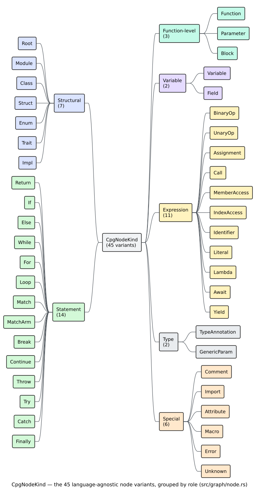
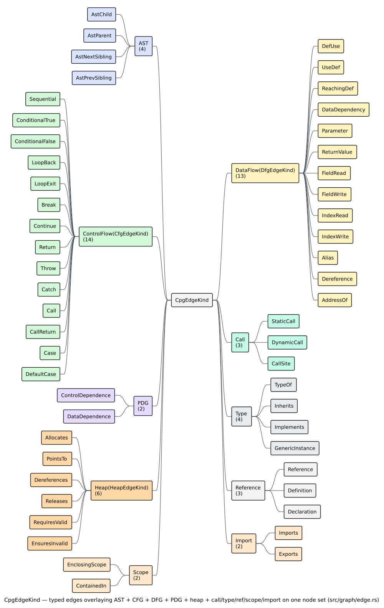

# Graph API Reference

This page is the authoritative reference for the **core graph types** of
`libcpg` — the [`CodePropertyGraph`](../GLOSSARY.md#code-property-graph-cpg)
container, its nodes and edges, and the identifier, location, language, and
error types that surround them. Every signature below is transcribed from
`src/graph/` (and the crate-root re-exports in `src/lib.rs`); nothing here is
aspirational.

If you are looking for how graphs are *built*, see the
[Builder reference](builder-reference.md); for how they are *analyzed*
(matching, similarity, GoF, algorithms, GNN) see the
[Pattern reference](pattern-reference.md). Conceptual definitions of every term
live in the [Glossary](../GLOSSARY.md).


*Figure — the four overlays of a CPG share one node set; each edge kind projects a different program view. Source: [`diagrams/cpg-overlay.dot`](../diagrams/cpg-overlay.dot).*

---

## Where these types live

Every type on this page is re-exported from the crate root, so a single `use`
suffices:

```rust
use libcpg::{
    CodePropertyGraph, CpgStats,
    CpgNode, CpgNodeKind, LiteralKind,
    CpgEdge, CpgEdgeKind, CfgEdgeKind, DfgEdgeKind,
    NodeId, EdgeId, SourceRange,
    Language, Paradigm,
    TypeInfo, MethodSignature, Visibility, ScopeId,
    PropertyKey, PropertyValue,
    Error, Result,
};
```

They also remain reachable at their defining paths (`libcpg::graph::…`), but the
root re-exports are canonical.

---

## `CodePropertyGraph`

The central container. It is **not** a bag of vectors: it wraps a
[petgraph](../GLOSSARY.md#petgraph) `DiGraph<CpgNode, CpgEdge>` plus two
`FxHashMap` side-tables that translate the stable `NodeId`/`EdgeId` the API
exposes into petgraph's internal `NodeIndex`/`EdgeIndex`. All fields are private;
you interact through the methods below.

```rust
pub struct CodePropertyGraph { /* private: petgraph DiGraph + id→index maps + metadata */ }
```

Besides the topology it records: the [`Language`](#language) it was built for, an
optional source path and retained source string, the AST `root` node, and the
[CFG](../GLOSSARY.md#control-flow-graph-cfg) entry/exit node lists.

### Construction & metadata

| Method | Signature | Notes |
|--------|-----------|-------|
| `new` | `fn new(language: Language) -> Self` | Empty graph for `language`. |
| `with_source_path` | `fn with_source_path(self, path: impl Into<Arc<str>>) -> Self` | Records the source file path. |
| `with_source_code` | `fn with_source_code(self, code: impl Into<Arc<str>>) -> Self` | Retains the source string (opt-in; off by default). |
| `language` | `fn language(&self) -> Language` | The graph's language. |
| `source_path` | `fn source_path(&self) -> Option<&str>` | The recorded path, if any. |
| `source_code` | `fn source_code(&self) -> Option<&str>` | The retained source, if any. |
| `root` | `fn root(&self) -> Option<NodeId>` | The AST root (the first node added). |
| `node_count` | `fn node_count(&self) -> usize` | Number of nodes. |
| `edge_count` | `fn edge_count(&self) -> usize` | Number of edges. |

`CodePropertyGraph` also implements `Clone`, `Debug`, and `Default` (a `Default`
graph has `Language::Unknown`).

### Node operations

| Method | Signature | Notes |
|--------|-----------|-------|
| `add_node` | `fn add_node(&mut self, node: CpgNode) -> NodeId` | Assigns a fresh `NodeId`, overwriting `node.id`. Sets `root` if this is the first node. |
| `add_node_with_id` | `fn add_node_with_id(&mut self, node: CpgNode) -> NodeId` | Keeps `node.id` (for reconstruction from serialized data). |
| `node` | `fn node(&self, id: NodeId) -> Option<&CpgNode>` | Look up a node. Returns `Option`, **not** `Result`. |
| `node_mut` | `fn node_mut(&mut self, id: NodeId) -> Option<&mut CpgNode>` | Mutable lookup. |
| `contains_node` | `fn contains_node(&self, id: NodeId) -> bool` | Membership test. |
| `nodes` | `fn nodes(&self) -> impl Iterator<Item = &CpgNode>` | Iterate all nodes. |
| `node_ids` | `fn node_ids(&self) -> impl Iterator<Item = NodeId> + '_` | Iterate all node ids. |
| `merge_from` | `fn merge_from(&mut self, other: &CodePropertyGraph) -> FxHashMap<NodeId, NodeId>` | Appends a collision-free copy in sorted source-id order and returns the complete source-to-destination map. |

> There is no `remove_node` / `remove_edge`: a CPG is built once and analyzed;
> extraction stages *add* overlay edges rather than mutate topology in place.

### Edge operations

| Method | Signature | Notes |
|--------|-----------|-------|
| `add_edge` | `fn add_edge(&mut self, edge: CpgEdge) -> Option<EdgeId>` | Assigns a fresh `EdgeId`. `None` if either endpoint is absent. |
| `add_edge_with_id` | `fn add_edge_with_id(&mut self, edge: CpgEdge) -> Option<EdgeId>` | Keeps `edge.id` (reconstruction). |
| `connect` | `fn connect(&mut self, source: NodeId, target: NodeId, kind: CpgEdgeKind) -> Option<EdgeId>` | Convenience constructor + insert. Returns `None` if an endpoint is missing. |
| `edges_between` | `fn edges_between(&self, source: NodeId, target: NodeId) -> Vec<&CpgEdge>` | All parallel edges from `source` to `target`. |
| `edges` | `fn edges(&self) -> impl Iterator<Item = &CpgEdge>` | Iterate all edges. |

There is no `edge(id)` accessor; look edges up by endpoint with `edges_between`,
`outgoing_edges`, or `incoming_edges`.

### AST traversal

Because petgraph iterates a node's outgoing edges newest-first, `ast_children`
sorts `AstChild` edges by `EdgeId` (assigned monotonically) to recover true
**source order** — analyses rely on, e.g., an `If`'s children being
`[condition, then, else]`.

| Method | Signature | Notes |
|--------|-----------|-------|
| `ast_children` | `fn ast_children(&self, id: NodeId) -> Vec<NodeId>` | Children in source order. |
| `ast_parent` | `fn ast_parent(&self, id: NodeId) -> Option<NodeId>` | Reads the node's `parent` pointer. |
| `ast_descendants` | `fn ast_descendants(&self, id: NodeId) -> Vec<NodeId>` | Depth-first descendants. |
| `ast_ancestors` | `fn ast_ancestors(&self, id: NodeId) -> Vec<NodeId>` | Chain toward the root. |

### CFG traversal

CFG edges carry a [`CfgEdgeKind`](#cfgedgekind); the successor/predecessor
accessors return the neighbour paired with the edge kind, so a caller can branch
on, e.g., `ConditionalTrue` vs `LoopBack`.

| Method | Signature | Notes |
|--------|-----------|-------|
| `cfg_successors` | `fn cfg_successors(&self, id: NodeId) -> Vec<(NodeId, CfgEdgeKind)>` | Outgoing control flow. |
| `cfg_predecessors` | `fn cfg_predecessors(&self, id: NodeId) -> Vec<(NodeId, CfgEdgeKind)>` | Incoming control flow. |
| `cfg_entries` | `fn cfg_entries(&self) -> &[NodeId]` | Function entry nodes. |
| `cfg_exits` | `fn cfg_exits(&self) -> &[NodeId]` | Recorded exit nodes. |
| `add_cfg_entry` | `fn add_cfg_entry(&mut self, id: NodeId)` | Register an entry (dedup). |
| `add_cfg_exit` | `fn add_cfg_exit(&mut self, id: NodeId)` | Register an exit (dedup). |
| `cfg_nodes` | `fn cfg_nodes(&self) -> impl Iterator<Item = &CpgNode>` | Nodes with any incident CFG edge. |

### DFG traversal

| Method | Signature | Notes |
|--------|-----------|-------|
| `reaching_definitions` | `fn reaching_definitions(&self, use_site: NodeId) -> Vec<NodeId>` | Definitions reaching `use_site` (incoming `DefUse`/`ReachingDef`). |
| `uses_of_definition` | `fn uses_of_definition(&self, def: NodeId) -> Vec<NodeId>` | Uses reached by `def` (outgoing `DefUse`). |
| `dfg_successors` | `fn dfg_successors(&self, id: NodeId) -> Vec<(NodeId, DfgEdgeKind)>` | Outgoing data flow. |
| `dfg_predecessors` | `fn dfg_predecessors(&self, id: NodeId) -> Vec<(NodeId, DfgEdgeKind)>` | Incoming data flow. |

See [reaching definitions](../GLOSSARY.md#reaching-definition) for the semantics
these edges encode.

### Call graph

| Method | Signature | Notes |
|--------|-----------|-------|
| `call_sites` | `fn call_sites(&self, function: NodeId) -> Vec<NodeId>` | `Call` nodes in `function`'s subtree. |
| `callees` | `fn callees(&self, call_site: NodeId) -> Vec<NodeId>` | Targets via `CallSite`/`StaticCall`/`DynamicCall`. |
| `callers` | `fn callers(&self, function: NodeId) -> Vec<NodeId>` | Call sites that reach `function`. |

### Query by kind

`nodes_by_kind` takes a **predicate over the kind**, not a kind value — there is
no `nodes_of_kind(kind)`.

| Method | Signature | Notes |
|--------|-----------|-------|
| `functions` | `fn functions(&self) -> impl Iterator<Item = &CpgNode>` | All `Function` nodes. |
| `classes` | `fn classes(&self) -> impl Iterator<Item = &CpgNode>` | All `Class` nodes. |
| `variables` | `fn variables(&self) -> impl Iterator<Item = &CpgNode>` | All `Variable` nodes. |
| `calls` | `fn calls(&self) -> impl Iterator<Item = &CpgNode>` | All `Call` nodes. |
| `nodes_by_kind` | `fn nodes_by_kind<F: Fn(&CpgNodeKind) -> bool>(&self, predicate: F) -> impl Iterator<Item = &CpgNode>` | Filter by a kind predicate. |

### Query by position

| Method | Signature | Notes |
|--------|-----------|-------|
| `node_at_offset` | `fn node_at_offset(&self, offset: u32) -> Option<&CpgNode>` | Smallest node covering a byte offset. |
| `nodes_in_range` | `fn nodes_in_range(&self, range: SourceRange) -> Vec<&CpgNode>` | Nodes overlapping a range. |
| `scope_at_offset` | `fn scope_at_offset(&self, offset: u32) -> Option<&CpgNode>` | Innermost `Block`/`Function` at an offset. |

### Edge helpers

| Method | Signature | Notes |
|--------|-----------|-------|
| `outgoing_edges` | `fn outgoing_edges(&self, id: NodeId) -> impl Iterator<Item = &CpgEdge>` | All outgoing edges. |
| `incoming_edges` | `fn incoming_edges(&self, id: NodeId) -> impl Iterator<Item = &CpgEdge>` | All incoming edges. |
| `edges_by_kind` | `fn edges_by_kind<F: Fn(&CpgEdgeKind) -> bool>(&self, predicate: F) -> impl Iterator<Item = &CpgEdge>` | Filter edges by a kind predicate. |

### Graph metrics

| Method | Signature | Notes |
|--------|-----------|-------|
| `ast_depth` | `fn ast_depth(&self) -> usize` | Longest root-to-leaf AST path. |
| `cyclomatic_complexity` | `fn cyclomatic_complexity(&self) -> usize` | McCabe's metric over the CFG (below). |
| `stats` | `fn stats(&self) -> CpgStats` | Aggregate counts (see [`CpgStats`](#cpgstats)). |

`cyclomatic_complexity` computes [McCabe's metric](../GLOSSARY.md#cyclomatic-complexity) [[2]](#references)

```math
M = E - N + 2
```

where $`E`$ is the number of CFG edges and $`N`$ the number of CFG
nodes (`cfg_nodes().count()`); when there are no CFG nodes it returns $`1`$.
The implementation uses a saturating subtraction, so it never underflows.

### Multi-file program composition

The feature-free program API combines independently built file CPGs without
colliding their local identifiers:

| Function | Signature | Result |
|---|---|---|
| `merge_programs` | `fn(Vec<CodePropertyGraph>) -> ProgramCpg` | Unified append-only CPG plus one ordered `FileScope` per input. |
| `build_import_graph` | `fn(&mut ProgramCpg) -> ImportGraph` | Ordered exact/ambiguous/external evidence plus idempotent `Imports`/`Exports` overlays. |

`FileScope` retains path, source, language, translated root, sorted member
nodes, and its `node_map`. `ImportResolution` records the matched alias,
candidate files, and selected declarations. Exact declaration-level `Imports`
edges carry the symbol's local binding as their label, so renamed imports feed
`ExactViaImport` correctly. See the complete
[program-composition component guide](../components/graph/program-composition.md)
and [usage guide](../usage/07-multi-file-programs.md).

### Evidence-bounded call resolution

The feature-free resolver turns parsed call syntax into definite call topology
only when one target is uniquely supported. It is exported from the crate root
and `libcpg::analysis`:

| Function | Signature | Result |
|---|---|---|
| `build_symbol_table` | `fn(&mut CodePropertyGraph, &ResolveConfig) -> SymbolTable` | Deterministic lexical, represented-import, and global function index; idempotently emits `EnclosingScope` and `ContainedIn`. |
| `resolve_calls` | `fn(&mut CodePropertyGraph, &ResolveConfig) -> CallGraphResolution` | Per-call evidence records plus uniquely supported `Reference`, `StaticCall`/`DynamicCall`, and `CallSite` edges. |

`ResolveConfig` exposes `max_scope_depth`,
`max_candidates_per_name`, `max_calls`, and `resolve_methods`.
`Confidence` has seven stable tiers: `ExactInFile`,
`ExactViaImport`, `ExactViaBinding`, `BareNameUnique`,
`BareNameAmbiguous`, `External`, and `Unresolved`. Only the first four
return `true` from `creates_topology()`.

`CallResolution` records `callee_name`, `scope`, `confidence`,
`target`, retained `candidates`, the full `candidate_count`, and
`candidates_truncated`. `CallGraphResolution` stores those records in a
`BTreeMap<NodeId, CallResolution>` and counts newly emitted topology edges,
ambiguous calls, external calls, and unresolved calls. See the complete
[call-resolution component guide](../components/graph/call-resolution.md) for
the evidence matrix, ordering and cap contracts, pseudocode, complexity,
examples, and validation.

### IFDS/IDE procedure summaries

The feature-free interprocedural framework evaluates a caller-defined
`SummaryDomain` over the current resolved call graph:

| Function | Signature | Result |
|---|---|---|
| `solve_summaries` | `fn<D: SummaryDomain>(&CodePropertyGraph, &D, &SccDecomposition, &IfdsCaps) -> IfdsOutput<D>` | Ordered summaries and completeness evidence using the built-in call-site resolver. |
| `solve_summaries_with_resolver` | `fn<D: SummaryDomain>(&CodePropertyGraph, &D, &SccDecomposition, &IfdsCaps, &dyn Fn(NodeId) -> CalleeRef) -> IfdsOutput<D>` | The same fixed point with caller-authoritative external/unresolved resolution. |

`SummaryDomain` declares an ordered finite `Fact`, a summary implementing
`analysis::ifds::Lattice`, `seed_facts`, and `summarize`. The crate-root alias
for that lattice is `IfdsLattice`; the existing root `Lattice` remains the
block-CFG data-flow trait. `SummaryCtx` exposes current summaries, the resolver,
and caps without mutating the CPG.

`IfdsCaps` bounds functions, distinct seed facts per point, scheduler work,
recursive SCC rounds, and default resolver depth. `IfdsOutput::is_complete()`
requires no `IfdsCapEvent` and no `IfdsIssue`. `CalleeRef` distinguishes
represented `Resolved`, caller-identified `External`, and evidence-insufficient
`Unresolved` calls. See the complete
[IFDS/IDE component guide](../components/graph/ifds-ide-framework.md) and
[usage guide](../usage/08-ifds-summary-domains.md).

### Interprocedural effect summaries

The feature-free effect domain specializes the shared summary solver for
observable reads/writes, transitive purity, parameter-to-return flow, and
scalar return constants:

| Function | Signature | Result |
|---|---|---|
| `analyze_effects` | `fn(&CodePropertyGraph, &SccDecomposition, &IfdsCaps) -> EffectAnalysis` | Ordered summaries plus processed-function, iteration, work, cap, and issue evidence. |
| `effect_summaries` | `fn(&CodePropertyGraph, &SccDecomposition, &IfdsCaps) -> BTreeMap<NodeId, EffectSummary>` | Convenience projection of the summary map; it can be a capped prefix. |

`Place::{Global, Param, Field}` identifies abstract storage. `Purity` is ordered
as `Pure < ReadsGlobal < WritesGlobal < Impure`. `EffectSummary` also exposes a
64-bit `param_to_return` mask, `const_return`, an explicit flat-lattice
`const_return_overdefined` bit, and truncation/cap flags. Only
`EffectAnalysis::is_complete()` licenses a negative claim; positive evidence
in a capped result remains useful. Return dependence and scalar folding use
typed heap continuation machines: accepted AST/def-use depth does not grow the
native call stack, while `IfdsCaps::{max_call_depth,max_worklist_steps}` still
bound logical evidence and work. See the
[effect-summary component guide](../components/graph/effect-summaries.md) and
[usage guide](../usage/09-effect-summaries.md).

### Advisory taint and maybe-null summaries

The feature-free taint domains consume the same resolved call graph and typed
AST/DFG evidence. They never scan retained source text:

| Function | Signature | Result |
|---|---|---|
| `analyze_taint_report` | `fn(&CodePropertyGraph, &CallGraphResolution, &TaintCatalog, &IfdsCaps) -> TaintAnalysis` | Ordered source-to-sink findings, per-function summaries, shared solver evidence, and domain-local cap state. |
| `analyze_taint` | `fn(&CodePropertyGraph, &CallGraphResolution, &TaintCatalog, &IfdsCaps) -> Vec<TaintFlow>` | Convenience finding vector; inspect the report API before making negative claims. |
| `analyze_null_flows_report` | `fn(&CodePropertyGraph, &CallGraphResolution, &IfdsCaps) -> NullAnalysis` | Ordered maybe-null dereference candidates with summaries and completeness evidence. |
| `analyze_null_flows` | `fn(&CodePropertyGraph, &CallGraphResolution, &IfdsCaps) -> Vec<NullFlow>` | Convenience finding vector with the same positive evidence boundary. |

`TaintCatalog` owns ordered call `sources`, categorical `literal_sources`,
`sinks`, `sanitizers`, and `externals`. `LiteralSourceRule` classifies a typed
`LiteralKind` category without copying or matching its value.
Rules select call paths with `Pattern::{Exact, Segment, Suffix, Substring}` and
use open `Arc<str>` classes; external calls use
`ExternalModel::{Passthrough, Havoc, Source, Sink, Sanitizer}`. Every finding
retains concrete source/sink ids, optional CWE metadata, confidence, and a
canonical `TaintWitness`. `NullOriginKind` distinguishes literal,
uninitialized-variable, and typed nullable-return evidence.

`TaintAnalysis::is_complete()` and `NullAnalysis::is_complete()` are the only
licenses for absence claims. The `Vec` conveniences deliberately preserve
positive findings while omitting that qualification. See the [component
guide](../components/graph/taint-analysis.md), [usage guide](../usage/10-taint-and-nullflow.md),
and [security boundary](../security/02-taint-analysis.md).

### System dependence and interprocedural slices

The feature-free SDG surface composes PDG, parameter, return, and effect
summary evidence without creating a parallel graph:

| Function | Signature | Result |
|---|---|---|
| `build_summary_edges` | `fn(&mut CodePropertyGraph, &BTreeMap<NodeId, EffectSummary>) -> usize` | Number of new `DataDependence(label="summary")` actual-to-call edges. |
| `interprocedural_backward_slice` | `fn(&CodePropertyGraph, NodeId, &SliceCaps) -> BTreeSet<NodeId>` | Deterministic two-pass predecessor slice. |
| `interprocedural_forward_slice` | `fn(&CodePropertyGraph, NodeId, &SliceCaps) -> BTreeSet<NodeId>` | Deterministic direction-dual successor slice. |

`SliceCaps::new(max_nodes, max_call_depth)` bounds distinct result nodes and
`Parameter`/`ReturnValue` boundary crossings. `SUMMARY_EDGE_LABEL` is the
stable `summary` label. Summary construction is append-only and idempotent;
unknown criteria and zero node caps return an empty set. See the
[component guide](../components/graph/system-dependence-slicing.md), [usage
guide](../usage/11-interprocedural-slicing.md), and [security
boundary](../security/03-system-dependence-slicing.md).

### Channel events and topology

Language frontends attach optional `MsgKind` metadata to existing CPG nodes;
the feature-free concurrency surface resolves stable `Variable` identities
through `Identifier::definition`, `DefUse`/`ReachingDef`, and `Reference`:

| Function | Signature | Result |
|---|---|---|
| `extract_events` | `fn(&CodePropertyGraph) -> BTreeMap<NodeId, Vec<ChannelEvent>>` | Top-level processes and statement sites in `NodeId` order; unresolved channel evidence remains `None`. |
| `channel_report` | `fn(&CodePropertyGraph) -> Vec<ChannelFinding>` | Ordered `OrphanSend`, `BlockedRecv`, and `NondeterministicConsumption` evidence. |

`ChannelId` is the defining `Variable` `NodeId`. `ChannelEvent` carries kind,
optional channel, site, and `SourceRange`; `ChannelFinding` carries channel,
sorted process/site ids, and detail. Both functions are read-only and advisory.
See the [component guide](../components/graph/channel-topology.md), [usage
guide](../usage/12-channel-topology.md), and [security
boundary](../security/04-channel-topology.md).

### Communication and lock-order deadlock candidates

`LockKind::{AcquireRead, AcquireWrite, Release}` is optional typed metadata on a
`Call`; `LockMode::{Read, Write}` appears in witnesses. A frontend or semantic
adapter attaches the operation after resolving the synchronization API. The
analyzer never infers it from a call's source spelling.

| Function | Signature | Result |
|---|---|---|
| `communication_deadlocks` | `fn(&CodePropertyGraph) -> Vec<DeadlockFinding>` | Communication wait-for SCCs followed by conflicting lock-order SCCs, all deterministically ordered. |

`DeadlockFinding` contains a `DeadlockFindingKind`, sorted `processes`, sorted
channel/lock `resources`, `DeadlockWitness` values, and explanatory `detail`.
Communication witnesses preserve waiter/producer/channel and receive/send
sites/ranges. Lock witnesses preserve holder/acquirer/resource/mode evidence,
both acquisition sites/ranges, and an optional interprocedural call site.

The function constructs `GraphProjection::External` values and reuses
`projection_sccs`; it is feature-free, read-only, and advisory. See the
[component guide](../components/graph/deadlock-analysis.md), [usage
guide](../usage/13-deadlock-candidates.md), [theory](../theory/30-cyclic-wait-and-lock-order.md),
and [security boundary](../security/05-deadlock-analysis.md).

### May-happen-in-parallel relation

`may_happen_in_parallel(&CodePropertyGraph) -> MhpRelation` recognizes typed
parallel regions (`Block` plus `MsgKind::Spawn`) and relates execution sites in
different direct operand subtrees. Direct process roots and wrapper blocks are
both valid operands; nested `Function` bodies are excluded.

| Item | Contract |
|---|---|
| `MhpPair` | One canonical unordered pair with `first < second`. |
| `MhpRelation::pairs` | Lexicographically sorted, deduplicated canonical pairs. |
| `MhpRelation::contains(left, right)` | Symmetric membership; self-pairs are false. |
| `MhpRelation::partners(node)` | Stable iterator over all sites related to `node`. |
| `MhpRelation::capped` | True when the public pair ceiling omitted later valid pairs. |
| `MAX_MHP_PAIRS` | One-million-pair materialization ceiling. |

Execution sites are statement nodes plus `Variable`, `Assignment`, `Call`,
`Await`, and `Yield`. The relation is feature-free, read-only, and out of graph.
A capped result contains no false pairs but is incomplete. See the [component
guide](../components/graph/mhp-analysis.md), [usage
guide](../usage/14-may-happen-in-parallel.md), [theory](../theory/31-may-happen-in-parallel.md),
and [security boundary](../security/06-mhp-analysis.md).

### Advisory session-protocol sketches (`rholang`)

With `feature = "rholang"`, `session_sketches(&CodePropertyGraph) ->
Vec<SessionSketch>` groups definition-resolved channel events into deterministic
per-process action vectors and checks ordinary binary linear duality.

| Item | Contract |
|---|---|
| `SessionSketch` | Resolved channel, sorted endpoints, three-valued verdict, and ordered issues. |
| `SessionEndpoint` | Top-level process plus actions sorted by event-site id. |
| `SessionAction` | Direction, exact `MsgKind`, shallow payload vector, site, and source range. |
| `SessionPayloadType` | Literal category, normalized explicit/named type, or `Unknown`. |
| `SessionConformance` | `Conformant`, `Nonconformant`, or `Inconclusive`. |
| `SessionIssueKind` | Cardinality, length, direction, arity, type, unknown-type, or non-linear-receive evidence. |

The API is read-only and out of graph. `Conformant` requires exactly two
equal-length linear traces with opposite directions and equal known payload
types. Concrete mismatches dominate uncertainty. See the [component
guide](../components/graph/session-analysis.md), [usage
guide](../usage/15-session-protocol-sketches.md), [theory](../theory/32-session-protocol-duality.md),
and [security boundary](../security/07-session-analysis.md).

### Deterministic typestate analysis

The feature-free typestate API evaluates a caller-defined `PropertyFsm` over
typed allocation, object-flow, call, and canonical intraprocedural CFG
evidence.

| Item | Contract |
|---|---|
| `PropertyFsm` | Ordered closed vocabularies, partial ordinary transitions, allocation seeds, accepting states, and one absorbing error state. |
| `PropertyFsm::validate` | Deterministic set of every structural property issue. |
| `analyze_typestate` | `fn(&CodePropertyGraph, &PropertyFsm, &IfdsCaps) -> TypestateAnalysis`; retains findings, terminal states, caps, issues, and work evidence. |
| `check_typestate` | Positive-finding convenience projection; use the report before a negative claim. |
| `TypestateViolation` | Allocation object, violating site, prior state, event, canonical witness, and cap qualifier. |
| `TypestateAnalysis::is_complete` | True only when no resource or structural/evidence boundary qualifies the result. |
| `TypestateAnalysis::object_is_accepting` | Whether all represented terminal states for one object belong to the policy's accepting set. |

Missing ordinary transitions enter the absorbing error state. Branch joins
retain may-unions, so one legal and one forbidden path can coexist. The analysis
is read-only, out of graph, deterministic, and stack-safe over graph depth. See
the [component guide](../components/graph/typestate-analysis.md), [usage
guide](../usage/16-typestate-analysis.md), [theory](../theory/33-finite-state-typestate-properties.md),
and [security boundary](../security/08-typestate-analysis.md).

### Advisory bug detectors

The feature-free bug-detector APIs compose existing typestate, variable-fact,
reaching-definition, call-SCC, type, inheritance, and reserved exception
evidence. Every report is read-only and deterministic.

| Item | Contract |
|---|---|
| `analyze_resource_leaks` | `fn(&CodePropertyGraph, &PropertyFsm, &IfdsCaps) -> ResourceLeakAnalysis`; projects non-accepting typestate terminals while retaining the complete typestate report. |
| `resource_leaks` | Positive-only leak projection; inspect `ResourceLeakAnalysis::is_complete()` before an absence claim. |
| `analyze_uninitialized_uses` | `fn(&CodePropertyGraph) -> UninitializedUseAnalysis`; reports binder-aware executable uses with no in-scope reaching definition. |
| `uninitialized_uses` | Positive-only use projection. |
| `analyze_exception_flow` | `fn(&CodePropertyGraph, &IfdsCaps) -> ExceptionFlowAnalysis`; returns finite escaping-type summaries, uncaught root propagation, reached/dead catches, work, caps, and issues. |
| `uncaught_exceptions` / `dead_catches` | Positive-only exception finding projections. |
| `ResourceLeak` | Allocation object, semantic exit, non-accepting state, canonical witness, and cap qualifier. |
| `UninitializedUse` | Function, executable use site, canonical variable name, and out-of-scope definitions. |
| `UncaughtException` | Root entry, escaping origin/type, canonical call/throw witness, and cap qualifier. |
| `DeadCatch` | Function, catch node, accepted types or catch-all marker, and cap qualifier. |

Unknown types, ambiguous calls, missing typed catch-entry edges, missing
witnesses, and shared-solver failures prevent exception completeness. See the
[component guide](../components/graph/bug-detectors.md), [usage
guide](../usage/17-advisory-bug-detectors.md), [theory](../theory/34-advisory-bug-detection.md),
and [security boundary](../security/09-bug-detectors.md).

### Population anomaly detectors

The feature-free population APIs compose caller-owned taint policy, typed API
identity, PDG checks, CFG reachability, and forward DFG/PDG value evidence.
They are deterministic, read-only, stack-safe over represented depth, and exact
at rational support boundaries.

| Item | Contract |
|---|---|
| `analyze_missing_checks` | `fn(&CodePropertyGraph, &MissingCheckConfig) -> Result<MissingCheckAnalysis, AnalysisError>`; returns qualified I6 findings, admitted sites, and typed issues. |
| `missing_checks` | Positive-only `Vec<MissingCheck>` projection; inspect the report before an absence claim. |
| `MissingCheckConfig` | Taint catalog/classes, exact support, minimum population, peer scope, and fingerprint/callee bounds. |
| `PeerScope` | `WholeProgram` or `CallGraph { max_distance }` over owner functions. |
| `CheckFingerprint` | Flat postorder semantic check tape; local spellings are abstracted while behavior-bearing payloads remain exact. |
| `analyze_deviant_behavior` | `fn(&CodePropertyGraph, &DeviantBehaviorConfig) -> Result<DeviantBehaviorAnalysis, AnalysisError>`; returns I7 order/return beliefs, deviations, sites, and issues. |
| `deviant_behaviors` | Positive-only `Vec<DeviantBehavior>` projection. |
| `CallOrderBelief` | Exact support for a later CFG-reachable API after a predecessor API. |
| `ReturnCheckBelief` | Exact support for call-result value evidence reaching a represented guard. |
| `ApiIdentity` | Sorted represented target set or typed named external path. |
| `PopulationFraction` / `PopulationThreshold` | Exact observed and required support; `ratio()` is presentation-only. |

Incomplete occurrences do not vote and remain visible as issues. See the
[component guide](../components/graph/population-anomaly-detectors.md), [usage
guide](../usage/18-population-anomaly-detectors.md), [theory](../theory/35-population-anomaly-inference.md),
and [security boundary](../security/10-population-anomaly-detectors.md).

### Clone-consistency and path-feasibility advisories

The feature-free I8/I9 APIs consume normalized graph evidence and return
read-only, canonically ordered reports. A positive-only convenience projection
discards issues; use the qualified analyzer and `is_complete()` for an absence
claim.

| API/type | Meaning |
|---|---|
| `analyze_inconsistent_clones` / `inconsistent_clone_bugs` | Qualified I8 report / positive finding projection. |
| `CloneBugConfig` | Clone/GED options, exact edit/rename thresholds, occurrence minimum, AST/alignment caps. |
| `CloneBugAnalysis` | Findings, evaluated exact pairs, typed issues, `is_complete()`. |
| `InconsistentCloneBug` / `InconsistentCloneKind` | Pair-local clone/GED/edit evidence and exact rename or guard witness. |
| `ClonePairEvidence` / `CloneBugIssue` | Evaluated pair admission and explicit evidence gaps. |
| `analyze_infeasible_paths` / `infeasible_paths` | Qualified I9 report / positive finding projection. |
| `InfeasiblePathConfig` | Condition-node, alternative-state, and machine-step caps. |
| `InfeasiblePathAnalysis` | Findings, analyzed functions/conditions, typed issues, `is_complete()`. |
| `InfeasiblePathFinding` / `InfeasiblePathKind` | Function/source/guard, branch/redundancy/contradiction kind, proof, and witnesses. |
| `FeasibilityProofSource` | SCCP, intervals, or their combined evidence. |
| `IntervalContradiction` / `IntervalPredicateEvidence` | Ordered empty-alternative proof and exact normalized predicates/regions. |

See the [component guide](../components/graph/clone-feasibility-bug-detectors.md),
[usage guide](../usage/19-clone-feasibility-advisories.md),
[theory](../theory/36-clone-consistency-and-abstract-feasibility.md), and
[security boundary](../security/11-clone-feasibility-detectors.md).

### API-usage and temporal protocol mining

The feature-free I12 API builds one centered typed API Usage Graph (AUG) per
complete call site, mines exact strict-majority fragments per anchor API, emits
advisory deviations, and delegates named temporal properties to typestate.

| API/type | Meaning |
|---|---|
| `analyze_api_usage_mining` | Qualified AUG, pattern, deviation, temporal-analysis, temporal-finding, and issue report. |
| `api_usage_misuses` | Positive-only usage-deviation projection; never use alone for an absence claim. |
| `ApiUsageMiningConfig` | Exact support/population policy; call, CFG, AUG, callee, property, and delegated typestate caps. |
| `ApiUsageMiningAnalysis` | Ordered graphs/patterns/findings/temporal evidence/admitted sites/issues; `is_complete()` composes both analysis paths. |
| `ApiUsageGraph` | Anchor/function/API plus dense typed local nodes and labeled edges; `is_acyclic()` is iterative. |
| `ApiUsageNodeKind` | Anchor action, following action, normalized data shape, or normalized control context. |
| `ApiUsageEdgeKind` | Receiver, positional parameter, selection, or represented order. |
| `ApiUsagePattern` / `ApiUsagePatternKind` | Exact support and supporting sites for following-call, arity, argument, receiver, or control fragments. |
| `ApiUsageMisuse` / `ApiUsageMisuseKind` | Deviating site with expected/observed evidence, exact peer support, supporting sites, and witness. |
| `NamedTemporalProperty` | Unique report name paired with a validated `PropertyFsm`. |
| `TemporalPropertyFindingKind` | Forbidden transition or non-accepting represented exit. |
| `TemporalPropertyAnalysis` | Complete delegated resource/typestate evidence for one name. |
| `ApiUsageMiningIssue` | Atomic inventory or site-local owner/identity/CFG/AUG incompleteness. |

See the [component guide](../components/graph/api-usage-protocol-mining.md),
[usage guide](../usage/20-api-usage-protocol-mining.md),
[theory](../theory/37-api-usage-graphs-and-temporal-properties.md), and
[security boundary](../security/12-api-usage-protocol-mining.md).

### Declarative CWE-template analysis

The feature-free CWE API intersects bounded structural embeddings with shared
semantic analysis evidence. It never parses source or mutates the target CPG.

| API/type | Meaning |
|---|---|
| `builtin_cwe_templates` | Owned canonical registry for CWE-22, 78, 79, 89, 190, 416, 476, 502, 787, and 798. |
| `analyze_builtin_cwes` | Qualified analysis of the complete shipped registry. |
| `analyze_cwe_templates` | Qualified analysis of a validated caller-supplied template set. |
| `CweTemplate` / `CweRole` / `CwePrimitive` | Stable identity and CWE metadata, source/neutralizer/sink role predicates, structural alternatives, and selected shared primitive. |
| `CweStructuralPattern` / `CwePatternEdge` | Dense exact node tags, typed directed relations, and designated mapped sink. |
| `CweAnalysisConfig` | CWE structural/origin caps plus delegated `IfdsCaps`. |
| `CweAnalysis` | Ordered templates, embeddings, candidates, delegated reports, typed issues, and aggregate `is_complete()`. |
| `CweStructuralMatch` | Template/pattern identity, mapped sink, and dense pattern-index-to-target mapping. |
| `CweCandidate` / `CweEvidence` | Immutable represented site/origin/witness, integer evidence score, and primitive-specific evidence. |
| `CweAnalysisError` | Invalid request rejected before evaluation. |
| `CweAnalysisIssue` | Missing, contradictory, unsupported, failed, or capped represented evidence. |
| `CweTypestateAnalysis` | Template identity paired with the complete delegated typestate report. |

See the [component guide](../components/graph/cwe-template-analysis.md),
[usage guide](../usage/21-cwe-template-analysis.md),
[theory](../theory/38-declarative-cwe-query-semantics.md), and
[security boundary](../security/13-cwe-template-analysis.md).

### Cryptographic API-misuse analysis

The feature-free crypto API composes finite-state call order, typed positional
constraints, and literal-origin data flow. It does not parse source or mutate
the graph.

| API/type | Meaning |
|---|---|
| `builtin_crypto_rules` | Owned cross-language default policy. |
| `analyze_builtin_crypto` | Runs the shipped policy. |
| `analyze_crypto_misuse` | Runs a caller-supplied `CryptoRuleSet`. |
| `CryptoArgumentRule` | Stable name, typed call patterns, and zero-based argument positions. |
| `CryptoRuleSet` | Property FSM, weak-hash/mode/IV/key rules, random sources, and forbidden names. |
| `CryptoAnalysisConfig` | Local call/origin bounds plus delegated `IfdsCaps`. |
| `CryptoFinding` / `CryptoMisuseKind` | Canonical advisory category, site, rule, optional argument, and qualification. |
| `CryptoEvidence` | Typed call path, literal origins, taint witness, or typestate witness. |
| `CryptoAnalysisIssue` | Invalid policy, bounded path/call/origin, or qualification evidence. |
| `CryptoAnalysis` | Findings plus complete typestate/taint reports and aggregate `is_complete()`. |
| `LiteralPattern` / `LiteralSourceRule` | General categorical literal provenance for `TaintCatalog`. |

See the [component guide](../components/graph/crypto-misuse-analysis.md),
[usage guide](../usage/22-cryptographic-api-misuse.md),
[theory](../theory/39-cryptographic-api-misuse.md), and
[security boundary](../security/14-cryptographic-api-misuse.md).

### Deterministic graph projections

`GraphProjection` is the feature-free, payload-free compressed-sparse-row view
used by exact graph analyses. These constructors are exported from the crate
root and `libcpg::analysis`:

| Function | Signature | Projection |
|---|---|---|
| `call_graph_projection` | `fn(&CodePropertyGraph) -> GraphProjection` | resolved calls between all functions |
| `module_graph_projection` | `fn(&CodePropertyGraph) -> GraphProjection` | `Imports` between `Root` / `Module` nodes |
| `cfg_projection` | `fn(&CodePropertyGraph, NodeId) -> Result<GraphProjection, ProjectionError>` | one intraprocedural CFG |
| `dfg_projection` | `fn(&CodePropertyGraph, Option<NodeId>) -> GraphProjection` | global or AST-scoped DFG |
| `pdg_projection` | `fn(&CodePropertyGraph, NodeId) -> Result<GraphProjection, ProjectionError>` | one function's PDG |
| `projection_of` | generic node / edge / weight predicates | caller-selected relation |

`GraphProjection::from_edges` is the external-graph adapter. Accessors include
`dense_index`, `node_id`, `successors`, `predecessors`, `successor_weights`,
`edges`, `transpose`, `undirected`, and the total `is_well_formed` validator.
Parallel edges are merged by summing
their weights; sorted nodes and adjacency make the result independent of input
enumeration order. See the complete [projection component guide](../components/graph/projections.md)
for field invariants, scope boundaries, complexity, pseudocode, and examples.

### Dominators and post-dominators

The feature-free dominance API is exported from the crate root and
`libcpg::analysis`:

| Function | Signature | Result |
|---|---|---|
| `dominator_tree` | `fn(&GraphProjection, NodeId) -> Result<DominatorTree, AnalysisError>` | Dominators of projection nodes reachable from the selected root. |
| `post_dominator_tree` | `fn(&CodePropertyGraph, NodeId) -> Result<PostDominatorTree, AnalysisError>` | Post-dominators and reverse dominance frontier for the shared reachable function CFG; returns `UnknownNode` / `NotAFunction` for invalid selectors. |

`DominatorTree` exposes deterministic `idom`, `children`, and `frontier` maps,
plus `immediate_dominator`, constant-time `dominates`, and the
`dominators_of` ancestor iterator. `PostDominatorTree` exposes sorted `exits`,
real `ipdom` relations, `virtual_children`, and its reverse `frontier`, plus
constant-time `post_dominates`, `control_dependence_edges`, and `is_empty`.
`PdgBuilder` uses that public control-dependence relation directly.

See the [dominator component guide](../components/graph/dominator-analysis.md)
for exit modeling, unreachable-node semantics, CHK/Cytron pseudocode,
complexity, validation, and examples.

### Strongly-connected components

These feature-free functions compute exact SCC partitions over CPG-specific or
caller-supplied graph projections:

| Function | Signature | Projection |
|---|---|---|
| `control_flow_sccs` | `fn control_flow_sccs(&CodePropertyGraph, NodeId) -> Result<SccDecomposition, SccAnalysisError>` | One function's intraprocedural CFG; nested functions and interprocedural call edges are excluded. |
| `call_graph_sccs` | `fn call_graph_sccs(&CodePropertyGraph) -> SccDecomposition` | All functions and resolved caller-to-callee relations in the CPG. |
| `projection_sccs` | `fn projection_sccs(&GraphProjection) -> SccDecomposition` | Any constructor-valid deterministic projection, preserving specialized CFG/call provenance or recording `Projection(kind)`. |

`SccDecomposition` exposes deterministic `components`, a
`component_by_node` membership map, cycle-only iteration, and the condensation
DAG's `condensation_edges`. Multi-node SCCs identify loop or recursion
clusters; singleton SCCs are marked cyclic only when they have a self-loop.
See the [SCC component guide](../components/graph/scc-analysis.md) for projection
boundaries, accepted call encodings, complexity, and examples.

### Condensation-DAG analytics

These feature-free functions consume the SCC result without mutating or
re-projecting the CPG:

| Function | Signature | Result |
|---|---|---|
| `condensation_metrics` | `fn(&SccDecomposition, &CondensationOptions) -> CondensationMetrics` | Source-oriented longest-path levels, SCC-member-weighted critical path, height/width, and an optional CG schedule; total incomplete/capped signaling. |
| `coffman_graham` | `fn(&SccDecomposition, u32) -> Result<CgLayering, AnalysisError>` | Sink-first width-bounded layers, or explicit invalid-input/budget error. |

`CondensationOptions` exposes `max_components` and
`coffman_graham_width`. `CondensationMetrics` exposes `levels`,
`critical_path`, `critical_path_weight`, `height`, `width`,
`coffman_graham`, `complete`, and `capped`. `CgLayering` exposes
`width_limit`, sorted `layers`, direct `layer_of`, and `height()` / `width()`.
The hard ceiling is the root-exported
`MAX_CONDENSATION_COMPONENTS = 1_000_000`.

See the [condensation component guide](../components/graph/condensation-analysis.md)
for orientation, Kahn and Coffman–Graham pseudocode, malformed-input policy,
complexity, examples, and exhaustive path/schedule oracles.

### Architectural layering inference

| Item | Signature / purpose |
|---|---|
| `infer_layering` | `fn(&SccDecomposition, &CondensationMetrics) -> LayeringReport` — reverse source levels into bottom-first layers and classify cycle, skip, and non-downward evidence. |
| `LayeringReport` | `layers`, `layer_of`, sorted `violations`, plus `complete`/`capped` state. |
| `LayeringViolation` | Component endpoints, bottom-first endpoint layers, absolute distance, and a `LayeringViolationKind`. |
| `LayeringViolationKind` | `CyclicComponent`, `SkipLayer`, or `Upward`. |

The input decomposition is structurally revalidated. Consumed level fields must
have the component domain, dense bounded levels, and consistent height/width.
Every non-violating condensation edge descends exactly one layer. A cyclic
witness names its exact contracted component rather than fabricating an
internal edge that `SccDecomposition` no longer stores. See the [layering
component guide](../components/graph/layering-analysis.md).

### Design Structure Matrix visibility and core–periphery

These feature-free functions consume a valid `GraphProjection` without
mutating it or its source CPG:

| Function | Signature | Result |
|---|---|---|
| `analyze_dsm` | `fn(&GraphProjection) -> DsmAnalysis` | Non-reflexive transitive visibility fan-out/fan-in and propagation cost via repeated forward BFS. |
| `classify_core_periphery` | `fn(&GraphProjection, &DsmAnalysis) -> CorePeripheryResult` | Inclusive-median `Core`/`Shared`/`Control`/`Peripheral` roles plus the largest multi-vertex SCC. |

`DsmAnalysis` exposes stable `nodes`, aligned `visibility_fan_out` and
`visibility_fan_in`, `propagation_cost`, `n`, `complete`, and `capped`.
`CorePeripheryResult` exposes stable `nodes`, aligned `classes`, both median
thresholds, dense `cyclic_core`, `complete`, and `capped`; `class_of` and
`cyclic_core_nodes` provide stable-identifier lookup. `CorePeriphery::as_str`
returns stable lowercase labels.

The hard ceiling is `MAX_DSM_NODES = 50_000`. Oversized input produces an
explicitly capped incomplete result; malformed public CSR or mismatched
analysis provenance/count/scalar consistency produces an uncapped incomplete
result. Derived vectors are empty in both cases, never partial. See the [DSM component
guide](../components/graph/dsm-analysis.md) for formulae, edge direction,
literate BFS/SCC composition, degenerate median semantics, examples, tests,
and interpretation limits.

### Martin package metrics and stable dependencies

These feature-free functions combine a caller-selected dependency projection
with an explicit assignment of stable node IDs to architectural modules:

| Function | Signature | Result |
|---|---|---|
| `martin_metrics` | `fn(&CodePropertyGraph, &ModuleAssignment, &GraphProjection) -> Vec<MartinMetrics>` | Lexically ordered module coupling, instability, abstractness, and main-sequence distance. |
| `sdp_violations` | `fn(&[MartinMetrics], &GraphProjection, &ModuleAssignment) -> Vec<SdpViolation>` | Ordered violating module pairs with dependency multiplicity and one stable edge witness. |

`ModuleAssignment` exposes canonical `buckets: Vec<Arc<str>>` and
`of_node: BTreeMap<NodeId, u32>`. `from_pairs` accepts caller policy;
`by_module_nodes` uses the nearest enclosing CPG module and
`by_source_path` uses retained graph provenance. `MartinMetrics` exposes
`module`, `ca`, `ce`, `instability`, `abstractness`, and `distance`.
`SdpViolation` exposes the module pair, smallest stable source/target witness,
dependency count, and both instability values.

Coupling counts distinct external projection vertices and ignores weights and
intra-module edges. Abstractness counts abstract classes plus traits over all
class/struct/enum/trait declarations assigned to a module. Malformed
projections return no results; invalid assignment indices are inert; duplicate
or invalid metric values suppress SDP verdicts. See the [Martin component
guide](../components/graph/martin-metrics.md) for formulae, assignment policy,
pseudocode, examples, complexity, and interpretation limits.

### CK, LCOM, and function metrics

The feature-free metrics API consumes nominal ownership, resolved calls, typed
field flow, and common CPG node kinds without reparsing source:

| Function | Signature | Result |
|---|---|---|
| `method_field_graph` | `fn(&CodePropertyGraph, NodeId) -> MethodFieldGraph` | Sorted method/field partitions, concrete access witnesses with read/write flags, and resolved internal method calls; `MethodFieldGraph::lcom()` projects that exact evidence to LCOM1–5. |
| `ck_metrics` | `fn(&CodePropertyGraph, &CkOptions) -> Vec<ClassMetrics>` | Class-ID-sorted WMC, DIT, NOC, CBO, RFC, and LCOM1–5 rows. |
| `function_metrics` | `fn(&CodePropertyGraph, NodeId) -> Result<FunctionMetrics, AnalysisError>` | Semantic Halstead, cyclomatic, cognitive, source-span/comment, and maintainability values for one function. |

`CkOptions` exposes `include_structs`, `include_enums`, and
`include_implements`. Defaults include structs, exclude enums, and treat only
`Inherits` as inheritance. `MethodFieldAccess` preserves `method`, `access`,
`field`, `reads`, and `writes`; it exists only when `Reference` and typed field
DFG evidence agree. `MethodCall` preserves resolved internal endpoints.

`ClassMetrics` exposes `class`, `wmc`, `dit`, `noc`, `cbo`, `rfc`, and
`LcomSuite`. `FunctionMetrics` exposes `function`, `cyclomatic_complexity`,
`cognitive_complexity`, `halstead`, `logical_lines`, `comment_lines`, and
`maintainability_index`. `HalsteadMetrics` retains all four primitive counts so
derived values can be independently audited.

Invalid function selectors use the shared analysis errors; invalid nominal
selectors return an empty evidence graph. Inheritance cycles are condensed,
all public vectors use stable ID order, and floating results have defined
zero-denominator cases. See the [code-metrics component guide](../components/graph/code-metrics.md)
for exact formulae, semantic classification, pseudocode, and interpretation
limits.

### Advisory architectural smells

The feature-free smell API composes a directed projection with its exact SCC
decomposition, an explicit module assignment, and Martin metrics:

| Item | Signature / purpose |
|---|---|
| `architecture_smells` | `fn(&GraphProjection, &SccDecomposition, &[MartinMetrics], &ModuleAssignment, &SmellOptions) -> Vec<ArchSmell>` — validate one evidence snapshot and return canonical advisory findings. |
| `ArchSmellKind` | `CyclicDependency { component }`, `HubLikeDependency`, `UnstableDependency`, or `GodComponent`. |
| `ArchSmell` | One kind, a sorted non-empty `Vec<NodeId>`, finite `severity`, and detector-specific `BTreeMap<&'static str, f64>` evidence. |
| `SmellOptions` | Non-negative fan-in/fan-out sigma multipliers, a less-stable share in `0.0..=1.0`, and a non-negative component-size sigma multiplier. |

Cycles require at least two SCC members. Hubs must exceed both configured
population degree thresholds. Unstable findings group one source module's
cross-module edges whose target has greater Martin instability. God components
are high-side outliers in assigned projection-node count because this API has
no lines-of-code table. Comparisons are strict; weights and self-loops do not
affect fan/module-edge rules.

Malformed CSR, stale SCCs, missing assignment/metrics, duplicate metric names,
or invalid numerics fail closed with an empty result. Findings sort by kind,
descending severity, smallest node, then the whole node vector. See the
[architectural-smell component guide](../components/graph/architecture-smells.md)
for evidence keys, a complete example, formulae, and advisory boundaries.

### Reflexion-model conformance

This feature-free path API compares a declared layered architecture with an
observed directed dependency multiset:

| Function | Signature | Result |
|---|---|---|
| `reflexion` | `fn(&ReflexionRules, impl IntoIterator<Item=(Arc<str>, Arc<str>)>) -> ReflexionSummary` | Input-order-invariant convergence/unlayered counts, path-sorted divergences, and ordered realized allowed pairs. |
| `ReflexionRules::layer_of` | `fn(&self, &str) -> Option<&str>` | First layer whose textual prefix matches the path. |
| `ReflexionRules::classify` | `fn(&self, &str, &str) -> ReflexionVerdict` | `SameLayer`, `Allowed`, `Divergence`, or `Unlayered`. |
| `ReflexionRules::absences` | `fn(&self, &BTreeSet<(Arc<str>, Arc<str>)>) -> Vec<(Arc<str>, Arc<str>)>` | Sorted, deduplicated declared pairs not realized by observed edges. |

`LayerSpec` exposes `name` and ordered `prefixes`; `ReflexionRules` exposes
ordered `layers` and directed `allow` pairs. `ReflexionDivergence` preserves
both paths plus their mapped layers. Paths are opaque strings: the API performs
no filesystem lookup or normalization, and duplicate observations preserve
multiplicity. See the [reflexion component guide](../components/graph/reflexion-model.md)
for syntax, semantics, pseudocode, security limits, examples, and evidence.

### Weisfeiler–Lehman labels and structural clones

These feature-free functions consume a valid `GraphProjection` without
mutating it or its source CPG:

| Function | Signature | Result |
|---|---|---|
| `wl_labels` | `fn(&GraphProjection, usize) -> Vec<u64>` | Final deterministic labels aligned with projection nodes after the bounded requested round count. |
| `structural_clone_classes` | `fn(&GraphProjection, usize, usize) -> Vec<Vec<NodeId>>` | Equal-label stable-id classes ordered by size and smallest member. |

The directed in/out degree pair seeds each label. Refinement folds the sorted
incoming-plus-outgoing neighbor-label multiset through a fixed wrapping mixer,
then assigns sorted raw-value ranks. `MAX_WL_ITERATIONS = 16` clamps hostile
requests; `min_class` has an effective floor of two. Edge weights are ignored,
and malformed public projection values return empty results before indexed
traversal. Equal labels are structural candidates, not a proof of exact
isomorphism or behavioral equivalence. See the complete [WL component
guide](../components/graph/wl-analysis.md) for formulas, pseudocode, examples,
collision limits, properties, and benchmark evidence.

### Projection centrality

The feature-free centrality family returns stable node-aligned vectors or
canonical stable edge pairs. Every function is exported from the crate root and
`libcpg::analysis`.

| Function | Signature | Topology |
|---|---|---|
| `pagerank` | `fn(&GraphProjection, PageRankOptions) -> CentralityScores` | directed |
| `reverse_pagerank` | `fn(&GraphProjection, PageRankOptions) -> CentralityScores` | directed transpose |
| `personalized_pagerank` | `fn(&GraphProjection, &[(NodeId, f64)], PageRankOptions) -> Result<CentralityScores, AnalysisError>` | directed with seed restart |
| `betweenness_centrality` | `fn(&GraphProjection, BetweennessOptions) -> Result<CentralityScores, AnalysisError>` | directed shortest paths |
| `accumulate_for_sources` | `fn(&GraphProjection, &[NodeId], BetweennessOptions) -> Result<CentralityScores, AnalysisError>` | directed source partition |
| `edge_betweenness` | `fn(&GraphProjection, CentralityBudget) -> Result<EdgeCentralityScores, AnalysisError>` | undirected shortest paths |
| `eigenvector_centrality` | `fn(&GraphProjection, IterationOptions) -> CentralityScores` | weighted undirected |
| `katz_centrality` | `fn(&GraphProjection, KatzOptions) -> CentralityScores` | weighted undirected |
| `closeness_centrality` | `fn(&GraphProjection, CentralityBudget) -> Result<CentralityScores, AnalysisError>` | unweighted undirected |
| `harmonic_centrality` | `fn(&GraphProjection, CentralityBudget) -> Result<CentralityScores, AnalysisError>` | unweighted undirected |
| `hits` | `fn(&GraphProjection, IterationOptions) -> HitsScores` | directed hub/authority |
| `burt_constraint` | `fn(&GraphProjection, CentralityBudget) -> Result<CentralityScores, AnalysisError>` | weighted undirected |

`CentralityScores` exposes `kind`, aligned `nodes` and `scores`, `iterations`,
and `converged`. `HitsScores` exposes `hubs` and `authorities` in that format.
`EdgeCentralityScores` exposes sorted canonical `edges`, aligned `scores`,
source `iterations`, and `converged`.

`PageRankOptions`, `IterationOptions`, and `KatzOptions` carry numerical
convergence controls. `BetweennessOptions` carries directed normalization and
a work cap; `CentralityBudget` carries the corresponding cap for undirected
all-sources and local-neighborhood kernels. Iteration requests are clamped to
`MAX_CENTRALITY_ITERATIONS = 10_000`; the default traversal ceiling is
`DEFAULT_CENTRALITY_WORK_LIMIT = 2_000_000_000` modeled operations.

Unknown personalized or Brandes source ids return `UnknownNode`. Malformed
public projections, overflowing restart mass, non-finite weighted-matrix
input, and over-budget traversals are rejected before indexed work where the
signature is fallible. Total scalar APIs return a non-converged aligned result
for invalid numerical options or non-finite weights. Brandes rescales path
weights per breadth-first layer, preserving predecessor ratios while
preventing path-count overflow.
See the complete [centrality component guide](../components/graph/centrality-analysis.md)
for formulas, direction and weight policy, literate pseudocode, examples,
complexity, validation, and interpretation limits.

### Community detection

The feature-free community family consumes a validated `GraphProjection` as a
weighted undirected graph. Reciprocal directed weights are summed; negative,
non-finite, or overflowing weights are rejected.

| Function | Signature | Result |
|---|---|---|
| `louvain` | `fn(&GraphProjection, LouvainOptions) -> Result<CommunityAssignment, AnalysisError>` | Deterministic multi-level Louvain partition aligned with the original projection. |
| `try_refine_connected` | `fn(&GraphProjection, &CommunityAssignment) -> Result<CommunityAssignment, AnalysisError>` | Checked split of every assigned group into induced connected components. |
| `refine_connected` | `fn(&GraphProjection, &CommunityAssignment) -> CommunityAssignment` | Total convenience boundary; malformed public input yields a canonical singleton fallback. |

`CommunityAssignment` exposes `kind`, aligned `nodes` and `community`,
`num_communities`, and generalized `modularity`. Community identifiers are
contiguous and ordered by smallest stable member. `LouvainOptions` controls
nonnegative finite `resolution`, `max_passes`, and `max_levels`; requests are
clamped to `MAX_LOUVAIN_PASSES = 50` and `MAX_LOUVAIN_LEVELS = 10`.

The checked refinement requires exact node alignment and canonical input
labels, inherits the resolution stored in `CommunityKind`, and recomputes the
score of the refined partition. See the [community component
guide](../components/graph/community-detection.md) for formulas, pseudocode,
examples, complexity, and evidence boundaries.

### Cohesion and structural robustness

The feature-free cohesion family validates a `GraphProjection` and returns
out-of-graph, canonically ordered evidence. Topological operations forget
direction, deduplicate reciprocal relations, and ignore self-loops. Weighted
minimum cut instead sums reciprocal weights and rejects negative, non-finite,
or overflowing values.

| Function | Signature | Result |
|---|---|---|
| `k_core_decomposition` | `fn(&GraphProjection) -> Result<KCoreDecomposition, AnalysisError>` | node-aligned core numbers |
| `k_truss_decomposition` | `fn(&GraphProjection) -> Result<KTrussDecomposition, AnalysisError>` | canonical edge trussness |
| `cut_vertices_and_bridges` | `fn(&GraphProjection) -> Result<CutStructure, AnalysisError>` | sorted articulation vertices and bridges |
| `two_edge_connected_components` | `fn(&GraphProjection) -> Result<TwoEdgeConnectedComponents, AnalysisError>` | smallest-member-ordered robust blocks |
| `global_min_cut` | `fn(&GraphProjection) -> Result<Option<GlobalMinCut>, AnalysisError>` | minimum weight and canonical cut side, or `None` below two nodes |
| `degree_assortativity` | `fn(&GraphProjection) -> Result<f64, AnalysisError>` | endpoint-degree correlation in `[-1,1]` |
| `attack_simulation` | `fn(&GraphProjection, &[NodeId], usize) -> Result<AttackResult, AnalysisError>` | ordered largest-component trace and normalized area |

`MAX_K_TRUSS_EDGES` is 200,000, `MAX_MIN_CUT_NODES` is 1,024, and
`MAX_ATTACK_STEPS` is 10,000. Excessive work returns
`AnalysisError::BudgetExceeded`. `AttackResult::truncated` describes a
caller-requested prefix shorter than the validated removal order; it is not
silent resource truncation. See the [cohesion component
guide](../components/graph/cohesion-analysis.md) for definitions, literate
algorithms, examples, complexity, and interpretation boundaries.

### Spectral connectivity and Fiedler partitioning

The feature-free spectral family validates a `GraphProjection`, derives its
simple undirected unweighted topology, and returns immutable node-aligned
numerical evidence.

| Function | Signature | Result |
|---|---|---|
| `algebraic_connectivity` | `fn(&GraphProjection, &SpectralOptions) -> Option<Spectral>` | total convenience result, or `None` below two nodes/on invalid input |
| `try_algebraic_connectivity` | `fn(&GraphProjection, &SpectralOptions) -> Result<Option<Spectral>, AnalysisError>` | checked algebraic connectivity, Fiedler vector/sign partition, iterations, convergence, and residual |

`MAX_SPECTRAL_ITERATIONS` is 1,000 per start and `MAX_SPECTRAL_STARTS` is eight;
larger requests are deterministically clamped. Disconnected graphs return exact zero with a canonical component
contrast and no iteration. Connected graphs use bounded sparse deflated power
iteration over the combinatorial Laplacian. See the [spectral component
guide](../components/graph/spectral-analysis.md) for formulas, pseudocode,
closed forms, convergence policy, and interpretation boundaries.

### Bounded simple-cycle enumeration

The feature-free cycle API validates directed CSR topology, reuses SCC
decomposition, and returns canonical stable-identifier witnesses.

| Function | Signature | Result |
|---|---|---|
| `simple_cycles` | `fn(&GraphProjection, &CycleOptions) -> Result<CycleSet, AnalysisError>` | cycles sorted by length/lexicographic order plus effective caps and first-omission evidence |

`CycleOptions` defaults to `max_length = 10` and `max_cycles = 10_000`.
Requests clamp to `MAX_CYCLE_LENGTH = 32` and
`MAX_SIMPLE_CYCLES = 100_000`. `CycleSet::truncated` and
`first_dropped_cycle` make a binding count limit explicit; individual retained
cycles remain valid witnesses. See the [cycle component
guide](../components/graph/cycle-analysis.md) for directed semantics,
canonicalization, literate pseudocode, complexity, and validation boundaries.

### Directed motif census

The feature-free motif API validates directed CSR topology, ignores weights and
self-loops, and returns the complete sixteen-class triad census plus two
selected four-node graphlet counts.

| Function | Signature | Result |
|---|---|---|
| `motif_census` | `fn(&GraphProjection, &MotifOptions) -> Result<MotifCensus, AnalysisError>` | `triads: [u64; 16]` in `TRIAD_NAMES` order and `graphlets_4: [u64; 2]` |

`MotifOptions` defaults to `max_nodes_triads = 512` and
`max_nodes_graphlets = 50`; requests above the corresponding hard ceilings are
clamped. Because one call requests both families, exceeding either effective
limit returns `AnalysisError::BudgetExceeded` rather than a partial census.
`graphlets_4[0]` is the complete bidirected four-clique count and index one is
the source-compatible out-star count. See the [motif component
guide](../components/graph/motif-analysis.md) for the complete index table,
conservation law, pseudocode, and interpretation boundaries.

### Natural loops and nesting

The feature-free loop API uses the shared reachable function CFG and dominator
engine:

| Function | Signature | Result |
|---|---|---|
| `loop_forest` | `fn loop_forest(&CodePropertyGraph, NodeId) -> Result<LoopForest, AnalysisError>` | Dominator-qualified natural loops, whole-SCC irreducible regions, strict nesting, innermost membership, and exit edges for one function. |

`LoopForest` exposes `loops`, `loop_of_node`, and `roots`, plus
`innermost`, `max_depth`, and `is_back_edge`. Each `NaturalLoop` records its
stable `id`, `header`, `entries`, `latches`, `body`, `exits`, `parent`,
`children`, `depth`, and `irreducible` flag. Each `LoopExitEdge` records
`source`, `target`, and the original `CfgEdgeKind`. Invalid selectors return the
same `UnknownNode` / `NotAFunction` variants as post-dominance.

See the [natural-loop component guide](../components/graph/loop-analysis.md)
for definitions, natural and irreducible pseudocode, builder `LoopExit`
semantics, nesting invariants, complexity, citations, and validation oracles.

### CFG reachability and dead branches

The feature-free reachability API partitions the complete function-scoped CFG
universe without mutating the CPG:

| Function | Signature | Result |
|---|---|---|
| `unreachable_code` | `fn unreachable_code(&CodePropertyGraph, NodeId) -> Result<ReachabilityReport, AnalysisError>` | Sorted reachable and unreachable CFG nodes plus conditional edges in unreachable islands. |

`ReachabilityReport` exposes `function`, `reachable`, `unreachable`, and
`dead_branches`; `is_reachable(NodeId)` performs a binary search over the sorted
reachable partition. Each `DeadBranch` records `guard`, `edge_kind`, and
`target`. The universe unions the entry-reachable projection with scoped
non-`Call` CFG endpoints, excludes nested functions when AST scope evidence
exists, and preserves every CPG node and edge.
Invalid selectors return `UnknownNode` or `NotAFunction`.

See the [reachability component guide](../components/graph/reachability-analysis.md)
for partition laws, builder termination semantics, pseudocode, complexity,
examples, security boundaries, and independent property-test oracles.

### Basic-block CFGs

The feature-free block API groups the shared reachable function CFG without
changing CPG nodes or edges:

| Function | Signature | Result |
|---|---|---|
| `block_cfg` | `fn block_cfg(&CodePropertyGraph, NodeId) -> Result<BlockCfg, AnalysisError>` | Deterministic id-preserving blocks, typed block edges, node membership, entry/exits, and traversal orders. |

`BlockCfg::blocks` is sorted by leader and each `BlockId` equals its vector
index. `block_of_node` is a complete `BTreeMap` partition. `edges` is a sorted,
deduplicated `Vec<BlockEdge>` that retains the original `CfgEdgeKind` for every
transition except adjacent internal `Sequential` steps. Accessors include
`block`, `successors`, `predecessors`, `nodes_in(petgraph::Direction)`,
`reverse_post_order`, and `post_order`. Invalid selectors return `UnknownNode`
or `NotAFunction`.

See the [basic-block component guide](../components/graph/basic-block-cfg.md)
for leader rules, field invariants, pseudocode, complexity, traversal semantics,
the compatibility API, citations, and property-test oracles.

### Monotone data-flow framework

The feature-free framework solves caller-defined analyses over `BlockCfg`:

| API | Signature or role |
|---|---|
| `solve` | `fn(&CodePropertyGraph, &BlockCfg, &A, &SolverConfig, Option<&LoopForest>) -> Result<DataflowSolution<A::Domain>, AnalysisError>` |
| `Lattice` | `Clone + PartialEq + Debug` domain with `join` and `leq` |
| `DataflowAnalysis` | direction, confluence, bottom/boundary, block transfer, optional edge transfer and widening |
| `SolverConfig` | per-block visit cap, loop-header widening threshold, bounded narrowing passes |
| `DataflowSolution<D>` | `before`, `after`, `visits`, and node-level `state_at` replay |
| `FactUniverse<T>` | sorted, deduplicated facts with stable dense `u32` ids |
| `BitSetDomain` / `MustBits` | union/subset may domain and intersection/reverse-subset must domain |
| `variable_facts` / `expression_facts` | canonical variable definition/use and structural expression universes |

`Direction::{Forward, Backward}` selects RPO or post-order propagation.
`Confluence::{May, Must}` documents path semantics; `Lattice::join` implements
the meet-over-predecessor/successor algebra. Exceeding
`max_visits_per_block` returns `AnalysisError::IterationLimitExceeded`.

See the [data-flow component guide](../components/graph/dataflow-framework.md)
for equations, trait laws, exact fact classification, pseudocode, complexity,
security controls, citations, and validation oracles.

### Variable liveness and dead stores

The first built-in feature-free solver instance computes backward-May variable
liveness and derives read-only dead-store evidence:

| API | Signature | Result |
|---|---|---|
| `liveness` | `fn(&CodePropertyGraph, NodeId) -> Result<LivenessResult, AnalysisError>` | Sorted `live_in` and `live_out` variable names for every reachable CFG node. |
| `dead_stores` | `fn(&CodePropertyGraph, NodeId) -> Result<DeadStoreReport, AnalysisError>` | Reachable non-parameter definitions whose variable is absent from node `live_out`. |

`LivenessResult` exposes `function`, `live_in`, and `live_out` as
`BTreeMap<NodeId, Vec<Arc<str>>>`. Each `DeadStore` exposes its `node`,
`variable`, and original `DefinitionKind`. The report is advisory: volatile,
atomic, reflective, foreign, and language-specific setter effects require
caller policy before any source transformation.

See [Variable liveness and dead stores](../components/graph/liveness-analysis.md)
for equations, the batched node-state replay, example code, complexity,
limitations, benchmark oracle, and citations.

### Available and very-busy expressions

Two feature-free Must analyses derive read-only expression-optimization
evidence from canonical `ExprKey` facts:

| API | Signature | Result |
|---|---|---|
| `expression_facts` | `fn(&CodePropertyGraph, NodeId) -> Result<ExprFacts, ExprKeyError>` | one shared flat `ExprUniverse`, generated occurrences, and operand-variable dependencies |
| `expression_facts_with_limits` | `fn(&CodePropertyGraph, NodeId, ExprKeyLimits) -> Result<ExprFacts, ExprKeyError>` | the same facts with caller-selected node, operand, string-byte, encoded-byte, and work limits |
| `available_expressions` | `fn(&CodePropertyGraph, NodeId) -> Result<AvailableExpressions, AnalysisError>` | `available_in` structural keys for every reachable node plus dominating `redundant` CSE pairs. |
| `very_busy_expressions` | `fn(&CodePropertyGraph, NodeId) -> Result<VeryBusyExpressions, AnalysisError>` | `busy_out` structural keys for every reachable node plus dominance-backed `hoistable` PRE placements. |

`ExprKey::try_new` constructs a flat key; `operator()` and `operands()` expose
borrowed logical views. `ExprOperand::Expression` contains another flat key
handle, not a recursive box. `ExprKeyLimits`, `ExprKeyMetrics`, and
`ExprKeyError` make construction and canonical CEK1 persistence explicit.
`ExprUniverse` assigns stable dense fact ids with exact bottom-up structural
classes and shares one arena across occurrences. See
[ADR-0041](../design/0041-shared-flat-expression-facts.md).

Forward availability intersects predecessor outputs; backward anticipability
intersects successor inputs. Defining any operand kills its expression. Reports
are deterministic and advisory: callers must validate language-specific side
effects, traps, floating-point behavior, and concurrency before transforming
source.

See [Available and very-busy
expressions](../components/graph/expression-analysis.md) for equations,
candidate invariants, example code, complexity, independent path-enumeration
oracles, limitations, and citations.

### Sparse conditional constant propagation

The feature-free SCCP API couples executable CFG edges with sparse definition
and expression values:

| API | Signature | Result |
|---|---|---|
| `sccp` | `fn(&CodePropertyGraph, NodeId) -> Result<SccpResult, AnalysisError>` | Proven scalar constants, executable CFG edges, dead conditional edges, and unreachable CFG nodes. |
| `ReachabilityReport::refine_with_sccp` | `fn(&self, &SccpResult) -> Result<ReachabilityReport, AnalysisError>` | A new structural report refined by same-function SCCP path evidence. |

`ConstValue::{Int, Float, Bool, Str, Char, Null}` preserves exact scalar
payloads; `ConstLattice::{Unknown, Constant, Overdefined}` implements the public
`Lattice` trait. `SccpResult` fields are public and deterministic. Mismatching
the two functions during reachability refinement returns
`AnalysisError::FunctionMismatch`.

See [Sparse conditional constant
propagation](../components/graph/sccp-analysis.md) for transfer semantics,
checked arithmetic, the dual-worklist algorithm, complexity, validation, and
limitations.

### Interval value-range analysis

The feature-free interval API computes sound integer ranges at reachable
basic-block entries:

| API | Signature | Result |
|---|---|---|
| `value_ranges` | `fn(&CodePropertyGraph, NodeId) -> Result<IntervalReport, AnalysisError>` | Canonical variable-name intervals keyed by block leader. |
| `IntervalReport::interval_at` | `fn(&self, NodeId, &str) -> Option<Interval>` | One named range at one reported block entry. |

`Bound::{NegInf, Finite(i128), PosInf}` defines extended endpoints.
`Interval` exposes checked construction, top, singleton, hull, meet, widening,
narrowing, subset, and membership operations. `IntervalEnv` is a sorted
pointwise `Lattice` over stable variable ids. The built-in analysis refines
integer comparison edges, widens only at `LoopForest` headers after three
visits, performs two bounded narrowing sweeps, and enforces a 64-visit cap.
Unary/binary expressions use typed heap continuation frames, so accepted AST
depth does not grow the native call stack; cycles or required machine-state
allocation failure conservatively become top.

See [Interval value-range
analysis](../components/graph/interval-analysis.md) for the domain equations,
transfer table, literate algorithm, examples, validation, and semantic limits.

### Loop invariants and induction variables

The feature-free loop-induction API composes a caller-supplied `LoopForest`
with semantic AST, CFG, `DefUse` DFG, canonical variable facts, and dominance
evidence:

| API | Signature | Result |
|---|---|---|
| `loop_induction` | `fn(&CodePropertyGraph, NodeId, &LoopForest) -> Result<InductionAnalysis, AnalysisError>` | One immutable function report containing per-loop invariants, basic/derived IVs, and counted-trip evidence. |

`InductionAnalysis` exposes `function`, `invariants`, `ivs`, and `bounds`.
`LoopInvariants` exposes a stable `loop_id`, sorted `invariant_nodes`, and a
sorted advisory `hoistable` subset. `InductionVariable` records its `loop_id`,
canonical `variable`, `update_node`, checked `step: Option<i64>`,
`IvDirection::{Increasing, Decreasing, Stationary, Unknown}`, and sorted
outside-loop `init_defs`. `LoopBoundEvidence` contains either
`TripEvidence::Counted { iv, comparison, bound_node }` or `Unknown`.

The analysis recognizes additive explicit recurrences, semantic step-one
ranges, and one level of affine derivation. A counted record is structural
direction/bound evidence, not an exact trip count or termination proof. Every
forest node and exit endpoint is validated against the function; foreign
references return `AnalysisError::UnknownNode`. Candidate-use summaries,
depth-three affine recognition, and arbitrary-depth signed integer constants
use typed heap continuations with cycle guards; input depth does not consume
native call frames. The CPG is never mutated.

See [Loop invariants, induction variables, and trip
evidence](../components/graph/induction-analysis.md) for fixed-point equations,
supported forms, hoist obligations, pseudocode, complexity, validation, and
limitations.

### Subgraph extraction

| Method | Signature | Notes |
|--------|-----------|-------|
| `subgraph` | `fn subgraph(&self, node_ids: &[NodeId]) -> Self` | Induced subgraph over `node_ids` (edges kept via `add_edge_with_id`, preserving ids). |
| `function_cfg` | `fn function_cfg(&self, function: NodeId) -> Self` | Control-flow/expression subtree of `function`. |
| `function_dfg` | `fn function_dfg(&self, function: NodeId) -> Self` | Subtree nodes carrying DFG edges. |

### Worked example — a hand-built CPG (no features required)

Every method above is available with `default = []`; only *parsing* needs a
`lang-*` feature. This builds a two-node CPG by hand and reads it back:

```rust
// requires: no features (the feature-free hand-built surface)
use libcpg::{
    CodePropertyGraph, CpgNode, CpgNodeKind, CpgEdgeKind,
    Language, NodeId, ScopeId, SourceRange, MethodSignature, Visibility,
};

let mut cpg = CodePropertyGraph::new(Language::Rust);

let func = cpg.add_node(CpgNode::new(
    NodeId::new(0),                      // id is reassigned by add_node
    CpgNodeKind::Function {
        signature: MethodSignature {
            name: "main".into(),
            params: Default::default(),
            return_type: None,
            is_static: false,
            is_async: false,
            visibility: Visibility::Public,
        },
    },
    SourceRange::default(),
));
let body = cpg.add_node(CpgNode::new(
    NodeId::new(0),
    CpgNodeKind::Block { scope: ScopeId::GLOBAL },
    SourceRange::default(),
));
cpg.connect(func, body, CpgEdgeKind::AstChild);

assert_eq!(cpg.node_count(), 2);
assert_eq!(cpg.ast_children(func), vec![body]);
assert_eq!(cpg.functions().count(), 1);
```

---

## `CpgNode`

A node is a plain struct with **public fields** — read `node.kind`, not
`node.kind()`.

```rust
pub struct CpgNode {
    pub id: NodeId,
    pub kind: CpgNodeKind,
    pub range: SourceRange,
    pub text: Option<Arc<str>>,
    pub properties: FxHashMap<PropertyKey, PropertyValue>,
    pub children: SmallVec<[NodeId; 4]>,
    pub parent: Option<NodeId>,
}
```

| Field | Type | Meaning |
|-------|------|---------|
| `id` | `NodeId` | Unique identifier within the graph. |
| `kind` | [`CpgNodeKind`](#cpgnodekind) | The node's tagged variant + payload. |
| `range` | [`SourceRange`](#sourcerange) | Byte/line/column span in source. |
| `text` | `Option<Arc<str>>` | Verbatim source text (terminals). |
| `properties` | `FxHashMap<PropertyKey, PropertyValue>` | Extra metadata. |
| `children` | `SmallVec<[NodeId; 4]>` | AST child ids (source order). |
| `parent` | `Option<NodeId>` | AST parent id. |

### Methods

| Method | Signature | Notes |
|--------|-----------|-------|
| `new` | `fn new(id: NodeId, kind: CpgNodeKind, range: SourceRange) -> Self` | Constructor. |
| `with_text` | `fn with_text(self, text: impl Into<Arc<str>>) -> Self` | Builder: set source text. |
| `with_property` | `fn with_property(self, key: PropertyKey, value: PropertyValue) -> Self` | Builder: add a property. |
| `with_child` | `fn with_child(self, child: NodeId) -> Self` | Builder: append a child id. |
| `with_parent` | `fn with_parent(self, parent: NodeId) -> Self` | Builder: set the parent id. |
| `name` | `fn name(&self) -> Option<&str>` | Name for named kinds (below); `None` otherwise. |
| `is_declaration` | `fn is_declaration(&self) -> bool` | `Module`/`Class`/`Struct`/`Enum`/`Trait`/`Function`/`Variable`/`Field`/`Parameter`. |
| `is_statement` | `fn is_statement(&self) -> bool` | `Return`/`If`/`While`/`For`/`Loop`/`Match`/`Break`/`Continue`/`Throw`/`Try`. |
| `is_expression` | `fn is_expression(&self) -> bool` | `BinaryOp`/`UnaryOp`/`Assignment`/`Call`/`MemberAccess`/`IndexAccess`/`Identifier`/`Literal`/`Lambda`/`Await`/`Yield`. |
| `is_control_flow` | `fn is_control_flow(&self) -> bool` | `If`/`While`/`For`/`Loop`/`Match`/`Break`/`Continue`/`Return`/`Throw`/`Try`. |
| `is_error` | `fn is_error(&self) -> bool` | `Error` (parser recovery). |

---

## `CpgNodeKind`

The [node kind](../GLOSSARY.md#node-kind--edge-kind) is a 45-variant enum mixing
**unit variants** (e.g. `Root`, `If`, `Return`, `Await`) with **data-carrying
variants** (e.g. `Function { signature }`, `Call { target, is_method }`). Kinds
drive every query, pattern, and complexity heuristic.



*Figure — the node-kind taxonomy: structural, function-level, variable, statement, expression, type, and special categories. Source: [`diagrams/node-kind-taxonomy.puml`](../diagrams/node-kind-taxonomy.puml).*

### Structural (7)

| Variant | Payload fields | `name()` |
|---------|----------------|----------|
| `Root` | — | — |
| `Module` | `name: Arc<str>` | ✓ |
| `Class` | `name: Arc<str>`, `is_abstract: bool` | ✓ |
| `Struct` | `name: Arc<str>` | ✓ |
| `Enum` | `name: Arc<str>` | ✓ |
| `Trait` | `name: Arc<str>` | ✓ |
| `Impl` | `for_type: Option<Arc<str>>`, `trait_name: Option<Arc<str>>` | — |

### Function-level (3)

| Variant | Payload fields | `name()` |
|---------|----------------|----------|
| `Function` | `signature: MethodSignature` | ✓ (from `signature.name`) |
| `Parameter` | `name: Arc<str>`, `param_type: Option<TypeInfo>`, `is_variadic: bool` | ✓ |
| `Block` | `scope: ScopeId` | — |

### Variable (2)

| Variant | Payload fields | `name()` |
|---------|----------------|----------|
| `Variable` | `name: Arc<str>`, `var_type: Option<TypeInfo>`, `scope: ScopeId`, `is_mutable: bool` | ✓ |
| `Field` | `name: Arc<str>`, `field_type: Option<TypeInfo>`, `visibility: Visibility` | ✓ |

### Statement (14, all unit variants)

`Return`, `If`, `Else`, `While`, `For`, `Loop`, `Match`, `MatchArm`, `Break`,
`Continue`, `Throw`, `Try`, `Catch`, `Finally`.

### Expression (11)

| Variant | Payload fields | `name()` |
|---------|----------------|----------|
| `BinaryOp` | `operator: Arc<str>` | — |
| `UnaryOp` | `operator: Arc<str>` | — |
| `Assignment` | `operator: Arc<str>` | — |
| `Call` | `target: Option<NodeId>`, `is_method: bool` | — |
| `MemberAccess` | `member: Arc<str>` | ✓ (the member) |
| `IndexAccess` | — | — |
| `Identifier` | `name: Arc<str>`, `definition: Option<NodeId>` | ✓ |
| `Literal` | `kind: LiteralKind` | — |
| `Lambda` | `captures: SmallVec<[NodeId; 4]>` | — |
| `Await` | — | — |
| `Yield` | — | — |

### Type (2)

| Variant | Payload fields | `name()` |
|---------|----------------|----------|
| `TypeAnnotation` | `type_info: TypeInfo` | — |
| `GenericParam` | `name: Arc<str>` | ✓ |

### Special (6)

| Variant | Payload fields | `name()` |
|---------|----------------|----------|
| `Comment` | `is_doc: bool` | — |
| `Import` | `path: Arc<str>` | ✓ (the path) |
| `Attribute` | `name: Arc<str>` | ✓ |
| `Macro` | `name: Arc<str>` | ✓ |
| `Error` | `message: Arc<str>` | — |
| `Unknown` | `kind: Arc<str>` | — |

Total: 7 + 3 + 2 + 14 + 11 + 2 + 6 = **45** variants.

---

## `LiteralKind`

The payload of `CpgNodeKind::Literal { kind }`.

| Variant | Payload | Meaning |
|---------|---------|---------|
| `Integer` | `i64` | Integer literal. |
| `Float` | `f64` | Float literal. |
| `String` | `Arc<str>` | String literal. |
| `Char` | `char` | Character literal. |
| `Bool` | `bool` | Boolean literal. |
| `Null` | — | `null` / `nil` / `None`. |
| `Array` | — | Array/list literal. |
| `Object` | — | Object/map literal. |
| `Regex` | `Arc<str>` | Regex literal. |

---

## Supporting node types

### `TypeInfo`

```rust
pub struct TypeInfo {
    pub name: Arc<str>,
    pub is_reference: bool,
    pub is_mutable: bool,
    pub generics: SmallVec<[Arc<str>; 2]>,
}
```

Builder methods: `new(name: impl Into<Arc<str>>)`, `with_reference(bool)`,
`with_mutable(bool)`, `with_generic(impl Into<Arc<str>>)`.

### `MethodSignature`

```rust
pub struct MethodSignature {
    pub name: Arc<str>,
    pub params: SmallVec<[TypeInfo; 4]>,
    pub return_type: Option<TypeInfo>,
    pub is_static: bool,
    pub is_async: bool,
    pub visibility: Visibility,
}
```

Carried by `CpgNodeKind::Function { signature }`.

### `Visibility`

Unit enum: `Public`, `Private` (the `Default`), `Protected`, `Package`, `Crate`.

### `ScopeId`

`pub struct ScopeId(pub u32)`. Constant `ScopeId::GLOBAL == ScopeId(0)`;
constructor `ScopeId::new(u32)`.

### `PropertyKey` / `PropertyValue`

`CpgNode::properties` maps keys to values:

- `PropertyKey`: `Name`, `Type`, `Scope`, `Visibility`, `Mutable`, `Static`,
  `Async`, `Custom(Arc<str>)`.
- `PropertyValue`: a logical `String`, `Int`, `Uint`, `Bool`, `Float`, `List`,
  or `Null`, owned as flat postorder node and edge tapes. Historical constructor
  spellings remain (`PropertyValue::List(vec![...])`); observation uses
  `kind() -> PropertyValueKind`, `as_list() -> Option<PropertyList>`, or the
  scalar `as_str`, `as_int`, `as_uint`, `as_bool`, and `as_float` accessors.
- `PropertyValueLimits`, `PropertyValueMetrics`, and `PropertyValueError` expose
  independent node, edge, string-byte, encoded-byte, and work accounting.
  `encode`/`decode` use canonical versioned CPV1 bytes with no logical-depth
  native recursion. See [ADR-0040](../design/0040-flat-property-value-arena.md).

---

## `CpgEdge`

Edges, like nodes, expose **public fields** — use `edge.source`, not
`edge.source()`.

```rust
pub struct CpgEdge {
    pub id: EdgeId,
    pub source: NodeId,
    pub target: NodeId,
    pub kind: CpgEdgeKind,
    pub label: Option<String>,
}
```

### Constructors & helpers

| Method | Signature | Notes |
|--------|-----------|-------|
| `new` | `fn new(id: EdgeId, source: NodeId, target: NodeId, kind: CpgEdgeKind) -> Self` | General constructor. |
| `with_label` | `fn with_label(self, label: impl Into<String>) -> Self` | Builder: set a label. |
| `ast_child` | `fn ast_child(id: EdgeId, parent: NodeId, child: NodeId) -> Self` | `AstChild` edge. |
| `control_flow` | `fn control_flow(id: EdgeId, from: NodeId, to: NodeId, kind: CfgEdgeKind) -> Self` | `ControlFlow(kind)` edge. |
| `data_flow` | `fn data_flow(id: EdgeId, from: NodeId, to: NodeId, kind: DfgEdgeKind) -> Self` | `DataFlow(kind)` edge. |
| `def_use` | `fn def_use(id: EdgeId, def: NodeId, use_site: NodeId) -> Self` | `DataFlow(DefUse)` shortcut. |
| `reference` | `fn reference(id: EdgeId, use_site: NodeId, def: NodeId) -> Self` | `Reference` edge. |
| `call_site` | `fn call_site(id: EdgeId, call: NodeId, callee: NodeId) -> Self` | `CallSite` edge. |
| `is_forward` | `fn is_forward(&self) -> bool` | `false` for `AstParent`, `AstPrevSibling`, `DataFlow(UseDef)`. |

> When you use [`connect`](#edge-operations) or `add_edge`, pass any `EdgeId`
> (e.g. `EdgeId::new(0)`) — the graph reassigns it.

---

## `CpgEdgeKind`

A 22-variant enum. Two variants wrap a finer kind:
`ControlFlow(CfgEdgeKind)` and `DataFlow(DfgEdgeKind)`.



*Figure — the edge-kind taxonomy across the AST, CFG, DFG, PDG, call, type, reference, scope, and import families. Source: [`diagrams/edge-kind-taxonomy.puml`](../diagrams/edge-kind-taxonomy.puml).*

| Family | Variants |
|--------|----------|
| AST | `AstChild`, `AstParent`, `AstNextSibling`, `AstPrevSibling` |
| CFG | `ControlFlow(CfgEdgeKind)` |
| DFG | `DataFlow(DfgEdgeKind)` |
| PDG | `ControlDependence`, `DataDependence` |
| Call | `StaticCall`, `DynamicCall`, `CallSite` |
| Type | `TypeOf`, `Inherits`, `Implements`, `GenericInstance` |
| Reference | `Reference`, `Definition`, `Declaration` |
| Scope | `EnclosingScope`, `ContainedIn` |
| Import | `Imports`, `Exports` |

### Classifier helpers

Predicates on the kind, useful with `edges_by_kind`:

| Method | True for |
|--------|----------|
| `is_ast(&self) -> bool` | the four AST variants |
| `is_cfg(&self) -> bool` | `ControlFlow(_)` |
| `is_dfg(&self) -> bool` | `DataFlow(_)` |
| `is_pdg(&self) -> bool` | `ControlDependence`, `DataDependence` |
| `is_call(&self) -> bool` | `StaticCall`, `DynamicCall`, `CallSite` |
| `is_type(&self) -> bool` | `TypeOf`, `Inherits`, `Implements`, `GenericInstance` |

---

## `CfgEdgeKind`

The 14 [control-flow](../GLOSSARY.md#control-flow-graph-cfg) edge kinds carried by
`CpgEdgeKind::ControlFlow(_)`.

| Variant | Meaning |
|---------|---------|
| `Sequential` | Fallthrough between statements. |
| `ConditionalTrue` | Branch taken when a condition holds. |
| `ConditionalFalse` | Branch taken when a condition fails. |
| `LoopBack` | Back edge to a loop head. |
| `LoopExit` | Edge leaving a loop. |
| `Break` | `break` to loop exit. |
| `Continue` | `continue` to loop head. |
| `Return` | Edge to function exit. |
| `Throw` | Exception raise edge. |
| `Catch` | Edge into a handler. |
| `Call` | Edge into a callee. |
| `CallReturn` | Return from a callee. |
| `Case` | Match/switch case edge. |
| `DefaultCase` | Default case edge. |

Helpers: `is_conditional()` (`ConditionalTrue`/`ConditionalFalse`/`Case`/`DefaultCase`),
`is_loop()` (`LoopBack`/`LoopExit`/`Break`/`Continue`), `is_exception()`
(`Throw`/`Catch`).

---

## `DfgEdgeKind`

The 13 [data-flow](../GLOSSARY.md#data-flow-graph-dfg) edge kinds carried by
`CpgEdgeKind::DataFlow(_)`.

| Variant | Meaning |
|---------|---------|
| `DefUse` | Definition → use. |
| `UseDef` | Use → definition (reverse). |
| `ReachingDef` | A reaching definition. |
| `DataDependency` | Generic data dependency. |
| `Parameter` | Argument → parameter. |
| `ReturnValue` | Return expression → caller. |
| `FieldRead` | Receiver → member access (the base-object read). |
| `FieldWrite` | Assignment → first-child member-access l-value. |
| `IndexRead` | Array receiver → index access. |
| `IndexWrite` | Assignment → first-child index-access l-value. |
| `Alias` | Alias relationship. |
| `Dereference` | Pointer dereference. |
| `AddressOf` | Address-of. |

Helpers: `is_read()` (`DefUse`/`FieldRead`/`IndexRead`/`Dereference`),
`is_write()` (`UseDef`/`FieldWrite`/`IndexWrite`).

With `DfgExtractorConfig::include_field_access` enabled (the default), the same
pass also emits `Reference` from a `self`/`this` member access to the unique
same-name `Field` declaration of its enclosing class/implemented type. This is
not a `DataFlow` edge and therefore is not returned by `dfg_successors`; inspect
`outgoing_edges(access)` or `edges_between(access, field)` when querying
declaration identity. Missing or ambiguous owner/type/field evidence emits no
reference.

---

## Identifiers & locations

### `NodeId` / `EdgeId`

```rust
pub struct NodeId(pub u32);
pub struct EdgeId(pub u32);
```

Both provide `new(u32)` and `as_u32(self) -> u32`. `NodeId` implements
`From<u32>` and `From<NodeId> for u32` (both directions); `EdgeId` implements
`From<u32>`. There is **no** `.index()` method — use `as_u32()` (or the `.0`
tuple field).

### `SourceRange`

Six `u32` fields (byte offsets are half-open `[start, end)`; lines/columns are
0-indexed):

```rust
pub struct SourceRange {
    pub start: u32,
    pub end: u32,
    pub start_line: u32,
    pub start_col: u32,
    pub end_line: u32,
    pub end_col: u32,
}
```

Constructors and helpers: `new(start, end, start_line, start_col, end_line, end_col)`,
`from_bytes(start, end)` (lines/cols zeroed), `len() -> u32`, `is_empty() -> bool`,
`to_text_range() -> text_size::TextRange`, and `Default` (all zeros).

---

## `Language` & `Paradigm`

### `Language`

A `#[non_exhaustive]` enum of ~40 languages spanning systems, JVM, scripting,
functional, .NET, Apple, shell, query, markup/config, and the F1R3FLY.io
languages **`Rholang`** and **`MeTTa`**, plus `Unknown` (the `Default`).

| Method | Signature | Notes |
|--------|-----------|-------|
| `name` | `fn name(&self) -> &'static str` | Display name (e.g. `"C++"`). |
| `extensions` | `fn extensions(&self) -> &'static [&'static str]` | Common file extensions (plural). |
| `from_extension` | `fn from_extension(ext: &str) -> Language` | Detect from an extension; returns `Unknown` (not `Option`) when unmatched. Leading `.` and case are ignored. |
| `is_systems` | `fn is_systems(&self) -> bool` | Rust/C/C++/Go/Zig. |
| `is_jvm` | `fn is_jvm(&self) -> bool` | Java/Kotlin/Scala/Groovy/Clojure. |
| `is_scripting` | `fn is_scripting(&self) -> bool` | Python/JS/TS/Ruby/PHP/Perl/Lua. |
| `is_functional` | `fn is_functional(&self) -> bool` | Haskell/OCaml/F#/Elixir/Erlang/Clojure/Lisp/Scheme. |
| `is_markup` | `fn is_markup(&self) -> bool` | JSON/YAML/TOML/XML/HTML/CSS/Markdown. |
| `is_f1r3fly` | `fn is_f1r3fly(&self) -> bool` | Rholang/MeTTa. |
| `paradigms` | `fn paradigms(&self) -> &'static [Paradigm]` | Primary paradigms. |

`Language` also implements `Display` (via `name()`).

### `Paradigm`

`Imperative`, `Procedural`, `ObjectOriented`, `Functional`, `Logic`,
`Concurrent`, `Reactive`, `ProcessCalculus`, `Declarative`, `EventDriven`. Method
`name() -> &'static str`; implements `Display`. Rholang reports
`[Concurrent, ProcessCalculus]`; MeTTa reports `[Logic, Functional]`.

---

## `Error` & `Result`

```rust
pub type Result<T> = std::result::Result<T, Error>;

pub enum Error {
    Analysis(#[from] analysis::AnalysisError),
    Construction(String),
    PatternMatch(String),
    #[cfg(feature = "gnn")] Gnn(String),
    InvalidNodeId(NodeId),
    InvalidEdgeId(EdgeId),
    UnsupportedLanguage(String),
    Io(#[from] std::io::Error),          // From<std::io::Error>
    #[cfg(feature = "serde")] Serialization(String),
}
```

`Error` derives `thiserror::Error` (so it implements `std::error::Error` and
`Display`). There is **no** `CpgError` type. `Gnn` exists only with the `gnn`
feature; `Serialization` only with `serde`. `From<std::io::Error>` lets `?`
propagate I/O errors from, e.g., `build_file`.

| Variant | Raised when |
|---------|-------------|
| `Analysis(AnalysisError)` | An exact analysis rejects its node, projection, iteration limit, or resource budget. |
| `Construction(String)` | Parse failure, oversized input, or malformed graph construction. |
| `PatternMatch(String)` | A pattern-matching operation failed. |
| `Gnn(String)` *(gnn)* | A GNN operation failed. |
| `InvalidNodeId(NodeId)` | A referenced node id is absent. |
| `InvalidEdgeId(EdgeId)` | A referenced edge id is absent. |
| `UnsupportedLanguage(String)` | No grammar registered for a language (e.g. its `lang-*` feature is off). |
| `Io(std::io::Error)` | Filesystem read failure. |
| `Serialization(String)` *(serde)* | (De)serialization failure. |

---

## `CpgStats`

Returned by `CodePropertyGraph::stats()`; a `Debug + Clone + Default` snapshot of
aggregate counts.

```rust
pub struct CpgStats {
    pub node_count: usize,
    pub edge_count: usize,
    pub ast_edges: usize,
    pub cfg_edges: usize,
    pub dfg_edges: usize,
    pub call_edges: usize,
    pub function_count: usize,
    pub class_count: usize,
    pub cyclomatic_complexity: usize,
}
```

Each edge count is `edges().filter(kind_predicate).count()`; `function_count` and
`class_count` come from `functions()`/`classes()`; `cyclomatic_complexity`
mirrors [`cyclomatic_complexity()`](#graph-metrics).

---

## Serialization note

With the `serde` feature, all types on this page derive `Serialize`/`Deserialize`
(the vector field of GNN embeddings is the only exception, and lives in the
[Pattern reference](pattern-reference.md#gnn--graph-neural-network-embeddings-feature-gnn)). There is **no**
bespoke export/import function or on-disk format — round-trip through your own
`serde_json`. To reconstruct a graph while preserving ids, use `add_node_with_id`
and `add_edge_with_id` rather than `add_node`/`add_edge`.

---

## See also

- [Builder reference](builder-reference.md) — how these graphs are constructed
  and how CFG/DFG/PDG overlays are added.
- [Pattern reference](pattern-reference.md) — matching, similarity, GoF,
  algorithm detection, and GNN embeddings over the graph.
- [Glossary](../GLOSSARY.md) — definitions of AST, CFG, DFG, PDG, and every other
  term used here.
- [Architecture overview](../architecture/overview.md) and
  [data flow](../architecture/data-flow.md) — the design behind the model.
- Component guides: [graph overview](../components/graph/overview.md),
  [nodes](../components/graph/nodes.md), [edges](../components/graph/edges.md),
  [traversal](../components/graph/traversal.md),
  [deterministic projections](../components/graph/projections.md),
  [Martin package metrics](../components/graph/martin-metrics.md),
  [dominator analysis](../components/graph/dominator-analysis.md), and
  [SCC analysis](../components/graph/scc-analysis.md).

---

## References

1. Yamaguchi, F., Golde, N., Arp, D., Rieck, K. (2014). *Modeling and Discovering Vulnerabilities with Code Property Graphs.* 2014 IEEE Symposium on Security and Privacy. DOI: [10.1109/SP.2014.44](https://doi.org/10.1109/SP.2014.44)
2. McCabe, T. J. (1976). *A Complexity Measure.* IEEE Transactions on Software Engineering SE-2(4). DOI: [10.1109/TSE.1976.233837](https://doi.org/10.1109/TSE.1976.233837)
3. Martin, R. C. (1994). *OO Design Quality Metrics: An Analysis of Dependencies.* Object Mentor technical report. [Archived report PDF](https://condor.depaul.edu/dmumaugh/OOT/Design-Principles/oodmetrc.pdf). No DOI assigned.
