# Data Flow Architecture

This page traces how information moves through libcpg in two phases:

1. the **construction pipeline** — source text becomes a [Code Property Graph](../GLOSSARY.md#code-property-graph-cpg) (Yamaguchi et al. [[1]](#references)) with AST, [CFG](../GLOSSARY.md#control-flow-graph-cfg), and [DFG](../GLOSSARY.md#data-flow-graph-dfg) overlays; and
2. the **analysis pipeline** — a constructed CPG is queried by exact [dominator/post-dominator](../components/graph/dominator-analysis.md), [natural-loop](../components/graph/loop-analysis.md), [loop-induction](../components/graph/induction-analysis.md), [liveness](../components/graph/liveness-analysis.md), [available/very-busy expression](../components/graph/expression-analysis.md), [SCCP](../components/graph/sccp-analysis.md), [interval value-range](../components/graph/interval-analysis.md), [SCC](../GLOSSARY.md#strongly-connected-component-scc), [condensation/layering](../components/graph/layering-analysis.md), [DSM visibility](../components/graph/dsm-analysis.md), [Martin package-metric](../components/graph/martin-metrics.md), [code-metric](../components/graph/code-metrics.md), [architectural-smell](../components/graph/architecture-smells.md), [reflexion-model](../components/graph/reflexion-model.md), [WL structural-clone](../components/graph/wl-analysis.md), [centrality](../components/graph/centrality-analysis.md), [community](../components/graph/community-detection.md), [cohesion/robustness](../components/graph/cohesion-analysis.md), [spectral connectivity](../components/graph/spectral-analysis.md), [bounded simple-cycle](../components/graph/cycle-analysis.md), [directed-motif](../components/graph/motif-analysis.md), and [deterministic CPG-diff](../components/graph/cpg-diff.md) analyses, the [PDG](../GLOSSARY.md#program-dependence-graph-pdg)/slicer, [function clone detector](../components/patterns/clone-detection.md), [VF2](../GLOSSARY.md#vf2), bounded bipartite [GED](../components/patterns/ged-analysis.md), and [GoF](../GLOSSARY.md#gang-of-four-gof) detectors, the algorithm/complexity heuristics, and the [GNN](../GLOSSARY.md#graph-neural-network-gnn).

"Data flow" here means both the program's own data-flow overlay *and* the flow of data through libcpg's stages. This is a rewrite of an earlier draft that invented `BranchTrue`/`UseUse`/`Phi` edge kinds, an SSA-based DFG, a parse/embedding cache, and a whole-graph bincode format — none of which exist. The real edge model is [`CpgEdgeKind::ControlFlow(CfgEdgeKind)`](../GLOSSARY.md#control-flow-graph-cfg) / [`DataFlow(DfgEdgeKind)`](../GLOSSARY.md#data-flow-graph-dfg), the DFG is [AST-ordered reaching definitions](../GLOSSARY.md#ast-ordered-reaching-definitions), and the caller chooses the outer Serde format. The later, opt-in [`FunctionAnalysisCache`](../components/builder/incremental-analysis-cache.md) retains only exact function-local analysis plans; it does not cache parse trees, CPGs, or serialized graphs. Logical recursion inside `PropertyValue` uses the versioned flat CPV1 inner representation described in [ADR-0040](../design/0040-flat-property-value-arena.md); standalone structural `ExprKey` values use the shared-arena/CEK1 boundary in [ADR-0041](../design/0041-shared-flat-expression-facts.md).

## The construction pipeline

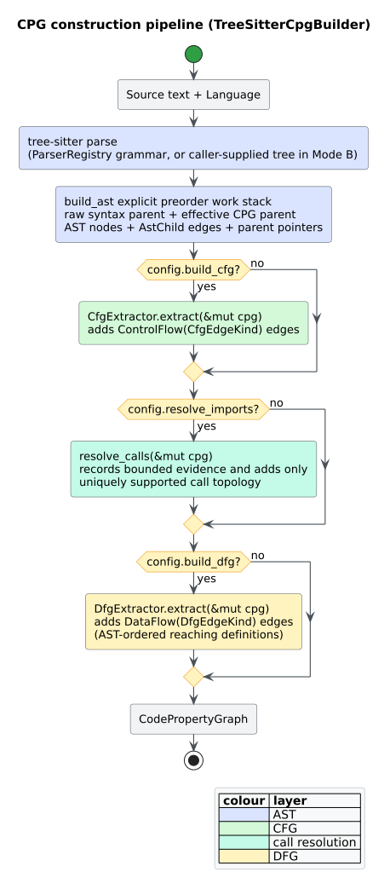

*Figure — the construction pipeline: parse (Mode A) or accept a caller-supplied
tree (Mode B), build the AST, then run config-gated CFG, call-resolution, and
DFG passes. Source:
[`diagrams/construction-pipeline.puml`](../diagrams/construction-pipeline.puml).*

Both entry points share one private post-parse pipeline.
`TreeSitterCpgBuilder::build` parses internally; `build_from_tree` accepts the
caller's tree. They then execute the same AST/CFG/resolution/DFG implementation,
so the two paths are byte-for-byte equivalent (a regression test asserts
identical node payloads and canonical typed edges).

```rust
// requires: features = ["lang-rust"]   (build() needs a grammar; default = [] has none)
use libcpg::{TreeSitterCpgBuilder, CpgBuilder, Language};

fn demo() -> libcpg::Result<()> {
    let builder = TreeSitterCpgBuilder::new();
    let cpg = builder.build("fn main() { let x = 1; let y = x; }", Language::Rust)?;
    println!("{} nodes, {} edges", cpg.node_count(), cpg.edge_count());
    Ok(())
}
```

### Stage 0 — parse

`build(source, language)` looks the language up in the [`ParserRegistry`](../GLOSSARY.md#tree-sitter), enforces `config.max_file_size` (default 10 MiB), and parses with tree-sitter before entering the shared pipeline. `build_from_tree(&tree, source, language)` skips the size check (the caller already owns the tree) and is the only path for [Rholang](../GLOSSARY.md#rholang)/[MeTTa](../GLOSSARY.md#metta). If no grammar is registered for `language` — the situation for *every* language under `default = []` — `build` returns `Error::UnsupportedLanguage`. The two modes are detailed in [`language-frontends.md`](language-frontends.md).

### Stage 1 — AST construction

`build_from_tree` walks the tree-sitter tree with the explicit preorder work
stack in `build_ast`. For each retained node it:

1. asks the `NodeMapper` whether to keep the node (`should_include_node`, which drops punctuation, comments unless configured, and language-specific wrappers/tokens);
2. maps the grammar's node-kind string to a `CpgNodeKind` (`map_kind`) and,
   where applicable, a language-neutral `MsgKind` (`message_kind`);
3. records a `SourceRange` from the tree-sitter byte offsets;
4. adds the node and, if it has a parent, wires an `AstChild` edge; and
5. marks `Function` nodes as CFG entry points.

`connect(.., AstChild)` owns all redundant bookkeeping in step 4: it appends to
the parent's ordered child index and maintains the child's parent pointer while
inserting the edge. `ast_children` then borrows the index without allocation,
while `ast_parent`/`ast_ancestors` read the back-pointer. Centralizing this
invariant prevents parser and fixture builders from drifting apart.
[`graph-data-model.md`](graph-data-model.md#recovering-source-order) specifies
source-order recovery, including explicit-id reconstruction and malformed
multi-parent graphs.

### Stage 2 — CFG extraction

`CfgExtractor` adds [`ControlFlow`](../GLOSSARY.md#control-flow-graph-cfg) edges. It is a plain struct, constructed with `new()` or `with_config(..)`, and `extract` takes `&mut cpg` and returns `()`:

```rust
// Feature-free: the extractors live in `builder`, always compiled.
use libcpg::{CfgExtractor, CfgExtractorConfig};

// Default config; or customise the three switches:
let cfg = CfgExtractorConfig { include_fallthrough: true, include_exceptions: true, include_call_edges: true };
CfgExtractor::with_config(cfg).extract(&mut cpg);
```

For each function it takes the **last AST child as the body**, connects the
function to that body with a `Sequential` edge, then evaluates the body with a
typed heap pushdown machine. `Enter`/`Leave` frames own active-path lifecycle;
construct-specific continuations own source-order child scheduling and exact
edge emission; a value stack carries completed exit sets. `CfgContext` carries
the enclosing loop/try stacks so `break`/`continue`/`throw` target the right
place. The complete former handler recursion component was defunctionalized
together, so valid or malformed AST depth does not consume native call frames.

The 14 `CfgEdgeKind` variants — the real vocabulary, replacing the invented `BranchTrue`/`BranchFalse`:

| `CfgEdgeKind` | Meaning |
|---------------|---------|
| `Sequential` | Fallthrough to the next statement |
| `ConditionalTrue` | Branch taken when the condition holds |
| `ConditionalFalse` | Branch taken when the condition fails |
| `LoopBack` | Back edge to the loop head |
| `LoopExit` | Edge leaving the loop |
| `Break` | `break` out of a loop |
| `Continue` | `continue` to the loop head |
| `Return` | Edge to the function exit |
| `Throw` | Exception raised |
| `Catch` | Exception caught by a handler |
| `Call` | Edge into a callee |
| `CallReturn` | Edge back from a callee |
| `Case` | `match`/`switch` case edge |
| `DefaultCase` | Default/`else` case edge |

From the resulting CFG, libcpg derives [cyclomatic complexity](../GLOSSARY.md#cyclomatic-complexity) (McCabe [[6]](#references)) as

```math
M = E - N + 2
```

where $`E`$ and $`N`$ are the CFG edge and node counts of a single-entry/single-exit component. `cpg.cyclomatic_complexity()` computes it directly.

### Stage 3 — evidence-bounded call resolution

When `CpgBuilderConfig::resolve_imports` is `true`, the feature-free
[`resolve_calls`](../components/graph/call-resolution.md) post-pass builds
lexical scope symbols and classifies every processed call. Only one uniquely
supported in-graph target becomes `Call::target` plus labeled
`Reference`, `StaticCall`/`DynamicCall`, and `CallSite` edges.
Ambiguous, external, and unresolved outcomes remain out-of-graph evidence
records. Running this stage before the DFG activates its existing parameter and
return-value construction without guessing call topology. The option defaults
to `false`, so prior construction shape is unchanged.

#### Optional post-C1 virtual-call type refinement

After the graph carries nominal ownership, `Inherits`/`Implements`, receiver
types, and normalized constructor evidence, callers can pass the C1 report to
[`devirtualize`](../components/graph/type-refinement.md). The immutable
feature-free pass computes one of three represented closed-world target sets:
CHA over compatible concrete subtypes, RTA over allocated compatible types, or
VTA over allocated types found in definitions reaching this receiver.

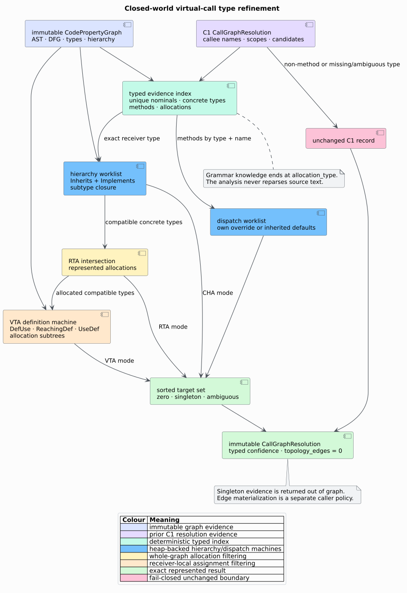

The result replaces out-of-graph candidates and sets a target only for a
singleton; it emits no topology. This step is not part of automatic builder
construction because its closed-world assumption is a caller policy. See
[ADR-0052](../design/0052-closed-world-type-refinement.md) and
[Usage 25](../usage/25-virtual-call-type-refinement.md).

This subsection is adjacent to C1 to show the dependency between reports, not
to place VTA before data flow. CHA/RTA can run once their typed evidence exists;
VTA requires Stage 4's DFG and is normally invoked after the builder returns.

### Stage 4 — DFG extraction

`DfgExtractor` adds [`DataFlow`](../GLOSSARY.md#data-flow-graph-dfg) edges. Its strategy is **[AST-ordered reaching definitions](../GLOSSARY.md#ast-ordered-reaching-definitions)** — a single flow-sensitive sweep over AST nodes in source order — **not** [SSA](../GLOSSARY.md#static-single-assignment-ssa) and **not** a classical CFG fixed point. (Two earlier CFG-based approaches remain in the source under `#[cfg(any())]`, never compiled, as an executable record of why they failed: nested-expression identifier uses are not CFG nodes, so a CFG-keyed reaching set never reached them.)

```rust
use libcpg::{DfgExtractor, DfgExtractorConfig};

let cfg = DfgExtractorConfig {
    include_field_access: true,
    include_parameters: true,
    include_return_values: true,
    track_aliases: false,   // more expensive; off by default
    max_iterations: 100,    // compatibility cap for the retired CFG fixed point
};
DfgExtractor::with_config(cfg).extract(&mut cpg);
```

The sweep abstract-interprets the function body in execution order, threading a `ReachingEnv` (a map from each bound name to the set of definitions currently reaching it). In literate form:

```text
visit_reaching(node, env, conditional):
  match node.kind:
    Variable{name} | Parameter{name}:
        visit each child EXCEPT the binder identifier   # the initializer's uses see the pre-binding env
        bind_definition(env, name, node, conditional)   # gen; strong-update in straight-line, weak in a branch
    Assignment{op}:
        if op is "=" and target is a plain identifier:  # simple write: target is not a read
            visit RHS children only
        else:                                            # compound (+=) or complex l-value: target is a read too
            visit all children
        if target is an identifier: bind_definition(env, target_name, node, conditional)
    Identifier{name}:                                    # a USE
        for def in env[name]: record edge  def --DefUse--> node
    _ (blocks, calls, control flow, ...):
        child_conditional = conditional or is_conditional_region(node)   # branch/loop body ⇒ weak updates
        passes = 2 if node is a loop else 1              # sweep loop bodies twice for loop-carried deps
        for _ in 0..passes: for child in ast_children(node): visit_reaching(child, env, child_conditional)
```

A [strong update](../GLOSSARY.md#strong-update--weak-update) (kill + gen; the latest write wins) applies in straight-line context; inside a [conditional region](../GLOSSARY.md#strong-update--weak-update) a weak update *adds* a definition without killing, so a write on one path cannot erase a write on another — a sound over-approximation (extra edges, never a missing one). This is what threads a definition into a deeply nested use such as `buf` in `decode(buf)` — precisely the case the retired CFG-based passes missed. The pass is intraprocedural, bounded, language-agnostic (it dispatches on `CpgNodeKind`, never grammar specifics), and **idempotent**: an edge is added only if an identical one does not already exist, so re-running `extract` is a no-op.

Beyond the core def-use sweep, three auxiliary builders run under their config
switches: `build_parameter_edges` (argument → `Parameter`),
`build_return_edges` (returned expression → caller, `ReturnValue`), and
`build_field_access_edges`. The last emits receiver reads, assignment-origin
`FieldWrite`/`IndexWrite`, index dependencies, and a conservative
`MemberAccess -> Field` `Reference` for uniquely supported `self`/`this`
accesses. The 13 `DfgEdgeKind` variants — replacing the invented
`UseUse`/`Phi`:

| `DfgEdgeKind` | Meaning |
|---------------|---------|
| `DefUse` | A definition reaches this use (the primary edge) |
| `UseDef` | Use back to its definition |
| `ReachingDef` | A reaching definition |
| `DataDependency` | Generic value dependency |
| `Parameter` | Argument passed to a parameter |
| `ReturnValue` | Value returned to a caller |
| `FieldRead` / `FieldWrite` | Object field read / write |
| `IndexRead` / `IndexWrite` | Indexed/array read / write |
| `Alias` | Aliasing between names (opt-in) |
| `Dereference` | Pointer dereference |
| `AddressOf` | Address-of |

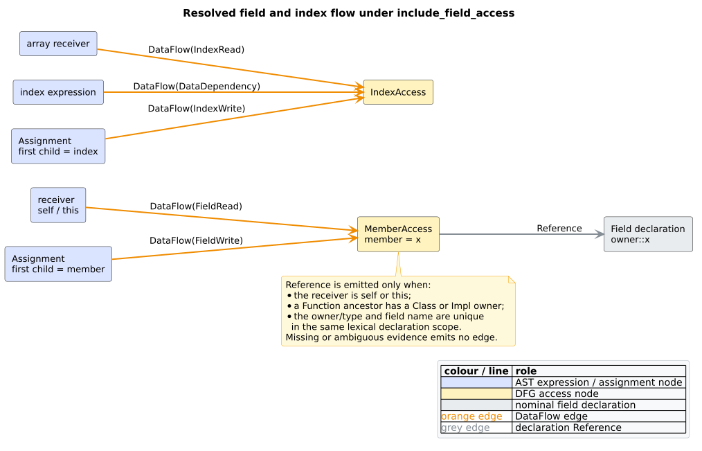

*Figure — typed read/write flow and the evidence-bounded declaration reference.
Source: [`diagrams/member-field-flow.puml`](../diagrams/member-field-flow.puml).*

Public helpers expose the same information as [def-use chains](../GLOSSARY.md#def-use-chain--definition--use): `Definition`/`DefinitionKind`, `Use`/`UseKind`, `DefUseChain`, and `build_def_use_chains(&cpg, function)`. Graph queries read the overlay directly — `reaching_definitions(use_site)`, `uses_of_definition(def)`, `dfg_successors`/`dfg_predecessors`. The DFG builder is dissected in [`../components/builder/dfg.md`](../components/builder/dfg.md); the theory of reaching definitions (Kildall's lattice framing [[5]](#references); the gen/kill formulation of the dragon book [[13]](#references)) is in [`../theory/03-data-flow-and-reaching-definitions.md`](../theory/03-data-flow-and-reaching-definitions.md).

### Config gating and idempotency

`CpgBuilderConfig.build_cfg` and `build_dfg` (both default `true`) decide whether stages 2 and 3 run during `build`/`build_from_tree`; disable one to get a cheaper partial graph, or run the extractors yourself later. Because all three of `CfgExtractor::extract`, `DfgExtractor::extract`, and `PdgBuilder::build` are [idempotent](../GLOSSARY.md#idempotent), re-applying them never duplicates edges.

### Optional exact per-function plan reuse

The cached Mode-A/Mode-B entry points always repeat parsing and AST
construction, then derive a canonical key for each function and requested
overlay. A digest selects a bucket, but full key bytes decide equality. A hit
contains only function-local ordinals, which are validated and expanded into
the newly built graph before the ordinary ordered emitter mutates it. A miss or
cross-boundary dependency uses the same fresh stack-safe planner as the
non-cache API.

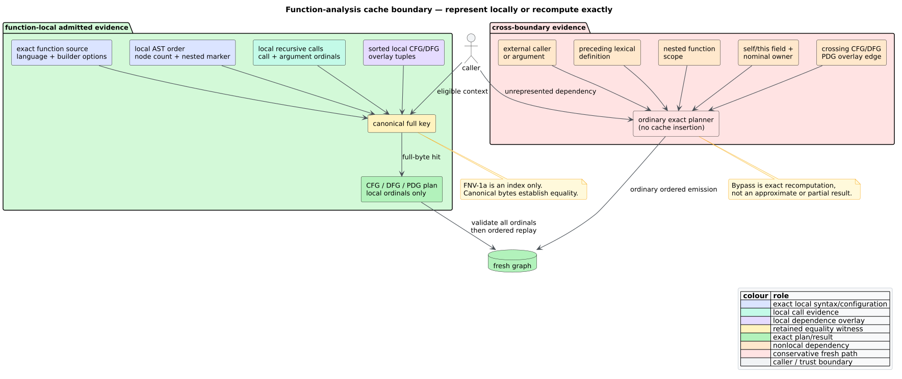

*Figure — local source/tree/overlay evidence may form a reusable plan;
cross-function evidence takes the ordinary exact path. Source:
[`diagrams/function-analysis-cache-boundary.puml`](../diagrams/function-analysis-cache-boundary.puml).*

The caller owns cache lifetime and hard entry/byte bounds. There is no global
state, background worker, parser cache, persistence format, or hidden I/O. See
[ADR-0062](../design/0062-bounded-function-analysis-cache.md) and the
[security boundary](../security/21-incremental-cache-boundary.md).

## The analysis pipeline

A constructed CPG is the substrate for several independent analyses. Each consumes the overlays built above; none of them run during construction.

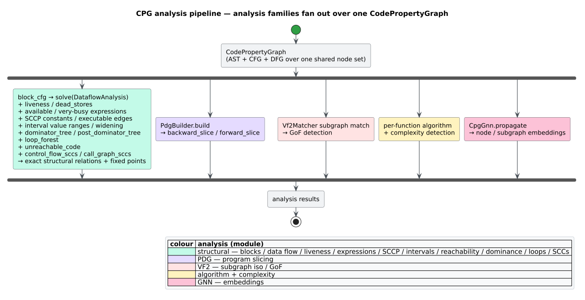

*Figure — a constructed CPG fans out to exact structural and data-flow analysis, the on-demand PDG/slicer, the VF2 and GoF pattern detectors, the algorithm/complexity heuristics, and the GNN. Source: [`diagrams/analysis-pipeline.puml`](../diagrams/analysis-pipeline.puml).*

### Basic-block CFGs (feature-free)

Before cyclic analysis, `block_cfg(&cpg, function)` can project the reachable
function CFG into deterministic maximal sequential blocks. It retains original
node ids and typed inter-block edges, then precomputes post-order and reverse
post-order without mutating the CPG. See the
[basic-block component guide](../components/graph/basic-block-cfg.md).

### Monotone data-flow analyses (feature-free)

`solve` combines a `BlockCfg`, a caller-defined `Lattice` domain, and a
`DataflowAnalysis` transfer contract. Forward analyses use deterministic RPO;
backward analyses use post-order. Optional `LoopForest` evidence restricts
widening to loop headers, `SolverConfig` bounds visits and narrowing passes,
and `DataflowSolution::state_at` replays transfers inside a block. The engine
reads the CPG but never materializes edges or mutates payloads. See the
[monotone data-flow component guide](../components/graph/dataflow-framework.md).

The built-in `liveness(&cpg, function)` instance propagates canonical variable
facts backward with union and returns sorted per-node `live_in` / `live_out`
states. `dead_stores` then reports reachable non-parameter definitions whose
value is not live after the write. It is read-only and advisory because generic
syntax does not model volatile, atomic, reflective, foreign, or setter effects.
See [variable liveness and dead stores](../components/graph/liveness-analysis.md).

The dual built-ins `available_expressions(&cpg, function)` and
`very_busy_expressions(&cpg, function)` intersect paths in forward and backward
directions. Canonical structural expressions are killed by definitions of any
operand. The reports expose per-node states plus conservative,
dominance-qualified CSE/PRE candidates without rewriting the CPG. See
[available and very-busy expressions](../components/graph/expression-analysis.md).

The separate `sccp(&cpg, function)` instance couples a flow-edge worklist with
a sparse AST/DFG value-cell worklist. Checked scalar folding can prove a boolean
guard, which prevents the rejected branch's definitions from joining later
uses. `SccpResult` exposes constants, executable/dead edges, and unreachable
nodes; `ReachabilityReport::refine_with_sccp` composes those value proofs with
the structural partition. Both APIs are deterministic, feature-free, and
read-only. See [sparse conditional constant
propagation](../components/graph/sccp-analysis.md).

The `value_ranges(&cpg, function)` instance propagates sorted integer interval
environments forward. Typed comparison edges intersect one variable with a
half-line; loop headers widen after three visits, and two descending sweeps
recover finite bounds. Local unary/binary evaluation uses a typed heap
continuation machine, keeping native call depth constant as AST depth grows.
The immutable `IntervalReport` is keyed by basic-block leader. See [interval value-range
analysis](../components/graph/interval-analysis.md).

### Strongly-connected components (feature-free)

`control_flow_sccs(&cpg, function)` partitions one function's intraprocedural
CFG; `call_graph_sccs(&cpg)` partitions the resolved function call graph. Both
return deterministic components, explicit cycle classification, node membership,
and the acyclic condensation graph. The analysis is exact for the projected
edges and does not guess unresolved calls. See the
[SCC component guide](../components/graph/scc-analysis.md) for the full contract.

### IFDS/IDE procedure summaries (feature-free)

`solve_summaries` combines the current call-graph SCC decomposition with a
caller-defined `SummaryDomain`. It validates the public decomposition against
the CPG, removes condensation sinks in stable callee-first order, evaluates
acyclic functions once, and iterates self/mutually recursive components from
lattice bottom under explicit caps. Results, retained seeds, cap events, and
structural/domain issues stay out of graph in ordered collections; the solver
does not mutate the CPG or create another graph store.

The interprocedural trait is namespaced as `analysis::ifds::Lattice` and
re-exported as `IfdsLattice`, distinct from the block-CFG `Lattice` above.
`CalleeRef` keeps represented, external, and unresolved boundaries explicit.
See the [IFDS/IDE component guide](../components/graph/ifds-ide-framework.md)
for the domain contract and [Theory 25](../theory/25-ifds-ide-summary-solving.md)
for the SCC fixed point.

### Effect summaries (feature-free)

`analyze_effects` instantiates that summary framework without adding a second
intermediate representation. It derives direct global, parameter, and field
places from typed CPG nodes and DFG edges; composes resolved callee summaries;
and reuses SCCP's checked scalar operators for constant returns. External or
unresolved calls, throws, awaits, and yields widen purity to `Impure`.

The result remains out of graph and keeps the shared cap and structural-issue
evidence. Domain-local expression and dependence traversals use the shared
depth cap; reaching it widens return-flow and constant facts instead of
silently asserting precision. See the [effect-summary component
guide](../components/graph/effect-summaries.md) and [Theory
26](../theory/26-interprocedural-effect-lattice.md).

### Taint and maybe-null summaries (feature-free)

`analyze_taint_report` and `analyze_null_flows_report` are two more lawful
summary domains over the same callee-first fixed point. They propagate facts
through typed AST value composition and `DataFlow` edges, classify represented
call paths with caller-owned catalog data, and retain canonical predecessor
chains as evidence. They do not parse or match source text.

Resolved calls compose callee parameter-to-return and parameter-to-sink jump
functions through typed actual arguments. Cataloged external calls instead
apply an explicit passthrough, havoc, source, sink, or sanitizer model.
Domain-local traversals and output retention use `IfdsCaps`; a reached bound is
visible in the report and its affected witnesses. See the [taint component
guide](../components/graph/taint-analysis.md) and [Theory
27](../theory/27-interprocedural-taint-and-nullflow.md).

`condensation_metrics(&sccs, &options)` continues that pipeline without
revisiting the CPG. A minimum-id Kahn order drives source-oriented longest-path
levels and an SCC-member-weighted critical path; optional
`coffman_graham(&sccs, width)` produces sink-oriented width-bounded scheduling
layers. Both are feature-free, iterative, canonical by component id, and
out-of-graph. See [condensation-DAG
analytics](../components/graph/condensation-analysis.md) for the two layer
orientations, cap/error contract, and exhaustive path/schedule oracles.

`infer_layering(&sccs, &metrics)` reverses the source-oriented longest-path
levels into bottom-first architectural indices. It emits one component-level
witness for every cyclic SCC plus skip-layer and non-downward cross-edge
witnesses. The report stays out of graph and every unflagged condensation edge
descends exactly one layer. See [architectural layering
inference](../components/graph/layering-analysis.md).

`analyze_dsm(&projection)` takes any valid directed `GraphProjection` and
computes non-reflexive transitive visibility fan-in/fan-out plus propagation
cost without materializing a closure matrix. `classify_core_periphery` uses
inclusive medians for four comparative roles and calls `projection_sccs` for
the largest multi-vertex cyclic group. The two total reports retain exact
stable-node provenance and reject malformed, mismatched, or over-50,000-node
inputs explicitly. See [DSM visibility and core–periphery
analysis](../components/graph/dsm-analysis.md).

`martin_metrics(&cpg, &assignment, &projection)` combines that validated
directed topology with an explicit node-to-module boundary. It counts distinct
external afferent/efferent vertices, derives abstractness from assigned CPG
type declarations, and returns instability and main-sequence distance in
lexical module order. `sdp_violations` then retains one concrete stable-node
edge for every module dependency that points from a more stable source to a
less stable target. See [Martin package metrics and SDP
analysis](../components/graph/martin-metrics.md).

`ck_metrics(&cpg, &options)` discovers selected nominal types, obtains each
type's real method–field graph from resolved `Reference` edges, and combines
that evidence with inheritance, type-use, and resolved-call topology for CK
and LCOM1–5 values. `function_metrics(&cpg, function)` independently walks one
semantic function scope to classify Halstead operators/operands and derive
cyclomatic, cognitive-complexity, and maintainability values. Both paths are
feature-free, deterministic, read-only, and exclude nested functions. See
[code metrics](../components/graph/code-metrics.md).

`architecture_smells(&projection, &sccs, &martin, &assignment, &options)`
validates those artifacts as one snapshot before running four independent
detectors. Multi-node SCCs, two-sided degree hubs, source modules with a high
share of dependencies toward greater Martin instability, and assigned
node-count outliers become stable-node findings with named numerical evidence.
The analysis is feature-free, read-only, and advisory; invalid or mismatched
evidence fails closed. See [architectural-smell
analysis](../components/graph/architecture-smells.md).

The pure [`reflexion`](../components/graph/reflexion-model.md) path is adjacent
to, rather than dependent on, CPG projection analysis. A caller supplies both
ordered path-layer rules and observed path dependency edges; the kernel returns
deterministic conformance categories without reading the graph or filesystem.

`wl_labels(&projection, rounds)` validates the same projection contract, seeds
directed in/out degrees, and performs at most 16 incident-neighborhood
refinement rounds. `structural_clone_classes` converts equal final labels to
deterministically ordered stable `NodeId` groups. This path reads no source
payload, edge weight, or parser state; equal classes are candidate evidence
rather than an exact-isomorphism claim. Refinement alternates two call-local
dense vectors and reuses canonical/incident workspaces, preserving exact label
bits without graph mutation, cross-call cache state, or native recursion. See
the [WL component guide](../components/graph/wl-analysis.md).

The [centrality family](../components/graph/centrality-analysis.md) also reads
that validated projection. Directed forward/reverse CSR drives PageRank,
personalized PageRank, vertex Brandes, HITS, and dominators. A deterministic
undirected view drives edge Brandes, distance, spectral, Katz, and Burt
measures. Results retain stable node alignment or canonical edge order,
iterative algorithms record convergence, and all-sources algorithms check an
explicit work budget before traversal.

`louvain(&projection, options)` derives the same canonical weighted-undirected
view, performs bounded dense-order local moving, and contracts communities
between levels. Its immutable result remains aligned with the original stable
nodes and stores modularity recomputed on the original projection.
`try_refine_connected` can then split any internally disconnected assigned
group without mutating the projection. See [deterministic community
detection](../components/graph/community-detection.md).

The [cohesion family](../components/graph/cohesion-analysis.md) derives one
canonical simple-undirected topology for core, truss, low-link, robust-block,
assortativity, and ordered attack analysis. Global minimum cut follows a
separate finite-nonnegative weighted path. Every result maps back to stable
projection identifiers without changing the CPG.

[`try_algebraic_connectivity`](../components/graph/spectral-analysis.md) reuses
the simple-undirected unweighted path, detects disconnected components exactly,
and otherwise runs at most 1,000 sparse deflated power iterations. The returned
Fiedler vector and sign partition align with stable projection identifiers;
iteration count, convergence, and residual make numerical status explicit.

[`simple_cycles`](../components/graph/cycle-analysis.md) preserves directed
projection topology and reuses `projection_sccs` to skip acyclic regions. An
iterative DFS enumerates exact bounded cycle lengths in stable order, rotates
each witness to its minimum `NodeId`, and stops inside discovery when the count
cap is exceeded. The partial result includes the first omitted cycle, so a
bounded witness prefix cannot be mistaken for a complete census.

[`motif_census`](../components/graph/motif-analysis.md) also preserves directed
projection topology, but packs it into bounded dense bit rows. Exhaustive
triple enumeration returns the complete sixteen-class triad distribution;
quadruple enumeration tests the two selected graphlets. Both vertex ceilings
are checked before enumeration, so success means a complete census.

### Natural loops and nesting (feature-free)

`loop_forest(&cpg, function)` combines the same reachable intraprocedural CFG,
the dominator tree, and iterative SCC/DFS evidence. Dominating back-edge heads
produce exact natural-loop bodies; non-dominating retreating cycles produce
explicit whole-SCC irreducible regions. Strict body containment supplies roots,
parents, children, depth, and innermost node membership. See the
[loop-analysis component guide](../components/graph/loop-analysis.md) for the
complete semantics and validation.

`loop_induction(&cpg, function, &forest)` composes that forest with semantic
AST/DFG variable evidence and dominance. It returns per-loop invariant and
advisory-hoist sets, unique latch-dominating basic/one-level-derived induction
variables, and direction-compatible counted-trip evidence without mutating the
CPG. The analysis consumes semantic range nodes emitted by language frontends;
it never reparses source. See the [loop-induction component
guide](../components/graph/induction-analysis.md) for the exact proof
obligations and limitations.

### Program dependence and slicing (feature-free)

`PdgBuilder::build(&mut cpg, function)` adds the [PDG](../GLOSSARY.md#program-dependence-graph-pdg) overlay for one function: [`ControlDependence`](../GLOSSARY.md#control-dependence) edges (taken directly from the public [`PostDominatorTree`](../components/graph/dominator-analysis.md), which computes the CFG's [reverse dominance frontier](../GLOSSARY.md#dominance-frontier--reverse-dominance-frontier) using a synthetic exit, deterministic CHK post-dominators, and the Cytron et al. frontier walk [[3]](#references)) and [`DataDependence`](../GLOSSARY.md#data-dependence) edges (re-projected from the DFG's `DefUse`/`ReachingDef` edges), following Ferrante–Ottenstein–Warren [[2]](#references). With the PDG in place, [program slicing](../GLOSSARY.md#program-slicing) (Weiser [[7]](#references)) is a bounded breadth-first traversal:

```rust
use libcpg::{PdgBuilder, backward_slice, forward_slice};

PdgBuilder::new().build(&mut cpg, function);              // adds PDG edges (idempotent)
let bwd = backward_slice(&cpg, criterion, 256);           // nodes that can affect `criterion`
let fwd = forward_slice(&cpg, criterion, 256);            // nodes `criterion` can affect
// Both return FxHashSet<NodeId>; the last argument caps the slice size.
```

The full construction and worked slices are in [`../components/builder/pdg-and-slicing.md`](../components/builder/pdg-and-slicing.md) and [`../usage/04-program-slicing.md`](../usage/04-program-slicing.md).

For revision-to-revision reuse, `build_with_analysis_cache`,
`build_all_with_analysis_cache`, and
`build_all_parallel_with_analysis_cache` retain exact function-local PDG plans.
Any CFG/DFG edge that crosses the local ordinal domain causes recomputation.

### System dependence and context-sensitive slicing (feature-free)

`build_summary_edges(&mut cpg, &effects)` extends the on-demand PDG overlay
with caller-local `DataDependence(label="summary")` edges. It selects actual
arguments from each resolved callee's `EffectSummary::param_to_return` mask;
`Parameter` and `ReturnValue` DFG edges remain the interprocedural spine.

`interprocedural_backward_slice` and `interprocedural_forward_slice` then run
two masked phases over those edges. The backward driver first excludes
`ReturnValue` while ascending and then excludes `Parameter` while descending.
The forward driver swaps those two interprocedural families because their
directions are dual. Stable neighbor sorting, `BTreeMap` depth state,
`BTreeSet` output, and explicit `SliceCaps` make both the complete result and a
node-capped prefix deterministic.

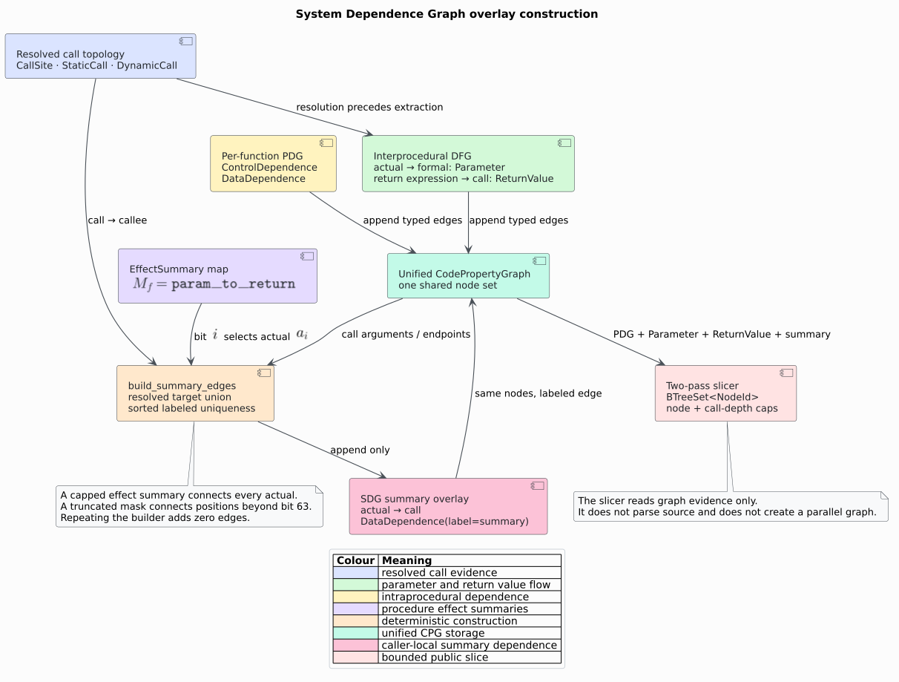

See the [component guide](../components/graph/system-dependence-slicing.md),
[Theory 28](../theory/28-system-dependence-and-slicing.md), and [Usage
11](../usage/11-interprocedural-slicing.md).

### Channel topology and linearity (feature-free)

During AST construction, a language frontend can attach `MsgKind` metadata
without replacing a node's structural `CpgNodeKind`. The Rholang mapper uses
this seam for asynchronous/synchronous sends, linear/persistent/peek receives,
select, and parallel spawn. This is the only grammar-specific stage.

`extract_events` then visits top-level function scopes, orders event sites by
`NodeId`, and resolves a channel only when an event-local identifier reaches a
`Variable` through `Identifier::definition`, `DefUse`/`ReachingDef`, or
`Reference`. `channel_report` groups resolved events by that stable identity
and returns ordered orphan-send, blocked-linear-receive, and non-deterministic-
consumption evidence. Both functions are read-only and advisory.

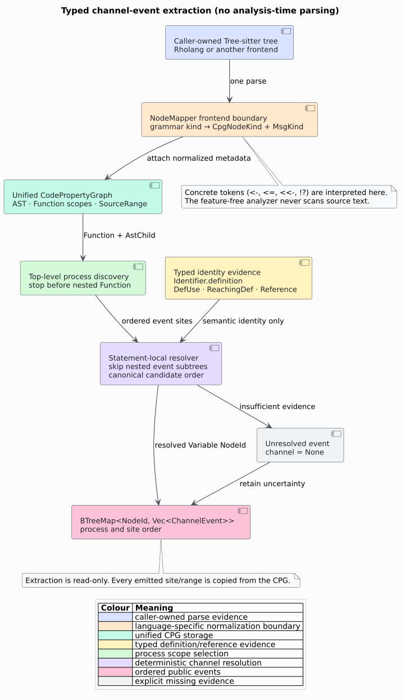

See the [component guide](../components/graph/channel-topology.md), [Theory
29](../theory/29-channel-topology-and-linearity.md), and [Usage
12](../usage/12-channel-topology.md).

### Deadlock projections and lexical capture (feature-free)

`communication_deadlocks` consumes the ordered channel sequences above and
typed `LockKind` calls. It builds a process wait-for projection for initial
linear receives and a lock-resource order projection for direct and resolved-
callee acquisitions. Both use `GraphProjection::External` and the shared
`projection_sccs` engine; neither relation is written back into the CPG.

The DFG seeds each function with lexically preceding outer definitions before
walking its own body. This lets Rholang contracts enclosed by one `new` share
channel definitions. The seed stops at `Function` nodes, so locals from a
preceding sibling function cannot leak.

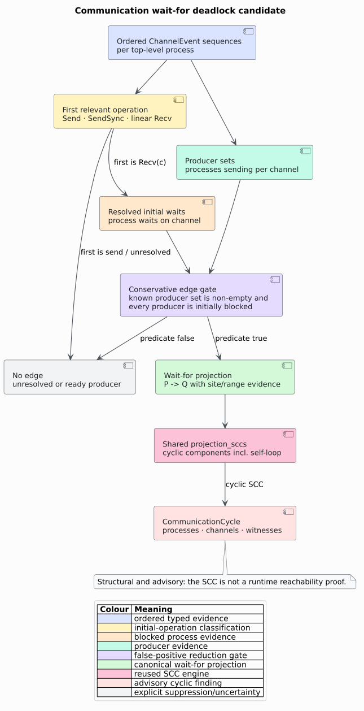

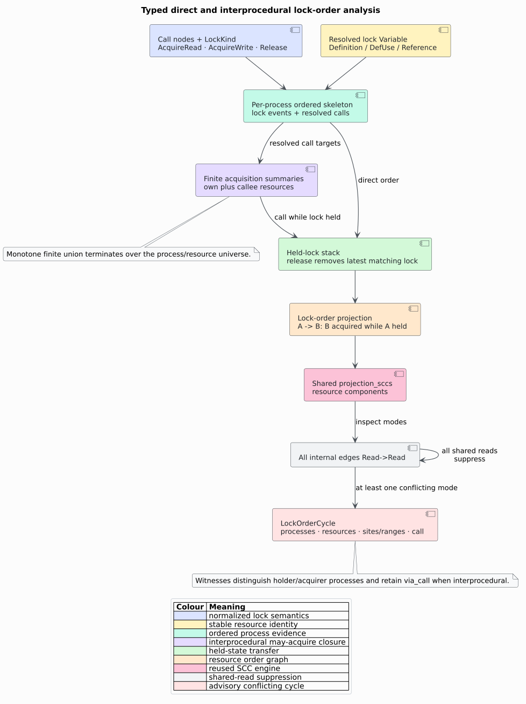

See the [component guide](../components/graph/deadlock-analysis.md), [Theory
30](../theory/30-cyclic-wait-and-lock-order.md), and [Usage
13](../usage/13-deadlock-candidates.md).

### May-happen-in-parallel relation (feature-free)

`may_happen_in_parallel` consumes the same typed `MsgKind::Spawn` boundary but
uses only AST structure. Each direct child of a parallel block is one operand
root, whether it is a direct process node or a wrapper block. Cycle-guarded
subtree walks collect execution sites while stopping at nested functions;
cross-products between distinct operands become canonical symmetric pairs.

The relation is immutable and out of graph. Ordered traversal and storage make
it deterministic, while `MAX_MHP_PAIRS` bounds quadratic materialization and
`MhpRelation::capped` exposes incomplete output.

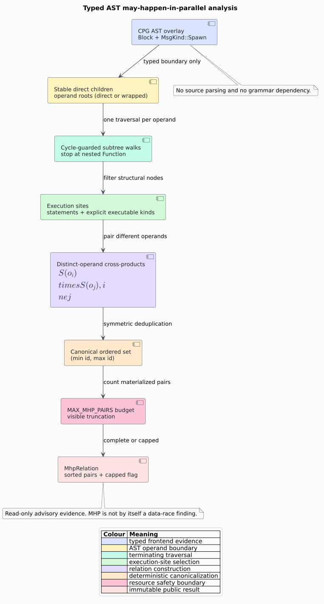

See the [component guide](../components/graph/mhp-analysis.md), [Theory
31](../theory/31-may-happen-in-parallel.md), and [Usage
14](../usage/14-may-happen-in-parallel.md).

### Race and atomicity candidates (feature-free)

`race_candidates` and `atomicity_candidates` consume a caller-supplied MHP
relation rather than changing it. Typed field/index DFG edges plus one exact
`Reference`, or typed channel metadata plus resolved identity, first become
access facts. Iterative parent machines lift expressions to executable sites
and execution strands. A source-ordered state machine replays typed lock
acquisitions/releases and snapshots exact held-lock instances.

The race path merge-joins locations attached to each MHP pair and retains
write conflicts without a common excluding lock. The atomicity path finds an
adjacent same-location read/write split across release/reacquire of a guard,
then requires an other-strand access that is MHP with both endpoints and not
excluded by a different continuously held acquisition. Both paths are
deterministic, stack-safe, immutable, and advisory.

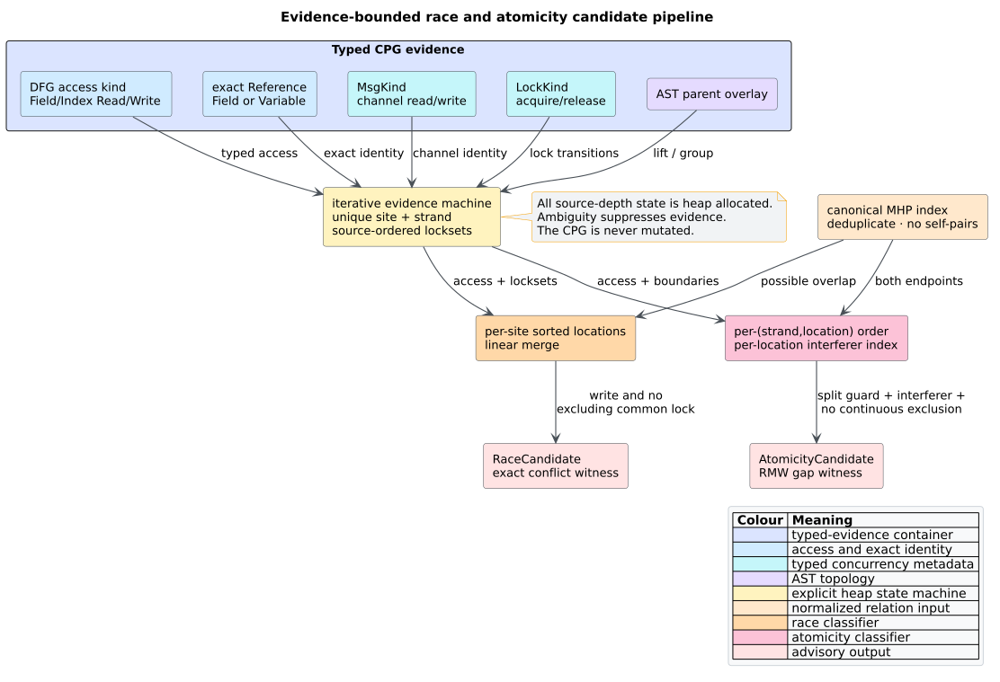

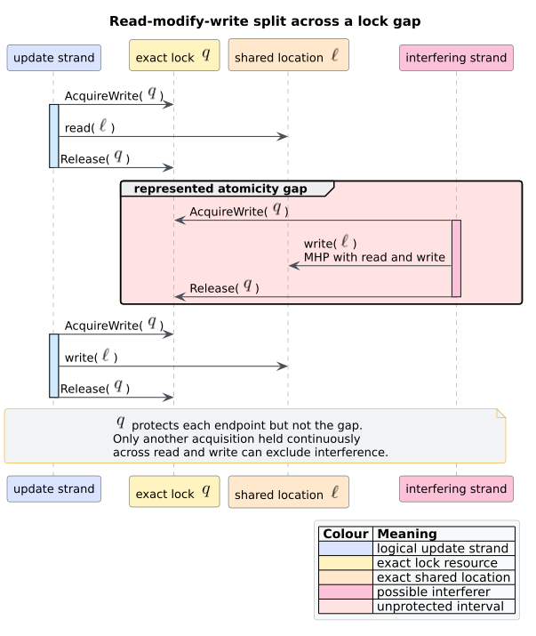

See the [component guide](../components/graph/concurrency-bug-detection.md),
[Theory 43](../theory/43-evidence-bounded-race-and-atomicity.md), and [Usage
26](../usage/26-concurrency-bug-candidates.md).

### Deterministic external-ML representations (feature-free)

`export_pyg` reads the immutable whole CPG and first replaces internal graph
order with ascending stable `NodeId` coordinates. One typed edge pass produces
nine-layer in/out degrees and a complete relation-class edge list. Independent
heap-backed passes compute AST depth/knownness/loop depth and canonical
forward/reverse PageRank. Optional localization traverses the complete backward
PDG slice before its caller cap is checked. The row assembler then aligns 69
named values with stable ids and source ranges.

`ast_paths` takes a separate function-local route. It collects AST descendants
without entering nested functions, normalizes exact `AstChild` parents and
source-ordered child slots, and walks every terminal parent chain with heap
vectors and generation marks. Shared chain suffixes identify the lowest common
ancestor; admitted terminal pairs retain their entire upward/downward path,
aligned kind classes, exact endpoints, and tokens.

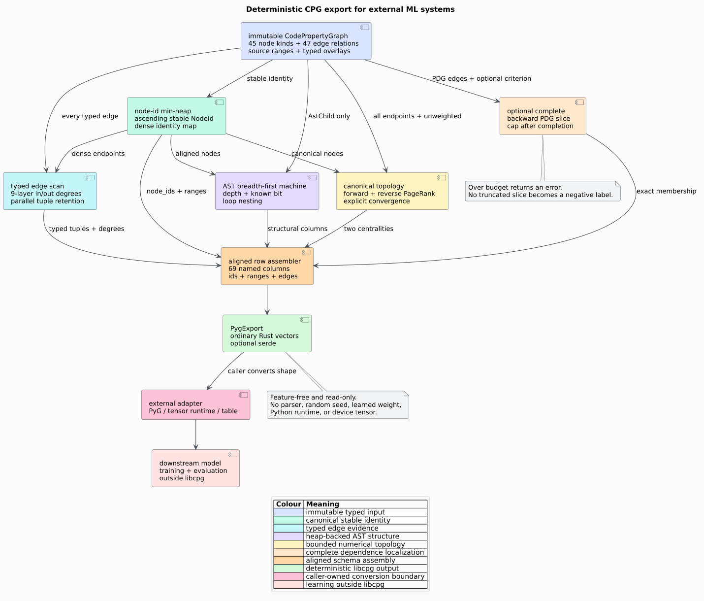

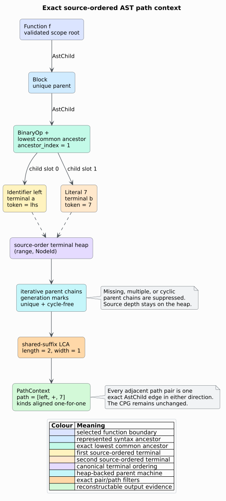

Both outputs remain out of graph and contain no learned weights or tensor-
runtime objects. The optional `gnn` module is a distinct randomly initialized,
untrained structural embedder; it is not the canonical interchange path.

See the [component guide](../components/graph/ml-export.md), [Theory
44](../theory/44-deterministic-cpg-ml-representations.md), and [Usage
27](../usage/27-ml-export-and-ast-paths.md).

### Deterministic CPG version diff (feature-free)

`cpg_diff` admits two immutable CPGs under independent node/edge limits, reuses
the bounded forward/reverse/delete-all GED assignment, and exposes the retained
canonical old-to-new node correspondence. It translates embedded node ids
through that map, compares complete node payloads, and consumes exact directed
typed/labelled edge occurrences before pairing same-endpoint leftovers as
substitutions.

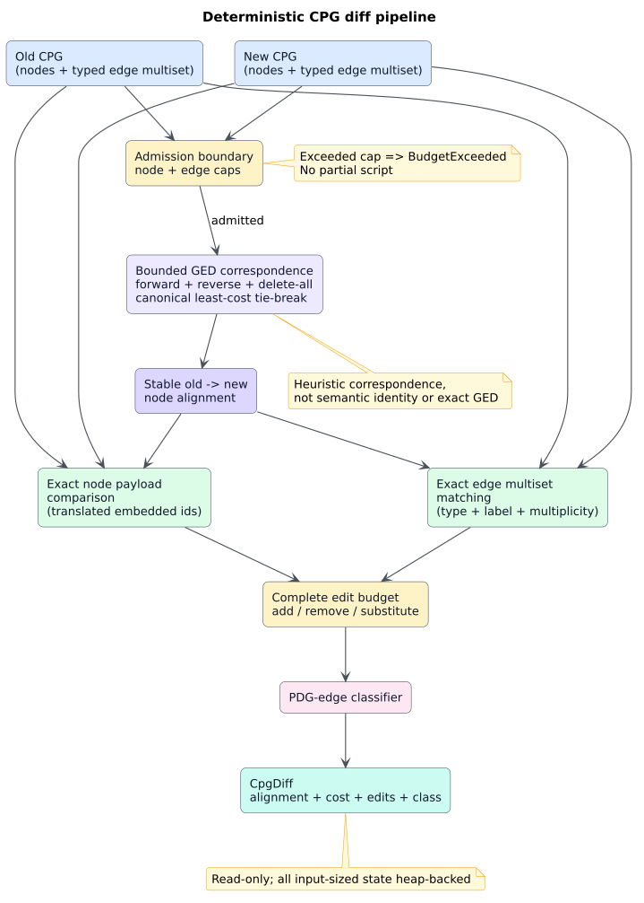

The output budget covers every addition, deletion, and substitution. Exceeding
it fails the whole operation, so an omitted suffix cannot hide the PDG edge
that decides `ChangeKind`.

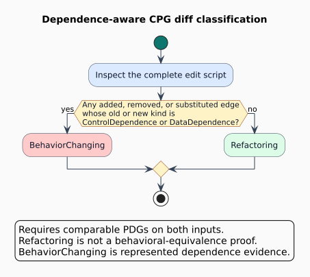

Build comparable PDGs on both inputs before interpreting the classification.
`Refactoring` means only that the complete script changed no represented
control/data-dependence edge; it does not prove runtime equivalence.
Container metadata is outside the node/edge structural flow.

See the [component guide](../components/graph/cpg-diff.md), [Theory
45](../theory/45-deterministic-cpg-diff.md), and [Usage
28](../usage/28-cpg-diff.md).

### Session-protocol sketches (`rholang`)

`session_sketches` reuses the ordered, definition-resolved events above. It
groups actions by channel and top-level process, excludes the exact channel
operand while inferring shallow event-local payload types, and compares exactly
two endpoint vectors for linear binary duality. Known direction, length, arity,
or type conflicts are nonconformant; missing types, non-linear receives, and
non-binary participation remain inconclusive.

The module is gated by `rholang`, deterministic, read-only, and out of graph.
The analyzer consumes typed CPG evidence and never inspects Rholang source text.

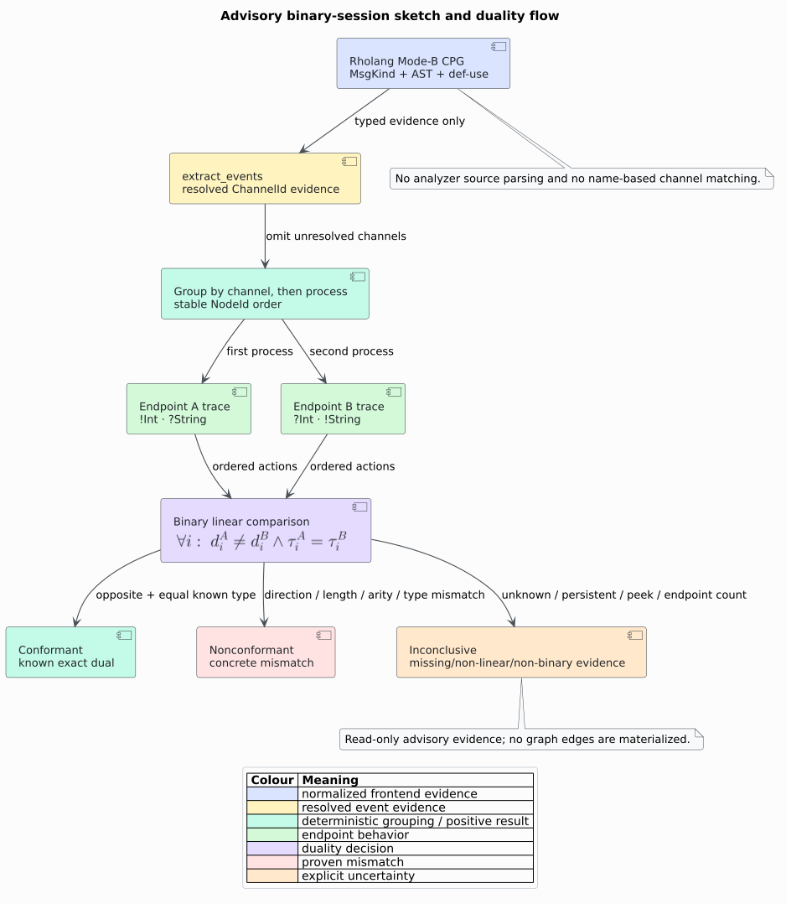

See the [component guide](../components/graph/session-analysis.md), [Theory
32](../theory/32-session-protocol-duality.md), and [Usage
15](../usage/15-session-protocol-sketches.md).

### Finite-state typestate properties (feature-free)

`analyze_typestate` combines a caller-owned `PropertyFsm` with four existing
CPG views: typed callee/target evidence classifies events, DFG/reference/alias
relations carry allocation-site object identity, the canonical function CFG
orders property transfer, and `IfdsCaps` qualifies finite resource use.
Policy-dependent `(object, state)` facts and witnesses remain immutable and out
of graph.

The flow is intentionally intraprocedural and finite. Ordered heap worklists
propagate may-facts until no new object/state pair reaches a CFG point. Missing
ordinary transitions enter an absorbing error state; missing graph or event
evidence instead makes the report incomplete. Terminal accepting-state policy
is exposed separately from forbidden-transition findings.

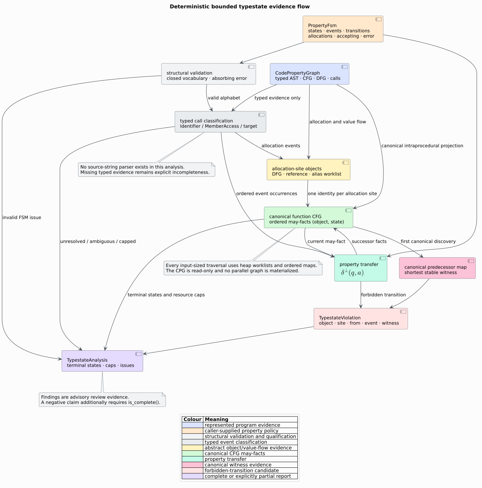

See the [component guide](../components/graph/typestate-analysis.md), [Theory
33](../theory/33-finite-state-typestate-properties.md), and [Usage
16](../usage/16-typestate-analysis.md).

### Evidence-composed bug detectors (feature-free)

`analysis::bugs` fans normalized evidence into three read-only paths. Resource
leaks project non-accepting `TypestateTerminal` values. Uninitialized uses reuse
the shared binder-aware variable facts and function-scoped reaching
definitions. Exception flow reuses the call-graph SCC summary solver, normalized
`Throw`/`Catch` nodes, typed `Catch` CFG entry, nominal type/inheritance
evidence, and lexical AST handler nesting.

No detector constructs a private parser or parallel graph. Ordered heap
worklists retain source/graph depth off the native stack, and each report keeps
the caps or structural issues needed to qualify an empty result.

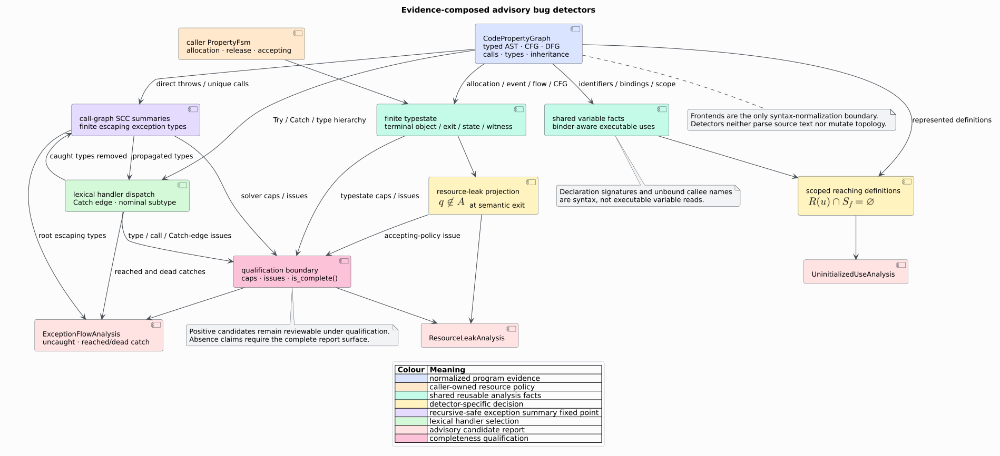

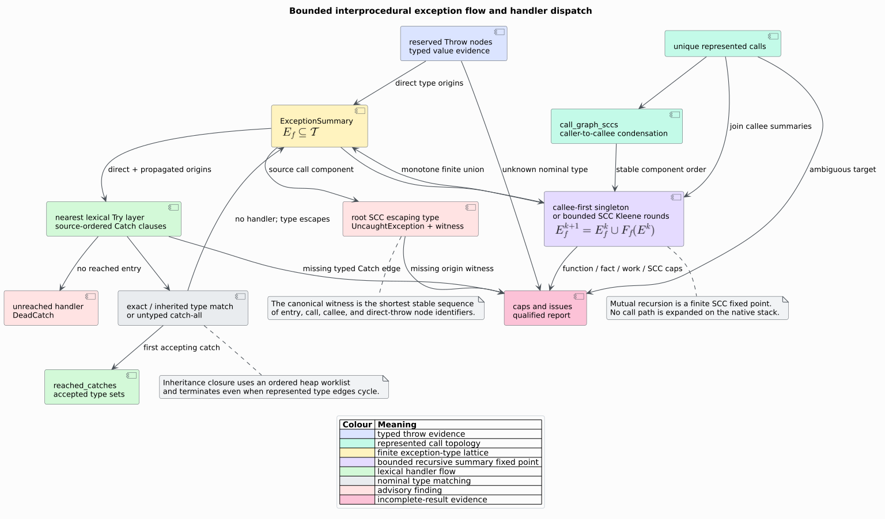

See the [component guide](../components/graph/bug-detectors.md), [Theory
34](../theory/34-advisory-bug-detection.md), and [Usage
17](../usage/17-advisory-bug-detectors.md).

### Exact population anomaly detectors (feature-free)

`analyze_missing_checks` selects sensitive calls through the caller's taint
catalog, identifies APIs through represented targets or typed callee paths,
normalizes PDG control checks into flat semantic tapes, and compares same-API
peers globally or within a bounded call-graph neighborhood.
`analyze_deviant_behavior` uses intraprocedural CFG reachability and forward
DFG/PDG value evidence to infer later-call and return-check beliefs.

Both paths store observed and required support as integer fractions. Threshold
decisions use widened cross multiplication, so the 4/5 and 9/10 oracles have no
floating-point boundary. Incomplete sites are excluded from inference and
retained as typed issues. AST, call-neighborhood, CFG, and value traversals use
heap worklists or flat postorder tapes; the graph remains unchanged.


See the [component guide](../components/graph/population-anomaly-detectors.md),
[Theory 35](../theory/35-population-anomaly-inference.md), and [Usage
18](../usage/18-population-anomaly-detectors.md).

### Clone and path-feasibility advisories (feature-free)

I8 follows `CodePropertyGraph → exact Type-2/3 pairs → flat typed AST tapes →
bounded alignment + GED → dominant rename/aligned guard evidence → qualified
findings`. I9 follows `CodePropertyGraph → typed guard root + SCCP + exact
guard-local interval state → heap Boolean continuation machine → qualified
branch/redundancy/contradiction findings`. Both paths are out-of-graph and keep
supporting providers independent.

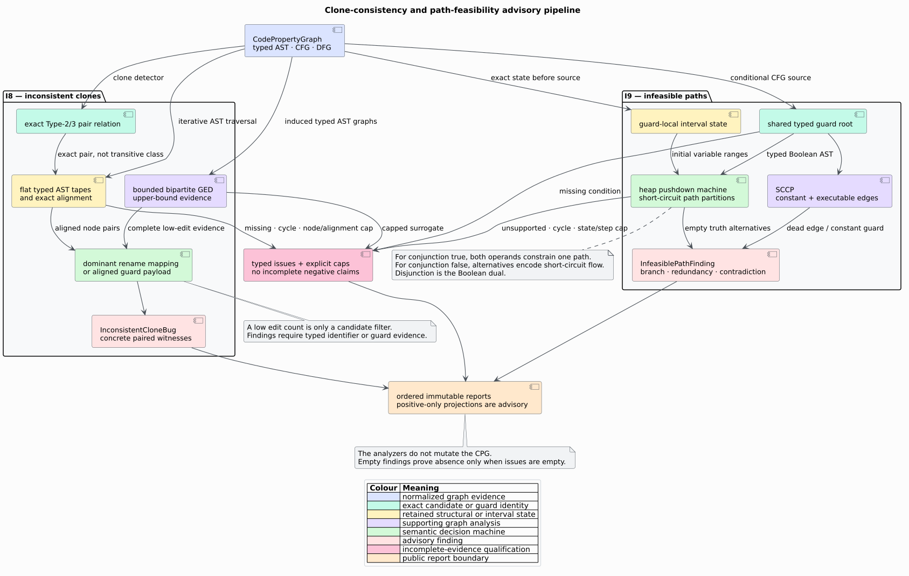

The condition evaluator preserves short-circuit order and disjoint integer
regions through explicit heap frames; it does not recursively interpret source
syntax or mutate SCCP/interval results.

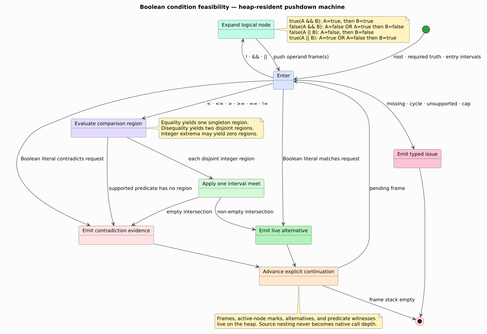

See the
[component guide](../components/graph/clone-feasibility-bug-detectors.md),
[Theory 36](../theory/36-clone-consistency-and-abstract-feasibility.md), and
[Usage 19](../usage/19-clone-feasibility-advisories.md).

### API-usage and temporal protocol mining (feature-free)

`analyze_api_usage_mining` follows `CodePropertyGraph → stable call identity +
owner → per-function CFG reachability → centered typed AUG → complete same-API
population → exact strict-majority fragment → advisory deviation`. Arguments,
typed method receivers, and direct PDG controllers point into the anchor;
CFG-reachable later calls point out. Sites with incomplete/capped evidence do
not enter a population and remain typed issues.

Named `PropertyFsm` values follow a separate path through the existing
typestate/resource-leak worklist. Forbidden transitions and non-accepting exits
are projected into the aggregate report while the complete delegated evidence
is retained. Both paths are read-only and stack-safe over represented depth.

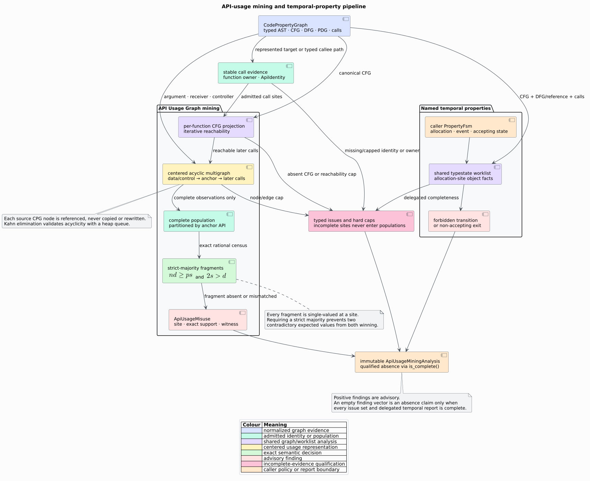

See the [component guide](../components/graph/api-usage-protocol-mining.md),
[Theory 37](../theory/37-api-usage-graphs-and-temporal-properties.md), and
[Usage 20](../usage/20-api-usage-protocol-mining.md).

### Declarative CWE-template analysis (feature-free)

`analyze_cwe_templates` follows `CodePropertyGraph + declarative role/shape
templates → bounded stack-safe VF2 embeddings → structurally qualified sites →
shared taint/null/typestate/interval or typed-literal evidence → immutable
advisory candidates`. Taint-backed templates share one catalog and solver run;
interval requests are grouped by containing function; delegated reports remain
in the aggregate result.

The result path is read-only and explicitly three-valued for interpretation:
positive represented evidence, complete represented no-match, or incomplete
evidence. Structural cap exhaustion, missing or contradictory numeric context,
and delegated solver qualification remain typed issues.

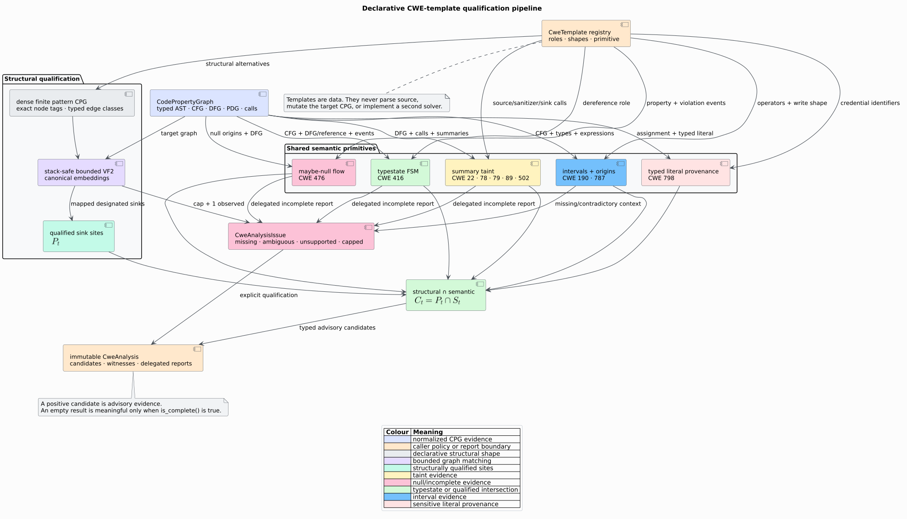

See the [component guide](../components/graph/cwe-template-analysis.md),
[Theory 38](../theory/38-declarative-cwe-query-semantics.md), and
[Usage 21](../usage/21-cwe-template-analysis.md).

### Cryptographic API-misuse analysis (feature-free)

`analyze_crypto_misuse` follows `CodePropertyGraph + CryptoRuleSet → shared
typestate + categorical literal-source taint + explicit argument provenance →
canonical CryptoFinding values`. Call-order semantics remain in `PropertyFsm`;
hardcoded-key propagation remains in the IFDS-style taint engine; the local
queue inspects only governed mode, IV/nonce, and algorithm positions.

The aggregate result retains both delegated reports. Policy, call-site, origin,
and delegated resource boundaries remain explicit, so a partial empty vector
cannot be interpreted as clean. The path is read-only and feature-free.

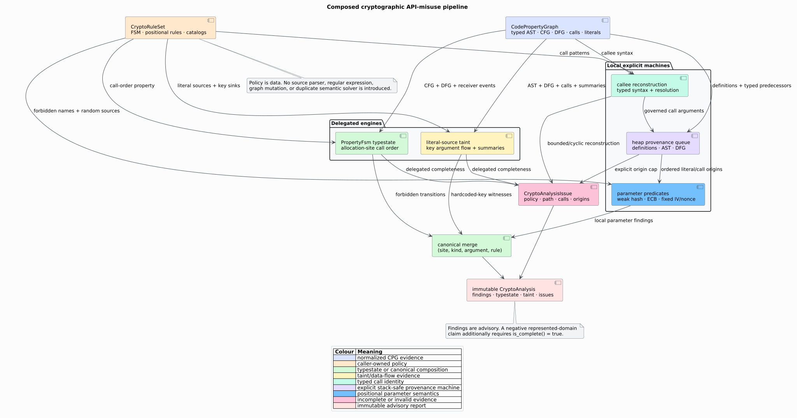

See the [component guide](../components/graph/crypto-misuse-analysis.md),
[Theory 39](../theory/39-cryptographic-api-misuse.md), and
[Usage 22](../usage/22-cryptographic-api-misuse.md).

### Secret-flow and missing access-guard analysis (feature-free)

`analyze_secret_flows` follows `CodePropertyGraph + SecretRuleSet → bounded
entropy/name qualification + shared literal-source taint → governed security
sink flows`. Qualification stores only integer entropy or matched policy/context
IDs; the existing IFDS-style engine owns propagation and witnesses.

`analyze_missing_authz` follows `CodePropertyGraph + AuthzRuleSet → shared exact
missing-check populations → flat typed authN/authZ fingerprint filter`. It
preserves exact peer support and witnesses rather than reconstructing them.

Both paths are feature-free, read-only, deterministic, and explicitly
three-valued. Local and delegated caps/issues prevent a clean interpretation.

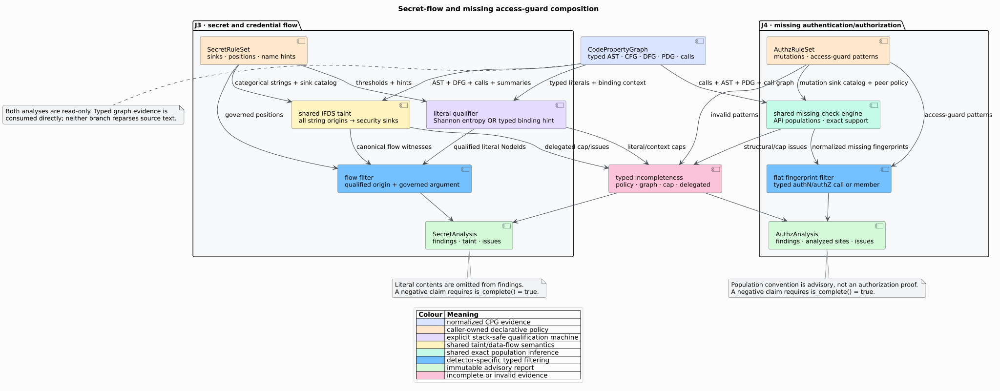

See the [component guide](../components/graph/security-policy-analysis.md),
[Theory 40](../theory/40-secret-flow-and-access-policy-inference.md), and
[Usage 23](../usage/23-secret-and-access-policy-analysis.md).

### Vulnerability extrapolation (feature-free)

`analyze_vulnerability_extrapolation` follows `CodePropertyGraph + labeled
function seed + ExtrapolationOptions → seed/candidate PDGs → jointly
canonicalized WL-label histograms → bounded relaxed VF2 → ranked aggregate
report`. Joint canonicalization is required because numeric WL ranks produced
for separate projections are graph-local names.

The path borrows the CPG immutably. Stable function enumeration, sparse WL
loops, and defunctionalized VF2 frames keep depth-dependent state on the heap.
Function, projection, VF2-invocation, and retained-result limits produce typed
issues, so partial output cannot silently support a clean claim.

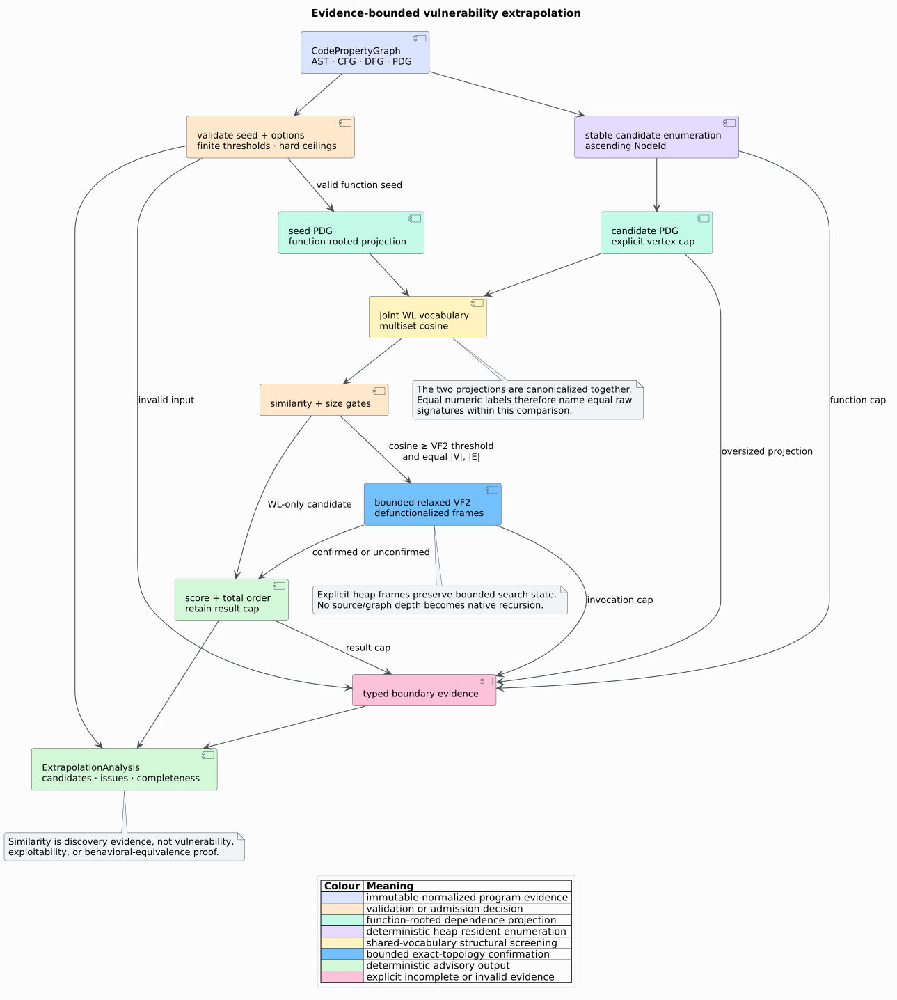

See the [component guide](../components/graph/vulnerability-extrapolation.md),
[Theory 41](../theory/41-vulnerability-extrapolation.md), and
[Usage 24](../usage/24-vulnerability-extrapolation.md).

### Pattern detection

Two layers, at two feature levels:

- **Function clones (feature-free, module `pattern`).**
  `detect_clones(&cpg, &options)` consumes ordered function ASTs for Type-1/2,
  kind-and-name bags for Type-3, and function PDG projections plus WL and the
  existing relaxed VF2 matcher for Type-4. Pair, PDG-size, and VF2-invocation
  budgets fail without returning partial classes.

- **Generic subgraph matching (feature-free, module `pattern`).** `Vf2Matcher` runs [VF2](../GLOSSARY.md#vf2) (Cordella et al. [[4]](#references)) to find every embedding of a pattern graph in the CPG. It exposes `with_strict_kinds`, `with_strict_edges`, and `with_max_matches(usize)` (`0` = unbounded), and `find_matches(&pattern, &target) -> Vec<PatternMatch>`.

  ```rust
  use libcpg::pattern::Vf2Matcher;
  use libcpg::SubgraphMatcher;

  let matches = Vf2Matcher::new()
      .with_max_matches(0)                 // 0 = find all embeddings
      .find_matches(&pattern, &cpg);
  for m in &matches { println!("{} @ {:?}", m.pattern_name, m.root); }
  ```

- **Whole-graph edit evidence (feature-free, module `pattern`).**
  `ged_upper_bound(&first, &second, &options)` orders stable ids, constructs a
  bounded node-star matrix, solves deterministic Hungarian assignment in both
  orientations, and prices the resulting concrete `NodeKindTag` and typed-edge
  scripts. The direct result exposes `capped`; `GraphSimilarity` maps an
  uncapped default result to `1 - normalized`.

- **Design-pattern detection (feature `design-patterns`, module `patterns`).** `GofPatternDetector::detect(&cpg) -> Vec<PatternMatch>` runs a *relaxed* VF2 (`strict_kinds = false`, `strict_edges = false`) against each [GoF](../GLOSSARY.md#gang-of-four-gof) template and keeps matches at or above `min_confidence` (default `0.7`).

  ```rust
  // requires: features = ["design-patterns"]
  use libcpg::patterns::{GofPatternDetector, PatternDetector};

  let hits = GofPatternDetector::new().with_min_confidence(0.7).detect(&cpg);
  ```

The distinction between the always-on `pattern` module and the gated `patterns` module is deliberate — see [`overview.md`](overview.md#pattern-versus-patterns--do-not-conflate) and [`../components/patterns/overview.md`](../components/patterns/overview.md).

### Algorithm and complexity detection (feature `algorithm-detection`)

`DefaultAlgorithmDetector::detect(&cpg, function)` is **per-function**. It
collects semantic loop/recursion shapes for family signatures, then
`ComplexityAnalyzer::estimate_time_complexity_with_evidence` validates the
centralized intraprocedural CFG scope, `LoopForest`, and DFG-backed
`InductionAnalysis`. Fully counted reducible depth supplies the polynomial
degree and provenance; missing or inconsistent evidence returns the exact
legacy AST heuristic. Five family routines consume the result and return
`Vec<DetectedAlgorithm>` sorted by confidence descending and filtered at
`min_confidence` (default `0.5`).

```rust
// requires: features = ["algorithm-detection"]
use libcpg::algorithms::detection::DefaultAlgorithmDetector;
use libcpg::algorithms::AlgorithmDetector;

for function in cpg.functions().map(|n| n.id).collect::<Vec<_>>() {
    for algo in DefaultAlgorithmDetector::new().detect(&cpg, function) {
        // algo.family, algo.confidence, algo.signature.time_complexity ...
    }
}
```

The complexity evidence and family label are advisory rather than proofs. The
consumer adds no parser and does not mutate the CPG; see
[`../components/algorithms/complexity.md`](../components/algorithms/complexity.md).

### GNN embeddings (feature `gnn`)

`CpgGnn::new(cpg)` **owns** the CPG (it takes it by value, not by `Arc`, and has no separate config object). `propagate(&mut self, iterations)` runs [message passing](../GLOSSARY.md#message-passing-gnn) — mean [aggregation](../GLOSSARY.md#aggregation-gnn) over the AST, CFG, and DFG neighbourhoods with a [ReLU](../GLOSSARY.md#relu) nonlinearity — after which node/subgraph [embeddings](../GLOSSARY.md#embedding) can be read and compared by [cosine similarity](../GLOSSARY.md#cosine-similarity).

```rust
// requires: features = ["gnn"]
use libcpg::gnn::CpgGnn;
use libcpg::GraphNeuralNetwork;

let mut gnn = CpgGnn::new(cpg).with_embedding_dim(128).with_num_layers(3).with_dropout(0.1);
gnn.propagate(3);
let emb = gnn.node_embedding(node_id);   // Option<ndarray::Array1<f32>>
```

The `Mean` aggregation is the only wired one; `Attention` and `Hierarchical` are reserved placeholders, and there is no GPU path. See [`../components/gnn/overview.md`](../components/gnn/overview.md).

## What this pipeline does *not* do

To close the door on the earlier draft's fictions:

- **No caching.** There is no parse cache, no embedding cache, no `enable_cache`. Each `build` reparses; each `propagate` recomputes.
- **No SSA and no `Phi`.** The DFG is AST-ordered reaching definitions; there are no `Phi`/`UseUse` edges.
- **No whole-graph on-disk format.** With `--features serde`, round-trip a CPG
  through the caller's selected outer format; libcpg has no graph export/import
  function. `PropertyValue` and standalone `ExprKey` are deliberate inner
  exceptions: their logical recursion is embedded as bounded, versioned CPV1
  and CEK1 bytes so lifecycle and deserialization remain stack-safe.
  `NodeEmbedding`'s vector is
  `#[serde(skip)]`. See [`../usage/05-serialization.md`](../usage/05-serialization.md)
  [ADR-0040](../design/0040-flat-property-value-arena.md), and
  [ADR-0041](../design/0041-shared-flat-expression-facts.md).
- **No hidden parallelism.** Serial methods remain serial. Callers explicitly
  opt into per-function planning with `parallel_analysis` or the public
  `*_parallel` methods; indexed plans feed one ordered graph emitter. See the
  [parallel-analysis guide](../usage/29-parallel-analysis.md).

## Where to go next

- [`overview.md`](overview.md) — design principles and the module map.
- [`graph-data-model.md`](graph-data-model.md) — the node/edge model the overlays are built on.
- [`language-frontends.md`](language-frontends.md) — Stage 0/1 in depth (parsing and mapping).
- [`../components/builder/cfg.md`](../components/builder/cfg.md) / [`../components/builder/dfg.md`](../components/builder/dfg.md) — the extractors in detail.
- [`../api/builder-reference.md`](../api/builder-reference.md) — the precise builder/extractor API.

## References

1. Yamaguchi, F., Golde, N., Arp, D., Rieck, K. (2014). *Modeling and Discovering Vulnerabilities with Code Property Graphs.* 2014 IEEE Symposium on Security and Privacy. DOI: [10.1109/SP.2014.44](https://doi.org/10.1109/SP.2014.44)
2. Ferrante, J., Ottenstein, K. J., Warren, J. D. (1987). *The Program Dependence Graph and Its Use in Optimization.* ACM TOPLAS 9(3). DOI: [10.1145/24039.24041](https://doi.org/10.1145/24039.24041)
3. Cytron, R., Ferrante, J., Rosen, B. K., Wegman, M. N., Zadeck, F. K. (1991). *Efficiently Computing Static Single Assignment Form and the Control Dependence Graph.* ACM TOPLAS 13(4). DOI: [10.1145/115372.115320](https://doi.org/10.1145/115372.115320)
4. Cordella, L. P., Foggia, P., Sansone, C., Vento, M. (2004). *A (Sub)graph Isomorphism Algorithm for Matching Large Graphs.* IEEE TPAMI 26(10). DOI: [10.1109/TPAMI.2004.75](https://doi.org/10.1109/TPAMI.2004.75)
5. Kildall, G. A. (1973). *A Unified Approach to Global Program Optimization.* POPL '73. DOI: [10.1145/512927.512945](https://doi.org/10.1145/512927.512945)
6. McCabe, T. J. (1976). *A Complexity Measure.* IEEE Transactions on Software Engineering SE-2(4). DOI: [10.1109/TSE.1976.233837](https://doi.org/10.1109/TSE.1976.233837)
7. Weiser, M. (1984). *Program Slicing.* IEEE Transactions on Software Engineering SE-10(4). DOI: [10.1109/TSE.1984.5010248](https://doi.org/10.1109/TSE.1984.5010248) (originally ICSE '81).
13. Aho, A. V., Lam, M. S., Sethi, R., Ullman, J. D. (2006). *Compilers: Principles, Techniques, and Tools* (2nd ed.). Addison-Wesley. ISBN 978-0321486813 (no DOI). *(Reaching definitions, data-flow analysis.)*
