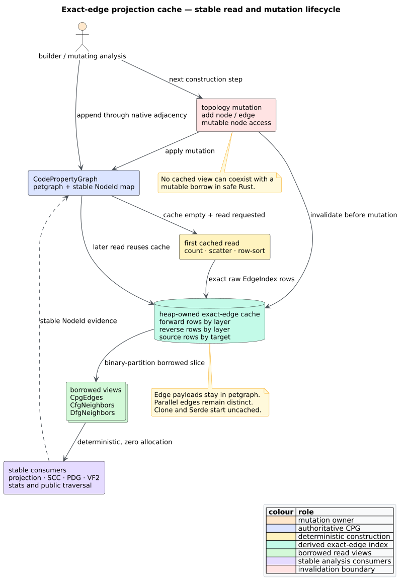

# Graph Data Model

The [Code Property Graph](../GLOSSARY.md#code-property-graph-cpg) is one directed graph $`G = (V, E)`$ in which the vertex set $`V`$ is the program's syntax nodes and the edge set $`E`$ carries *typed overlays* — [AST](../GLOSSARY.md#abstract-syntax-tree-ast), [CFG](../GLOSSARY.md#control-flow-graph-cfg), [DFG](../GLOSSARY.md#data-flow-graph-dfg), and (on demand) [PDG](../GLOSSARY.md#program-dependence-graph-pdg) — over the *same* $`V`$. This single-node-set design is what lets one query cross layers, following Yamaguchi et al. [[1]](#references). This page specifies the storage: the [petgraph](../GLOSSARY.md#petgraph) backing, the `CpgNode` and `CpgEdge` shapes, the four overlays, and how AST source order is recovered.

## petgraph-backed storage

`CodePropertyGraph` wraps a `petgraph::graph::DiGraph<CpgNode, CpgEdge>` and adds
one node index map so that stable node identity survives graph mutation and
serialization:

```text
CodePropertyGraph (private fields)
├── graph:          petgraph DiGraph<CpgNode, CpgEdge>     ← the vertices and edges
├── node_index_map: FxHashMap<NodeId, NodeIndex>           ← stable NodeId → petgraph index
├── projection_cache: OnceLock<Box<CpgProjectionCache>>     ← lazy exact-edge CSR rows
├── language:       Language
├── source_path / source_code: Option<Arc<str>>
├── root:           Option<NodeId>                          ← first node added
└── cfg_entries / cfg_exits: Vec<NodeId>                    ← CFG boundary nodes
```

The distinction between a `NodeId` and petgraph's `NodeIndex` is deliberate.
`NodeId` is libcpg's public, stable identity: it is assigned monotonically,
never reused, and appears in edges, pattern matches, and serialized graphs.
petgraph's `NodeIndex` is an internal storage detail; the `FxHashMap` (from
`rustc-hash`) bridges the two in $`O(1)`$. `EdgeId` is stored directly in each
edge weight and assigned by the monotonic `next_edge_id` counter. There is no
edge-id lookup API, so a second id-to-index map would be write-only duplicate
storage. All fields are private; callers use methods (`node_count`, `add_node`,
`connect`, `node`, the traversal families, `stats`) documented in the
[API reference](../api/graph-reference.md).

Building a graph by hand needs no Cargo features — this is the surface that always works, even under `default = []`:

```rust
// Feature-free: hand-build a two-node CPG.
use libcpg::{CodePropertyGraph, CpgNode, CpgNodeKind, CpgEdgeKind, NodeId, SourceRange, Language};

let mut cpg = CodePropertyGraph::new(Language::Rust);
let root = cpg.add_node(CpgNode::new(NodeId::new(0), CpgNodeKind::Root, SourceRange::default()));
let ret  = cpg.add_node(CpgNode::new(NodeId::new(0), CpgNodeKind::Return, SourceRange::default()));
cpg.connect(root, ret, CpgEdgeKind::AstChild);          // returns Option<EdgeId>
assert_eq!(cpg.node_count(), 2);
assert_eq!(cpg.edge_count(), 1);
```

`add_node` assigns the real id (any `NodeId` you pass to `CpgNode::new` is overwritten), and `connect(source, target, kind)` returns `Option<EdgeId>` — `None` if either endpoint is unknown. Reconstruction from serialized data uses `add_node_with_id`/`add_edge_with_id`, which preserve the stored ids.

## The node: `CpgNode`

A `CpgNode` carries public **fields** (access `node.kind`, not `node.kind()`):

```rust
pub struct CpgNode {
    pub id: NodeId,
    pub kind: CpgNodeKind,               // the type tag + associated data
    pub range: SourceRange,              // byte + line/col span
    pub text: Option<Arc<str>>,          // original source slice, for terminals
    pub message_kind: Option<MsgKind>,   // typed channel operation, if any
    pub lock_kind: Option<LockKind>,     // typed lock operation, if any
    pub allocation_type: Option<Box<TypeInfo>>, // nominal constructor result, if any
    pub properties: Option<Box<FxHashMap<PropertyKey, PropertyValue>>>,
    pub children: SmallVec<[NodeId; 4]>, // AST child ids (inline for small arity)
    pub parent: Option<NodeId>,          // AST parent
}
```

`message_kind`, `lock_kind`, and `allocation_type` are orthogonal semantic
annotations: a channel send, lock acquisition, or constructor can remain a
`Call` while feature-free analyses consume typed evidence without parsing
source text. JavaScript/TypeScript `new` and Java object creation populate the
nominal allocation field; unsupported frontends leave it `None`. Convenience
methods layer over the fields: `name() -> Option<&str>` (the bound name for the
kinds that have one), and the predicates `is_declaration`, `is_statement`,
`is_expression`, `is_control_flow`, `is_error`.

Large, cold payloads use owned heap indirection: `Function.signature` is
`Box<MethodSignature>`; optional parameter, variable, field, and allocation
types are `Option<Box<TypeInfo>>`; and `TypeAnnotation.type_info` is
`Box<TypeInfo>`. This makes common nodes dense without introducing shared
ownership or lifetimes. The indirection is transparent to Serde's data model
and to field reads through `Deref`; it affects Rust construction syntax only.
The property map follows the same cold-payload rule: `None` is empty and the
first `with_property` call creates the boxed map. Its Serde adapter continues
to encode an empty map as `{}` and a populated map without wrapper layers.

### The 45 `CpgNodeKind` variants

`CpgNodeKind` is the [node kind](../GLOSSARY.md#node-kind--edge-kind) tag — a mix of **unit variants** (e.g. `Root`, `If`, `Return`) and **data-carrying variants** (e.g. `Function { signature }`, `Call { target, is_method }`). Its 45 variants group as follows:


*Figure — the 45 `CpgNodeKind` variants organized into structural, function-level, variable, statement, expression, type, and special groups. Source: [`diagrams/node-kind-taxonomy.puml`](../diagrams/node-kind-taxonomy.puml).*

| Group | Variants (fields shown for data-carrying kinds) |
|-------|--------------------------------------------------|
| Structural | `Root`; `Module{name}`; `Class{name,is_abstract}`; `Struct{name}`; `Enum{name}`; `Trait{name}`; `Impl{for_type,trait_name}` |
| Function-level | `Function{signature}`; `Parameter{name,param_type,is_variadic}`; `Block{scope}` |
| Variable | `Variable{name,var_type,scope,is_mutable}`; `Field{name,field_type,visibility}` |
| Statement | `Return`; `If`; `Else`; `While`; `For`; `Loop`; `Match`; `MatchArm`; `Break`; `Continue`; `Throw`; `Try`; `Catch`; `Finally` |
| Expression | `BinaryOp{operator}`; `UnaryOp{operator}`; `Assignment{operator}`; `Call{target,is_method}`; `MemberAccess{member}`; `IndexAccess`; `Identifier{name,definition}`; `Literal{kind}`; `Lambda{captures}`; `Await`; `Yield` |
| Type | `TypeAnnotation{type_info}`; `GenericParam{name}` |
| Special | `Comment{is_doc}`; `Import{path}`; `Attribute{name}`; `Macro{name}`; `Error{message}`; `Unknown{kind}` |

`Literal { kind }` carries a `LiteralKind`: `Integer(i64)`, `Float(f64)`, `String(Arc<str>)`, `Char(char)`, `Bool(bool)`, `Null`, `Array`, `Object`, `Regex(Arc<str>)`. Because kinds drive every query and every pattern/complexity heuristic, they are enumerated once here and reused everywhere — [`../components/graph/nodes.md`](../components/graph/nodes.md) walks each group with examples.

Two tag projections serve different architectural roles. The crate-root
`CpgNodeKindTag` is a complete, one-byte discriminant: `CpgNodeKind::tag()` and
`CodePropertyGraph::node_tag()` preserve all 45 variants one-to-one so an
extractor can dispatch without copying names, types, or signatures. In
contrast, `pattern::NodeKindTag` is a deliberately lossy 29-way public
vocabulary for pattern matching and similarity; variants outside that
vocabulary project to `Unknown`. Analyses must choose the complete tag when
variant identity affects semantics and the coarse tag only when abstraction is
intentional.

### Supporting value types

Several kinds embed richer records, all in the `graph` module:

- `MethodSignature { name, params, return_type, is_static, is_async, visibility }` — carried by `Function`.
- `TypeInfo { name, is_reference, is_mutable, generics }` — a type reference.
- `Visibility` — `Public`, `Private` (the default), `Protected`, `Package`, `Crate`.
- `ScopeId(u32)` — a lexical scope handle; `ScopeId::GLOBAL` is the sentinel.
- `PropertyKey` (`Name`, `Type`, `Scope`, `Visibility`, `Mutable`, `Static`, `Async`, `Custom(Arc<str>)`) and `PropertyValue` (`String`, `Int`, `Uint`, `Bool`, `Float`, `List`, `Null`) — the open `properties` side-table for metadata not modeled by a dedicated field.

## The edge: `CpgEdge`

A `CpgEdge` is likewise a public-field struct — access `edge.source`, not `edge.source()`:

```rust
pub struct CpgEdge {
    pub id: EdgeId,
    pub source: NodeId,
    pub target: NodeId,
    pub kind: CpgEdgeKind,
    pub label: Option<Box<str>>,
}
```

The label box is transparent to Serde and borrowed through `as_deref()`. It
reduces the common unlabeled edge's inline layout without interning unrelated
labels or adding shared ownership.

Typed constructors keep call sites readable: `CpgEdge::ast_child`, `control_flow`, `data_flow`, `def_use`, `reference`, `call_site` (plus `new` and `with_label`). `is_forward()` reports whether an edge points "forward" (e.g. `AstParent`, `AstPrevSibling`, and `DataFlow(UseDef)` are the reverse-direction kinds).

### `CpgEdgeKind` and its classifiers

The [edge kind](../GLOSSARY.md#node-kind--edge-kind) both *labels* the overlay and, for CFG/DFG, *wraps* the sub-kind:


*Figure — `CpgEdgeKind` grouped by overlay; control flow is `ControlFlow(CfgEdgeKind)` and data flow is `DataFlow(DfgEdgeKind)`. Source: [`diagrams/edge-kind-taxonomy.puml`](../diagrams/edge-kind-taxonomy.puml).*

| Group | `CpgEdgeKind` variants | Classifier |
|-------|------------------------|------------|
| AST | `AstChild`, `AstParent`, `AstNextSibling`, `AstPrevSibling` | `is_ast()` |
| CFG | `ControlFlow(CfgEdgeKind)` (14 sub-kinds) | `is_cfg()` |
| DFG | `DataFlow(DfgEdgeKind)` (13 sub-kinds) | `is_dfg()` |
| PDG | `ControlDependence`, `DataDependence` | `is_pdg()` |
| Call | `StaticCall`, `DynamicCall`, `CallSite` | `is_call()` |
| Type | `TypeOf`, `Inherits`, `Implements`, `GenericInstance` | `is_type()` |
| Reference | `Reference`, `Definition`, `Declaration` | — |
| Scope | `EnclosingScope`, `ContainedIn` | — |
| Import | `Imports`, `Exports` | — |

There is **no** `CfgEdge`/`DfgEdge` wrapper type and **no** `BranchTrue`/`UseUse`/`Phi` variant. The 14 [`CfgEdgeKind`](../GLOSSARY.md#control-flow-graph-cfg) and 13 [`DfgEdgeKind`](../GLOSSARY.md#data-flow-graph-dfg) sub-kinds are tabulated in [`data-flow.md`](data-flow.md#stage-2--cfg-extraction) and [`../components/graph/edges.md`](../components/graph/edges.md). The classifiers let an analysis filter to one overlay in a single pass — for example, `cpg.edges_by_kind(|k| k.is_cfg())` yields exactly the control-flow edges.

## Four overlays over one node set

The payoff of the shared $`V`$ is that the overlays *co-locate*: the same `Call` node participates in AST child edges, CFG sequencing, DFG argument edges, and — after `PdgBuilder::build` — dependence edges.


*Figure — one node set with the AST, CFG, and DFG overlays drawn as distinct edge colors; a query hops between them without leaving the graph. Source: [`diagrams/cpg-overlay.dot`](../diagrams/cpg-overlay.dot).*

Each overlay is queried through its own traversal family. Hot edge queries
borrow exact-size iterator views from the lazy projection cache; the hot-path
`ast_children` query instead borrows the node's maintained child index as
`&[NodeId]`. Call `.to_vec()` or `.collect()` when a caller must retain a result
while mutating the graph. Higher-level queries that discover a transitive set
still return owned vectors.

| Overlay | Edges | Queries |
|---------|-------|---------|
| AST | `AstChild` (+ parent pointer) | `ast_children`, `ast_parent`, `ast_descendants`, `ast_ancestors` |
| CFG | `ControlFlow(_)` | `cfg_successors`, `cfg_predecessors`, `cfg_entries`, `cfg_exits`, `cfg_nodes` |
| DFG | `DataFlow(_)` | `reaching_definitions`, `uses_of_definition`, `dfg_successors`, `dfg_predecessors` |
| PDG | `ControlDependence`, `DataDependence` | traversed by `backward_slice` / `forward_slice` |
| Call | `CallSite`/`StaticCall`/`DynamicCall` | `call_sites`, `callees`, `callers` |

Positional and kind queries round out the surface: `node_at_offset`, `nodes_in_range`, `scope_at_offset`; `functions`, `classes`, `variables`, `calls`, and the general `nodes_by_kind(predicate)` (note: a **predicate**, `Fn(&CpgNodeKind) -> bool`, not a single kind). Metrics include `ast_depth`, `cyclomatic_complexity` ($`M = E - N + 2`$ over the CFG), and `stats() -> CpgStats`. Subgraph extraction — `subgraph`, `function_cfg`, `function_dfg` — returns new `CodePropertyGraph`s.

## Identities and ranges

- `NodeId(pub u32)` and `EdgeId(pub u32)` each expose `new(u32)`, `as_u32()`, and `From<u32>` (both directions for `NodeId`). Use `as_u32`, not `.index()`.
- `SourceRange` holds six `u32`s — `start`, `end` (byte offsets), and `start_line`, `start_col`, `end_line`, `end_col` (0-indexed). Helpers: `new`, `from_bytes`, `len`, `is_empty`, `to_text_range` (into a `text_size::TextRange`).

## Recovering source order

petgraph iterates a node's outgoing edges **newest-first** (reverse insertion
order), but many analyses need AST children in *source* order — an `if`'s
children as `[condition, then, else]`, an assignment's first child as its
l-value. libcpg therefore maintains a redundant AST navigation index on each
node:

1. `connect(source, target, AstChild)` appends `target` to `source.children` as
   it inserts the monotonically numbered edge. The common parser and hand-built
   paths are consequently constant-time and already in ascending `EdgeId`
   order.
2. `ast_children(source)` borrows that stored slice directly. It performs no
   graph scan, allocation, or sort; an unknown source returns the empty slice.
3. `add_edge_with_id`, used for reconstruction, admits explicit edge ids in any
   storage order. It rebuilds the affected child list in ascending `EdgeId`
   order, so deserialization and insertion order cannot change traversal.
4. The same insertion API maintains each child's `parent` pointer, so
   `ast_parent` and `ast_ancestors` do not depend on petgraph iteration order.
   A malformed graph with several incoming `AstChild` edges deterministically
   chooses the source of the lowest-id edge as the parent.

The edge is the containment relation; `children` and `parent` are its
read-optimized navigation indices. Callers should therefore create AST
containment through `connect`/`add_edge`, not repeat the bookkeeping by mutating
the public fields. Direct field mutation remains possible for deliberately
malformed robustness fixtures, but it can make the indices disagree with the
edge set.

## Lazy exact-edge projection cache

The public [`GraphProjection`](../components/graph/projections.md) is a compact,
owned, payload-free topology for an analysis. `CodePropertyGraph` also owns a
different structure: a **projection cache** containing exact petgraph edge
indices. It accelerates repeated reads of the mutable CPG without cloning edge
payloads or merging parallel edges.



*Figure — a first edge-projection read builds deterministic forward, reverse,
and endpoint CSR rows; reads borrow exact edges; topology mutation discards the
box before the next read. Source:
[`diagrams/projection-cache-lifecycle.puml`](../diagrams/projection-cache-lifecycle.puml).*

**Compressed sparse row** (CSR) stores a row-offset array beside one contiguous
value array. For internal node index $`i`$, the forward edge-index row is

```math
R^{+}(i) = I^{+}[O^{+}[i] \ldots O^{+}[i+1]).
```

Here $`O^{+}`$ is the forward offset array and $`I^{+}`$ stores exact petgraph
edge indices. Reverse rows $`R^{-}`$ use the target as row owner. A third row
order groups each source's entries by target, enabling `edges_between(s, t)`
to find the exact parallel-edge interval with two binary partition searches.
Forward/reverse rows group by overlay—AST, CFG, DFG, PDG, call, then other—and
then by opposite stable `NodeId`, `EdgeId`, and raw edge index. That final raw
index breaks malformed duplicate-id ties without making normal ordering depend
on hash enumeration.

The construction is a counting/scatter pass followed by independent row-local
sorts. Stating the mutation boundary in the algorithm is essential: a cached
petgraph index is valid only for the topology from which it was derived.

```text
READ_EDGE_VIEW(cpg, query):
    if cpg.projection_cache is empty:
        count every edge into forward, reverse, and by-target row offsets
        scatter raw edge records into those rows
        sort each nontrivial row by its canonical key
        retain exact edge indices in one heap-owned cache
    binary-partition the requested row and return a borrowed exact-size view

MUTATE_CPG(cpg, operation):
    discard cpg.projection_cache
    apply node or edge mutation through the graph API
```

The first read costs $`O(V+E+\sum_r d_r\log d_r)`$ time and $`O(V+E)`$
auxiliary space, where $`d_r`$ is one row's degree. A later whole-row lookup is
$`O(1)`$ plus iteration, an overlay lookup adds two $`O(\log d_r)`$ partitions,
and an endpoint lookup adds two $`O(\log d^{+}(s))`$ partitions. The public
views `CpgEdges`, `CfgNeighbors`, and `DfgNeighbors` allocate nothing and retain
exact parallel-edge payloads.

`add_node`, `add_node_with_id`, `node_mut`, `add_edge`, and
`add_edge_with_id` invalidate the cache. Clone and deserialization start empty;
Serde omits the derived field, so persisted shape remains compatible. Mutating
builders use petgraph's native adjacency inside build-and-append loops, avoiding
the wasteful pattern “build cache, add one edge, invalidate, repeat.” Stable
analysis consumers—projection construction, SCC, PDG, and VF2—use cached reads.
Every build and traversal uses finite loops, row-local library sorting, and heap
vectors; graph depth does not become native call depth. The rationale and
controlled measurements are recorded in
[ADR-0056](../design/0056-lazy-deterministic-edge-projection-cache.md) and
[scientific validation 51](../scientific/51-projection-cache-validation.md).

## Mutability, identity, and serialization

The graph is a mutable owned value, not a frozen artifact:

- Construction mutates it (`add_node`, `connect`); the `CfgExtractor`, `DfgExtractor`, and `PdgBuilder` mutate it in place; `CodePropertyGraph` implements `Clone`.
- Ids are stable across mutation: adding nodes/edges never renumbers existing ones, so a `NodeId` captured before an extractor runs is still valid after.
- With `--features serde`, graph containers and nonrecursive graph types derive
  `Serialize`/`Deserialize` (petgraph's `serde-1` feature serializes the
  `DiGraph`). The caller still chooses JSON, bincode, CBOR, or another outer
  format. The one exception is logical recursion inside `PropertyValue`, which
  Serde embeds as bounded, versioned CPV1 bytes over a flat arena. libcpg has no
  whole-graph export/import format; portable snapshots still rebuild indices
  via `add_node_with_id`/`add_edge_with_id`. See
  [`../usage/05-serialization.md`](../usage/05-serialization.md) and
  [ADR-0040](../design/0040-flat-property-value-arena.md).

## Where to go next

- [`overview.md`](overview.md) — how this model sits in the wider architecture.
- [`data-flow.md`](data-flow.md) — how the overlays are populated and queried.
- [`../components/graph/nodes.md`](../components/graph/nodes.md) / [`../components/graph/edges.md`](../components/graph/edges.md) — per-kind detail.
- [`../components/graph/traversal.md`](../components/graph/traversal.md) — navigation recipes over the overlays.
- [`../api/graph-reference.md`](../api/graph-reference.md) — the exhaustive `CodePropertyGraph` method reference.
- [`../theory/01-code-property-graphs.md`](../theory/01-code-property-graphs.md) — the formal model behind the overlays.

## References

1. Yamaguchi, F., Golde, N., Arp, D., Rieck, K. (2014). *Modeling and Discovering Vulnerabilities with Code Property Graphs.* 2014 IEEE Symposium on Security and Privacy. DOI: [10.1109/SP.2014.44](https://doi.org/10.1109/SP.2014.44)
