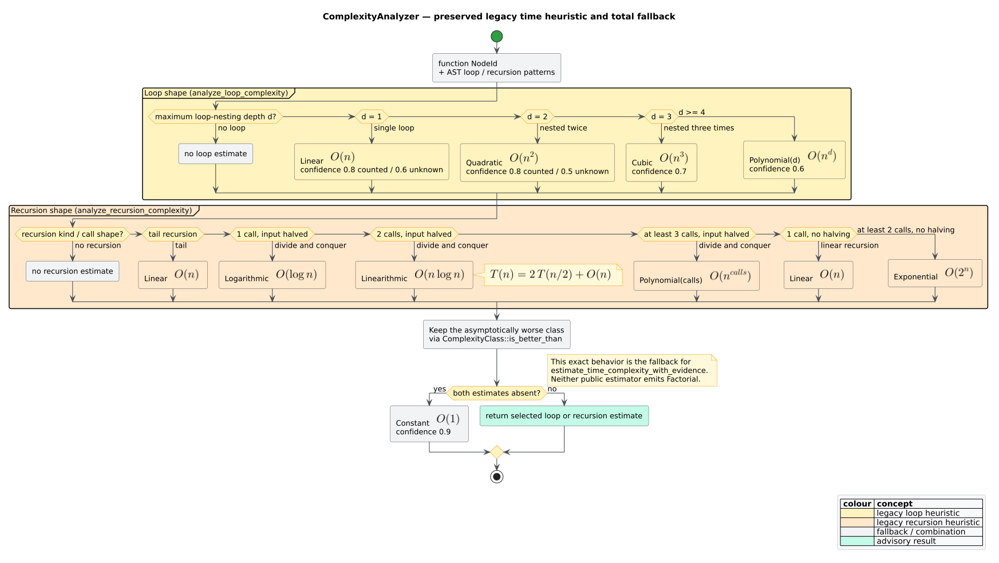

# Complexity analysis

`ComplexityAnalyzer` estimates a function's asymptotic running-time or space
class. A **complexity class** groups functions with the same growth order, such
as linear $`O(n)`$ or quadratic $`O(n^2)`$. An estimate is advisory: it contains
a `ComplexityClass`, a confidence in $`[0,1]`$, and a justification that names
the evidence used.

> **Feature gate.** The analyzer and its result types live in the
> `algorithm-detection`-gated `algorithms` module. `libcpg` has
> `default = []`; enable this feature explicitly. The feature consumes the
> feature-free CFG, loop-forest, and induction analyses and adds no parser.


*Figure — evidence-aware complexity estimation. Green is Control Flow Graph
(CFG) evidence, amber is Data Flow Graph (DFG) evidence, and grey is the total
fallback. Source:
[`diagrams/complexity-evidence.puml`](../../diagrams/complexity-evidence.puml).*

## Public syntax

The public analyzer has one constructor and three estimators:

```rust
// requires: features = ["algorithm-detection"]
use libcpg::algorithms::detection::ComplexityAnalyzer;

let analyzer = ComplexityAnalyzer::new();

// Original AST-shape heuristic, preserved byte-for-byte in behavior.
let legacy_time = analyzer.estimate_time_complexity(&cpg, function_id);

// Preferred time estimate: validated CFG/DFG evidence with exact legacy fallback.
let evidence_time =
    analyzer.estimate_time_complexity_with_evidence(&cpg, function_id);

// Separate recursion/allocation heuristic.
let space = analyzer.estimate_space_complexity(&cpg, function_id);

println!(
    "{} at {:.0}%: {}",
    evidence_time.class,
    evidence_time.confidence * 100.0,
    evidence_time.justification,
);
```

There is no `ComplexityEstimator` type and there are no input-name or
assumption builders. `DefaultAlgorithmDetector` uses
`estimate_time_complexity_with_evidence`; direct callers can use either time
method.

Every method is total over a `CodePropertyGraph`: an absent selector, malformed
scope, missing CFG, or insufficient downstream evidence returns an estimate
rather than panicking. All three methods borrow the graph immutably.

## Result types

```rust
// requires: features = ["algorithm-detection"]
pub struct ComplexityEstimate {
    pub class: ComplexityClass,
    pub confidence: f64,
    pub justification: String,
}

pub enum ComplexityClass {
    Constant,
    Logarithmic,
    Linear,
    Linearithmic,
    Quadratic,
    Cubic,
    Polynomial(u32),
    Exponential,
    Factorial,
    Unknown,
}
```

`ComplexityClass::as_str()` supplies a fixed display label:

| Variant | Label | Mathematical meaning |
|---|---|---|
| `Constant` | `O(1)` | $`O(1)`$ |
| `Logarithmic` | `O(log n)` | $`O(\log n)`$ |
| `Linear` | `O(n)` | $`O(n)`$ |
| `Linearithmic` | `O(n log n)` | $`O(n\log n)`$ |
| `Quadratic` | `O(n²)` | $`O(n^2)`$ |
| `Cubic` | `O(n³)` | $`O(n^3)`$ |
| `Polynomial(k)` | `O(n^k)` | $`O(n^k)`$ |
| `Exponential` | `O(2^n)` | $`O(2^n)`$ |
| `Factorial` | `O(n!)` | $`O(n!)`$ |
| `Unknown` | `Unknown` | no determined class |

`Polynomial(k)` deliberately returns the literal `O(n^k)`; inspect its payload
to display the concrete exponent.

### Growth-faithful comparison

`is_better_than` is a strict weak order over asymptotic growth. Equal growth
rates compare equivalent, so neither side is better:

```rust
// requires: features = ["algorithm-detection"]
use libcpg::algorithms::ComplexityClass;

assert!(ComplexityClass::Linear.is_better_than(&ComplexityClass::Quadratic));
assert!(!ComplexityClass::Quadratic
    .is_better_than(&ComplexityClass::Polynomial(2)));
assert!(!ComplexityClass::Polynomial(2)
    .is_better_than(&ComplexityClass::Quadratic));
assert!(ComplexityClass::Polynomial(1_000)
    .is_better_than(&ComplexityClass::Exponential));
```

The private rank collapses the named polynomial equivalents and keeps every
finite polynomial below exponential growth:

| Class | Private rank |
|---|---:|
| `Constant`, `Polynomial(0)` | $`0`$ |
| `Logarithmic` | $`1`$ |
| `Linear`, `Polynomial(1)` | $`2`$ |
| `Linearithmic` | $`3`$ |
| `Quadratic`, `Polynomial(2)` | $`4`$ |
| `Cubic`, `Polynomial(3)` | $`5`$ |
| `Polynomial(k)`, $`k \ge 4`$ | $`6 - 1/k`$ |
| `Exponential` | $`10`$ |
| `Factorial` | $`20`$ |
| `Unknown` | $`1000`$ |


*Figure — named and general polynomial classes ordered by asymptotic growth.
Source: [`diagrams/complexity-ladder.dot`](../../diagrams/complexity-ladder.dot).*

## Evidence-aware time semantics

A **reducible loop** has a natural header that dominates its back edge. An
**irreducible cyclic region** has multiple entries and no single natural-loop
header. A **loop forest** records these regions and their strict nesting. An
**induction variable** (IV) changes by a regular additive step, while
`TripEvidence::Counted` records a direction-compatible comparison against an
invariant bound. These terms are produced by the feature-free
[`loop_forest`](../graph/loop-analysis.md) and
[`loop_induction`](../graph/induction-analysis.md) analyses.

The evidence-aware estimator performs this literate algorithm:

```text
EVIDENCE-TIME(cpg, function)
  fallback := LEGACY-TIME(cpg, function)

  view := validated intraprocedural CFG scope for function
  if view is invalid or has no CFG edge: return fallback

  forest := LOOP-FOREST(cpg, function)
  if forest fails or has no cyclic region: return fallback

  induction := LOOP-INDUCTION(cpg, function, forest)
  if induction fails: return fallback

  d := maximum nesting depth among reducible loops, or 1 if all are irreducible
  loop.class := POLYNOMIAL-CLASS(d)

  if any region is irreducible:
      loop.confidence := 0.3
  else if any trip evidence is Unknown:
      loop.confidence := confidence of the legacy loop heuristic
  else:
      loop.confidence := 1.0

  recursion := legacy recursion estimate, if present
  return the asymptotically worse of loop and recursion,
         retaining the subordinate evidence in the justification
```

For reducible counted nests, the degree is

```math
d = \max_{L \in \mathcal{L}_{r}} \operatorname{depth}(L),
\qquad
T(n) \in O(n^d),
```

where $`\mathcal{L}_{r}`$ is the set of reducible loops. Degrees one, two, and
three use `Linear`, `Quadratic`, and `Cubic`; $`d \ge 4`$ uses
`Polynomial(d)`. This is a structural cost model: a counted nesting level
contributes one factor of $`n`$; it is not an exact symbolic bound solver.

### Confidence policy

The confidence is evidence-bounded rather than averaged:

```math
c =
\begin{cases}
0.3 & \text{if any cyclic region is irreducible},\\
c_h & \text{if any reducible loop has unknown trip evidence},\\
1.0 & \text{if every reducible loop has counted trip evidence},
\end{cases}
```

where $`c_h`$ is the original loop heuristic's confidence, clamped to
$`[0,1]`$. Irreducibility wins over the unknown-trip ceiling because one
linear factor is only a conservative structural representation of that
region—not a proven iteration bound.

The justification is deterministic and auditable. It lists each stable loop
id, header `NodeId`, depth, sorted IV names, and either the comparison and bound
nodes for a counted trip, `trip evidence unknown`, or `irreducible region`.
When recursion dominates, the same loop details remain as subordinate evidence.

### Exact fallback compatibility

The following cases return the exact `estimate_time_complexity` result—same
class, same floating-point confidence bits, and same justification string:

- the selector is absent or cannot define a valid function CFG scope;
- the selected function has no intraprocedural CFG edges;
- loop-forest construction fails or finds no loop;
- induction analysis rejects inconsistent evidence; or
- a parsed function is loop-free.

This boundary preserves callers that construct AST-only CPGs and avoids turning
missing graph evidence into invented certainty. It also answers the parser
boundary directly: `ComplexityAnalyzer` never parses text or scans tokens. The
tree-sitter frontends normalize syntax once; this consumer reads semantic CPG
nodes and typed CFG/DFG edges.

## Legacy loop and recursion heuristics

`estimate_time_complexity` remains available and unchanged. Its loop half walks
AST descendants, derives maximum syntactic nesting, and maps it as follows:

| Maximum depth | All loops counted? | Class | Confidence |
|---:|:---:|---|---:|
| 1 | yes | `Linear` | 0.8 |
| 1 | no | `Linear` | 0.6 |
| 2 | yes | `Quadratic` | 0.8 |
| 2 | no | `Quadratic` | 0.5 |
| 3 | either | `Cubic` | 0.7 |
| $`d \ge 4`$ | either | `Polynomial(d)` | 0.6 |

Its recursion half looks for tail position, recursive call count, and shallow
divide-and-conquer cues such as division/right-shift by two or identifiers
`mid`, `middle`, `pivot`, or containing `half`:

| Recursion shape | Class | Confidence |
|---|---|---:|
| tail recursion | `Linear` | 0.8 |
| one halving call | `Logarithmic` | 0.8 |
| two halving calls | `Linearithmic` | 0.7 |
| at least three halving calls | `Polynomial(calls)` | 0.5 |
| one non-halving call, clear base case | `Linear` | 0.7 |
| one non-halving call, no clear base case | `Linear` | 0.4 |
| two non-halving calls | `Exponential` | 0.7 |
| at least three non-halving calls | `Exponential` | 0.6 |



*Figure — the preserved fallback heuristic. `Factorial` is correctly absent
from every emitted branch. Source:
[`diagrams/complexity-heuristics.puml`](../../diagrams/complexity-heuristics.puml).*

The halving cases approximate the Master Theorem recurrence [[1]](#references)

```math
T(n) = aT(n/b) + f(n), \qquad a \ge 1,\ b > 1.
```

They do not solve it: call sites approximate $`a`$, a halving cue approximates
$`b = 2`$, and $`f(n)`$ is not derived. Consequently, the estimate is a
structural hint rather than a proof.

### Worked outcomes

| Function shape | Evidence-aware result |
|---|---|
| two nested semantic ranges with valid CFG/DFG evidence | `Quadratic`, confidence `1.0`, with both headers/IVs/bounds |
| `while true` natural loop | `Linear`, legacy loop-confidence ceiling, unknown trip named |
| irreducible cyclic region | `Linear`, confidence `0.3`, irreducibility named |
| loop-free parsed function | exact legacy `Constant`, confidence `0.9` |
| one counted loop plus dominant binary recursion | `Exponential`; counted loop retained as subordinate evidence |

The mathematical function `factorial(n)` usually has one recursive call and
therefore receives `Linear`, $`O(n)`$. This is unrelated to the `Factorial`
class $`O(n!)`$. Neither time estimator emits `Factorial`; non-divide-and-
conquer recursion is capped at `Exponential`.

## Space estimate

`estimate_space_complexity` is independent of the evidence-aware time path:

- tail recursion becomes `Constant` at confidence `0.6`, assuming frame reuse;
- direct or indirect recursion becomes `Linear` at confidence `0.6`;
- an array literal or allocation-like call name (`vec`, `new`, `alloc`,
  `create`, `clone`, or `collect`) becomes `Linear` at confidence `0.5`; and
- otherwise the result is `Constant` at confidence `0.7`.

## Interpretation and security boundary

Asymptotic time and McCabe's exact cyclomatic complexity are different
quantities. Cyclomatic complexity counts independent CFG paths [[2]](#references);
this analyzer estimates input-size growth. Neither result proves termination,
worst-case input distribution, amortized cost, alias effects, or machine-width
overflow behavior.

The evidence path is read-only, iterative through its providers, and bounded by
the finite selected graph plus the providers' documented convergence limits.
Its justification can grow with the number of loops, so callers processing
hostile graphs must still cap source or CPG size. Never authorize an
optimization or security decision from a `ComplexityEstimate` alone.

## Validation and measurement

The executable validation includes fixed counted, unknown, irreducible,
fallback, recursion-composition, and parser-backed examples; 128-case storage-
permutation and generated-CFG-free properties; public integration; malformed-
graph robustness through `DefaultAlgorithmDetector`; and a Criterion group
whose correctness oracle runs before timing. See [Complexity-evidence
validation](../../scientific/08-complexity-evidence-validation.md).

Run the public and parser-backed acceptance cases with:

```text
cargo test --no-default-features --features "algorithm-detection lang-rust" \
  --test complexity_evidence_integration

cargo bench --no-default-features --features algorithm-detection \
  --bench induction_analysis -- --test
```

## Related reading

- [Algorithm detection overview](overview.md) — the default consumer.
- [Loop analysis](../graph/loop-analysis.md) and [induction analysis](../graph/induction-analysis.md) — evidence providers.
- [Theory](../../theory/08-algorithm-and-complexity-analysis.md) — formal interpretation.
- [API reference](../../api/pattern-reference.md) — exact public signatures.
- [ADR-0013](../../design/0013-evidence-bounded-complexity-estimates.md) — why the fallback and confidence boundaries were selected.

## References

1. Cormen, T. H., Leiserson, C. E., Rivest, R. L., Stein, C. (2009).
   *Introduction to Algorithms* (3rd ed.), Chapter 4. MIT Press.
   ISBN 978-0262033848 (no DOI).
2. McCabe, T. J. (1976). *A Complexity Measure.* IEEE Transactions on Software
   Engineering SE-2(4), 308–320. DOI:
   [10.1109/TSE.1976.233837](https://doi.org/10.1109/TSE.1976.233837)
