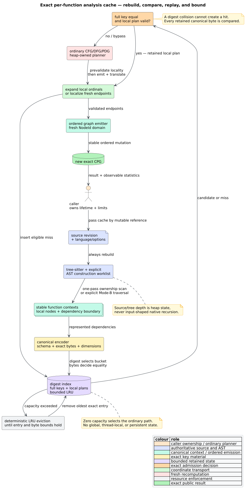

# Incremental function-analysis cache

The incremental cache reuses exact per-function CFG, DFG, and PDG plans while
always rebuilding a fresh AST. It is designed for editors, indexers, and
services that analyze successive revisions in one process. The cache is
caller-owned, bounded, deterministic, and optional.



*Figure -- the cache never replaces parsing or AST construction. Source:
[`diagrams/function-analysis-cache-lifecycle.puml`](../../diagrams/function-analysis-cache-lifecycle.puml).*

## Public surface

| Type or method | Purpose |
|---|---|
| `FunctionAnalysisCache` | Owns exact canonical keys and function-local plans. |
| `FunctionAnalysisCacheLimits` | Sets maximum entries and estimated resident bytes. |
| `FunctionAnalysisCacheStats` | Reports hits, misses, bypasses, evictions, and additive residency. |
| `TreeSitterCpgBuilder::build_with_analysis_cache` | Mode-A parse plus cached CFG/DFG construction. |
| `TreeSitterCpgBuilder::build_from_tree_with_analysis_cache` | Mode-B caller-tree construction with source-and-shape keys. |
| `PdgBuilder::*_with_analysis_cache` | Single, serial-all, or parallel-miss PDG reuse. |

The default limit is 4,096 entries and 64 MiB. An entry is one analysis plan,
so a function with both CFG and DFG plans consumes two entries.

## What a hit means

A hit means that complete canonical bytes compare equal. The digest only
selects a collision bucket. The cache then validates that every retained local
ordinal exists in the new function context before emitting anything.

The two key modes are:

| Mode | Why the key is sufficient |
|---|---|
| Mode A, internal parse | exact function source, language, options, schema, and local cardinality determine the parser-built local tree for this compiled grammar set |
| Mode B, caller-supplied tree | the same dimensions plus exact local tags, relative ranges, child structure, and unknown-kind names distinguish trees that share source text |

## Dependency boundary


*Figure -- conservative DFG and PDG admission. Source:
[`diagrams/function-analysis-cache-boundary.puml`](../../diagrams/function-analysis-cache-boundary.puml).*

CFG construction is function-local after AST mapping. DFG construction can
read beyond that boundary:

- parameter and return edges read resolved callers and call arguments;
- lexical seeding can read definitions before the function;
- nested functions establish a distinct lexical scope; and
- `self`/`this` field resolution reads enclosing type declarations.

Local recursive calls are included in the key. The other dependencies cause a
`dfg_dependency_bypasses` event and ordinary DFG computation. PDG admission
requires every relevant CFG/DFG overlay edge to have either both endpoints
inside or both outside the function; a crossing edge causes a key bypass.

## Lifecycle pseudocode

```text
LOOKUP_OR_PLAN(function, context, family):
    key <- canonicalize(context, family)
    bucket <- digest_index[digest(key)]
    if bucket contains full byte-equal key:
        plan <- retained local plan
        if every local ordinal expands in context:
            touch LRU clock
            emit expanded plan
            return

    plan <- run ordinary family planner
    emit plan
    if every endpoint belongs to context:
        local_plan <- replace endpoints with local ordinals
        insert(key, local_plan)
        evict deterministic LRU victims until both limits hold
```

Fresh plans are emitted and localized in one pass after a complete endpoint
precheck. Hit plans are validated completely before their first graph mutation.

## Statistics and residency

`FunctionAnalysisCacheStats` counters saturate rather than wrap. `reset_stats`
resets event counters but preserves entries. `clear` removes entries
iteratively and preserves event counters. Occupancy fields always describe the
current cache:

```math
B_{\mathrm{resident}}
=B_{\mathrm{key}}+B_{\mathrm{artifact}}+B_{\mathrm{metadata}}.
```

These are conservative estimates of owned key bytes, plan storage, and entry
records; allocator and balanced-tree implementation overhead is not claimed as
exact. The configured byte limit applies to the reported estimate, and the
entry limit independently bounds implementation overhead.

## Concurrency and determinism

The cache itself takes `&mut self` and is never shared implicitly. Parallel
builder modes compute misses with indexed Rayon iterators against an immutable
graph, collect plans in function order, then emit and update the cache
serially. Hits are also emitted in that stable order. No lock, concurrent
mutation, or scheduling-dependent LRU order exists.

## Stack safety

Source ownership is a single dense scan. Mode-B tree-shape discovery uses an
explicit heap stack and visited set. Local conversion, replay, eviction,
clearing, and destruction are iterative. A parser-built function nested
100,000 levels deep and a 100,000-statement wide function both complete replay,
eviction, clear, and drop on a 256 KiB worker stack.

See the [usage guide](../../usage/31-incremental-analysis-cache.md), [API
reference](../../api/builder-reference.md), [theory
46](../../theory/46-content-addressed-incremental-analysis.md), and [security
boundary](../../security/21-incremental-cache-boundary.md).
