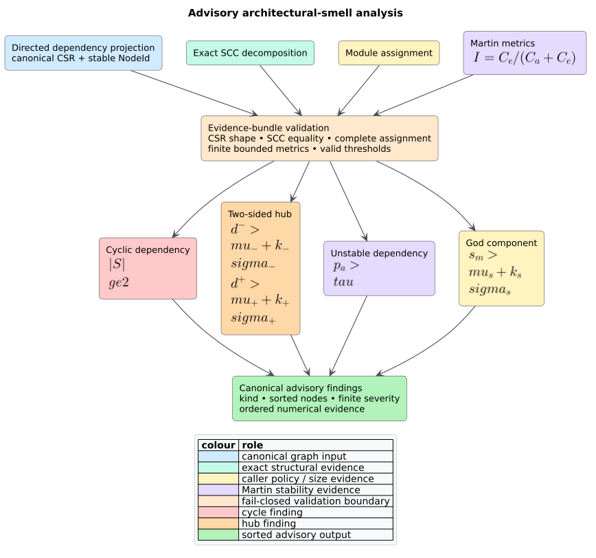

# Architectural-smell analysis

`libcpg::architecture_smells` is a feature-free, read-only analysis for four
dependency smells: multi-node cycles, two-sided hubs, dependencies toward less
stable modules, and module-size outliers. Every finding includes sorted stable
node identifiers, finite severity, and a deterministic evidence map.



*Figure 1 — component pipeline. Source:
[`architecture-smells-pipeline.puml`](../../diagrams/architecture-smells-pipeline.puml).*

## Public pipeline

```rust
use libcpg::{
    architecture_smells, martin_metrics, module_graph_projection,
    projection_sccs, CodePropertyGraph, ModuleAssignment, SmellOptions,
};

fn review(cpg: &CodePropertyGraph) {
    let view = module_graph_projection(cpg);
    let scc = projection_sccs(&view);
    let assignment = ModuleAssignment::by_module_nodes(cpg);
    let martin = martin_metrics(cpg, &assignment, &view);
    let findings = architecture_smells(
        &view,
        &scc,
        &martin,
        &assignment,
        &SmellOptions::default(),
    );

    for finding in findings {
        println!("{:?}: {:?}", finding.kind, finding.evidence);
    }
}
```

No Cargo feature is required. Feature `serde` serializes/deserializes options,
kinds, findings, nodes, and the stable evidence-key vocabulary.

## `SmellOptions`

| Field | Default | Valid domain | Meaning |
|---|---:|---:|---|
| `hub_fan_in_sigma` | `1.0` | finite, at least zero | Sigma multiplier above population mean fan-in. |
| `hub_fan_out_sigma` | `1.0` | finite, at least zero | Sigma multiplier above population mean fan-out. |
| `unstable_dependency_threshold` | `0.5` | finite, `0.0..=1.0` | Exclusive lower bound for the less-stable edge share. |
| `god_component_sigma` | `1.0` | finite, at least zero | Sigma multiplier above mean assigned node count. |

All comparisons are strict: equality with a threshold is not a finding.

## Result contract

`ArchSmell.kind` is one of:

| Kind | Finding identity | Severity |
|---|---|---:|
| `CyclicDependency { component }` | all nodes in a multi-node SCC | SCC node count |
| `HubLikeDependency` | one two-sided hub node | minimum in/out z-score |
| `UnstableDependency` | endpoints of one source module's violating edges | less-stable edge share |
| `GodComponent` | all projected nodes assigned to one large module | node-count z-score |

`nodes` is never empty and is always sorted. `evidence` is a `BTreeMap`, so its
serialized key order is stable. Evidence names are detector-specific:

- cycle: `component_size`, `internal_dependencies`;
- hub: `fan_in`, `fan_out`, means, standard deviations, and z-scores;
- unstable dependency: total/less-stable efferent edges, share, source
  instability, and configured threshold;
- god component: node count, population mean/standard deviation, and z-score.

The result vector sorts by family order shown above, descending severity,
smallest node, then the complete node vector.

## Input consistency and failure behavior

Treat the five parameters as one snapshot. The function returns an empty vector
if any threshold is invalid, CSR invariants fail, recomputed SCCs differ, a
projected node has no valid assignment, a used module lacks Martin metrics, or
the metrics contain duplicate names or non-finite/out-of-range values.

Assignment entries outside the projection and valid Martin records for unused
modules do not affect findings. All supplied metric records are nevertheless
validated, so a duplicate or invalid unused record fails the whole snapshot.
This permits one validated whole-CPG assignment/metric bundle to serve a
smaller projection without weakening validation of the evidence supplied.

## Projection choices

- A **module projection** finds import topology smells.
- A **call projection** finds function dependency shapes; group functions with
  `ModuleAssignment` to obtain module-level instability and size evidence.
- An **external projection** supports repository, package, service, or artifact
  identities supplied by an adapter.

Weights do not affect detection. Parallel edges have already been merged by
`GraphProjection`, and self-loops do not contribute to fan or unstable-edge
counts. A singleton self-cycle is intentionally not a cyclic-dependency smell.

## Advisory boundary

The analysis does no parsing, recursion, I/O, environment access, unsafe code,
or graph mutation. It allocates linear maps/vectors over the validated
projection and recomputes SCCs in linear graph time. Findings are review inputs:
callers must not automatically split modules or remove dependencies based only
on a smell classification.

See [Theory 21](../../theory/21-advisory-architectural-smells.md), [ADR
0027](../../design/0027-validated-advisory-architectural-smells.md), and
[Scientific validation 22](../../scientific/22-architectural-smells-validation.md).

## References

1. Fontana, F. A. et al. (2017). *Arcan: A Tool for Architectural Smells
   Detection*. DOI:
   [10.1109/ICSAW.2017.16](https://doi.org/10.1109/ICSAW.2017.16).
2. Fontana, F. A. et al. (2016). *Automatic Detection of Instability
   Architectural Smells*. DOI:
   [10.1109/ICSME.2016.33](https://doi.org/10.1109/ICSME.2016.33).
