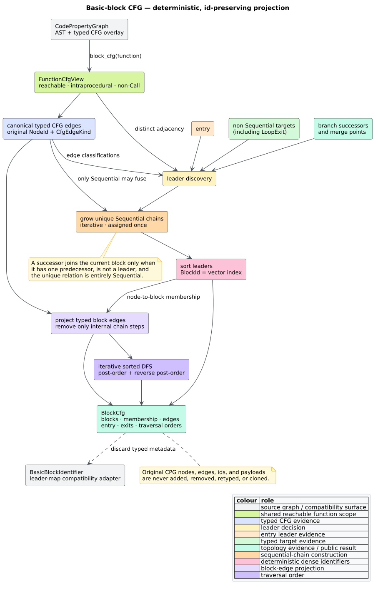

# Basic-block control-flow graphs

A **control-flow graph** (CFG) connects program points by possible execution
transitions. A **basic block** is a maximal CFG run with one entry, whose
internal transitions are unbranched `Sequential` edges. A **leader** is the
first CPG node in such a block. `libcpg::block_cfg` computes a read-only,
feature-free block view while retaining every original
[`NodeId`](../../api/graph-reference.md#where-these-types-live).



*Figure — construction of the id-preserving block CFG. Source:
[`diagrams/basic-block-cfg.puml`](../../diagrams/basic-block-cfg.puml).*

## Public API

```rust
// requires: no features
use libcpg::{block_cfg, AnalysisError, BlockCfg, CodePropertyGraph, NodeId};

fn blocks_for(
    cpg: &CodePropertyGraph,
    function: NodeId,
) -> Result<BlockCfg, AnalysisError> {
    block_cfg(cpg, function)
}
```

`function` must identify a `CpgNodeKind::Function`. An absent identifier
returns `AnalysisError::UnknownNode`; another node kind returns
`AnalysisError::NotAFunction`. The returned view owns only identifiers and
edge classifications: it neither borrows nor mutates CPG payloads.

The public result types have these contracts:

| Type or field | Contract |
|---|---|
| `BlockId(u32)` | Dense identifier. `blocks[id.0 as usize].id == id`. |
| `BasicBlock { id, leader, nodes }` | `nodes` is non-empty, begins with `leader`, and retains original CPG `NodeId` values in execution order. |
| `BlockEdge { source, target, kind }` | One inter-block or non-chain CFG transition with its original `CfgEdgeKind`. |
| `BlockCfg::function` | Function selected by the caller. |
| `blocks` | Complete disjoint partition, sorted by `leader`; therefore ids are deterministic. |
| `block_of_node` | `BTreeMap<NodeId, BlockId>` containing exactly one membership for every projected node. |
| `edges` | Deduplicated and sorted by source id, target id, then edge kind. |
| `entry` | Block containing the function entry node. |
| `exit_blocks` | Sorted, unique blocks containing explicit or structural function exits. |

`block(id)` returns `None` for an out-of-range id. `successors(id)` and
`predecessors(id)` return empty iterators for one. Both edge iterators follow
the canonical order in `edges`.

## Leader rules

Let $`G = (V, E)`$ be the reachable, intraprocedural function CFG, let $`r`$ be
its entry, and let $`E_s`$ contain its `Sequential` edges. The leader set is

```math
L = \{r\}
  \cup \{v \mid (u,v) \in E \setminus E_s\}
  \cup \{v \mid (u,v) \in E \land \operatorname{outdegree}(u) \ge 2\}
  \cup \{v \mid \operatorname{indegree}(v) \ge 2\}.
```

Consequently:

- the entry always starts a block;
- every non-`Sequential` target starts a block, including conditional, loop,
  exceptional, and `LoopExit` targets;
- every successor of a node with multiple distinct CFG successors starts a
  block; and
- every merge point with at least two distinct predecessors starts a block.

Parallel edges do not create artificial branch or merge counts because the
shared deterministic projection stores distinct successor and predecessor
relations. Edge kinds remain available separately for the block-edge result.

## Construction algorithm

The implementation uses the same `FunctionCfgView` as dominance, natural-loop,
and reachability analyses. It excludes `Call` edges and nested functions when
AST scope evidence exists; a CFG-only hand-built graph remains supported.

```text
build_block_cfg(cpg, function):
    view  := reachable intraprocedural function CFG
    typed := canonical non-Call CFG edges within view
    leaders := {entry}

    for node in view nodes:
        if predecessor_count(node) >= 2: leaders += node
        if successor_count(node) >= 2:   leaders += successors(node)
    leaders += targets(edge in typed where edge.kind != Sequential)

    for leader in leaders ordered by NodeId:
        if unassigned(leader):
            block := [leader]
            while tail has exactly one distinct successor next
              and every tail -> next edge is Sequential
              and next has exactly one distinct predecessor
              and next is neither a leader nor assigned:
                append next

    form one deterministic singleton-or-chain fallback for any unassigned
    projected node in a malformed hand-built CFG
    sort blocks by leader and assign BlockId equal to vector index
    project typed edges, removing only adjacent internal Sequential steps
    compute entry, exits, adjacency, post-order, and reverse post-order
```

For every projected CPG edge $`u \xrightarrow{k} v`$, either $`u`$ and $`v`$
are adjacent nodes of one block and $`k = \mathtt{Sequential}`$, or the result
contains the typed block edge
$`block(u) \xrightarrow{k} block(v)`$. This is the edge-projection invariant;
it prevents block formation from erasing a branch, loop, exceptional edge, or
non-chain parallel relation.

## Traversal orders

**Post-order** emits a block after all of its unvisited successors in a
depth-first search. **Reverse post-order** (RPO) reverses that sequence and is a
common forward data-flow order. Successor ids are visited in ascending order,
and the DFS uses an explicit stack, so the result is deterministic and does not
consume the native call stack.

```rust
use petgraph::Direction;

# fn inspect(cfg: &libcpg::BlockCfg) {
let forward = cfg.nodes_in(Direction::Outgoing);
assert_eq!(forward, cfg.reverse_post_order());

let backward = cfg.nodes_in(Direction::Incoming);
assert_eq!(backward, cfg.post_order());
# }
```

RPO and post-order begin from `entry`. Defensive additional roots cover a
malformed projection without omitting blocks; well-formed function projections
are entry-reachable and therefore have one root.

## Worked diamond

For `entry -> guard`, `guard -true-> yes`, `guard -false-> no`, and both arms
flowing to `join -> return`, the result is:

```text
BlockId(0): [entry, guard]
BlockId(1): [yes]
BlockId(2): [no]
BlockId(3): [join, return]

0 -ConditionalTrue-> 1
0 -ConditionalFalse-> 2
1 -Sequential-> 3
2 -Sequential-> 3
```

The numeric ids above follow the example's ascending `NodeId` assignment; the
general guarantee is sorting by leader, not source insertion order.

## Compatibility API

`builder::BasicBlockIdentifier` remains available for existing callers and its
API documentation points to `block_cfg`. The legacy method scans AST descendants
and therefore retains emitted CFG fragments after a terminator; `block_cfg`
instead consumes the canonical entry-reachable `FunctionCfgView`. The adapter
now sorts its leader worklist before constructing the historical
`FxHashMap<NodeId, Vec<NodeId>>`, but hash-map iteration remains unspecified.
New code should use `block_cfg`: the compatibility map cannot retain `BlockId`,
typed block edges, entry/exit metadata, typed selector errors, deterministic map
iteration, or traversal orders.

## Determinism, cost, and limits

- Node membership and all returned vectors are independent of node and edge
  insertion order.
- Construction is iterative and stack-safe; tests exercise 25,000 blocks.
- The operation is read-only: CPG node and edge counts and classifications are
  unchanged.
- With $`|V|`$ scoped CFG nodes and $`|E|`$ typed CFG edges, graph discovery,
  leader discovery, block growth, edge projection, and traversal are linear
  apart from canonical sorting: $`O((|V|+|E|)\log(|V|+|E|))`$ time and
  $`O(|V|+|E|)`$ auxiliary space.
- `BlockId` uses a `u32` dense domain. A graph requiring more than
  $`2^{32}`$ blocks cannot be represented and aborts construction rather than
  silently wrapping an id.
- Blocks represent CFG topology, not source-layout contiguity or machine-code
  instruction scheduling. Unreachable CFG islands are reported by
  [`unreachable_code`](reachability-analysis.md), not included in this reachable
  block view.

## Validation

Example-based tests pin diamonds, loops, `LoopExit`, CFG-only graphs, invalid
selectors, parser-built functions, public root exports, non-mutation, serde
round trips, and deep traversal. Property-based tests permute insertion order
and generate extra typed edges; independent oracles verify exact node
partitioning, adjacent intra-block predecessor relations, and projection of
every typed CFG edge. The feature matrix tests the API with `default = []` and
all features.

## See also

- [Graph projections](projections.md) — deterministic CSR substrate.
- [Natural loops and nesting](loop-analysis.md) — loop headers and `LoopExit`.
- [CFG reachability](reachability-analysis.md) — unreachable islands.
- [CFG construction](../builder/cfg.md) — parser-to-CFG edge semantics.
- [ADR-0008](../../design/0008-id-preserving-basic-block-cfg.md) — why the
  result is an immutable id-preserving view.

## References

- Aho, A. V., Sethi, R., Ullman, J. D. (1986). *Compilers: Principles,
  Techniques, and Tools.* Addison-Wesley. ISBN 0-201-10088-6. The book predates
  routine DOI assignment and has no DOI; the ISBN is the stable identifier.
