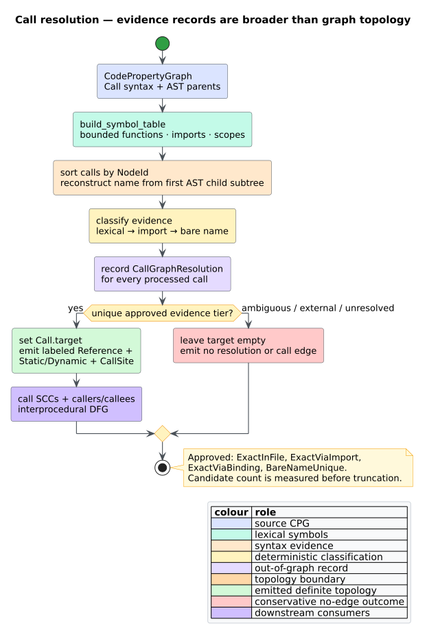

# Evidence-bounded call-target resolution

Call-target resolution turns a syntactic `Call { target: None }` node into a
conservative interprocedural relation. `libcpg` performs it as an explicit,
feature-free post-pass: it builds a lexical symbol table, records the evidence
for every processed call out of graph, and materializes call-graph edges only
when one target is uniquely supported.

This boundary matters because call edges are topology. A guessed edge can merge
two strongly connected components (SCCs), invent recursion, change graph
centrality, and activate incorrect interprocedural data flow. The resolver
therefore accepts conservative false negatives rather than fabricated positive
edges. [ADR-0006](../../design/0006-evidence-bounded-call-resolution.md)
records that decision; it is the repository realization of the epic's ADR-044
evidence policy.



*Figure — the out-of-graph evidence record and the guarded topology emission
channel. Source: [`diagrams/call-resolution.puml`](../../diagrams/call-resolution.puml).*

## Public API

All types and functions are available from `libcpg::analysis` and the crate
root, with `default = []`:

```rust
use libcpg::{
    build_symbol_table, resolve_calls, CallGraphResolution, CodePropertyGraph,
    ResolveConfig, SymbolTable,
};

fn analyze(cpg: &mut CodePropertyGraph) -> (SymbolTable, CallGraphResolution) {
    let config = ResolveConfig::default();
    let symbols = build_symbol_table(cpg, &config);
    let calls = resolve_calls(cpg, &config);
    (symbols, calls)
}
```

```rust
pub fn build_symbol_table(
    cpg: &mut CodePropertyGraph,
    cfg: &ResolveConfig,
) -> SymbolTable;

pub fn resolve_calls(
    cpg: &mut CodePropertyGraph,
    cfg: &ResolveConfig,
) -> CallGraphResolution;
```

Both functions preserve nodes. They append edges with unique endpoint/kind
semantics, so rerunning them does not grow the graph. `resolve_calls` invokes
`build_symbol_table` itself; callers need not invoke both unless they also want
the standalone table.

## Evidence tiers

The table below defines the C1 evidence classification. The score is a
downstream ranking signal; C1's unique-target tiers are its emission boundary.

| Tier | Score | Evidence | Creates topology? |
|---|---:|---|:---:|
| `ExactInFile` | $`1.0`$ | One declaration with the name is visible in the lexical scope chain. | yes |
| `ExactViaImport` | $`0.95`$ | A declaration-level import edge names exactly one represented function, including a renamed local binding; or the legacy visible-import fallback finds one global declaration. | yes |
| `ExactViaBinding` | $`0.9`$ | The input call already points to an existing function node. | yes |
| `BareNameUnique` | $`0.7`$ | No lexical/import match exists, but exactly one in-graph function has the bare name. | yes |
| `BareNameAmbiguous` | $`0.3`$ | At least two in-graph functions have that name. | **no** |
| `External` | $`0.0`$ | A visible import names a function absent from this CPG. | **no** |
| `Unresolved` | $`0.0`$ | The AST exposes no supported unique evidence. | **no** |

The successor [virtual-call type-refinement component](type-refinement.md)
adds `ClassHierarchy` (0.75), `RapidType` (0.80), and `VariableType` (0.85).
Those tiers can identify a represented closed-world singleton, but the
immutable `devirtualize` API does not itself materialize topology.

The stable edge labels are the snake-case tier names: `exact_in_file`,
`exact_via_import`, `exact_via_binding`, and `bare_name_unique`. Ambiguous,
external, and unresolved tiers emit no resolution edge, so their labels live
only in `CallResolution::confidence`.

Formally, let $`C(c)`$ be the candidate set for call $`c`$ after lexical and
import lookup. The resolver creates topology only when

```math
\lvert C(c) \rvert = 1 \;\land\; \operatorname{confidence}(c) \in
\{\mathrm{ExactInFile},\mathrm{ExactViaImport},
\mathrm{ExactViaBinding},\mathrm{BareNameUnique}\}.
```

Candidate *count* is computed before retention truncation. Setting
`max_candidates_per_name = 1` therefore does not turn three same-named
functions into a false unique match.

## Emission matrix

For a uniquely resolved call $`c`$ and target function $`f`$, the resolver:

1. sets `Call::target = Some(f)`;
2. adds `Reference(c, f)`;
3. adds `StaticCall(c, f)` for a function call or `DynamicCall(c, f)` for a
   method call; and
4. adds `CallSite(c, f)`.

All three emitted edge families carry the confidence label. `StaticCall` or
`DynamicCall` and `CallSite` are the two topology edges counted by
`CallGraphResolution::topology_edges`; `Reference` is supporting evidence.
`connect_unique`/unique labeled insertion makes a second pass add zero edges.
The second pass recovers the prior evidence tier from those labels, so its
per-call records remain stable rather than degrading to `ExactViaBinding`.

For `BareNameAmbiguous`, `External`, and `Unresolved`, none of those four actions
occurs. In particular, neither channel read by `call_graph_sccs`—a populated
`Call::target` or an `is_call()` edge—is touched.

## Symbol and scope model

`build_symbol_table` recognizes `Root`, `Module`, `Class`, `Struct`, `Enum`,
`Trait`, `Impl`, `Function`, `Block`, and `Lambda` nodes as lexical scopes.
Parent pointers determine containment, bounded by `max_scope_depth` and guarded
against cycles.

It emits two reserved scope relations:

- `EnclosingScope(scope, parent_scope)` for a nested scope; and
- `ContainedIn(node, scope)` for a non-scope node.

`SymbolTable` exposes:

| Field | Meaning |
|---|---|
| `enclosing_scope` | nearest lexical scope for every represented non-root node |
| `functions_by_scope` | function declarations keyed first by containing scope, then by name |
| `functions_by_name` | global bare-name index used only after lexical/import lookup |
| `imports_by_scope` | visible imports keyed by terminal path name |
| `imported_functions_by_scope` | functions selected by declaration-level `Imports` edges, keyed by the edge's local-binding label or the declaration name |

Every candidate bucket is a `SymbolCandidates { nodes, total }`. `nodes` is
sorted, deduplicated, and capped; `total` preserves the pre-cap cardinality and
`is_truncated()` reports whether identifiers were omitted.

## Resolution algorithm

The algorithm is deliberately staged so evidence collection cannot implicitly
become graph mutation:

```text
resolve_calls(cpg, config):
    symbols = build_symbol_table(cpg, config)
    calls = sort_by_NodeId(cpg.calls)[0 .. max_calls]

    for call in calls:
        name = first_named_node_in_callee_subtree(call, max_scope_depth)

        if call has a valid existing target:
            decision = prior_edge_label or ExactViaBinding
        else if method resolution is disabled:
            decision = Unresolved
        else if nearest lexical scope containing name has candidates:
            decision = unique ? ExactInFile : BareNameAmbiguous
        else if nearest declaration-level import binding has candidates:
            decision = unique ? ExactViaImport : BareNameAmbiguous
        else if a legacy visible import has name:
            decision = global candidate count is
                       1 ? ExactViaImport :
                       >1 ? BareNameAmbiguous : External
        else:
            decision = global candidate count is
                       1 ? BareNameUnique :
                       >1 ? BareNameAmbiguous : Unresolved

        record decision in CallGraphResolution
        if decision.confidence.creates_topology():
            set target and emit labeled unique edges
```

The callee-name walk examines only the first AST child subtree because grammar
call nodes place the callee before their arguments. It never falls through to a
later argument identifier: doing so would convert an argument name into a false
callee. Nested `Call` subtrees also stop the walk.

## Result and configuration contracts

`CallResolution` records the reconstructed name, starting scope, confidence,
target, retained candidates, full candidate count, and truncation flag.
`CallGraphResolution::resolutions` is a `BTreeMap<NodeId, CallResolution>`;
aggregate counters distinguish newly emitted topology edges, ambiguous calls,
external calls, and unresolved calls.

`ResolveConfig` supplies four explicit resource/policy controls:

| Field | Default | Effect |
|---|---:|---|
| `max_scope_depth` | `128` | caps parent-scope traversal and callee-subtree search; cycle guards stop earlier |
| `max_candidates_per_name` | `64` | caps retained identifiers without changing the true ambiguity count |
| `max_calls` | `100_000` | processes the lowest sorted call identifiers and leaves the remainder untouched |
| `resolve_methods` | `true` | when false, unbound method calls remain `Unresolved`; valid existing bindings remain authoritative |

With $`N`$ nodes, $`E`$ AST edges, $`C`$ processed calls, scope-depth bound
$`D`$, and retained candidate cap $`K`$, a conservative implementation-level
time bound is
$`O(ND \log N + NK \log K + C(N + E + K))`$ and retained table/result
space is $`O(N + CK)`$. The per-call $`N + E`$ term is adversarial: it covers
a first-callee subtree that spans the whole malformed graph. Ordinary callee
expressions are tiny, and visited sets ensure each reachable node is examined
at most once per call. Typical scope lookup is also much shallower than
$`D`$. No recursive resolver traversal consumes the native call stack.

`build_import_graph` labels every import-to-declaration edge with the local
binding (`sum` in `from math import add as sum`). Repeated statements are first
deduplicated as `(binding, target)` pairs, so importing one declaration twice
does not manufacture ambiguity. File-root dependency edges remain unlabeled.

## Builder integration

Direct post-pass use is the clearest API:

```rust
use libcpg::{resolve_calls, CodePropertyGraph, ResolveConfig};

fn resolve(cpg: &mut CodePropertyGraph) {
    let result = resolve_calls(cpg, &ResolveConfig::default());
    println!("{} new topology edges", result.topology_edges);
}
```

`CpgBuilderConfig::with_import_resolution(true)` opts the shared
`build_from_tree` pipeline into the same pass after CFG extraction and before
DFG extraction. That ordering lets parameter and return-value DFG helpers see
resolved callers. The flag remains `false` by default, so existing construction
shape and edge-count contracts are unchanged.

## Determinism and validation

Node and call enumeration is sorted by `NodeId`; candidate vectors are sorted
and deduplicated; all public maps are `BTreeMap`; ambiguity uses `total`, never
hash iteration or the truncated vector length. Scope and call edges are emitted
in canonical order.

Validation includes exact examples for every confidence family, static and
dynamic edge labels, invalid pre-bindings, scope-edge idempotency, caps, method
policy, and argument-subtree isolation. Two 256-case property suites prove
stable results under node/edge insertion permutations and prove that duplicated
names over generated well-formed CPGs add zero call edges and leave the SCC
partition unchanged. A parsed-Rust integration test proves that the opt-in
builder resolves an in-file call before interprocedural parameter/return DFG
edges are constructed.

## Reference

- Yamaguchi, F., Golde, N., Arp, D., Rieck, K. (2014). *Modeling and Discovering Vulnerabilities with Code Property Graphs.* 2014 IEEE Symposium on Security and Privacy, 590–604. DOI: [10.1109/SP.2014.44](https://doi.org/10.1109/SP.2014.44).
