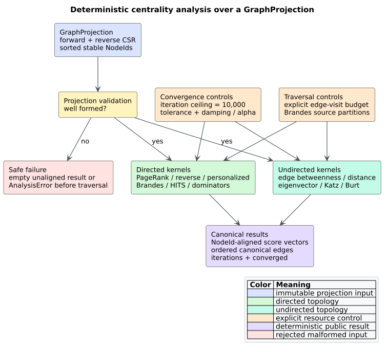

# Projection centrality analysis

**Centrality** assigns a numerical score to each vertex or edge according to a
precisely stated notion of structural importance. libcpg provides deterministic,
feature-free implementations of PageRank, personalized PageRank, reverse
PageRank, vertex and edge betweenness, eigenvector and Katz centrality,
closeness, harmonic centrality, Hyperlink-Induced Topic Search (HITS), and
Burt's structural-holes constraint. The existing projection dominator tree is
the corresponding path-mandatory relation rather than a scalar score.

Every function reads an immutable [`GraphProjection`](projections.md). Node
results use stable `NodeId` values in `graph.nodes` order. No function adds,
removes, or rewrites a Code Property Graph (CPG) node or edge.



*Figure 1 — the complete centrality boundary, including validation and resource
controls. Source: [`diagrams/centrality-pipeline.puml`](../../diagrams/centrality-pipeline.puml).*

## Choosing a measure

The word “important” is not one mathematical property. Choose the measure whose
question matches the program relation represented by the projection.

| Measure | Direction and weight policy | Question answered |
|---|---|---|
| PageRank | directed, unweighted | Which vertices receive score from vertices that point to them? |
| reverse PageRank | directed transpose, unweighted | Which dependency sinks support vertices that point outward from them? |
| personalized PageRank | directed, unweighted, caller restart vector | Which vertices are structurally close to selected seeds under a random walk with restart? |
| vertex betweenness | directed, unweighted shortest paths | Which vertices mediate directed source-to-target paths? |
| edge betweenness | undirected, unweighted shortest paths | Which canonical relations bridge regions of the topology? |
| eigenvector | undirected, nonnegative weighted | Which vertices connect to other highly scored vertices? |
| Katz | undirected, nonnegative weighted | Which vertices receive attenuated credit from walks of every length plus a baseline? |
| closeness | undirected, unweighted | Which vertices have the smallest average distance within their reachable component? |
| harmonic | undirected, unweighted | Which vertices remain close to many others, including in disconnected graphs? |
| HITS | directed, unweighted | Which vertices are hubs pointing to authorities, and which are authorities pointed to by hubs? |
| Burt constraint | undirected, nonnegative weighted | Which vertices have redundant rather than brokerage-oriented neighborhoods? |
| dominators | directed, rooted | Which vertices lie on every path from one root to another reachable vertex? |

PageRank on a call graph, for example, does not measure the same property as
betweenness on a control-flow graph. Results describe the supplied projection;
they do not infer whether its edges are semantically complete.

## Public result types

Scalar node measures return `CentralityScores`:

```rust
pub struct CentralityScores {
    pub kind: CentralityKind,
    pub nodes: Vec<NodeId>,
    pub scores: Vec<f64>,
    pub iterations: usize,
    pub converged: bool,
}
```

For every valid input, `nodes == graph.nodes` and
`scores.len() == nodes.len()`. `iterations` counts fixed-point rounds for
iterative algorithms and completed source traversals for all-sources
algorithms. `converged` distinguishes a completed fixed point or traversal from
an invalid numerical option or exhausted iteration request.

`EdgeCentralityScores` contains sorted canonical `(NodeId, NodeId)` pairs and
aligned scores. `HitsScores` contains two `CentralityScores` values, with kinds
`HitsHub` and `HitsAuthority`.

The shared controls are:

```rust
pub const MAX_CENTRALITY_ITERATIONS: usize = 10_000;
pub const DEFAULT_CENTRALITY_WORK_LIMIT: u64 = 2_000_000_000;

pub struct PageRankOptions {
    pub damping: f64,
    pub max_iterations: usize,
    pub tolerance: f64,
}

pub struct IterationOptions {
    pub max_iterations: usize,
    pub tolerance: f64,
}

pub struct KatzOptions {
    pub alpha: f64,
    pub beta: f64,
    pub max_iterations: usize,
    pub tolerance: f64,
}

pub struct CentralityBudget { pub max_work: u64 }
pub struct BetweennessOptions { pub normalized: bool, pub max_work: u64 }
```

The default PageRank damping is `0.85`; the default iteration request is 100;
the default tolerance is `1e-8`. Every request is clamped to the hard 10,000
round ceiling. A non-finite or negative tolerance, or a PageRank damping value
outside the closed interval `[0, 1]`, produces an aligned, non-converged result
without iterating.

## PageRank family

Let the directed graph be $`G=(V,E)`$, let $`n=|V|`$, and let $`d^+(u)`$ be the
out-degree of vertex $`u`$. A **restart vector** $`r`$ is a nonnegative vector
whose components sum to one. With damping $`d`$, the update is

```math
p_{t+1}(v)=(1-d)r_v+d\left(
\sum_{(u,v)\in E,\ d^+(u)>0}\frac{p_t(u)}{d^+(u)}
+r_v\sum_{d^+(u)=0}p_t(u)
\right).
```

Uniform PageRank uses $`r_v=1/n`$. Personalized PageRank uses caller seeds.
Repeated seed identifiers are grouped by dense vertex; their finite,
nonnegative weights are sorted before addition and then L1-normalized. If all
weights are zero, restart mass is uniform across the distinct seed vertices.
An empty seed set, negative or non-finite weight, unknown `NodeId`, or finite
weights whose combined mass overflows is an `AnalysisError`.

Reverse PageRank is exactly PageRank on $`G^T`$, the graph obtained by reversing
every edge. The implementation uses the existing reverse compressed-sparse-row
(CSR) arrays directly and does not allocate a transposed graph.

```text
PAGERANK(graph, restart, damping, limit, tolerance):
    current = restart
    repeat at most min(limit, 10,000) times:
        dangling = stable-sum current[u] where out-degree(u) = 0
        for v in ascending dense order:
            incoming = stable-sum current[u] / out-degree(u) for u -> v
            next[v] = (1 - damping) restart[v]
                      + damping (incoming + dangling restart[v])
        if max-component-distance(current, next) < tolerance:
            return aligned(next, converged = true)
        current = next
    return aligned(current, converged = false)
```

Contributions are sorted by their floating-point total order before addition.
That policy removes hash and adjacency-insertion order from the numerical
result and reduces stable-identifier relabeling sensitivity.

## Betweenness family

For distinct vertices $`s,t,v`$, let $`\sigma_{st}`$ be the number of shortest
directed paths from $`s` to $`t`$, and let $`\sigma_{st}(v)`$ count those paths
whose interior contains $`v`$. Vertex betweenness is

```math
C_B(v)=\sum_{s\ne v\ne t}\frac{\sigma_{st}(v)}{\sigma_{st}}.
```

`betweenness_centrality` uses Brandes' dependency-accumulation algorithm. The
default directed normalization divides by $`(n-1)(n-2)`$ when $`n>2`.
`normalized: false` returns raw dependency sums.

`accumulate_for_sources` is the public serial kernel used by future ordered
parallel callers. It validates, sorts, and deduplicates source `NodeId` values.
Each partial result uses the same global normalization, so aligned partial
score vectors from disjoint source partitions sum to the full result when the
caller combines partitions in a fixed order.

```text
BRANDES-SOURCES(graph, sources):
    output = zero vector
    for s in sorted unique sources:
        breadth-first search from s
        record distance, predecessor lists, visit stack
        for each breadth-first layer:
            weight[v] = stable-sum weight[p] for predecessor p of v
            divide the layer by its maximum weight
        pop vertices in reverse breadth-first order
        denominator = stable-sum weight[p] for predecessors of v
        propagate weight[p] / denominator dependency fractions
        add each non-source dependency to output
    optionally divide output by (n - 1)(n - 2)
    return output
```

The modeled work is $`|S||E|`$ directed edge visits and is checked before
allocation-heavy traversal. `edge_betweenness` instead uses the deduplicated
undirected view, ignores self-loops, canonicalizes each edge by smaller stable
identifier first, halves the double source credit, and budgets the exact number
of undirected adjacency entries times $`n`$.

Raw shortest-path counts can grow exponentially and exceed `f64` even when the
graph fits the work budget. Brandes needs only each predecessor's share of a
successor's shortest paths. Dividing every breadth-first layer by one common
positive scale preserves those shares exactly while keeping every stored path
weight finite.

## Spectral walk measures

The weighted undirected adjacency matrix $`A`$ is formed deterministically.
Every directed edge contributes `max(weight, 0)` in both directions; reciprocal
edges therefore add. A self-loop contributes twice for the spectral measures,
matching the two symmetric incidences of the ported pgmcp kernel.
Non-finite projection weights are not meaningful matrix coefficients:
eigenvector and Katz return aligned non-converged results, while the fallible
Burt API returns `AnalysisError::InvalidInput`.

### Eigenvector centrality

Eigenvector centrality seeks a nonnegative unit vector $`x`$ satisfying

```math
Ax=\lambda x.
```

The implementation runs normalized power iteration on $`A+I`$. Adding the
identity matrix does not change the eigenvectors and removes the sign-period
oscillation that plain power iteration exhibits on bipartite graphs such as a
star. The output is L2-normalized. A slow spectral gap can exhaust the caller's
bounded request; the latest normalized vector is returned with
`converged == false`.

### Katz centrality

Before final normalization, Katz centrality solves the fixed point

```math
x=\alpha Ax+\beta\mathbf{1}.
```

libcpg requires finite $`\alpha\ge 0`$ and $`\beta`$, and uses the sufficient
convergence condition
$`\alpha\max_i\sum_j A_{ij}<1`$. A violation returns the aligned zero initial
vector with zero iterations and `converged == false`; it does not risk an
unbounded or divergent iteration. Successful or capped iterates are
L2-normalized for comparability with eigenvector scores.

## Distance measures

Both distance measures run breadth-first search over the deduplicated,
self-loop-free undirected projection. Let $`R_v`$ be the other vertices
reachable from $`v`$, and let $`d(v,u)`$ be their unweighted shortest-path
distance.

Wasserman–Faust normalized closeness is

```math
C_C(v)=\frac{|R_v|}{n-1}\frac{|R_v|}{\sum_{u\in R_v}d(v,u)}.
```

The reachable-fraction factor prevents a vertex in a small disconnected
component from receiving an artificially maximal score. Harmonic centrality is

```math
C_H(v)=\frac{1}{\max(n-1,1)}\sum_{u\in R_v}\frac{1}{d(v,u)}.
```

An isolated vertex scores zero under both definitions. Before traversal, the
functions check `n * undirected_adjacency_entries` against `CentralityBudget`.

## HITS hubs and authorities

Hyperlink-Induced Topic Search (HITS) maintains two directed scores. With
adjacency matrix $`A`$, one coupled round is

```math
a_{t+1}=A^T h_t,\qquad h_{t+1}=A a_{t+1}.
```

Each vector is independently L2-normalized. A vertex with edges to several
high-scoring authorities becomes a hub; a vertex reached from high-scoring hubs
becomes an authority. Empty graphs converge immediately. Weights do not affect
HITS.

## Burt structural-holes constraint

Burt's constraint is computed over the nonnegative weighted undirected view,
with self-loops ignored. Let $`w_{ij}`$ be the summed symmetric weight and

```math
p_{ij}=\frac{w_{ij}}{\sum_q w_{iq}}.
```

Then the local constraint of $`i`$ is

```math
C_i=\sum_j\left(p_{ij}+\sum_{q\ne i,j}p_{iq}p_{qj}\right)^2.
```

A low value indicates brokerage across less redundant neighborhoods; a high
value indicates that direct contacts are also connected through intermediaries.
The explicit work estimate is $`\sum_i d(i)^2`$ neighbor comparisons.

## Usage example

```rust
use libcpg::{
    betweenness_centrality, pagerank, BetweennessOptions, GraphProjection,
    NodeId, PageRankOptions, ProjectionKind,
};

let graph = GraphProjection::from_edges(
    ProjectionKind::External,
    (0..4).map(NodeId::new),
    [
        (NodeId::new(0), NodeId::new(1), 1.0),
        (NodeId::new(0), NodeId::new(2), 1.0),
        (NodeId::new(1), NodeId::new(3), 1.0),
        (NodeId::new(2), NodeId::new(3), 1.0),
    ],
);

let rank = pagerank(&graph, PageRankOptions::default());
assert_eq!(rank.nodes, graph.nodes);
assert_eq!(rank.scores.len(), graph.node_count());

let bridge = betweenness_centrality(&graph, BetweennessOptions::default())?;
assert!(bridge.converged);
# Ok::<(), libcpg::AnalysisError>(())
```

The snippet requires no Cargo feature. Projection nodes absent from an edge
remain in every aligned result. Edges whose endpoints are outside the declared
projection universe were already excluded by `GraphProjection::from_edges`.

## Determinism, malformed inputs, and interpretation

All vertex arrays use dense projection order, and CSR neighbors are sorted.
Seed weights and the contribution sets used by PageRank, spectral, HITS, and
Burt kernels are total-order sorted before floating-point reduction. Brandes
uses canonical source, breadth-first-neighbor, predecessor, and reverse-stack
orders; edge results use `BTreeMap` ordering. Tests require exact equality
across repeated calls and reversed input enumeration, plus numerical
equivalence after an isomorphic stable-identifier reversal.

Public projection fields can be caller-mutated or deserialized. Every kernel
checks `GraphProjection::is_well_formed()` before indexed traversal. Functions
whose signatures already return `Result` report `AnalysisError::InvalidInput`.
Total scalar functions return an empty, unaligned result with
`converged == false`; this cannot be confused with a valid nonempty aligned
result. Empty well-formed graphs instead return empty aligned results with
`converged == true`.

Centrality is advisory structural evidence. High PageRank does not prove
semantic importance; high betweenness does not prove a runtime bottleneck; low
Burt constraint does not prove architectural quality. Scores can be distorted
by incomplete call resolution, an inappropriate projection, duplicated
semantic relations that became distinct edges, or a caller-selected numerical
cap. Preserve `kind`, `iterations`, `converged`, projection provenance, and
options when comparing or persisting results.

## Complexity

Let $`n=|V|`$, $`m=|E|`$, $`k`$ be the bounded iteration count, and $`a`$ the
number of undirected adjacency entries.

| Kernel | Time | Extra space |
|---|---:|---:|
| PageRank/reverse/personalized | $`O(k(n+m))`$ | $`O(n)`$ |
| vertex Brandes, all sources | $`O(n(n+m))`$ | $`O(n+m)`$ |
| edge Brandes | $`O(n(n+a))`$ | $`O(n+a+m)`$ |
| eigenvector/Katz | $`O(k(n+m))`$ | $`O(n+m)`$ |
| closeness/harmonic | $`O(n(n+a))`$ | $`O(n+a)`$ |
| HITS | $`O(k(n+m))`$ | $`O(n)`$ |
| Burt constraint | $`O(m+\sum_i d(i)^2)`$ | $`O(n+m)`$ |

No kernel creates a thread pool, recursively traverses the graph, or allocates
an $`n\times n`$ matrix. Ordered external parallelism can partition Brandes
sources through `accumulate_for_sources`.

## Validation

The implementation is checked by fixed ring, path, star, triangle, diamond, and
disconnected examples; petgraph PageRank and dominator differentials; a naive
all-simple-path betweenness oracle; source-partition composition; malformed and
budget tests; public feature-free integration; the repository corruption
campaign; a 1,100-layer exponential-path fixture that exceeds the ordinary
`f64` path-count range; and 128 generated topologies with repeated-call,
input-permutation, and stable-ID-reversal checks for every public measure.
Oracle-guarded Criterion cases cover paths, rings, and clustered graphs at
128–1,024 vertices.

See [Scientific validation 12](../../scientific/12-centrality-validation.md)
for the falsifiable claims and reproduction protocol, and
[ADR-0017](../../design/0017-deterministic-bounded-centrality.md) for the
design rationale.

## References

1. Brin, S., and Page, L. (1998). *The Anatomy of a Large-Scale Hypertextual
   Web Search Engine.* Computer Networks and ISDN Systems 30, 107–117.
   [DOI 10.1016/S0169-7552(98)00110-X](https://doi.org/10.1016/S0169-7552(98)00110-X).
2. Berkhin, P. (2005). *A Survey on PageRank Computing.* Internet Mathematics
   2(1), 73–120.
   [DOI 10.1080/15427951.2005.10129098](https://doi.org/10.1080/15427951.2005.10129098).
3. Tong, H., Faloutsos, C., and Pan, J.-Y. (2006). *Fast Random Walk with
   Restart and Its Applications.* ICDM, 613–622.
   [DOI 10.1109/ICDM.2006.70](https://doi.org/10.1109/ICDM.2006.70).
4. Brandes, U. (2001). *A Faster Algorithm for Betweenness Centrality.* The
   Journal of Mathematical Sociology 25(2), 163–177.
   [DOI 10.1080/0022250X.2001.9990249](https://doi.org/10.1080/0022250X.2001.9990249).
5. Girvan, M., and Newman, M. E. J. (2002). *Community Structure in Social and
   Biological Networks.* PNAS 99(12), 7821–7826.
   [DOI 10.1073/pnas.122653799](https://doi.org/10.1073/pnas.122653799).
6. Bonacich, P. (1987). *Power and Centrality: A Family of Measures.* American
   Journal of Sociology 92(5), 1170–1182.
   [DOI 10.1086/228631](https://doi.org/10.1086/228631).
7. Katz, L. (1953). *A New Status Index Derived from Sociometric Analysis.*
   Psychometrika 18, 39–43.
   [DOI 10.1007/BF02289026](https://doi.org/10.1007/BF02289026).
8. Sabidussi, G. (1966). *The Centrality Index of a Graph.* Psychometrika 31,
   581–603. [DOI 10.1007/BF02289527](https://doi.org/10.1007/BF02289527).
9. Marchiori, M., and Latora, V. (2000). *Harmony in the Small-World.* Physica
   A 285, 539–546.
   [DOI 10.1016/S0378-4371(00)00311-3](https://doi.org/10.1016/S0378-4371(00)00311-3).
10. Kleinberg, J. M. (1999). *Authoritative Sources in a Hyperlinked
    Environment.* Journal of the ACM 46(5), 604–632.
    [DOI 10.1145/324133.324140](https://doi.org/10.1145/324133.324140).
11. Burt, R. S. (1992). *Structural Holes: The Social Structure of
    Competition.* Harvard University Press. ISBN 978-0-674-84371-4.
