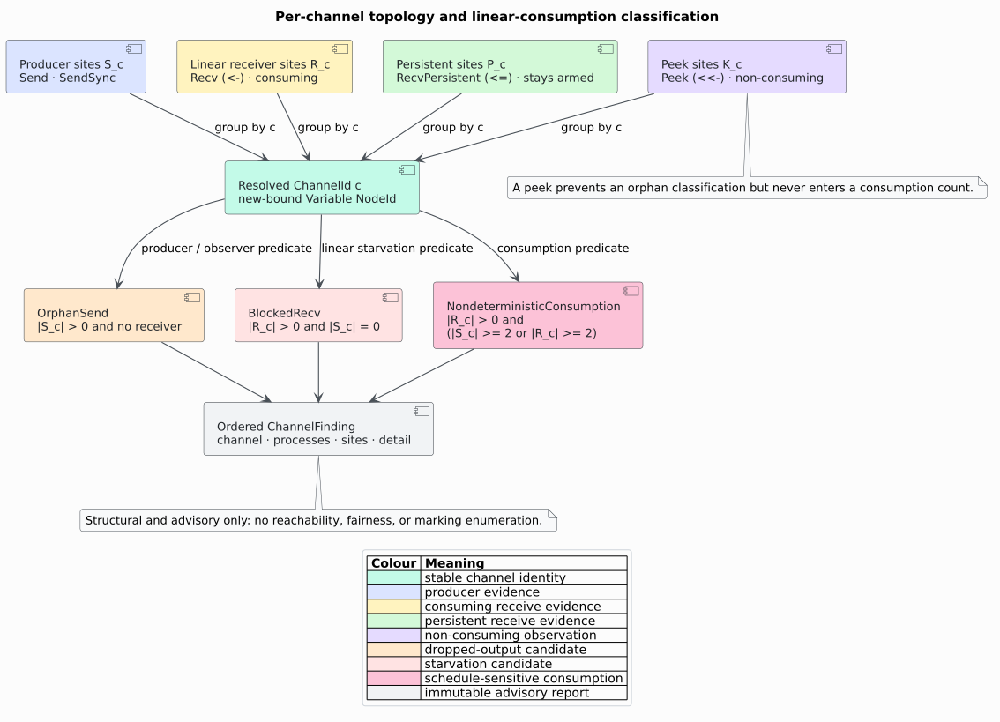

# Channel-event extraction and topology reports

`analysis::concurrency` is a feature-free, read-only component that turns
frontend-normalized message nodes into ordered per-process events, resolves
their channel identity through typed graph evidence, and reports F1 topology
and F4 linear-consumption concerns.


## Public surface

| Item | Semantics |
|---|---|
| `MsgKind` | closed language-neutral event vocabulary |
| `CpgNode::message_kind` | optional frontend-supplied normalized metadata |
| `ChannelId` | alias of the defining `Variable` `NodeId` |
| `ChannelEvent` | kind, optional channel, exact site, and source range |
| `extract_events(&cpg)` | ordered events per top-level process/function |
| `ChannelFindingKind` | orphan, blocked, or non-deterministic consumption |
| `ChannelFinding` | channel plus sorted process/site evidence and detail |
| `channel_report(&cpg)` | ordered immutable advisory findings |

All items compile with `default = []`; their serde derives compile only with
`serde`.

## Construction seam

`NodeMapper::message_kind` is called alongside `map_kind` during
`TreeSitterCpgBuilder::convert_node`. This orthogonal field avoids changing a
node's established structural meaning. For example, a Rholang `send` remains a
`Call`, `choice` remains `Match`, and `par` remains `Block`, while each also
carries the appropriate `MsgKind`.

For `par`, the block's direct children are its semantic operands. Depending on
the real grammar tree, those roots may be process nodes or wrapper blocks. The
[MHP component](mhp-analysis.md) intentionally accepts both shapes.

The Rholang mapping is:

```text
send | send_method -> Send       send_sync    -> SendSync
linear_bind        -> Recv       repeated_bind -> RecvPersistent
peek_bind          -> Peek       choice       -> Select
par                -> Spawn
```

No grammar crate is linked into the feature-free core. Mode B callers supply
the real parse tree.

## Extraction pipeline

For each function without a function ancestor, `function_scope_nodes` collects
its AST scope while stopping before nested functions. Sites with
`message_kind != None` are sorted by id. Channel-using sites search their own
subtree, stopping at nested event sites, and retain only identifiers whose
typed definition candidates are `Variable` nodes.

Candidate ordering is `(start_byte, end_byte, identifier_id, definition_id)`.
That tie-break is independent of petgraph adjacency order. The output is a
`BTreeMap`, even though internal visited sets use faster hash storage.

## Classification pipeline



Events with `channel = None`, plus `Select` and `Spawn`, remain in the extraction
result but do not enter a channel tally. Each channel tally stores producer,
linear receiver, persistent receiver, and peek event sites. One ordered pass
emits findings in this fixed order per channel:

1. `OrphanSend` when producers exist but no receiver/observer exists;
2. `BlockedRecv` when linear receivers exist but producers do not; and
3. `NondeterministicConsumption` when a linear receiver coexists with at least
   two producer sites or at least two linear receiver sites.

Finding `processes` and `sites` are independently sorted and deduplicated.

## Failure and uncertainty behavior

- no top-level functions: empty process map and report;
- event without a resolvable variable: retained event with `channel = None`;
- dangling edge endpoint: graph insertion rejects it before analysis;
- equal channel spellings without typed relations: never joined;
- persistent-only or peek-only channel: no blocked finding;
- unknown/stale metadata: no event is invented;
- malformed cyclic AST edges: visited sets guarantee termination; and
- any report invocation: node and edge counts remain unchanged.

## Related material

- [Theory 29](../../theory/29-channel-topology-and-linearity.md)
- [ADR-0036](../../design/0036-typed-channel-topology.md)
- [Usage 12](../../usage/12-channel-topology.md)
- [Scientific validation 31](../../scientific/31-channel-topology-validation.md)
- [Security boundary](../../security/04-channel-topology.md)
- [May-happen-in-parallel analysis](mhp-analysis.md)

## References

1. Meredith, L. G., Radestock, M. (2005). *A Reflective Higher-order Calculus.*
   DOI:
   [10.1016/j.entcs.2005.05.016](https://doi.org/10.1016/j.entcs.2005.05.016).
