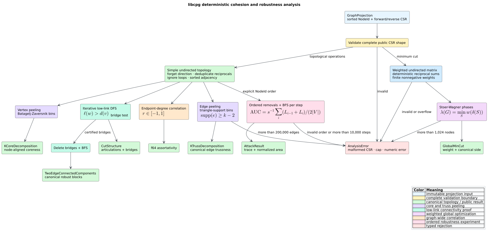

# Cohesion and structural robustness

**Cohesion** asks how strongly vertices or edges belong to mutually supporting
subgraphs. **Structural robustness** asks which vertices, edges, or cuts can
fragment that structure. libcpg provides a deterministic, feature-free family
over an immutable [`GraphProjection`](projections.md): k-core, k-truss,
articulation vertices and bridges, two-edge-connected components, global
minimum cut, degree assortativity, and sequential attack simulation.



*Figure 1 — complete cohesion-analysis flow. Source:
[`diagrams/cohesion-pipeline.puml`](../../diagrams/cohesion-pipeline.puml).*

## Questions the family answers

| Question | Analysis | Output |
|---|---|---|
| Which vertices survive increasingly strict minimum-degree filters? | `k_core_decomposition` | node-aligned core numbers |
| Which dependencies have increasingly strong triangle support? | `k_truss_decomposition` | canonical edges with trussness |
| Which single vertex or edge can increase the component count? | `cut_vertices_and_bridges` | sorted articulation vertices and bridges |
| Which maximal regions survive deletion of any one edge? | `two_edge_connected_components` | canonical component partition |
| What is the lightest weighted seam? | `global_min_cut` | weight and one canonical cut side |
| Do similar-degree vertices tend to connect? | `degree_assortativity` | Newman's coefficient in `[-1, 1]` |
| How quickly does connectivity collapse under a chosen removal order? | `attack_simulation` | trace and normalized area under the curve |

These answers describe the supplied relation. A bridge in a module-dependency
projection is an architectural single edge of failure; a bridge in a control-
flow projection has a different meaning. None of the outputs independently
proves runtime failure, semantic ownership, or vulnerability.

## Public API

```rust
pub fn k_core_decomposition(
    graph: &GraphProjection,
) -> Result<KCoreDecomposition, AnalysisError>;

pub fn k_truss_decomposition(
    graph: &GraphProjection,
) -> Result<KTrussDecomposition, AnalysisError>;

pub fn cut_vertices_and_bridges(
    graph: &GraphProjection,
) -> Result<CutStructure, AnalysisError>;

pub fn two_edge_connected_components(
    graph: &GraphProjection,
) -> Result<TwoEdgeConnectedComponents, AnalysisError>;

pub fn global_min_cut(
    graph: &GraphProjection,
) -> Result<Option<GlobalMinCut>, AnalysisError>;

pub fn degree_assortativity(
    graph: &GraphProjection,
) -> Result<f64, AnalysisError>;

pub fn attack_simulation(
    graph: &GraphProjection,
    order: &[NodeId],
    max_steps: usize,
) -> Result<AttackResult, AnalysisError>;
```

All node-aligned vectors follow `graph.nodes`. Edge endpoints are stable
`NodeId` values ordered `(smaller, larger)`. Component identifiers are
contiguous from zero and ordered by the smallest member. No function mutates
the projection or its source Code Property Graph (CPG).

The explicit hard ceilings are:

```rust
pub const MAX_K_TRUSS_EDGES: usize = 200_000;
pub const MAX_MIN_CUT_NODES: usize = 1_024;
pub const MAX_ATTACK_STEPS: usize = 10_000;
```

An excessive request returns `AnalysisError::BudgetExceeded`; no result is
silently truncated. `AttackResult::truncated` instead reports the intentional,
caller-selected suffix omitted when `order.len() > max_steps`.

## Shared topology semantics

All analyses except minimum cut derive the same **simple undirected** graph:

1. edge direction is forgotten;
2. reciprocal and parallel relations become one topological edge;
3. self-loops are ignored; and
4. numeric weights are not interpreted.

This means a negative or not-a-number weight does not affect k-core topology,
but it is rejected by weighted minimum cut. The distinction is deliberate:
topological reachability is defined by edge presence, whereas a cut weight is
a numeric measure.

`global_min_cut` forgets direction, deterministically sums reciprocal weights,
ignores self-loops, and requires every input and accumulated weight to remain
finite and nonnegative. A disconnected graph therefore has a valid minimum
cut of weight zero.

## K-core decomposition

For an undirected graph $`G=(V,E)`$, the $`k`$-core is the unique maximal
induced subgraph in which every remaining vertex has degree at least $`k`$.
The **coreness** of vertex $`v`$ is

```math
c(v)=\max\{k\mid v\in V(G_k)\}.
```

libcpg uses the Batagelj–Zaversnik bin-sort algorithm. Vertices begin in bins
indexed by degree. Removing the next minimum-degree vertex decrements only
neighbors with larger current degree. The final degree array is the core-number
array.

```text
CORE(graph):
    build the canonical simple undirected adjacency
    degree[v] = number of neighbors of v
    bin-sort vertices by (degree, dense vertex id)
    for v in bin order:
        for each neighbor u in ascending order:
            if degree[u] > degree[v]:
                move u one degree bin lower in constant time
    return degree aligned with graph.nodes
```

The kernel is $`O(|V|+|E|)`$ time and $`O(|V|+|E|)`$ space.

## K-truss decomposition

The **support** of edge $`e=(u,v)`$ is the number of triangles containing
$`e`$. A $`k`$-truss is a maximal subgraph in which every edge has support at
least $`k-2`$ inside that subgraph. Edge trussness is the largest such $`k`$.

```math
t(e)=\max\{k\mid e\in E(T_k)\}.
```

Support changes when edges are removed, so the algorithm peels edges rather
than evaluating initial triangle counts once.

```text
TRUSS(graph):
    build canonical edges and sorted endpoint adjacency
    reject when the simple edge count exceeds 200,000
    support[e] = common-neighbor count of e's endpoints
    bin-sort edges by (support, canonical edge id)
    for edge e in bin order:
        mark e removed and record support[e] + 2
        scan the smaller endpoint neighborhood
        for every still-complete triangle containing e:
            decrement each surviving companion edge only when
            its support is greater than support[e]
    return canonical edges with recorded trussness
```

Scanning the smaller endpoint neighborhood gives the classical simple-graph
bound $`O(|E|^{3/2})`$ for neighborhood work; bin updates are constant time.
The implementation does not materialize an unbounded list of all triangles.

## Cut vertices, bridges, and robust blocks

An **articulation vertex** is a vertex whose removal increases the number of
connected components. A **bridge** is an edge with the analogous property.
During depth-first search, discovery time $`d(v)`$ records when $`v`$ was first
seen and low-link value $`\ell(v)`$ is the earliest discovery reachable from
$`v`$ through its subtree plus at most one back edge.

For a tree edge $`(v,w)`$:

- it is a bridge exactly when $`\ell(w)>d(v)`$;
- non-root $`v`$ is an articulation vertex when
  $`\ell(w)\ge d(v)`$ for some child $`w`$; and
- a DFS root is an articulation vertex when it has more than one tree child.

libcpg implements the traversal iteratively, so a deep path cannot overflow
the process stack. Removing the resulting bridges and running breadth-first
search produces the two-edge-connected components. Both operations are
$`O(|V|+|E|)`$ time and space.

## Weighted global minimum cut

For a nonempty proper subset $`S\subset V`$, the cut weight is

```math
w(\delta(S))=\sum_{\substack{u\in S\\v\notin S}}w(u,v).
```

The global minimum cut minimizes this quantity over every such $`S`$. libcpg
uses the Stoer–Wagner maximum-adjacency-phase algorithm. Every phase adds the
not-yet-selected vertex most strongly connected to the growing set; the last
vertex defines a phase cut, then it is merged into the previous vertex.

```text
MIN-CUT(graph):
    validate CSR and finite nonnegative weights
    reject more than 1,024 vertices
    build a symmetric matrix with deterministic reciprocal sums
    while at least two supervertices remain:
        construct one maximum-adjacency ordering
        compare the final phase cut with the best cut
        break equal connection choices toward the smallest dense id
        merge the final vertex into its predecessor with checked sums
    select the smaller cut side; break equal-size sides lexicographically
```

The matrix kernel uses $`O(|V|^3)`$ time and $`O(|V|^2)`$ space. Graphs with
fewer than two vertices return `Ok(None)` because no nontrivial bipartition
exists.

## Degree assortativity

Newman's undirected degree assortativity is the Pearson correlation between
degrees observed at the two ends of an edge. For $`M=|E|`$, endpoint degrees
$`j_e`$ and $`k_e`$, and

```math
\mu=\frac{1}{M}\sum_e\frac{j_e+k_e}{2},
```

libcpg computes

```math
r=\frac{M^{-1}\sum_e j_ek_e-\mu^2}
{M^{-1}\sum_e(j_e^2+k_e^2)/2-\mu^2}.
```

Positive $`r`$ indicates like-degree attachment; negative $`r`$ indicates
high-to-low-degree attachment. A star has $`r=-1`$. When there are no edges or
endpoint-degree variance is zero, libcpg returns zero by convention.

## Attack simulation

Attack simulation removes distinct projected vertices in the exact order the
caller supplies. After each removal it measures the largest connected
component (LCC) by an ascending-order breadth-first search. If $`L_0`$ is the
initial LCC size, $`L_i`$ is the size after step $`i`$, $`n=|V|`$, and $`s`$
steps are processed, the reported trapezoidal area is

```math
\operatorname{AUC}=\frac{1}{s}\sum_{i=1}^{s}
\frac{L_{i-1}/n+L_i/n}{2}.
```

Lower area means the selected order fragments the relation faster. Unknown or
duplicate identifiers are rejected. A zero-step request returns an empty trace
and zero area.

## End-to-end example

```rust
use libcpg::{
    attack_simulation, cut_vertices_and_bridges, degree_assortativity,
    global_min_cut, k_core_decomposition, k_truss_decomposition,
    two_edge_connected_components, GraphProjection, NodeId, ProjectionKind,
};

fn main() -> Result<(), libcpg::AnalysisError> {
    let graph = GraphProjection::from_edges(
        ProjectionKind::External,
        (0..6).map(NodeId::new),
        [
            (NodeId::new(0), NodeId::new(1), 1.0),
            (NodeId::new(1), NodeId::new(2), 1.0),
            (NodeId::new(2), NodeId::new(0), 1.0),
            (NodeId::new(2), NodeId::new(3), 1.0),
            (NodeId::new(3), NodeId::new(4), 1.0),
            (NodeId::new(4), NodeId::new(5), 1.0),
            (NodeId::new(5), NodeId::new(3), 1.0),
        ],
    );

    assert_eq!(k_core_decomposition(&graph)?.coreness, vec![2; 6]);
    assert_eq!(k_truss_decomposition(&graph)?.max_truss, 3);

    let cuts = cut_vertices_and_bridges(&graph)?;
    assert_eq!(cuts.articulation_points, vec![NodeId::new(2), NodeId::new(3)]);
    assert_eq!(cuts.bridges, vec![(NodeId::new(2), NodeId::new(3))]);

    let blocks = two_edge_connected_components(&graph)?;
    assert_eq!(blocks.component, vec![0, 0, 0, 1, 1, 1]);
    assert_eq!(global_min_cut(&graph)?.expect("six vertices").weight, 1.0);
    assert!((-1.0..=1.0).contains(&degree_assortativity(&graph)?));

    let attack = attack_simulation(
        &graph,
        &[NodeId::new(2), NodeId::new(3)],
        2,
    )?;
    assert_eq!(attack.trace.len(), 2);
    Ok(())
}
```

## Determinism and malformed input

Determinism follows from sorted projection nodes, canonical simple edges,
sorted adjacency, bin initialization in edge or vertex order, ascending DFS and
BFS roots, smallest-identifier minimum-cut ties, and canonical result labels.
The only hash table is a k-truss edge lookup; it is never iterated and therefore
cannot choose public order or floating-point reduction order.

Every boundary first validates the public CSR fields. Malformed offsets,
neighbors, reverse adjacency, or weight alignment return
`AnalysisError::InvalidInput` before indexed traversal. Weighted overflow is
also rejected rather than saturated.

## Benchmark evidence

`benches/cohesion.rs` exercises all seven public operations. Fixtures include
4-regular ring lattices, chains of eight-vertex cliques, weighted two-block
seams, and center-first star attacks at multiple sizes. Before timing, each
group checks repeatability and analytic core, truss, bridge, component,
minimum-cut, assortativity, or attack invariants. Run the smoke boundary with:

```sh
cargo bench --bench cohesion --no-default-features -- --test
```

Use `./scripts/bench.sh cohesion` for controlled measurements described by the
[measurement methodology](../../scientific/04-measurement-methodology.md).

## Interpretation limits

- High core number is minimum-degree persistence, not semantic cohesion.
- High trussness requires triangle support and can undervalue tree-shaped but
  intentional architecture.
- An articulation vertex or bridge is a topological single point, not proof of
  operational failure.
- Minimum cut depends on the projection's weight semantics.
- Assortativity is one graph-wide correlation and can hide local regimes.
- Attack area compares explicit removal orders; it does not predict an
  adversary or random failure process by itself.

## References

- Stephen B. Seidman, “Network Structure and Minimum Degree,” *Social
  Networks* 5(3), 1983.
  [DOI: 10.1016/0378-8733(83)90028-X](https://doi.org/10.1016/0378-8733(83)90028-X).
- Vladimir Batagelj and Matjaž Zaveršnik, “An O(m) Algorithm for Cores
  Decomposition of Networks,” 2003. [arXiv:cs/0310049](https://arxiv.org/abs/cs/0310049).
- Jonathan Cohen, “Trusses: Cohesive Subgraphs for Social Network Analysis,”
  National Security Agency Technical Report, 2008. No DOI assigned.
- John Hopcroft and Robert Tarjan, “Algorithm 447: Efficient Algorithms for
  Graph Manipulation,” *Communications of the ACM* 16(6), 1973.
  [DOI: 10.1145/362248.362272](https://doi.org/10.1145/362248.362272).
- Robert Tarjan, “Depth-First Search and Linear Graph Algorithms,” *SIAM
  Journal on Computing* 1(2), 1972.
  [DOI: 10.1137/0201010](https://doi.org/10.1137/0201010).
- Mechthild Stoer and Frank Wagner, “A Simple Min-Cut Algorithm,” *Journal of
  the ACM* 44(4), 1997.
  [DOI: 10.1145/263867.263872](https://doi.org/10.1145/263867.263872).
- Mark E. J. Newman, “Mixing Patterns in Networks,” *Physical Review E* 67,
  026126, 2003.
  [DOI: 10.1103/PhysRevE.67.026126](https://doi.org/10.1103/PhysRevE.67.026126).
- Petter Holme, Beom Jun Kim, Chang No Yoon, and Seung Kee Han, “Attack
  Vulnerability of Complex Networks,” *Physical Review E* 65, 056109, 2002.
  [DOI: 10.1103/PhysRevE.65.056109](https://doi.org/10.1103/PhysRevE.65.056109).

## Related documentation

- [Cohesion and robustness theory](../../theory/14-graph-cohesion-and-robustness.md)
- [ADR-0019: deterministic bounded cohesion analysis](../../design/0019-deterministic-bounded-cohesion-analysis.md)
- [Cohesion validation](../../scientific/14-cohesion-validation.md)
- [Projection semantics](projections.md)
- [Resource hardening](../../security/01-input-and-resource-hardening.md)
