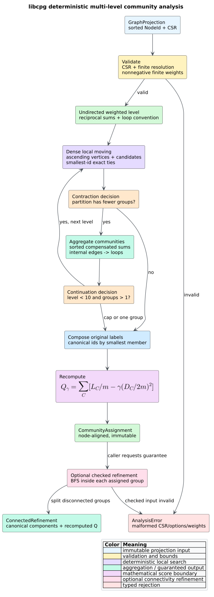

# Deterministic community detection

**Community detection** partitions vertices into groups whose internal relation
weight is denser than a degree-preserving null model predicts. libcpg provides
a deterministic, feature-free, multi-level Louvain implementation and a
separate connected-component refinement. Both operate on an immutable
[`GraphProjection`](projections.md) and return stable `NodeId`-aligned data;
neither changes the Code Property Graph (CPG).



*Figure 1 — the complete community-analysis flow. Source:
[`diagrams/community-pipeline.puml`](../../diagrams/community-pipeline.puml).*

## What a community means

The partition describes the supplied relation, not an intrinsic ownership
fact. Communities in a module-dependency projection may suggest architectural
subsystems. Communities in a call graph describe calling structure. A
control-flow projection answers a different question and usually is not a
useful module boundary. Missing or spurious projection edges change the
partition.

Louvain is a heuristic: it searches for a high-modularity partition but does
not prove global optimality. A community identifier is only a canonical label;
it is not a rank, severity, or persistent database key.

## Public API

```rust
pub struct LouvainOptions {
    pub resolution: f64,
    pub max_passes: usize,
    pub max_levels: usize,
}

pub enum CommunityKind {
    Louvain { resolution: f64 },
    ConnectedRefinement { resolution: f64 },
}

pub struct CommunityAssignment {
    pub kind: CommunityKind,
    pub nodes: Vec<NodeId>,
    pub community: Vec<u32>,
    pub num_communities: usize,
    pub modularity: f64,
}

pub fn louvain(
    graph: &GraphProjection,
    options: LouvainOptions,
) -> Result<CommunityAssignment, AnalysisError>;

pub fn try_refine_connected(
    graph: &GraphProjection,
    assignment: &CommunityAssignment,
) -> Result<CommunityAssignment, AnalysisError>;

pub fn refine_connected(
    graph: &GraphProjection,
    assignment: &CommunityAssignment,
) -> CommunityAssignment;
```

`nodes` is exactly `graph.nodes`; `community[i]` classifies `nodes[i]`.
Identifiers are contiguous from zero and ordered by each community's smallest
member. Consequently, results can be compared byte-for-byte when the same
projection and options are used.

`CommunityKind` retains the resolution so connected refinement can recompute
modularity for its changed partition. `try_refine_connected` is the checked
API. The total convenience wrapper `refine_connected` returns the canonical
singleton partition if a caller supplies malformed public fields; this keeps
downstream rendering total without presenting an invalid partition as
refined.

The hard ceilings are:

```rust
pub const MAX_LOUVAIN_PASSES: usize = 50;
pub const MAX_LOUVAIN_LEVELS: usize = 10;
```

Larger requests are clamped. A zero pass or level request deliberately returns
the singleton partition without local moving.

## Graph and weight semantics

Louvain consumes the projection as an undirected weighted graph:

1. a directed edge becomes one undirected relation;
2. reciprocal directed edges are summed deterministically;
3. parallel edges already merged by `GraphProjection` remain merged;
4. a zero-weight edge contributes no modularity mass;
5. a self-loop contributes once to internal edge weight and twice to weighted
   degree; and
6. negative, non-finite, or overflowing undirected weights are rejected.

Connected refinement uses undirected **topology**, including a zero-weight edge,
because its question is reachability rather than modularity contribution.

## Generalized modularity

Let $`G=(V,E,w)`$ be the undirected weighted graph. Let $`m`$ be the sum of
canonical edge weights, with each self-loop counted once. Let $`k_i`$ be the
weighted degree of vertex $`i`$, with a self-loop counted twice. A partition
$`c:V\to\{0,\ldots,K-1\}`$ has resolution-$`\gamma`$ modularity

```math
Q_\gamma(c)=\sum_{r=0}^{K-1}
\left(
\frac{L_r}{m}
-\gamma\left(\frac{D_r}{2m}\right)^2
\right),
```

where $`L_r`$ is the weight of edges whose two endpoints are in community
$`r`$, $`D_r=\sum_{i:c(i)=r}k_i`$, and $`\gamma`$ is `resolution`.
The first term rewards internal weight. The second subtracts the expected
internal weight under the configuration-model null hypothesis.

At $`\gamma=1`$, the implementation uses standard modularity. A larger
resolution increases the null-model penalty and generally favors smaller
communities. Zero resolution removes that penalty and favors merging connected
positive-weight structure. Resolution must be finite and nonnegative.

## Literate algorithm

The implementation follows the two repeated phases introduced by Blondel,
Guillaume, Lambiotte, and Lefebvre: local moving and aggregation.

```text
LOUVAIN(projection, resolution, pass_limit, level_limit):
    validate CSR, resolution, and nonnegative finite weights
    base = canonical undirected weighted graph
    original_to_level[v] = v

    repeat at most min(level_limit, 10) levels:
        place every current-level vertex in its own community
        repeat at most min(pass_limit, 50) dense-order sweeps:
            for vertex i in ascending dense order:
                remove k_i from its current community strength
                accumulate weights from i to neighbor communities
                scan candidate community ids in ascending order
                choose the greatest normalized modularity score
                break an exact tie toward the smallest community id
                insert i into the selected community
            stop the level when a complete sweep moves no vertex

        renumber communities by their smallest member
        compose current labels into original_to_level
        stop when no contraction occurred or one community remains
        aggregate each community into one weighted vertex

    canonicalize original_to_level
    recompute Q on the original graph with an independent full formula
    return the node-aligned partition
```

For a candidate community $`C`$ after temporarily removing vertex $`i``, the
normalized comparison score is

```math
s(i,C)=\frac{k_{i,C}}{2m}
-\gamma\frac{k_i}{2m}\frac{D_C}{2m},
```

where $`k_{i,C}`$ is the incident weight from $`i`$ to vertices in $`C`$.
Dividing every score by the common positive value $`2m`$ avoids overflow and
does not change which candidate is maximal.

Aggregation preserves total edge weight. Edges between two communities become
one edge whose weights are sorted before compensated summation; internal edges
become self-loops. The next level can therefore move whole first-level groups,
which the single-level pgmcp predecessor cannot do.

## Connected refinement

Plain Louvain can produce a community whose induced subgraph is disconnected.
`try_refine_connected` groups input members, performs deterministic
breadth-first search inside each induced undirected subgraph, sorts the
resulting connected components by smallest member, and recomputes modularity.

```text
REFINE-CONNECTED(graph, assignment):
    validate exact node alignment and canonical community identifiers
    for each input community in ascending id order:
        mark its members
        for each unvisited member in ascending dense order:
            breadth-first search through marked undirected neighbors
            emit one connected component
    sort all components by smallest member
    assign contiguous ids and recompute Q at the inherited resolution
```

This is a **Leiden-style connectivity refinement**, not the complete Leiden
algorithm. It guarantees ordinary internal connectivity. It does not claim
$`\gamma`$-connectivity, subset optimality, randomized fast local moving, or
the other guarantees of full Leiden.

## Example

```rust
use libcpg::{
    louvain, refine_connected, GraphProjection, LouvainOptions, NodeId,
    ProjectionKind,
};

fn main() -> Result<(), libcpg::AnalysisError> {
    let graph = GraphProjection::from_edges(
        ProjectionKind::External,
        (0..6).map(NodeId::new),
        [
            (NodeId::new(0), NodeId::new(1), 1.0),
            (NodeId::new(1), NodeId::new(2), 1.0),
            (NodeId::new(2), NodeId::new(0), 1.0),
            (NodeId::new(3), NodeId::new(4), 1.0),
            (NodeId::new(4), NodeId::new(5), 1.0),
            (NodeId::new(5), NodeId::new(3), 1.0),
            (NodeId::new(2), NodeId::new(3), 0.1),
        ],
    );

    let partition = louvain(&graph, LouvainOptions::default())?;
    assert_eq!(partition.community, vec![0, 0, 0, 1, 1, 1]);
    let connected = refine_connected(&graph, &partition);
    assert_eq!(connected.community, partition.community);
    Ok(())
}
```

Use the checked refinement when the assignment came from deserialization or a
caller-controlled source:

```rust
use libcpg::{try_refine_connected, CommunityAssignment, GraphProjection};

fn checked(
    graph: &GraphProjection,
    partition: &CommunityAssignment,
) -> Result<(), libcpg::AnalysisError> {
    let connected = try_refine_connected(graph, partition)?;
    assert_eq!(connected.nodes, graph.nodes);
    Ok(())
}
```

## Determinism and complexity

Determinism comes from sorted projection nodes, sorted compressed-sparse-row
(CSR) neighbors, ascending dense sweeps, reusable dense candidate storage,
smallest-community tie breaking, sorted aggregation reductions, and canonical
result labels. There is no hash-iteration dependence and no kernel-owned thread
pool.

For one level with $`n`$ vertices and $`m`$ canonical undirected edges, one
local-moving pass is $`O(n+m\log n)`$ in the worst case because each vertex
sorts at most its incident neighboring community identifiers. Memory is
$`O(n+m)`$. The public ceilings bound the complete computation by 50 passes
per level and 10 levels. Connected refinement is $`O(n+m)`$ time and $`O(n)`$
temporary memory.

## Benchmark evidence

`benches/community.rs` measures `louvain` on 256- and 1,024-vertex rings of
eight-vertex cliques and `try_refine_connected` on 512- and 2,048-vertex
families of disconnected eight-vertex paths. Before Criterion enters either
timed loop, the target checks exact repeatability, canonical alignment and
labels, independently recomputed modularity, expected component counts, and an
independent induced-connectivity breadth-first search. Run it with
`./scripts/bench.sh community` under the controlled protocol in
[measurement methodology](../../scientific/04-measurement-methodology.md).

## Interpretation and limitations

- Modularity has a resolution limit; small real groups can be merged in a
  sufficiently large graph.
- Louvain is order-sensitive in general. libcpg fixes one canonical order for
  reproducibility; it does not sample alternative orders.
- A high modularity value is comparative evidence, not proof of a correct
  architecture.
- Connected refinement can lower modularity because it prioritizes a
  structural validity guarantee over the heuristic partition's score.
- Weight scale does not change standard modularity when all weights are scaled
  uniformly, but direction-forgetting and reciprocal-edge summation remain
  semantic choices.

## References

- Vincent D. Blondel, Jean-Loup Guillaume, Renaud Lambiotte, and Etienne
  Lefebvre, “Fast unfolding of communities in large networks,” *Journal of
  Statistical Mechanics: Theory and Experiment*, P10008, 2008.
  [DOI: 10.1088/1742-5468/2008/10/P10008](https://doi.org/10.1088/1742-5468/2008/10/P10008).
- Vincent A. Traag, Ludo Waltman, and Nees Jan van Eck, “From Louvain to
  Leiden: guaranteeing well-connected communities,” *Scientific Reports* 9,
  5233, 2019.
  [DOI: 10.1038/s41598-019-41695-z](https://doi.org/10.1038/s41598-019-41695-z).

## Related documentation

- [Community structure theory](../../theory/13-community-structure-and-modularity.md)
- [ADR-0018: deterministic multi-level community detection](../../design/0018-deterministic-multilevel-community-detection.md)
- [Community validation](../../scientific/13-community-validation.md)
- [Projection semantics](projections.md)
- [Resource hardening](../../security/01-input-and-resource-hardening.md)
