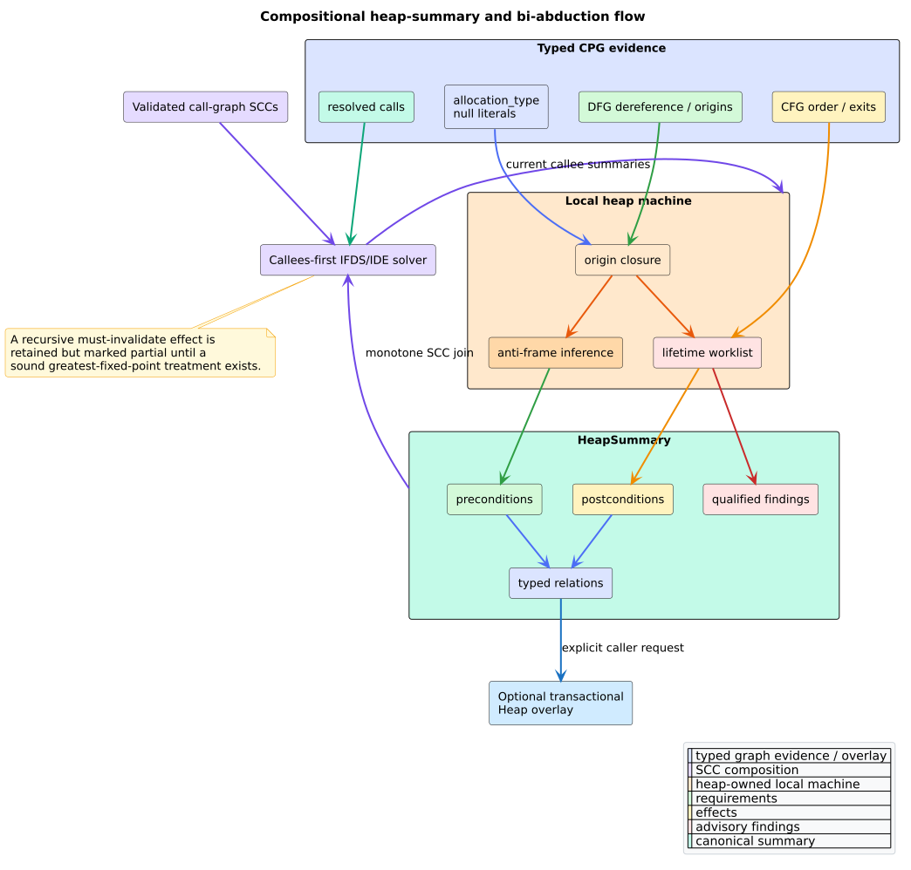

# Compositional heap analysis

`analysis::heap` infers deterministic per-procedure heap requirements and
effects, detects advisory memory-safety violations, and optionally materializes
an append-only Heap overlay. It is feature-free and depends only on existing
typed CPG, CFG, DFG, call-resolution, SCC, and IFDS/IDE infrastructure.

## Public surface

| API or type | Contract |
|---|---|
| `analyze_heap` | complete report with default release vocabulary and solver evidence |
| `analyze_heap_with_model` | same analysis with caller-owned exact release names |
| `biabduction_summaries` | compatibility projection to `BTreeMap<NodeId, HeapSummary>` |
| `memory_safety` | canonical null-dereference, use-after-free, and leak projection |
| `materialize_heap_overlay` | transactionally append valid `HeapEdgeKind` relations |
| `HeapAnalysis` | summaries, processing order, SCC rounds, caps, and structural issues |
| `HeapSummary` | anti-frame, postconditions, local allocations, composed callees, relations, findings |
| `HeapModel` | exact full or terminal callee names classified as releases |
| `HeapOverlayError` | malformed source/target relation error before graph mutation |

Use `HeapAnalysis::is_complete()` before any negative claim. The bare summary
and finding projections intentionally cannot represent every solver-level
issue.

## Evidence model

| Semantic fact | Required CPG evidence |
|---|---|
| allocation | `CpgNode::allocation_type` |
| null | `CpgNodeKind::Literal { kind: Null }` |
| dereference | `DataFlow(Dereference)` or unary `*` plus typed operands |
| release | reconstructed typed callee path accepted by `HeapModel` plus first argument |
| alias/origin | identifier definition, reaching definition, AST value flow, or typed DFG edge |
| interprocedural effect | one resolved call target and a validated call-graph summary |
| lifetime order | canonical intraprocedural CFG |

The implementation never parses source text. The release vocabulary is
language-neutral string policy over reconstructed callee names; consumers add
project-specific APIs explicitly with `HeapModel::with_release_call`.

## Summary semantics

`preconditions` are synthesized anti-frame assertions. A parameter
dereference produces `Valid(Parameter(i))`. `postconditions` describe
represented exits: local allocations or parameters may be `Invalid` when all
represented exits after a modeled release exclude `Live`; a live local
allocation also produces a leak finding.

`HeapLocation::Allocation` is an allocation-site abstraction, not a concrete
runtime address. `HeapRelation` endpoints are existing CPG nodes. The six
overlay kinds are `Allocates`, `PointsTo`, `Dereferences`, `Releases`,
`RequiresValid`, and `EnsuresInvalid`.

## Determinism and stack safety

- functions and summaries use ascending `NodeId` order;
- the shared solver processes SCC condensation components callees-first;
- origins, assertions, relations, violations, and model names use ordered sets;
- CFG propagation uses a heap `VecDeque` and finite state bits;
- source order is canonicalized before a call's callee is separated from its
  arguments; and
- no AST, CFG, call-graph, summary, witness, serialization, or drop path uses
  input-shaped native recursion.

The integration gate exercises 100,000 nested syntax/CFG levels through
summary construction, materialization, and drop on a 256 KiB native stack.

## Completeness and mutation

`IfdsCaps` bounds functions, facts, worklist steps, call-path depth, and cyclic
SCC rounds. Local origin and lifetime machines inherit those limits. Any
breach sets cap evidence; recursive must-invalidate composition is also marked
partial rather than trusted prematurely.

Overlay materialization first unions and validates every relation. If one
endpoint is missing it returns `HeapOverlayError` without adding any edge.
Successful repeated materialization adds zero duplicate edges through
`connect_unique`; node count and every non-Heap overlay remain unchanged.

## Related documentation

- [Theory](../../theory/51-compositional-heap-analysis.md)
- [ADR-0068](../../design/0068-compositional-heap-summaries.md)
- [Usage](../../usage/36-compositional-heap-analysis.md)
- [Security boundary](../../security/26-compositional-heap-boundary.md)
- [Scientific validation](../../scientific/63-compositional-heap-validation.md)

## References

1. Calcagno, C., Distefano, D., O'Hearn, P. W., Yang, H. (2011).
   DOI: [10.1145/2049697.2049700](https://doi.org/10.1145/2049697.2049700).
2. Calcagno, C., Distefano, D., O'Hearn, P. W., Yang, H. (2009).
   DOI: [10.1145/1480881.1480917](https://doi.org/10.1145/1480881.1480917).
