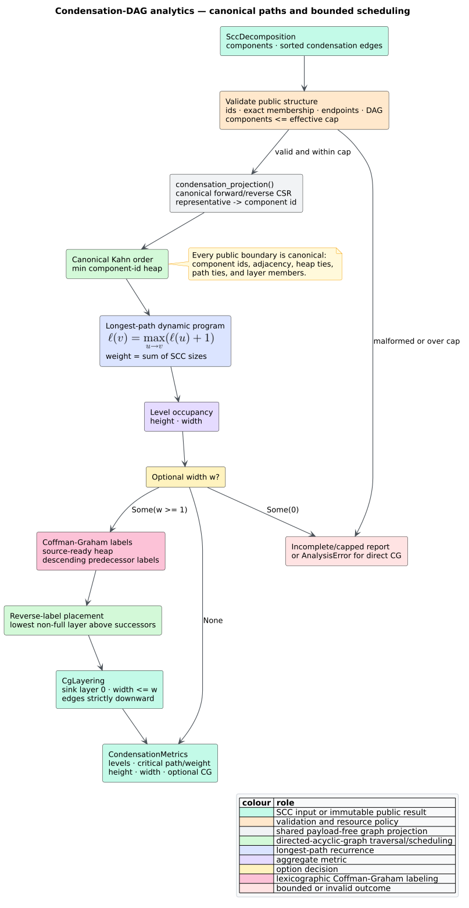
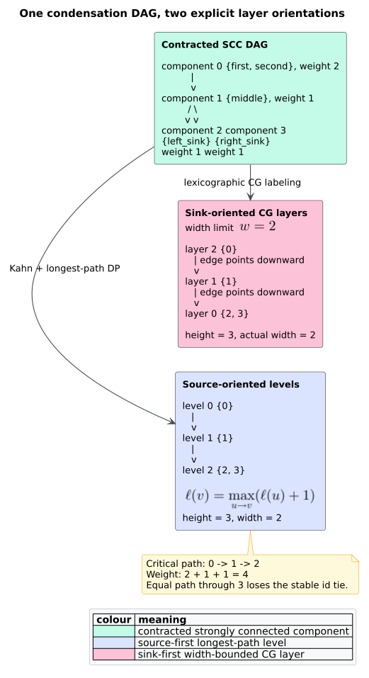

# Condensation-DAG analytics

`libcpg::condensation_metrics` turns
[`SccDecomposition::condensation_projection`](scc-analysis.md) into
deterministic depth, width, and weighted-critical-path evidence while mapping
stable representatives back to component ids. It can also attach a width-bounded
[Coffman–Graham](../../GLOSSARY.md#coffmangraham-layering-cg) (CG) layering. The
analysis is feature-free, read-only, language-independent, and out of graph: it
neither adds a second program graph nor mutates the Code Property Graph (CPG).



*Figure 1 — the complete condensation-analytics pipeline. Source:
[`diagrams/condensation-analytics.puml`](../../diagrams/condensation-analytics.puml).*

## Terms and intuition

- A [strongly connected component
  (SCC)](../../GLOSSARY.md#strongly-connected-component-scc) represents mutual
  reachability; mutual recursion is one call-graph SCC, while a cyclic
  control-flow region is one CFG SCC.
- The [condensation graph](../../GLOSSARY.md#condensation-graph--condensation-metrics)
  contracts every SCC into one component vertex and is a [directed acyclic
  graph (DAG)](../../GLOSSARY.md#directed-acyclic-graph-dag).
- A [topological order](../../GLOSSARY.md#topological-order) lists every DAG
  vertex after all its predecessors. Kahn's algorithm repeatedly removes a
  predecessor-free vertex [[1]](#references).
- A [critical path](../../GLOSSARY.md#critical-path) is the source-to-sink path with maximum total weight.
  Here component $`v`$ has weight $`|C_v|`$, the number of original CPG nodes
  in SCC $`C_v`$. A mutually recursive cluster therefore contributes more
  weight than a singleton.
- A [CG layering](../../GLOSSARY.md#coffmangraham-layering-cg) assigns an
  integer layer to every component. Source-oriented
  longest-path levels answer architectural depth. Sink-oriented CG layers
  answer width-bounded unit-task scheduling: at most $`w`$ components occupy
  a layer and every precedence edge points strictly downward [[2]](#references).

The two layer orientations are intentionally different. Conflating them makes
an edge invariant appear reversed even when both analyses are correct.



*Figure 2 — one DAG under both documented orientations. Source:
[`diagrams/condensation-layer-orientation.puml`](../../diagrams/condensation-layer-orientation.puml).*

## Public API

The crate root and `libcpg::analysis` export both entry points and all result
types:

```rust
use libcpg::{
    coffman_graham, condensation_metrics, AnalysisError, CgLayering,
    CondensationMetrics, CondensationOptions, SccDecomposition,
};

fn analyze_condensation(
    sccs: &SccDecomposition,
) -> Result<(CondensationMetrics, CgLayering), AnalysisError> {
    let metrics = condensation_metrics(
        sccs,
        &CondensationOptions {
            max_components: 50_000,
            coffman_graham_width: Some(4),
        },
    );
    let layering = coffman_graham(sccs, 4)?;
    Ok((metrics, layering))
}
```

`CondensationOptions::default()` selects the hard one-million-component cap and
does not request CG layering. A smaller `max_components` imposes a tighter
caller budget; a larger value is clamped to
`MAX_CONDENSATION_COMPONENTS = 1_000_000`.

### `CondensationMetrics`

| Field | Meaning |
|---|---|
| `levels: Vec<u32>` | Source-oriented longest-path level indexed by component id. |
| `critical_path: Vec<usize>` | Deterministic maximum-weight component path in source-to-sink order. |
| `critical_path_weight: u64` | Sum of SCC member counts along `critical_path`. |
| `height: u32` | Number of source-oriented levels; zero for an empty decomposition. |
| `width: u32` | Largest source-oriented level occupancy. |
| `coffman_graham: Option<CgLayering>` | Requested width-bounded schedule, otherwise `None`. |
| `complete: bool` | Every requested result was computed from a valid, in-budget decomposition. |
| `capped: bool` | The effective component cap stopped computation before traversal. |

`condensation_metrics` is deliberately total. `SccDecomposition` has public
fields, so downstream code can construct a malformed value even though
`call_graph_sccs` and `control_flow_sccs` never do. A malformed id, empty
component, invalid endpoint, self-loop, or cyclic condensation returns an empty
report with `complete == false`; a cap breach additionally sets `capped`.
`Some(0)` requests an invalid optional width and preserves the core metrics but
sets `complete == false`.

### `CgLayering`

| Field or method | Meaning |
|---|---|
| `width_limit` | Requested positive layer capacity $`w`$. |
| `layers` | Sink-first layers; every inner vector is sorted by component id. |
| `layer_of` | Direct component-id-to-layer lookup. |
| `height()` | Number of layers. |
| `width()` | Actual maximum occupancy, never greater than `width_limit`. |

The direct `coffman_graham` function returns an `AnalysisError` rather than a
partial schedule. Width zero yields `AnalysisError::InvalidInput`; a malformed
condensation also yields `InvalidInput`; a graph above the hard cap yields
`AnalysisError::BudgetExceeded` with unit `components`.

With feature `serde`, the options and both result structs serialize and
round-trip. No analysis feature or language grammar is required.

## Canonical Kahn order

Let $`G_c=(V_c,E_c)`$ be the condensation DAG and $`pred(v)`$ be the immediate
predecessors of component $`v`$. The implementation initializes an indegree
counter for every vertex and a min-heap containing exactly those vertices with
zero remaining predecessors. Popping the smallest component id makes the
topological order independent of adjacency insertion order.

```text
CANONICAL_TOPOLOGICAL_ORDER(dag):
    remaining[v] := number of distinct predecessors of v
    ready := min-heap of every v with remaining[v] = 0
    order := empty vector with capacity |V_c|

    while ready is not empty:
        u := pop_min(ready)
        append u to order
        for v in sorted distinct successors(u):
            remaining[v] := remaining[v] - 1
            if remaining[v] = 0:
                push v into ready

    if |order| != |V_c|:
        report malformed cyclic condensation
    return order
```

Duplicate public edges are normalized before this algorithm, so they cannot
inflate indegrees. The test suite explicitly reverses and duplicates edge
storage while requiring byte-for-byte equal reports.

## Longest-path levels and weighted critical path

For each source $`s`$, define $`\ell(s)=0`$. Kahn order ensures every
predecessor is final before a component is visited, so one forward dynamic
program computes

```math
\ell(v) =
\begin{cases}
0, & pred(v)=\varnothing,\\
1 + \max_{u\in pred(v)}\ell(u), & \text{otherwise}.
\end{cases}
```

The public height and width are

```math
H =
\begin{cases}
0, & V_c=\varnothing,\\
1 + \max_{v\in V_c}\ell(v), & \text{otherwise},
\end{cases}
\qquad
B = \max_{k\in[0,H)} |\{v\mid\ell(v)=k\}|.
```

Let $`m(v)=|C_v|`$ be the SCC member count. The weighted path recurrence is

```math
W(v)=m(v)+
\begin{cases}
0, & pred(v)=\varnothing,\\
\max_{u\in pred(v)}W(u), & \text{otherwise}.
\end{cases}
```

Every component weight is positive, so a globally maximum path ends at a sink.
The implementation stores one predecessor pointer per vertex. Equal candidate
weights choose the smaller immediate predecessor; equal terminal weights choose
the smaller terminal id. This local rule is deterministic and requires linear
state rather than retaining every tied path.

For Figure 2, $`m=(2,1,1,1)`$, levels are $`(0,1,2,2)`$, and both terminal
paths weigh four. The terminal-id tie returns `0 -> 1 -> 2`.

## Coffman–Graham labeling and placement

The implementation uses the transpose-equivalent, predecessor-oriented form of
the Coffman–Graham algorithm. Labels grow from sources toward sinks. When all
predecessors of a component are labeled, their labels are sorted descending to
form the component's lexicographic key. The smallest key wins; an equal key
selects the smaller component id.

```text
COFFMAN_GRAHAM(decomposition, w):
    require w >= 1
    dag := validate_and_normalize(decomposition)

    eligible := min-heap ordered by
                (descending predecessor-label vector, component id)
    insert every source with the empty vector

    for label in 1 .. |V_c|:
        u := pop_min(eligible)
        label_of[u] := label
        for v in sorted successors(u):
            if every predecessor of v is labeled:
                key[v] := labels(pred(v)) sorted descending
                insert (key[v], v)

    layers := empty sink-first vector
    available := ordered set of non-full layer ids
    for u in decreasing label order:
        minimum := 1 + max(layer_of[v] for v in successors(u))
                   or 0 when u is a sink
        layer := lowest available id at least minimum;
                 create the next contiguous layer if none exists
        insert u; remove layer from available when its occupancy reaches w

    sort every layer by component id
    return layers and layer_of
```

Reverse label order guarantees every successor is already placed. Choosing a
layer strictly above the maximum successor layer proves the precedence
invariant; choosing only a non-full layer proves the width invariant. The
classical unit-task result is exact for two processors and, for $`w\ge2`$, has
the Coffman–Graham height guarantee

```math
H_{CG} \le \left(2-\frac{2}{w}\right)H_{opt}.
```

Width one is the trivial exact serial schedule. The property suite compares
the implementation with exhaustive optimal schedules rather than assuming the
bound from its own construction.

## Determinism and read-only invariants

Determinism is enforced at every boundary:

1. component ids must equal their positions;
2. successor and predecessor lists are sorted and deduplicated;
3. Kahn ties select the minimum component id;
4. weighted-path ties use documented component-id rules;
5. CG keys contain descending predecessor labels and include component id as
   the final tie-break;
6. the available-layer set selects the lowest feasible id; and
7. every public layer vector is sorted before return.

Only `SccDecomposition` is read. Results contain component ids and scalar
evidence; they do not clone CPG payloads, add edges, or remove nodes. This is
the out-of-graph result form permitted by ADR-0001.

## Resource and complexity envelope

Let $`C=|V_c|`$, $`E=|E_c|`$, and $`M`$ be the total SCC member count.
Validation scans $`M+E`$ records. Adjacency normalization and the canonical
heap give a conservative $`O(M + E\log E + (C+E)\log C)`$ time bound and
$`O(C+E)`$ auxiliary space; the longest-path dynamic program alone is linear
once the order exists.

CG constructs each predecessor-label entry once and sorts each component's key,
for $`\sum_v O(d_v\log d_v)`$ key-construction work where $`d_v`$ is indegree.
Heap comparisons inspect lexicographic key prefixes, so their exact cost depends
on shared prefixes and is $`O(C^2\log C)`$ in the worst case; placement performs
$`O(C\log C)`$ ordered-set operations.
The implementation does not claim a stronger asymptotic bound than those data
structures establish.

The hard $`10^6`$-component cap bounds every dense vector, heap, key set, and
layer index. A caller can lower the cap for an interactive latency budget. The
algorithms are iterative; a million-component path cannot consume native call
stack depth.

## Worked call-graph example

The feature-free integration test constructs calls

```text
first <-> second -> middle -> {left_sink, right_sink}
```

SCC contraction yields component weights $`(2,1,1,1)`$. The public pipeline is:

```rust
use libcpg::{
    call_graph_sccs, condensation_metrics, CodePropertyGraph,
    CondensationOptions,
};

fn inspect(cpg: &CodePropertyGraph) {
    let sccs = call_graph_sccs(cpg);
    let metrics = condensation_metrics(
        &sccs,
        &CondensationOptions {
            coffman_graham_width: Some(2),
            ..CondensationOptions::default()
        },
    );

    assert!(metrics.complete);
    assert_eq!(metrics.levels, vec![0, 1, 2, 2]);
    assert_eq!(metrics.critical_path, vec![0, 1, 2]);
    assert_eq!(metrics.critical_path_weight, 4);
    assert_eq!(
        metrics.coffman_graham.expect("requested layering").layers,
        vec![vec![2, 3], vec![1], vec![0]],
    );
}
```

A second integration test exercises the real Rust tree-sitter frontend with
opt-in call resolution before SCC contraction. Condensation analytics still
consume only semantic graph topology; they do not parse source text.

## Testing and measurement

The unit suite covers empty, weighted, branched, malformed, capped, width-zero,
duplicate-edge, and serde cases. A 128-case property campaign generates DAGs of
up to eight components and checks:

- weighted critical paths against exhaustive path enumeration;
- every reported critical-path edge and weight;
- source-level precedence;
- CG coverage, width, and strict downward precedence;
- exact optimum at width one and two;
- the $`2-2/w`$ bound at widths three and four; and
- equality after edge reversal and duplication.

`benches/condensation.rs` measures 1,024- and 8,192-component paths and eight
independent chains, with and without CG. Exact height, width, critical-path,
coverage, and precedence oracles run before Criterion enters any timed closure.
See [Scientific validation 09](../../scientific/09-condensation-validation.md)
and the [measurement methodology](../../scientific/04-measurement-methodology.md).

## Interpretation boundary

These metrics describe the contracted graph supplied to them. A critical path
is not a wall-clock performance prediction: SCC size is a structural weight,
not instruction latency. A CG layer is a deterministic unit-task precedence
schedule, not proof that components are independent, thread-safe, equally
expensive, or executable in parallel. Call-graph precision remains bounded by
the call-resolution evidence that created topology.

## References

1. Kahn, A. B. (1962). *Topological sorting of large networks.*
   Communications of the ACM 5(11), 558. DOI:
   [10.1145/368996.369025](https://doi.org/10.1145/368996.369025)
2. Coffman, E. G., Jr., Graham, R. L. (1972). *Optimal scheduling for
   two-processor systems.* Acta Informatica 1, 200–213. DOI:
   [10.1007/BF00288685](https://doi.org/10.1007/BF00288685)
