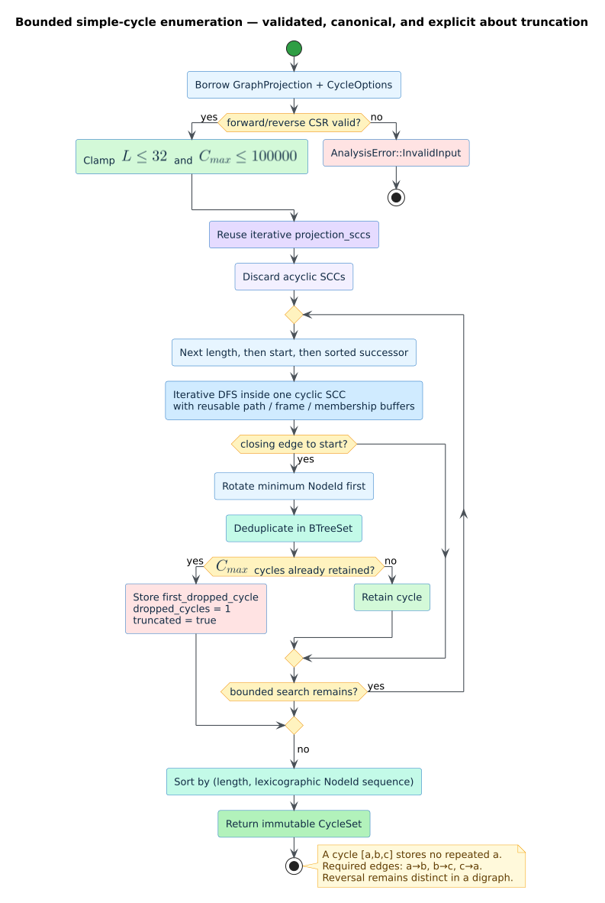

# Bounded simple-cycle analysis

`libcpg::simple_cycles` enumerates elementary directed cycles over any validated
[`GraphProjection`](projections.md). An **elementary cycle**, also called a
**simple cycle**, is a closed directed walk whose vertices are distinct except
for the implicit return from the final vertex to the first. The analysis is
feature-free, deterministic, read-only, and explicitly bounded by cycle length
and result count.

Use this analysis when the concrete cycle witnesses matter. Use
[`projection_sccs`](scc-analysis.md) when only maximal mutually reachable
regions or acyclicity matter: strongly connected component (SCC) decomposition
is linear, whereas the number of simple cycles can be exponential.



*Figure — the complete cycle-analysis flow, including both resource boundaries
and the explicit truncation witness. Source:
[`diagrams/cycle-enumeration-pipeline.puml`](../../diagrams/cycle-enumeration-pipeline.puml).*

## Public API

```rust
use libcpg::{simple_cycles, CycleOptions, GraphProjection};

fn enumerate(graph: &GraphProjection) -> Result<(), libcpg::AnalysisError> {
    let result = simple_cycles(
        graph,
        &CycleOptions {
            max_length: 10,
            max_cycles: 10_000,
        },
    )?;

    for cycle in &result.cycles {
        println!("{cycle:?}");
    }
    if let Some(first_omitted) = &result.first_dropped_cycle {
        println!("result was truncated before {first_omitted:?}");
    }
    Ok(())
}
```

The defaults are `max_length = 10` and `max_cycles = 10_000`. Requests are
clamped to the hard ceilings `MAX_CYCLE_LENGTH = 32` and
`MAX_SIMPLE_CYCLES = 100_000`. A zero length returns a complete empty result. A
zero count still probes for the first admissible cycle, so truncation remains
observable.

## Result contract

`CycleSet` contains:

| Field | Meaning |
|---|---|
| `nodes` | Stable projection nodes in dense analysis order. |
| `cycles` | Canonical cycles sorted by length, then lexicographically. |
| `max_length` | Effective length bound after the hard ceiling. |
| `max_cycles` | Effective retained-result bound after the hard ceiling. |
| `truncated` | Whether a unique cycle was omitted by the count bound. |
| `dropped_cycles` | Proven omitted-count lower bound: zero when complete, one when truncated. |
| `first_dropped_cycle` | Canonical witness for the first omitted cycle. |

The repeated start vertex is not stored. A returned sequence `[a, b, c]`
asserts all three directed edges `a -> b`, `b -> c`, and `c -> a`. Every node
belongs to the supplied projection, every sequence contains distinct nodes,
and the smallest `NodeId` in a sequence is first.

## Directed-cycle semantics

- A self-loop is a length-one cycle: `[a]` requires `a -> a`.
- Reciprocal edges form a length-two cycle: `[a, b]` requires both directions.
- Cyclic rotations are equivalent. `[a, b, c]`, `[b, c, a]`, and `[c, a, b]`
  are represented once, with the smallest stable identifier first.
- Reversal is not equivalent in a directed graph. `[a, b, c]` and `[a, c, b]`
  are distinct when both directed orientations exist.
- Edge weights do not affect membership. The algorithm reads only topology.
- Parallel input edges were already merged by `GraphProjection`; they cannot
  duplicate a cycle.

## Literate algorithm

The implementation is a bounded, iterative depth-first-search (DFS) variant
informed by Johnson's classical elementary-circuit enumeration algorithm
[[1]](#references). It deliberately reuses `projection_sccs` rather than
carrying another Tarjan implementation.

```text
ENUMERATE-BOUNDED-CYCLES(projection, options)
    validate both forward and reverse CSR invariants
    length_limit <- min(options.max_length, 32)
    count_limit  <- min(options.max_cycles, 100000)
    components   <- PROJECTION-SCCS(projection)

    for length in 1 .. length_limit
        for start in ascending dense-node order
            skip start unless its SCC is cyclic and large enough
            DFS paths of exactly length vertices inside that SCC
                admit only unused successors greater than start
                when the final vertex has an edge to start:
                    rotate to the smallest vertex and deduplicate
                    if count_limit retained cycles already exist:
                        record this first omitted witness and stop
                    retain the cycle

    return cycles sorted by (length, lexicographic sequence)
```

Restricting internal path vertices to identifiers greater than `start` makes
`start` the unique minimum of every discovered cycle. Rotation normalization
and a `BTreeSet` then provide a defensive uniqueness boundary. Processing
lengths before starts makes the retained prefix itself canonical when the count
cap trips.

All traversal state is stored in reusable vectors: an explicit DFS-frame stack,
the current path, and an `on_path` membership array. No recursive call depends
on graph depth. Discovery is limited inside the DFS to at most the remaining
result capacity plus one witness, so a dense local search cannot allocate an
unbounded staging buffer before the public cap is applied.

## Validation and failure behavior

Because `GraphProjection` fields are public and serializable, the function
checks sorted nodes, forward/reverse compressed-sparse-row (CSR) shape,
in-range adjacency, and transpose agreement before indexed traversal. Invalid
input returns `AnalysisError::InvalidInput`; it cannot reach `node_id` or
`successors` with an out-of-graph dense identifier.

The input is borrowed immutably. A count-limited result is successful but
explicitly partial. This distinction matters operationally: `truncated = true`
means the returned cycles are valid witnesses, not a complete census.

## Complexity and resource interpretation

Let $`V`$ be the number of vertices, $`E`$ the number of directed edges, $`L`$
the effective length bound, and $`C_L`$ the number of cycles within that bound
before the count cap. CSR validation and SCC decomposition cost $`O(V + E)`$.
Enumeration is output- and topology-sensitive and remains exponential in the
worst case because a dense directed graph contains exponentially many simple
cycles. The explicit bounds make this cost finite; they do not turn enumeration
into a polynomial-time census.

Auxiliary structural state is $`O(V + E + L)`$, excluding retained cycle
payloads. Retained output is bounded by $`O(\min(C_L, C_{max})L)`$, where
$`C_{max}`$ is the effective count cap. The first omitted witness adds at most
$`O(L)`$.

## References

1. Johnson, D. B. (1975). *Finding All the Elementary Circuits of a Directed
   Graph.* SIAM Journal on Computing 4(1), 77–84. DOI:
   [10.1137/0204007](https://doi.org/10.1137/0204007).
