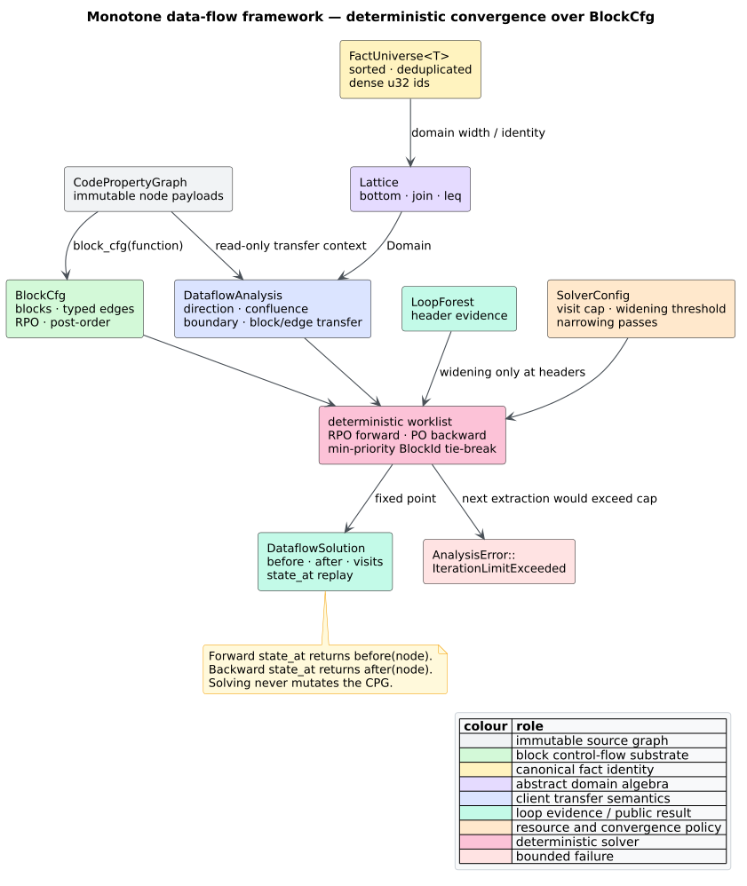

# Monotone data-flow framework

A **data-flow analysis** computes facts at program points by repeatedly applying
transfer functions along a control-flow graph. A **lattice** supplies a partial
order $`\sqsubseteq`$, a least element $`\bot`$, and a join $`\sqcup`$. A
transfer function $`f`$ is **monotone** when
$`x \sqsubseteq y \Rightarrow f(x) \sqsubseteq f(y)`$. A **fixed point** is a
state unchanged by another application of the equations.

`libcpg::solve` implements a deterministic, feature-free monotone framework over
[`BlockCfg`](basic-block-cfg.md). It is a reusable analysis engine; it does not
replace the DFG builder's AST-ordered materialization pass. The distinction is
described in [Theory 03](../../theory/03-data-flow-and-reaching-definitions.md).



*Figure — inputs, convergence controls, and result of the monotone solver.
Source: [`diagrams/dataflow-framework.puml`](../../diagrams/dataflow-framework.puml).*

## Equations and direction

For a forward analysis on block $`b`$, predecessor output meets at its input:

```math
\mathrm{before}[b] = \mathit{boundary}(b)
  \sqcup \bigsqcup_{(p,b) \in E} e_{p,b}(\mathrm{after}[p]),
\qquad
\mathrm{after}[b] = f_b(\mathrm{before}[b]).
```

For a backward analysis, successor input meets at the output:

```math
\mathrm{after}[b] = \mathit{boundary}(b)
  \sqcup \bigsqcup_{(b,s) \in E} e_{b,s}(\mathrm{before}[s]),
\qquad
\mathrm{before}[b] = f_b(\mathrm{after}[b]).
```

The boundary participates only at the entry block for `Forward` and at every
exit block for `Backward`. The optional $`e`$ is an edge transfer over the
original `CfgEdgeKind`; returning `None` from `transfer_edge` means identity.

`Confluence::May` means a fact need hold on at least one path; union is the
usual join. `Confluence::Must` means it must hold on every path; intersection is
the usual join under reverse inclusion. `Confluence` documents intent while the
analysis's `Lattice::join` defines the actual algebra.

## Public contracts

```rust
// requires: no features
use libcpg::{
    solve, BitSetDomain, BlockCfg, BlockId, CodePropertyGraph, Confluence,
    DataflowAnalysis, Direction, SolverConfig,
};

struct ReachableBlocks;

impl DataflowAnalysis for ReachableBlocks {
    type Domain = BitSetDomain;

    const NAME: &'static str = "reachable-blocks";
    const DIRECTION: Direction = Direction::Forward;
    const CONFLUENCE: Confluence = Confluence::May;

    fn bottom(&self, cfg: &BlockCfg) -> Self::Domain {
        BitSetDomain::new(cfg.blocks.len())
    }

    fn boundary(&self, cfg: &BlockCfg) -> Self::Domain {
        BitSetDomain::new(cfg.blocks.len())
    }

    fn transfer_block(
        &self,
        _cpg: &CodePropertyGraph,
        _cfg: &BlockCfg,
        block: BlockId,
        state: &mut Self::Domain,
    ) {
        state.insert(block.as_u32());
    }
}

# fn run(cpg: &CodePropertyGraph, cfg: &BlockCfg) -> Result<(), libcpg::AnalysisError> {
let solution = solve(
    cpg,
    cfg,
    &ReachableBlocks,
    &SolverConfig::default(),
    None,
)?;
assert!(solution.after[cfg.entry.as_u32() as usize]
    .contains(cfg.entry.as_u32()));
# Ok(())
# }
```

The required `Lattice` methods are:

| Method | Law expected by `solve` |
|---|---|
| `join(&mut self, other) -> bool` | computes $`self \sqcup other`$ and reports semantic change; associative, commutative, and idempotent |
| `leq(&self, other) -> bool` | decides $`self \sqsubseteq other`$; reflexive, antisymmetric up to `PartialEq`, and transitive |

`DataflowAnalysis` supplies `bottom`, `boundary`, and `transfer_block` plus two
optional hooks: `transfer_edge` for path-sensitive refinement and `widen` for
infinite-height domains. The default widening is ordinary join.

## Solver and convergence

The solver is Kildall's worklist algorithm [[1]](#references), specialized to
deterministic blocks and monotone frameworks [[2]](#references):

```text
order := reverse-post-order if Forward else post-order
queue := every block, prioritized by its position in order
state := bottom at every before/after slot

while queue is not empty:
    b := extract minimum-priority block
    if visits[b] >= max_visits_per_block: return IterationLimitExceeded
    visits[b] += 1

    confluence := boundary when b is an applicable boundary
    confluence := confluence join transferred adjacent states
    candidate := transfer_block(b, confluence)

    if b is a loop header and visits[b] > widen_after:
        changed := widen(stored, candidate)
    else:
        changed := stored != candidate
        stored := candidate

    if changed: enqueue dependants not already queued

repeat narrow_passes times:
    sweep blocks in deterministic direction order
    retain only candidate states below the widened state
```

The priority queue is keyed by deterministic reverse post-order for forward
problems and post-order for backward problems. `BlockId` breaks ties. This
changes visit count, not semantics: property tests run the same generated CFGs
through priority, FIFO, and LIFO queues and require identical fixed-point
states.

`SolverConfig::default()` is:

| Field | Default | Meaning |
|---|---:|---|
| `max_visits_per_block` | `256` | hard extraction cap per block |
| `widen_after` | `None` | widening disabled |
| `narrow_passes` | `0` | no post-fixpoint descending sweeps |

A **widening** accelerates an ascending chain to a post-fixpoint, as introduced
by Cousot and Cousot [[3]](#references). `solve` invokes it only for blocks that
`LoopForest` identifies as loop headers. A **narrowing** then descends from that
safe approximation; configured passes are bounded and deterministic. A finite
bit-set analysis normally needs neither.

The visit cap is independent of widening. Exceeding it returns
`AnalysisError::IterationLimitExceeded { analysis: A::NAME, limit }`; malformed
or non-monotone client analyses therefore cannot keep the worklist alive
indefinitely.

## Built-in domains and fact universes

`FactUniverse<T>` sorts and deduplicates ordered facts, assigning stable dense
`u32` ids. It rejects $`2^{32}`$ or more distinct facts instead of wrapping.
This canonical numbering makes bit domains independent of graph insertion
order.

| Type | Meaning | Join / order |
|---|---|---|
| `BitSetDomain` | fixed-width dense may-fact set | union / subset |
| `MustBits::Universe(width)` | compact must-analysis bottom: every fact provisionally present | intersection / reverse subset |
| `MustBits::Set(bits)` | concrete must-fact set | intersection / reverse subset |

Both bit domains expose fixed width, membership, insertion, removal, and
ascending iteration. Combining different widths is a caller error and panics;
an analysis must derive every state from one fact universe.

`variable_facts(cpg, function)` returns `VarFacts`:

- `universe`: sorted variable names;
- `definitions`: `Variable`, `Parameter`, and simple or compound `Assignment`
  writes, classified by `DefinitionKind`; and
- `uses`: identifier reads, excluding declaration/parameter binders and the
  target of plain `=` while retaining compound-assignment target reads.

`expression_facts(cpg, function)` returns `Result<ExprFacts, ExprKeyError>`.
Unary and binary expressions receive structural `ExprKey` roots in one shared
postorder node/operand arena. Variables, exact literal values, ordered nested
keys, and arena-local exact structural classes determine identity. Unsupported
operands retain their `NodeId` as `Opaque`, preventing an unsound equivalence.
`ExprUniverse` assigns stable dense ids without copying or repeatedly comparing
deep subtrees. `generated_at`, `occurrences`, `variables_of`, and
`killed_by_var` support available-expression and partial-redundancy analyses.
`expression_facts_with_limits` exposes independent node, operand, string-byte,
encoded-byte, and work policies; any failure aborts the whole fact derivation.
Both fact builders exclude nested function scopes and leave the CPG unchanged.


*Figure — expression-fact ownership and lifecycle. Source:
[`expression-key-flat-arena.puml`](../../diagrams/expression-key-flat-arena.puml).*

## Node-level states

`DataflowSolution` stores `before`, `after`, and `visits`, indexed by
`BlockId`. `state_at` replays a caller-supplied node transfer within one block.
For a forward problem it returns the state immediately before the node; for a
backward problem it returns the state immediately after it. It returns `None`
when the node is outside the block CFG.

The replay closure must be the node-level counterpart of `transfer_block`.
This explicit contract keeps the generic solver block-oriented without forcing
one node representation or cloning analysis implementations into the result.

## Determinism, cost, and security

For $`B`$ blocks, $`E`$ block edges, lattice height $`H`$, and block-transfer
cost $`T`$, a finite monotone problem has the conventional worst-case bound
$`O(H \cdot (B + E + B \cdot T))`$ before canonical queue overhead. The heap
adds $`O(\log B)`$ per enqueue/extraction. Space is $`O(B \cdot |D| + E)`$ for
dense fact states and CFG adjacency, excluding analysis-owned tables.

`solve` takes `&CodePropertyGraph` and cannot mutate graph nodes or edges. It
uses explicit queues rather than recursive CFG descent. The per-block visit cap
is the hard resource boundary; applications analyzing hostile graphs should
lower it and bound CPG size before solving. Widening hooks execute client code,
so their monotonicity and cost remain the client's responsibility.

## Validation

Example tests cover forward and backward boundary behavior, typed edge
transfer, widening restricted to loop headers, visit-cap failure, narrowing
non-ascent, malformed public-view handling, node replay, serde round trips, and
graph non-mutation. Property tests prove union and
intersection join laws and compare priority/FIFO/LIFO fixed points over
generated CFGs. A private reaching-definitions instantiation exactly matches
the retired CFG fixpoint on acyclic input; on cyclic input its facts cover the
core AST-ordered `DefUse` edges. Crate-root integration tests implement an
analysis as a downstream consumer and extract facts from a parser-built
function with no private API access. The malformed-graph property harness runs
fact extraction and solving across every corruption class.

## See also

- [Basic-block CFGs](basic-block-cfg.md) — the solver's control-flow substrate.
- [Natural loops](loop-analysis.md) — loop-header evidence for widening.
- [DFG builder](../builder/dfg.md) — materialized AST-ordered def-use edges.
- [ADR-0009](../../design/0009-deterministic-monotone-dataflow.md) — the design
  choice and alternatives.

## References

1. Kildall, G. A. (1973). *A Unified Approach to Global Program Optimization.*
   POPL '73, 194–206. DOI:
   [10.1145/512927.512945](https://doi.org/10.1145/512927.512945)
2. Kam, J. B., Ullman, J. D. (1977). *Monotone Data Flow Analysis Frameworks.*
   Acta Informatica 7, 305–317. DOI:
   [10.1007/BF00290339](https://doi.org/10.1007/BF00290339)
3. Cousot, P., Cousot, R. (1977). *Abstract Interpretation: A Unified Lattice
   Model for Static Analysis of Programs by Construction or Approximation of
   Fixpoints.* POPL '77, 238–252. DOI:
   [10.1145/512950.512973](https://doi.org/10.1145/512950.512973)
