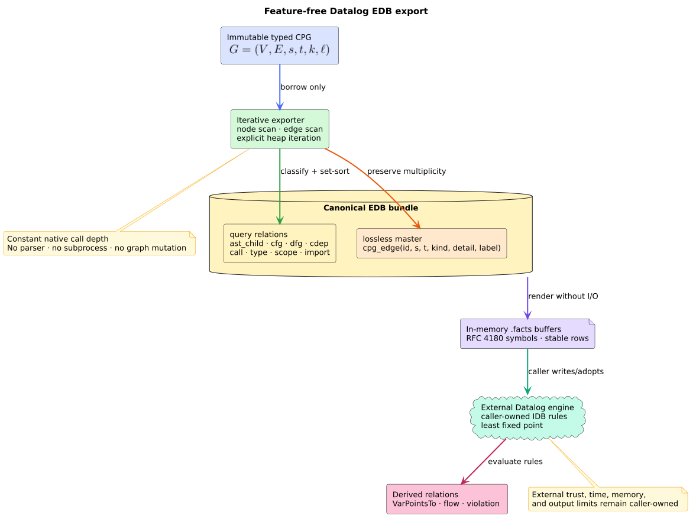

# Datalog extensional-database export

The Datalog export translates an immutable code property graph (CPG) into a
canonical **extensional database** (EDB): the finite input relations supplied
to a Datalog program. **Intensional database** (IDB) relations are the derived
relations computed by rules. libcpg emits EDB facts; an external engine such
as Soufflé parses and evaluates IDB rules.



*Figure -- side-effect-free exporter and external query boundary. Source:
[`diagrams/datalog-export-pipeline.puml`](../../diagrams/datalog-export-pipeline.puml).*

## Public API

```rust
use libcpg::{export_datalog, CodePropertyGraph, DatalogFacts};

fn facts(cpg: &CodePropertyGraph) -> DatalogFacts {
    export_datalog(cpg)
}
```

`export_datalog` is feature-free and does not mutate the graph. The
result contains typed Rust tuples and `souffle_files()`, which renders
in-memory, Request for Comments (RFC) 4180 tab-separated `.facts` buffers
without performing file I/O.

## Relation schema

`NodeId` and `EdgeId` values are emitted as unsigned
numbers. Every symbol field is double-quote enclosed; an internal double quote
is doubled. Tabs, carriage returns, newlines, and backslashes remain literal
field content under RFC 4180 rather than becoming row or column separators.
The consuming Soufflé relation must declare
`.input relation(IO=file, rfc4180=true, delimiter="\t")`.

| Relation | Arity | Meaning |
|---|---:|---|
| `node(node, kind)` | 2 | Stable node identity and complete node-kind tag. |
| `cpg_edge(edge, source, target, relation, detail, label)` | 6 | Lossless typed multigraph snapshot. |
| `ast_child(parent, child)` | 2 | Parent-to-child syntax relation. |
| `cfg(source, target, kind)` | 3 | Typed control-flow relation. |
| `dfg(source, target, kind)` | 3 | Typed data-flow relation. |
| `cdep(source, target)` / `ddep(source, target)` | 2 | Control/data dependence. |
| `call(site, callee, kind)` | 3 | Static, dynamic, or call-site resolution. |
| `type_of`, `inherits`, `implements`, `generic_instance` | 2 | Type topology. |
| `reference`, `definition`, `declaration` | 2 | Symbol topology. |
| `enclosing_scope`, `contained_in` | 2 | Scope topology. |
| `imports`, `exports` | 2 | Dependency topology. |
| `declared_type(node, role, name, reference, mutable)` | 5 | Nominal type embedded in a node. |

Relation-specific vectors have mathematical set semantics: equal tuples are
sorted and deduplicated. `cpg_edge` deliberately retains the edge
identifier and parallel multiplicity. Calling
`DatalogFacts::cpg_edges` therefore reconstructs every represented
overlay edge exactly, including its label.
The generic relation and `souffle_files()` include all six `HeapEdgeKind`
details when a caller has explicitly materialized that overlay; heap summaries
remain absent until that opt-in mutation. No separate heap relation is emitted.

## Export algorithm

The implementation is literate in three phases:

```text
EXPORT_DATALOG(cpg):
    reserve node and edge snapshots from known CPG counts
    for each represented node:
        append its stable kind
        append any embedded return, parameter, variable, field,
            annotation, and allocation type
    for each represented edge:
        append the exact lossless edge tuple
        append the corresponding relation-specific tuple
    sort every relation by stable identity and semantic kind
    deduplicate only relation-specific set tuples
    return the immutable relation bundle
```

All loops and rendering cursors are explicit heap-resident iteration. Native
call depth is constant in CPG depth. For $`n = |V|`$ nodes,
$`m = |E|`$ edges, and $`b`$ rendered bytes, the scans
cost $`O(n+m)`$, canonical sorting costs
$`O(n\log n+m\log m)`$ in the worst case, and rendering costs
$`O(b)`$. Owned output is $`O(n+m+b)`$.

## Determinism and interpretation

Canonical order is independent of internal graph iteration order when stable
identities and semantic tuples are equal. An EDB fact is exact only for the
represented CPG. Missing frontend types, unresolved calls, or absent PDG edges
remain absent; a Datalog rule cannot recover evidence that was never modeled.

The shipped [`doop_lite.dl`](../../../examples/datalog/doop_lite.dl)
demonstrates allocation propagation through def-use assignments. The shipped
[`ifc.dl`](../../../examples/datalog/ifc.dl) demonstrates explicit
and implicit flow closure. They are examples, not privileged built-in policies.

## References

1. Bravenboer, M., Smaragdakis, Y. (2009). *Strictly Declarative Specification
   of Sophisticated Points-to Analyses.* OOPSLA. DOI:
   [10.1145/1640089.1640108](https://doi.org/10.1145/1640089.1640108).
2. Jordan, H., Scholz, B., Subotić, P. (2016). *Soufflé: On Synthesis of Program
   Analyzers.* CC. DOI:
   [10.1007/978-3-319-41540-6_23](https://doi.org/10.1007/978-3-319-41540-6_23).
3. Shafranovich, Y. (2005). *Common Format and MIME Type for
   Comma-Separated Values (CSV) Files.* RFC 4180.
   [RFC Editor](https://www.rfc-editor.org/rfc/rfc4180).
