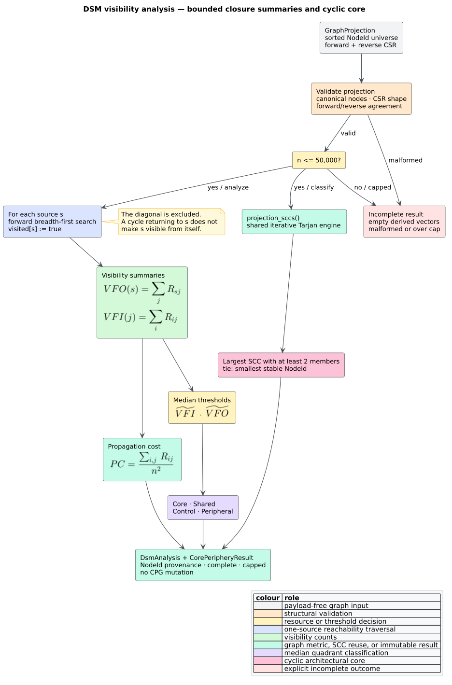

# Design Structure Matrix visibility and core–periphery analysis

`libcpg::analyze_dsm` summarizes the transitive closure of any directed
[`GraphProjection`](projections.md) as visibility fan-in, visibility fan-out,
and propagation cost. `libcpg::classify_core_periphery` then places each
vertex in a median-defined visibility quadrant and reports the largest
multi-vertex strongly connected component (SCC) as separate cyclic-core
evidence. Both entry points are feature-free, deterministic, read-only, and
language-independent.

A [Design Structure Matrix
(DSM)](../../GLOSSARY.md#design-structure-matrix-dsm) is a square matrix whose
rows and columns represent the same component set and whose marked cells encode
directed dependencies [[1]](#references). libcpg receives the equivalent sparse
graph rather than materializing the matrix. The analysis is not a parser: a
language frontend may produce a CPG, but this module consumes only sorted
`NodeId` values and compressed-sparse-row (CSR) adjacency.



*Figure 1 — the complete bounded DSM pipeline. Source:
[`diagrams/dsm-visibility-pipeline.puml`](../../diagrams/dsm-visibility-pipeline.puml).*

## Terms, direction, and the visibility matrix

Let $`G=(V,E)`$ be a directed graph with $`n=|V|`$ vertices. A directed edge
means whatever relation the selected projection defines. For a call graph,
libcpg uses caller-to-callee edges; for a module graph, it uses importer-to-
imported-module edges. The interpretation of “depends on” must therefore follow
the chosen [`ProjectionKind`](projections.md), while the mathematics remains
the same.

The off-diagonal visibility relation $`R`$ is

```math
R_{ij} =
\begin{cases}
1, & i\ne j\ \text{and a directed path from }i\text{ to }j\text{ exists},\\
0, & \text{otherwise}.
\end{cases}
```

The diagonal is deliberately zero. A self-loop or a longer cycle that returns
to its source does not make the source visible from itself. For vertex $`i`$,
[visibility fan-out
(VFO)](../../GLOSSARY.md#visibility-fan-in-vfi--visibility-fan-out-vfo) counts
the vertices reachable from it. Visibility fan-in (VFI) counts the vertices
that can reach it:

```math
VFO(i)=\sum_{j\in V}R_{ij},
\qquad
VFI(i)=\sum_{j\in V}R_{ji}.
```

The two totals are necessarily equal because both count the same ordered
reachable pairs:

```math
\sum_{i\in V}VFO(i)=\sum_{i\in V}VFI(i)=\sum_{i,j\in V}R_{ij}.
```

[Propagation cost](../../GLOSSARY.md#propagation-cost) is the density of this
off-diagonal visibility relation [[1]](#references):

```math
PC(G)=
\begin{cases}
0, & n=0,\\
\dfrac{\sum_{i,j\in V}R_{ij}}{n^2}, & n>0.
\end{cases}
```

Thus $`0\le PC(G)\le 1-1/n`$ for a nonempty graph. The denominator remains
$`n^2`$, matching the complete DSM area; excluding self-visibility makes the
finite-graph maximum slightly less than one. A lower value means fewer ordered
component pairs are transitively coupled in the supplied edge direction. It is
structural evidence, not a prediction of change probability or engineering
effort.

## Public API

The crate root and `libcpg::analysis` export both functions, their result types,
the class enum, the general SCC projection entry point, and the hard node cap:

```rust
use libcpg::{
    analyze_dsm, classify_core_periphery, CorePeriphery, GraphProjection,
    NodeId,
};

fn architectural_roles(
    graph: &GraphProjection,
) -> Option<(f64, Vec<(NodeId, CorePeriphery)>, Vec<NodeId>)> {
    let dsm = analyze_dsm(graph);
    if !dsm.complete {
        return None;
    }

    let result = classify_core_periphery(graph, &dsm);
    if !result.complete {
        return None;
    }

    let roles = result
        .nodes
        .iter()
        .copied()
        .zip(result.classes.iter().copied())
        .collect();
    let cyclic_core = result.cyclic_core_nodes().collect();
    Some((dsm.propagation_cost, roles, cyclic_core))
}
```

This snippet is valid with `default = []`; it requires no grammar or optional
analysis feature.

### `DsmAnalysis`

| Field | Contract |
|---|---|
| `nodes: Vec<NodeId>` | Exact stable node universe of the analyzed projection. |
| `visibility_fan_out: Vec<usize>` | `VFO` values indexed by the projection's dense identifier. |
| `visibility_fan_in: Vec<usize>` | `VFI` values under the same alignment. |
| `propagation_cost: f64` | Visibility-matrix density; zero for an empty graph or unavailable result. |
| `n: usize` | Input vertex count; equals `nodes.len()`. |
| `complete: bool` | Every count and the scalar were computed from a valid, in-budget projection. |
| `capped: bool` | The input exceeded `MAX_DSM_NODES = 50_000`. |

A complete result has `nodes.len() == visibility_fan_in.len() ==
visibility_fan_out.len() == n`. An incomplete result retains the stable node
universe but exposes no partial visibility vectors, so zero cannot be confused
with an uncomputed count.

### `CorePeripheryResult`

| Field or method | Contract |
|---|---|
| `nodes` | Stable node universe corresponding to `classes`. |
| `classes` | One `CorePeriphery` value per dense vertex. |
| `vfi_threshold` / `vfo_threshold` | Medians used for the inclusive high/low decisions. |
| `cyclic_core` | Sorted dense identifiers of the selected multi-vertex SCC. |
| `class_of(NodeId)` | Stable-id lookup; `None` for an absent node or incomplete result. |
| `cyclic_core_nodes()` | Stable-id iterator over `cyclic_core`. |
| `complete` / `capped` | Total-result status with the same meaning as the DSM result. |

With the `serde` feature, both result structs and `CorePeriphery` round-trip
through serde. `CorePeriphery::as_str()` returns the stable lowercase labels
`core`, `shared`, `control`, and `peripheral`.

## Computing visibility without a quadratic matrix

Materializing $`R`$ would require $`O(n^2)`$ booleans. libcpg instead performs
one forward breadth-first search (BFS) per source. The `visited` array is reset
and reused; each newly discovered target increments the source's VFO and the
target's VFI exactly once.

```text
ANALYZE_DSM(graph):
    validate sorted nodes, both CSR shapes, and forward/reverse agreement
    if graph.node_count > 50,000:
        return capped incomplete result

    vfo := n zeros
    vfi := n zeros
    total_pairs := 0

    for each dense source s in ascending order:
        clear visited
        visited[s] := true                 // excludes self, even through cycles
        queue := [s]
        reached := 0

        while queue is not empty:
            u := pop_front(queue)
            for v in graph.successors(u): // sorted, duplicate-free CSR slice
                if not visited[v]:
                    visited[v] := true
                    reached := reached + 1
                    vfi[v] := vfi[v] + 1
                    push_back(queue, v)

        vfo[s] := reached
        total_pairs := total_pairs + reached

    propagation_cost := total_pairs / n squared, or zero when n = 0
    return complete result
```

For $`m=|E|`$, validation is $`O(n+m\log d_{max})`$ in the worst case because
forward entries are checked against sorted reverse slices. The BFS phase is
$`O(n(n+m))`$ time and $`O(n)`$ temporary space. The returned two count vectors
also use $`O(n)`$ space. Edge weights do not affect binary visibility: a
directed adjacency either exists or it does not.

## Median quadrants

Let $`\widetilde{VFI}`$ and $`\widetilde{VFO}`$ be the ordinary medians of the
two count vectors; an even-length vector uses the arithmetic mean of its middle
pair. A value equal to its threshold is **high**. The four combinations are:

| Class | VFI condition | VFO condition | Structural reading |
|---|---|---|---|
| `Core` | high | high | reachable from many and reaches many |
| `Shared` | high | low | many paths lead to it; it reaches relatively few |
| `Control` | low | high | it reaches many; relatively few paths lead to it |
| `Peripheral` | low | low | limited transitive coupling in both directions |


*Figure 2 — the median quadrants and independent cyclic-core result. Source:
[`diagrams/dsm-core-periphery.puml`](../../diagrams/dsm-core-periphery.puml).*

The median split is libcpg's deterministic comparative policy, inherited from
the pgmcp implementation being ported. It is not a claim that the median is a
universal architectural boundary. In particular, every vertex of an all-zero
graph satisfies both inclusive zero thresholds and is mechanically `Core`.
Consumers should report the counts and thresholds with the label rather than
treating the enum as semantic ground truth.

The 2014 directed-network methodology motivates examining indirect
dependencies and identifying the largest cyclic group [[2]](#references).
libcpg reports that group separately instead of changing a median-quadrant
class. This separation prevents two meanings of “core” from being silently
conflated.

## Largest cyclic group through the shared SCC engine

`classify_core_periphery` calls [`projection_sccs`](scc-analysis.md), which
feeds the projection's canonical CSR adjacency to libcpg's existing iterative
Tarjan engine. There is no DSM-local SCC implementation. The selected cyclic
core is the largest SCC with at least two vertices; a singleton self-loop is
excluded by this architectural-core contract. Equal-sized groups choose the
component whose smallest stable `NodeId` is lower. Members are returned in
ascending dense order.

SCC decomposition takes $`O(n+m)`$ time and space after validation. Median
sorting takes $`O(n\log n)`$ time. These costs are dominated by the all-sources
BFS for nontrivial DSM inputs.

## Worked examples

### Four-vertex chain

For `0 -> 1 -> 2 -> 3`, the reachable sets are

```text
0: {1, 2, 3}    1: {2, 3}    2: {3}    3: {}
```

Therefore `VFO = [3, 2, 1, 0]`, `VFI = [0, 1, 2, 3]`, and

```math
PC = \frac{3+2+1+0}{4^2} = \frac{6}{16} = 0.375.
```

### Hub-and-spoke dependency flow

For `0,1 -> 2 -> 3,4`, the vectors are

```text
VFO = [3, 3, 2, 0, 0]
VFI = [0, 0, 2, 3, 3]
```

Both medians are two. Vertices 0 and 1 are `Control`, vertex 2 is `Core`, and
vertices 3 and 4 are `Shared`. The graph is acyclic, so `cyclic_core` is empty.

### Three-vertex cycle

For `0 -> 1 -> 2 -> 0`, every vertex reaches the other two, but not itself.
Both vectors are `[2, 2, 2]`, propagation cost is $`6/9`$, every quadrant class
is `Core`, and the cyclic core is `[0, 1, 2]`.

## Validation, malformed input, and resource policy

Before traversing, `analyze_dsm` checks the public `GraphProjection` contract:
stable nodes are strictly sorted, offsets have the right shape and monotonicity,
targets are in range and strictly sorted per adjacency slice, optional weights
align with forward targets, and reverse CSR represents every forward edge.
Malformed input returns `complete == false`, `capped == false`, and empty
visibility vectors.

The hard ceiling is 50,000 vertices because the specified algorithm is
quadratic even on sparse graphs. An oversized input is rejected before CSR
validation or BFS and returns `complete == false`, `capped == true`. The
classifier independently rechecks the cap, graph validity, exact `NodeId`
provenance, vector lengths, per-node count bounds, equal fan-in/fan-out totals,
finite propagation cost, scalar/count consistency, and completion flag. A DSM
result from a different same-sized projection—or a forged internally
inconsistent result—therefore cannot be mixed with the supplied graph.

`GraphProjection::from_edges` already discards edges whose endpoint is outside
the selected node universe. The DSM tests pin that invariant explicitly.
Neither function mutates the projection or its source CPG.

## Test and oracle map

The implementation is guarded by:

- verbatim chain, disconnected, cycle, and hub fixture oracles from pgmcp;
- empty, self-loop, equal-cycle tie, out-of-universe edge, exact/over-cap,
  malformed-CSR, mismatched/forged-result, stable-label, and serde examples;
- a 256-case `proptest` campaign comparing VFI, VFO, propagation cost, and the
  largest cyclic group with an independent Floyd–Warshall closure oracle;
- reversed and duplicate edge enumeration in every generated case, requiring
  identical analysis and classification results;
- a feature-free public CPG/call-projection integration test;
- a real Rust tree-sitter, evidence-bounded call-resolution, call-projection,
  DSM, and SCC integration test; and
- the whole-public-surface malformed-CPG robustness campaign.

See the [scientific validation record](../../scientific/10-dsm-validation.md)
for falsifiable hypotheses, oracle independence, and reproduction commands.

## Interpretation boundary

The results describe reachability in the supplied directed projection. They do
not prove parser completeness, call-target completeness, causal change
propagation, runtime cost, ownership, failure probability, or an objectively
correct modularization. Dense indices are local to one projection; persist
stable `NodeId` values instead. The median labels should be used as comparative
signals, and propagation cost should be compared only across graph snapshots
whose vertex and edge semantics are compatible.

## References

1. MacCormack, A., Rusnak, J., Baldwin, C. Y. (2006). *Exploring the Structure
   of Complex Software Designs: An Empirical Study of Open Source and
   Proprietary Code.* Management Science 52(7), 1015–1030. DOI:
   [10.1287/mnsc.1060.0552](https://doi.org/10.1287/mnsc.1060.0552)
2. Baldwin, C. Y., MacCormack, A., Rusnak, J. (2014). *Hidden Structure: Using
   Network Methods to Map System Architecture.* Research Policy 43(8),
   1381–1397. DOI:
   [10.1016/j.respol.2014.05.004](https://doi.org/10.1016/j.respol.2014.05.004)
