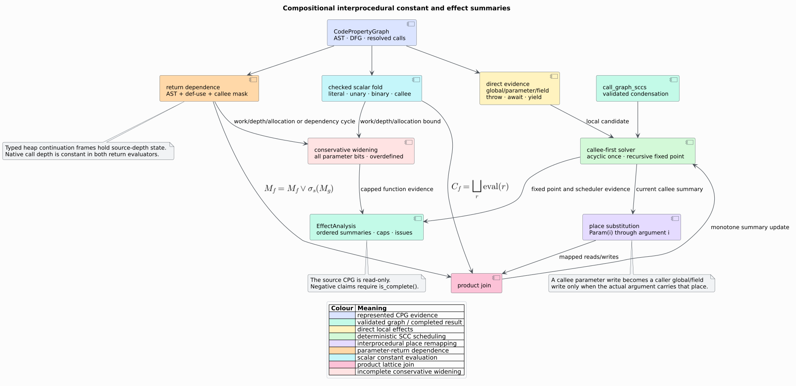

# Interprocedural constant and effect summaries

`libcpg::analyze_effects` computes deterministic, read-only procedure summaries
over the current resolved call graph. It is the first concrete client of the
[IFDS/IDE summary framework](ifds-ide-framework.md): the generic engine supplies
callee-first scheduling and recursive fixed points, while this component
defines what an *effect* means.

The analysis is feature-free and language-agnostic. It consumes typed Code
Property Graph (CPG) nodes and edges; it does not parse source text, match
language syntax strings, query a database, or add a parallel graph.



## 1. Vocabulary

- A **place** is storage whose observation matters outside one local scalar
  computation. `Place::Global` names an out-of-function variable,
  `Place::Param` names a zero-based formal parameter, and `Place::Field` names
  object or nominal state.
- **Purity** is an ordered classification: `Pure`, `ReadsGlobal`,
  `WritesGlobal`, then `Impure`. A larger value is conservatively worse.
- A **procedure summary** is a compact description of reads, writes, purity,
  return dependence, and a scalar return constant.
- **Overdefined** means available paths disagree or an operation cannot be
  folded safely. **Bottom** means no return evidence has arrived yet. They are
  deliberately distinct.

## 2. Public API

```rust
use std::collections::{BTreeMap, BTreeSet};
use std::sync::Arc;
use libcpg::{ConstValue, NodeId};

pub enum Place {
    Global(Arc<str>),
    Param(u16),
    Field(Arc<str>),
}

pub enum Purity { Pure, ReadsGlobal, WritesGlobal, Impure }

pub struct EffectSummary {
    pub reads: BTreeSet<Place>,
    pub writes: BTreeSet<Place>,
    pub purity: Purity,
    pub param_to_return: u64,
    pub const_return: Option<ConstValue>,
    pub const_return_overdefined: bool,
    pub param_mask_truncated: bool,
    pub capped: bool,
}

// The completeness-preserving entry point.
pub fn inspect(
    cpg: &libcpg::CodePropertyGraph,
    call_graph: &libcpg::SccDecomposition,
    caps: &libcpg::IfdsCaps,
) -> libcpg::EffectAnalysis {
    libcpg::analyze_effects(cpg, call_graph, caps)
}

// The task-specified map projection.
pub fn summaries(
    cpg: &libcpg::CodePropertyGraph,
    call_graph: &libcpg::SccDecomposition,
    caps: &libcpg::IfdsCaps,
) -> BTreeMap<NodeId, libcpg::EffectSummary> {
    libcpg::effect_summaries(cpg, call_graph, caps)
}
```

Use `analyze_effects` for decisions. `effect_summaries` intentionally projects
away completeness evidence and can therefore contain a capped monotone prefix.

## 3. Evidence interpretation

| CPG evidence | Summary interpretation |
|---|---|
| Identifier whose definition is an out-of-function `Variable` | `Global(name)` read, or write when it is the assignment target |
| Identifier reaching a formal `Parameter` | `Param(index)` read/write |
| `FieldRead` / `FieldWrite` incident on `MemberAccess` | named `Field` read/write |
| `IndexRead` / `IndexWrite` | read/write of the base parameter, global, or field when represented |
| `Throw`, `Await`, or `Yield` | direct `Impure` evidence |
| one resolved callee | compose its current summary |
| external or unresolved callee | conservatively `Impure`; returned value is overdefined |
| scalar literal/unary/binary expression | the same checked folding vocabulary as SCCP |

Only evidence represented in the CPG creates a place. An identifier with no
definition or def-use evidence is not guessed to be global. This is the same
evidence-boundary discipline used by call resolution.

## 4. Composition algorithm

The following literate pseudocode names both the action and its rationale.

```text
EFFECT-SUMMARY(function, current summaries, resolver, caps)
    start with direct typed-edge reads/writes and direct control effects
        because local evidence must survive every recursive round

    for call in ascending NodeId order
        if call resolves to a represented callee with a current summary
            map callee Param(i) places through call argument i
            union mapped reads and writes
            retain the worse purity
        otherwise
            raise purity to Impure
        end if
    end for

    for each represented return expression
        trace parameter dependence through AST, def-use, and callee masks
        fold scalar constants through literals, definitions, and callees
        meet all return constants in the three-level constant lattice
    end for

    if a local traversal reaches a configured bound
        widen parameter dependence to every representable bit
        widen the constant to overdefined and set capped
    end if

    return the monotone summary
```

The generic solver visits acyclic callees once and recursive strongly
connected components (SCCs) to a bounded fixed point. Therefore callers see
stable callee facts without a second whole-program pass.

## 5. Lattice semantics

`EffectSummary` is a product lattice. Reads and writes use set union; the
parameter mask uses bitwise OR; Boolean evidence uses OR; purity uses the worse
ordered value. The constant coordinate is

```math
\bot_C \sqsubset c \sqsubset \top_C,
```

where $`c`$ is one exact `ConstValue`, distinct constants join to
$`\top_C`$, and `const_return_overdefined` distinguishes $`\top_C`$ from the
`None` representation of $`\bot_C`$. This extra bit prevents a conflicting
constant from incorrectly becoming constant again in a later recursive round.

The `u64` parameter mask represents formal parameters 0 through 63.
`param_mask_truncated` records a wider signature. Transitive use of a truncated
callee conservatively visits every argument and makes the result incomplete.

## 6. Purity and place remapping

A write to `Param(i)` alone remains `Pure`: the summary says the function can
mutate its caller-provided place, but it does not yet know whether that place is
externally visible. At a call, parameter places are remapped through actual
arguments. Passing a global to such a callee turns the caller into
`WritesGlobal`; passing a local scalar does not fabricate a global effect.

This delayed remapping is what makes summaries reusable and compositional.

## 7. Determinism, bounds, and malformed input

- functions, calls, returns, facts, places, and evidence use sorted vectors or
  `BTreeMap`/`BTreeSet`;
- the exact current call-graph SCC decomposition is validated before analysis;
- recursive rounds and shared scheduler work use `IfdsCaps`;
- expression/dependence walks use `max_call_depth`, `max_worklist_steps`, and
  cycle guards;
- a domain-local limit sets `EffectSummary::capped`, rolls up through
  `EffectAnalysis::domain_capped_functions`, widens dependencies, and prevents
  `is_complete()` from succeeding;
- the source CPG is never mutated.

An incomplete may-summary can still prove a positive effect. It cannot justify
the negative claim “this function never writes that place.”

## 8. Complexity

Let $`F`$ be functions, $`C`$ call sites, $`A`$ inspected AST/def-use evidence,
and $`I`$ recursive rounds. Ordered-set operations add logarithmic factors.
The bounded worst-case work is

```math
O\!\left(I(A+C)\log P\right),
```

where $`P`$ is the number of distinct places retained. Acyclic components have
$`I=1`$. The configured work and depth caps provide operational ceilings.

## 9. See also

- [Theory 26](../../theory/26-interprocedural-effect-lattice.md)
- [ADR-0033](../../design/0033-compositional-effect-summaries.md)
- [Scientific validation 28](../../scientific/28-effect-summary-validation.md)
- [Usage 09](../../usage/09-effect-summaries.md)
- [Input and resource hardening](../../security/01-input-and-resource-hardening.md)

## References

1. Reps, T., Horwitz, S., Sagiv, M. (1995). *Precise Interprocedural Dataflow
   Analysis via Graph Reachability.* POPL. DOI:
   [10.1145/199448.199462](https://doi.org/10.1145/199448.199462).
2. Wegman, M. N., Zadeck, F. K. (1991). *Constant Propagation with Conditional
   Branches.* ACM TOPLAS 13(2), 181–210. DOI:
   [10.1145/103135.103136](https://doi.org/10.1145/103135.103136).
