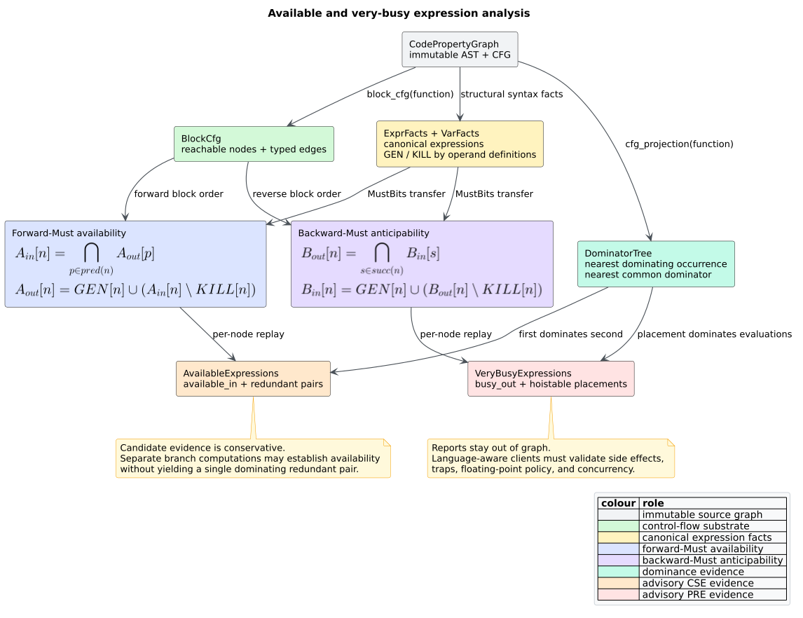
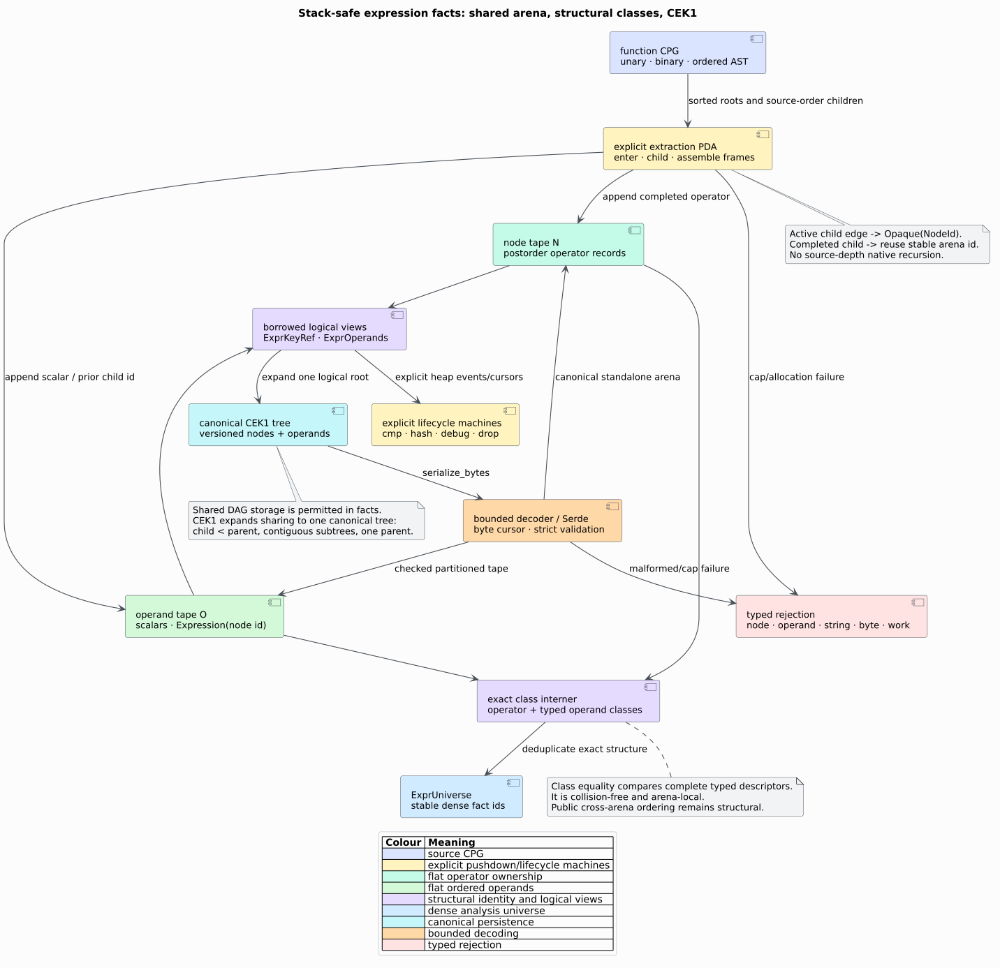

# Available and very-busy expressions

`libcpg::available_expressions` finds expressions already computed on every
path to a program point; `libcpg::very_busy_expressions` finds expressions that
every future path computes before an operand changes. These classical
forward-Must and backward-Must analyses provide conservative evidence for
[common-subexpression elimination](../../GLOSSARY.md#common-subexpression-elimination-cse)
(CSE) and [partial-redundancy
elimination](../../GLOSSARY.md#partial-redundancy-elimination-pre) (PRE).

Both APIs are feature-free, deterministic, read-only clients of the
[monotone data-flow framework](dataflow-framework.md). They return evidence by
stable `NodeId`; they never rewrite the source CPG.



*Figure — dual expression analyses and their advisory candidate filters.
Source: [`diagrams/expression-analysis.puml`](../../diagrams/expression-analysis.puml).*

## 1. Structural expression facts

Fix the finite `ExprUniverse` $`E`$ of unary and binary [`ExprKey`](dataflow-framework.md#built-in-domains-and-fact-universes)s
in one function. A key preserves:

- operator spelling and operand order;
- variable names and exact literal values, including floating-point bits;
- nested unary/binary roots in one shared flat postorder arena; and
- an identity-qualified `Opaque(NodeId)` for an unsupported operand.

Opaque identity is deliberately conservative: two unsupported constructs are
not called equivalent merely because their node kinds resemble one another.
Nested functions are separate scopes. Only occurrences in the selected
function's reachable [`BlockCfg`](basic-block-cfg.md) receive output states.

`ExprKey` has no recursive owned field. A node stores an operator plus a
checked range in an ordered operand tape; a nested operand stores the id of a
previously completed node. Exact bottom-up structural classes deduplicate equal
roots without a finite digest. Extraction, comparison, hashing, formatting,
Serde, and destruction use explicit heap state. See
[ADR-0041](../../design/0041-shared-flat-expression-facts.md).



*Figure — shared expression facts and their persistence boundary. Source:
[`expression-key-flat-arena.puml`](../../diagrams/expression-key-flat-arena.puml).*

For node $`n`$, define:

- $`GEN[n] \subseteq E`$: expressions evaluated at $`n`$;
- $`DEF[n]`$: variables syntactically defined at $`n`$; and
- $`KILL[n] = \{e \in E \mid operands(e) \cap DEF[n] \ne \varnothing\}`$.

Declarations, parameters, and assignments use the same binding rules as
`variable_facts`. The node transfer is shared by both analyses:

```math
f_n(S) = GEN[n] \cup \left(S \setminus KILL[n]\right).
```

Kill happens before generation. Thus an expression evaluated by a node remains
true after that node even if a language frontend ever represents a definition
and evaluation together.

## 2. Available expressions

An expression is **available immediately before** $`n`$ when every entry-to-$`n`$
path has evaluated it and no later node on that path has defined one of its
operands. With $`entry`$ as the function entry:

```math
AVAILABLE_{in}[entry] = \varnothing,
```

```math
AVAILABLE_{in}[n]
  = \bigcap_{p \in pred(n)} AVAILABLE_{out}[p],
\qquad
AVAILABLE_{out}[n] = f_n(AVAILABLE_{in}[n]).
```

Intersection is the crucial **Must** meet. If only the left arm of a branch
computes `x + 1`, it is not available at the join. If both arms compute it and
neither changes `x`, it is available there.

`AvailableExpressions::redundant` contains `(first, second)` only when:

1. the expression generated at `second` belongs to `available_in[second]`;
2. `first` is an occurrence of the same structural key; and
3. `first` dominates `second`; and
4. no path from `first` to `second` defines an operand before reaching
   `second`.

The implementation chooses the nearest provenance-safe occurrence on
`second`'s dominator chain. The fourth condition matters when an old dominating
value is killed and separate branch computations re-establish availability:
the old value cannot be reused. Availability can also be established by different
occurrences on separate predecessor paths. In that case the expression remains
in `available_in`, but no arbitrary branch occurrence is reported as `first`:
none dominates the join, so such a pair would overstate the evidence.

## 3. Very-busy expressions

An expression is **very busy**, or **anticipable**, immediately after $`n`$ when
every $`n`$-to-exit path evaluates it before defining an operand. The dual
backward equations are:

```math
BUSY_{out}[exit] = \varnothing,
```

```math
BUSY_{out}[n]
  = \bigcap_{s \in succ(n)} BUSY_{in}[s],
\qquad
BUSY_{in}[n] = f_n(BUSY_{out}[n]).
```

Every modeled exit receives the empty boundary. Therefore an expression is not
anticipable across a branch with an exit arm that never evaluates it.

`VeryBusyExpressions::hoistable` contains advisory `(expression, placement)`
pairs. A key must have at least two reachable evaluations. `placement` is their
nearest common dominator, so it dominates every evaluation; the expression
must also belong to `BUSY_in[placement]`. These conditions provide precise
control-flow evidence for a PRE client without claiming that moving an
operation is language-semantically safe.

## 4. Public API

```rust
// requires: no features
use libcpg::{
    available_expressions, very_busy_expressions, CodePropertyGraph, NodeId,
};

# fn inspect(
#     cpg: &CodePropertyGraph,
#     function: NodeId,
# ) -> Result<(), libcpg::AnalysisError> {
let available = available_expressions(cpg, function)?;
for (node, expressions) in &available.available_in {
    println!("available before {node:?}: {expressions:?}");
}
for (first, second) in available.redundant {
    println!("{second:?} can reuse the value from {first:?}");
}

let busy = very_busy_expressions(cpg, function)?;
for (expression, placement) in busy.hoistable {
    println!("consider placing {expression:?} before {placement:?}");
}
# Ok(())
# }
```

| API | Result contract |
|---|---|
| `available_expressions(cpg, function)` | `AvailableExpressions { function, available_in, redundant }` |
| `available_in` | every reachable block-CFG node mapped to structural keys available immediately before it |
| `redundant` | sorted, deduplicated dominating CSE occurrence pairs |
| `very_busy_expressions(cpg, function)` | `VeryBusyExpressions { function, busy_out, hoistable }` |
| `busy_out` | every reachable block-CFG node mapped to keys anticipable immediately after it |
| `hoistable` | sorted, deduplicated `(ExprKey, nearest_common_dominator)` PRE evidence |

All expression vectors follow canonical `ExprUniverse` dense-id order.
Unknown node ids and non-function selectors return
`AnalysisError::{UnknownNode, NotAFunction}`. Bodyless functions produce one
empty state for the function entry. Unreachable AST islands and nested-function
nodes are absent.

Expression construction and persistence failures return
`AnalysisError::ExpressionKey`. No available/very-busy result is produced from
partial facts.

With the optional `serde` feature, both report types and their structural keys
round-trip through Serde.

## 5. Algorithm and convergence

The implementation uses the finite `MustBits` lattice. `Universe(|E|)` is
lattice bottom under reverse-subset order; concrete path boundaries are empty
sets; join is intersection. This initialization lets the first real path state
remove provisional truths while preserving the standard greatest fixed point.

```text
facts    := expression_facts(cpg, function)
cfg      := block_cfg(cpg, function)
killed   := invert expression operands, then map each variable definition

available.direction := Forward
available.meet      := intersection
available.boundary  := empty
available.transfer  := GEN union (state minus KILL)

very_busy.direction := Backward
very_busy.meet      := intersection
very_busy.boundary  := empty at every exit
very_busy.transfer  := GEN union (state minus KILL)

solve both with the default bounded deterministic worklist
replay each block once to materialize per-node states
filter CSE/PRE candidates with the function's DominatorTree
```

The fact universe is finite, so both monotone problems terminate without
widening. The shared default 256-visit-per-block cap remains a hard backstop for
hostile or structurally malformed inputs.

## 6. Determinism and complexity

Deterministic structural-class universes, block traversal, `BTreeMap` states, and
sorted candidate vectors make reports independent of CPG node and CFG-edge
insertion order.

Let $`B`$ be the block count, $`E_b`$ the block-edge count, $`N`$ the reachable
node count, $`F = |E|`$ the expression count, $`V_e`$ the number of distinct
operand variables, $`D`$ the number of variable definitions, and
$`W = \lceil F/64 \rceil`$ machine words per state. The conventional finite
worklist bound is $`O(H(B + E_b)W)`$, where $`H \le F`$. Building kills costs
$`O(FV_e + D)`$ plus emitted kill memberships. Per-node replay and report
materialization cost $`O(NW)`$. Dominator queries used by candidate filtering
are constant time after tree construction; walking a dominator chain is bounded
by $`N`$. Each provisional CSE pair also performs bounded forward/reverse
reachability checks for intervening kills, costing $`O(N + E_b)`$ per checked
kill in the conservative worst case.

## 7. Validation evidence

The primary property test builds acyclic CFGs of up to 12 nodes, explicitly
enumerates every entry-to-node and node-to-exit path, and checks the two public
maps against definitions independent of the production solver:

- available iff every entry path has a computation after its last operand
  definition;
- very busy iff every exit path meets a computation before its first operand
  definition.

The same 96-case property rebuilds each graph with reversed node and CFG-edge
insertion order and requires identical reports. It also checks that every CSE
pair is available, dominating, and preserves its first value on every path,
and that every PRE placement dominates all of its evaluations. Examples cover
straight-line redundancy, operand kills, branch recomputation after a killed
dominating value, diamonds, loops, unreachable and nested occurrences,
bodyless functions, typed selector errors, Serde, and graph non-mutation.
Public integration tests exercise the
feature-free crate-root API; the repository robustness harness invokes both
analyses for every malformed-graph class.

## 8. Advisory and security boundaries

Structural equality is necessary but not sufficient for a legal source
transformation. The reports do not model:

- volatile, atomic, memory-mapped, or reflective reads;
- overloaded operators or user-defined coercions;
- traps, checked overflow, exceptions, or observable evaluation order;
- floating-point status flags, rounding modes, or NaN payload policy; or
- concurrency and interprocedural mutation of operand state.

A language-aware optimizer must discharge those conditions before eliminating
or moving an evaluation. Keeping evidence out of the graph also prevents an
advisory pass from being mistaken for a committed rewrite.

## See also

- [Monotone data-flow framework](dataflow-framework.md) — lattice and solver
  contracts.
- [Variable liveness and dead stores](liveness-analysis.md) — the backward-May
  sibling analysis.
- [Dominator analysis](dominator-analysis.md) — candidate-placement evidence.
- [Theory 03](../../theory/03-data-flow-and-reaching-definitions.md) — the
  classical data-flow framework.

## References

1. Morel, E., Renvoise, C. (1979). *Global Optimization by Suppression of
   Partial Redundancies.* Communications of the ACM 22(2), 96–103. DOI:
   [10.1145/359060.359069](https://doi.org/10.1145/359060.359069)
2. Kildall, G. A. (1973). *A Unified Approach to Global Program Optimization.*
   POPL '73. DOI:
   [10.1145/512927.512945](https://doi.org/10.1145/512927.512945)
