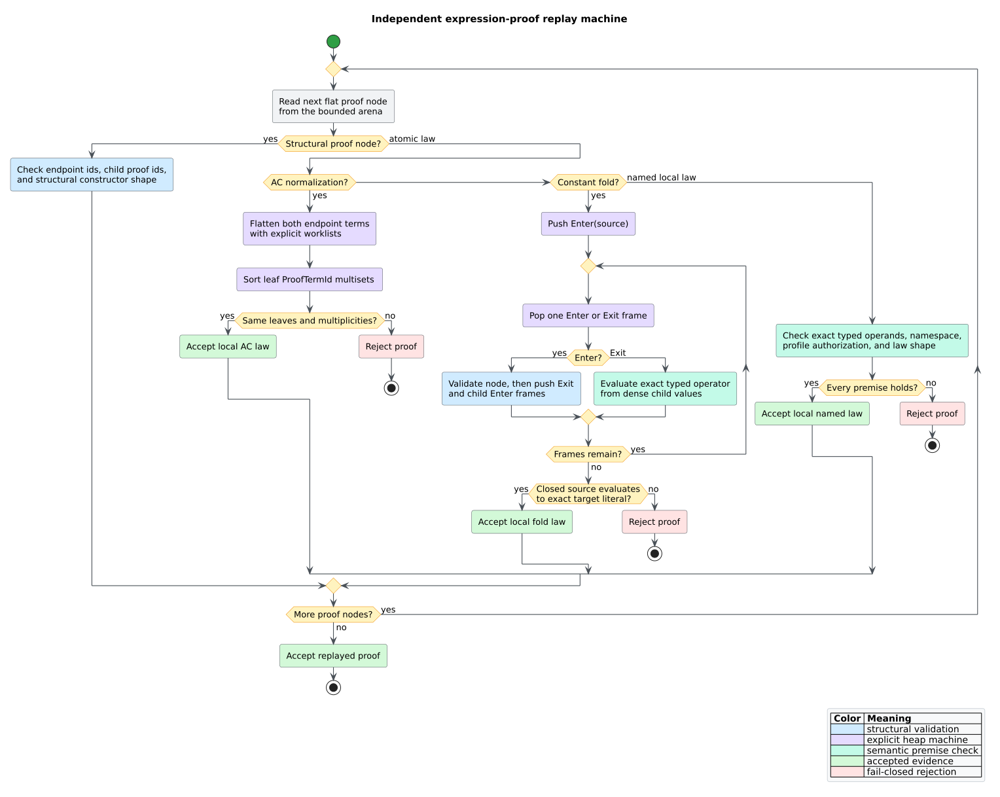

# Expression-equivalence component

## Responsibility

`analysis::expression_equivalence` translates already validated, flat
`ExpressionIr` values into two bounded Replete e-graphs and emits qualified
positive pairs with independently replayable proofs. It does not parse source,
infer types, mutate the CPG, execute Datalog, perform control/data-flow, or
extract replacement source code.

## Data flow



*Figure -- independent proof replay machine. Source:
[`expression-proof-replay-machine.puml`](../../diagrams/expression-proof-replay-machine.puml).*

Each prepared IR node stores two operators:

- the exact operator retains resolved binding identity and the caller's binding
  context as a namespace;
- the alpha operator replaces bindings with deterministic local slots and has
  no exact namespace.

Both forms retain the exact result type. Canonical operator bytes include the
namespace, operator/literal identity, and type descriptor.

## Literate algorithm

The algorithm below states both action and rationale. “Abort” means return the
corresponding typed incomplete report, never discard the reason.

```text
ANALYZE(domain, profile, candidates, limits):
    validate limits
        because malformed resource policy must fail before graph allocation
    sort candidates by stable source and binding context
        because public behavior must not depend on caller insertion order
    for each candidate:
        validate live provenance, completion, root, profile, and purity
        prepare exact and alpha flat operators iteratively
            because expression depth must not consume native call-stack depth
    exact := RUN-PASS(Exact, prepared)
    alpha := RUN-PASS(Alpha, prepared)
    merge, sort, and deduplicate positive pairs
    return both pass completions, unsupported inputs, metrics, and limits

RUN-PASS(mode, prepared):
    create an empty bounded Replete graph and enable bounded provenance
    add every flat node in child-before-parent order
    for each certified AC node:
        build its exact multiplicity-preserving canonical AC application
        merge positional and canonical classes with named evidence
    compile only profile-authorized named rules
    alternate Replete saturation and typed native folding until fixed point
    rebuild and require complete provenance
    enumerate comparable source pairs in stable order
    for each equivalent pair within the pair cap:
        construct a bounded proof tape and replay it independently
        emit the qualified pair
```

## Proof replay

Replete verifies structural proof nodes. libcpg verifies atomic labels:

- commutativity checks exactly two reversed child terms;
- associativity checks the two legal binary shapes with identical leaves;
- identities check the exact typed unit and retained child;
- AC normalization iteratively flattens both endpoints and compares sorted
  `ProofTermId` multisets; and
- constant folding iteratively evaluates every closed source node and requires
  exact equality with a leaf target.

The closed evaluator uses `Enter` and `Exit` frames plus a dense result arena.
Bindings, calls, loads, opaque operators, malformed arity, mixed namespace or
type, undefined arithmetic, and a nonliteral target all reject the proof.

## Complexity

Let $`N`$ be total admitted IR nodes, $`R`$ represented e-nodes, $`M`$ observed
matches, $`I`$ iterations, $`Q`$ comparable candidate pairs, and $`P`$ retained
proof terms. Construction is bounded by caller-charged work over $`N`$ and AC
members. Saturation is bounded by $`R`$, $`M`$, and $`I`$. Pair enumeration is
$`O(Q)`$ before proof output. One proof replay is $`O(P)`$ time and $`O(P)`$
heap in the worst case, with constant native-stack use.

These are bounded operational costs, not a promise that saturation is
polynomial in source size. The benchmark separates pair-output and AC-width
effects so regressions remain attributable.

## Dependencies and ownership

The dependency direction is `libcpg -> Replete`. Replete contains no libcpg,
parser, Datalog, or MeTTaIL dependency. The adapter borrows `ExpressionIr` and
returns owned reports. No mutable graph or global cache crosses the boundary.

## References

1. Nelson, G., Oppen, D. C. (1980). *Fast Decision Procedures Based on
   Congruence Closure.* DOI:
   [10.1145/322186.322198](https://doi.org/10.1145/322186.322198).
2. Willsey, M. et al. (2021). *egg: Fast and Extensible Equality Saturation.*
   DOI: [10.1145/3434304](https://doi.org/10.1145/3434304).
