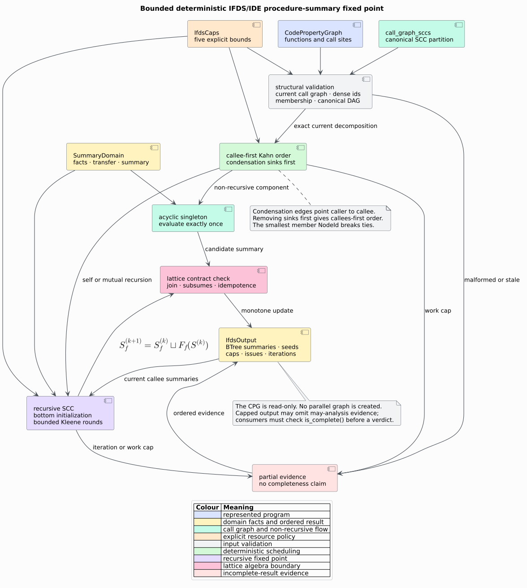

# Deterministic IFDS/IDE procedure-summary framework

The feature-free `analysis::ifds` module supplies the interprocedural scheduling
and fixed-point layer shared by data-flow analyses such as taint and effect
propagation. **Interprocedural Finite Distributive Subset (IFDS)** analysis
represents data flow as reachability over a finite fact domain. Its
**Interprocedural Distributive Environment (IDE)** generalization propagates
distributive value-transforming environments. libcpg provides the generic
procedure-summary engine; each `SummaryDomain` supplies its analysis-specific
local flow and summary semantics.



*Figure — deterministic IFDS/IDE summary solving. Source:
[`ifds-summary-fixpoint.puml`](../../diagrams/ifds-summary-fixpoint.puml).*

## Public API and feature boundary

The API is available with `default = []`:

```rust
pub trait Lattice: Clone + Default {
    fn join(&mut self, other: &Self) -> bool;
    fn subsumes(&self, other: &Self) -> bool;
}

pub trait SummaryDomain {
    type Fact: Clone + Eq + std::hash::Hash + Ord;
    type Summary: Lattice;

    fn seed_facts(
        &self,
        cpg: &CodePropertyGraph,
        function: NodeId,
    ) -> Vec<(NodeId, Self::Fact)>;

    fn summarize(
        &self,
        cpg: &CodePropertyGraph,
        function: NodeId,
        ctx: &SummaryCtx<'_, Self>,
    ) -> Self::Summary;
}

pub fn solve_summaries<D: SummaryDomain>(
    cpg: &CodePropertyGraph,
    domain: &D,
    call_graph: &SccDecomposition,
    caps: &IfdsCaps,
) -> IfdsOutput<D>;

pub fn solve_summaries_with_resolver<D: SummaryDomain>(
    cpg: &CodePropertyGraph,
    domain: &D,
    call_graph: &SccDecomposition,
    caps: &IfdsCaps,
    resolve: &dyn Fn(NodeId) -> CalleeRef,
) -> IfdsOutput<D>;
```

The trait's canonical name is
`libcpg::analysis::ifds::Lattice`. The crate-root alias `IfdsLattice` avoids a
collision with the separate intraprocedural `libcpg::Lattice` used by
`analysis::dataflow`.

`Default::default()` is lattice bottom. `join` returns `true` exactly when the
semantic value grows; `subsumes(a, b)` means that `a` contains all information
represented by `b`. The solver checks reflexivity, join idempotence, agreement
between `join` and `subsumes`, and upper-bound containment on every candidate.
It reports `IfdsIssue::LatticeLaw` if that executable contract is contradicted.
The checks cannot prove associativity, commutativity, domain monotonicity, or
distributivity; those remain obligations of the domain and its tests.

## Domain responsibilities

The framework owns whole-program orchestration:

- it validates the supplied SCC decomposition against the current call graph;
- it orders recursive components after their callees;
- it initializes every represented summary to bottom;
- it iterates recursive components monotonically;
- it retains seed facts canonically; and
- it enforces framework-level resource caps.

The domain owns local semantics. `seed_facts` returns finite
`(program_point, fact)` pairs inside the selected function's AST scope.
`summarize` evaluates one procedure from the CPG and the current immutable
`SummaryCtx`. A true IFDS instance normally implements local
exploded-supergraph flow in `summarize` and packages the resulting
entry-to-exit relation as its summary. An IDE instance stores distributive
environment transformers instead.

`SummaryCtx::summaries` includes bottom values for not-yet-evaluated functions
and active recursive peers. The map is a `BTreeMap<NodeId, Summary>`, so domains
must use lookup rather than positional indexing. A custom resolver may return a
`Resolved` node outside the map; a total domain treats absence conservatively.

## Callee evidence boundary

`CalleeRef` has three explicit cases:

| Variant | Meaning | Summary lookup |
|---|---|---|
| `Resolved(NodeId)` | one represented function is selected | look up by node id |
| `External(Arc<str>)` | an authoritative caller says the callee is outside the program | apply an external model or conservative top effect |
| `Unresolved(Arc<str>)` | represented evidence does not select one callee | apply the domain's unknown-call policy |

The default resolver combines `Call::target`, `CallSite`, `StaticCall`,
`DynamicCall`, and CFG `Call` evidence. Exactly one represented function yields
`Resolved`. Conflicting targets remain `Unresolved`; no arbitrary candidate is
chosen. An unresolved label comes from a bounded, cycle-safe descent through
the call's AST children, falling back to retained call text and then
`call@<NodeId>`. The framework cannot infer `External` from graph absence alone,
because “outside this CPG” and “not yet resolved” are different claims.

## Call-graph validation

The supplied `SccDecomposition` is not trusted merely because its fields are
public. Before a domain runs, the solver checks:

| Invariant | Evidence on failure |
|---|---|
| projection is `CallGraph` | `NotCallGraph` |
| component ids are dense vector positions | `ComponentId` |
| every component is nonempty with strictly sorted unique members | `EmptyComponent`, `NonCanonicalMembers`, `DuplicateMember` |
| members are exactly the current CPG functions | `NotAFunction`, `MissingFunction` |
| `component_by_node` agrees in both directions | `Membership` |
| condensation endpoints are distinct and in range | `CondensationEdge` |
| condensation edges are sorted and deduplicated | `NonCanonicalCondensation` |
| condensation relation is acyclic | `CyclicCondensation` |
| the entire value equals a fresh `call_graph_sccs(cpg)` result | `StaleCallGraph` |

This last equality is deliberate. A structurally plausible decomposition can
still predate a call-resolution pass. Accepting it could evaluate a caller
before a newly discovered callee and silently under-approximate the result.

## Literate solver

Call-graph condensation edges point from caller component to callee component.
The solver therefore removes zero-outdegree components first. A
`(smallest_member, component_id)` ordered ready set makes independent callees
deterministic.

```text
solve(cpg, domain, call_graph, caps):
    reject when represented function count exceeds max_functions
    validate call_graph against call_graph_sccs(cpg)
    order = repeatedly remove the smallest zero-outdegree component
    canonicalize, validate, and cap every function's seed facts
    summaries = bottom for every represented function

    for component in order:
        if component is acyclic:
            candidate = domain.summarize(function, summaries)
            checked_join(summaries[function], candidate)
        else:
            repeat at most max_scc_iters rounds:
                changed = false
                for function in ascending NodeId order:
                    candidate = domain.summarize(function, summaries)
                    changed |= checked_join(summaries[function], candidate)
                stop when not changed
            stop the caller frontier if the recursive component is capped

    return ordered summaries, seeds, iteration counts, caps, and issues
```

Functions inside a recursive component use sequential, ascending-`NodeId`
updates. This deterministic Gauss–Seidel schedule may expose a newly grown peer
summary later in the same round. A round is complete only after every member is
evaluated; `component_iterations` records completed rounds.

## Resource semantics

`IfdsCaps` makes every whole-program resource policy explicit:

| Cap | Counted resource | Behavior at the boundary |
|---|---|---|
| `max_functions` | represented CPG functions | return no summaries with `Functions` evidence |
| `max_facts_per_node` | distinct, deduplicated seed facts at one point | retain the least facts by `Ord`, record exact observed count, do not start summary solving |
| `max_worklist_steps` | condensation removals plus summary evaluations | stop before the first unbudgeted step |
| `max_scc_iters` | complete rounds in one recursive component | retain monotone partial summaries and stop before callers |
| `max_call_depth` | default callee-name descent; also available to domains | classify deeper unresolved syntax conservatively |

`IfdsOutput::is_complete()` is true only when no cap fired and no issue was
observed. Capped summaries are bottom-based monotone prefixes. For a may
analysis they may omit a real flow, so consumers must not turn a capped result
into a clean-security or no-effect verdict. `cap_events` and `issues` are
ordered sets suitable for stable diagnostics and serialization.

`max_call_depth` is also passed through `SummaryCtx`. The framework cannot
interrupt an arbitrary loop inside client code; a domain must apply that cap,
or a stricter domain-specific cap, to its own traversals.

## Determinism, mutation, and complexity

The solver reads but never mutates the CPG and creates no parallel graph.
`BTreeMap`, `BTreeSet`, sorted member lists, and stable `NodeId` ties define
every public order. Reordering identical CPG edge insertions therefore leaves
`IfdsOutput` equal.

Let $`F`$ be the number of functions, $`C`$ the number of SCCs, $`Q`$ the
number of condensation edges, $`Z`$ the number of returned seed pairs, and
$`W`$ the number of summary evaluations actually performed. Excluding the
domain's own local work, orchestration costs
$`O(F + Q + Z \log Z + W)`$ time and $`O(F + Q + Z)`$ retained space.
Recomputing call-graph SCCs for stale-input validation adds the existing
linear projection/decomposition cost. Summary storage and join cost depend on
the chosen domain.

## Security and interpretation

The framework is defensive analysis infrastructure, not a vulnerability
verdict. It distinguishes malformed inputs, explicit resource exhaustion,
external calls, and unresolved calls. No category is silently converted to a
resolved edge or a complete result. Domains should document whether their
unknown-call policy chooses top, a catalog model, identity, or another
conservative transformer.

## See also

- [Theory 25](../../theory/25-ifds-ide-summary-solving.md) formalizes the
  lattice and SCC fixed point.
- [ADR-0032](../../design/0032-deterministic-ifds-ide-summaries.md) records the
  architectural decision.
- [Scientific validation 27](../../scientific/27-ifds-ide-validation.md)
  maps claims to example, property, integration, serde, and benchmark oracles.
- [Usage 08](../../usage/08-ifds-summary-domains.md) implements a complete
  custom domain.

## References

1. Reps, T., Horwitz, S., Sagiv, M. (1995). *Precise Interprocedural Dataflow
   Analysis via Graph Reachability.* POPL. DOI:
   [10.1145/199448.199462](https://doi.org/10.1145/199448.199462).
2. Sagiv, M., Reps, T., Horwitz, S. (1996). *Precise Interprocedural Dataflow
   Analysis with Applications to Constant Propagation.* Theoretical Computer
   Science 167(1–2), 131–170. DOI:
   [10.1016/0304-3975(96)00072-2](https://doi.org/10.1016/0304-3975(96)00072-2).
