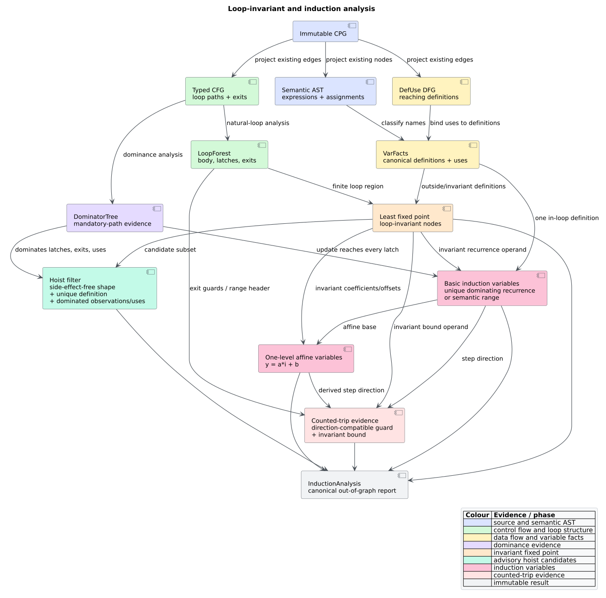

# Loop invariants, induction variables, and trip evidence

`libcpg::loop_induction` computes three related forms of evidence for every
loop in a supplied [`LoopForest`](loop-analysis.md): loop-invariant
computations, basic and one-level-derived induction variables, and
direction-compatible counted-loop guards. The analysis is feature-free,
deterministic, intraprocedural, read-only, and language-independent. It
interprets the semantic Abstract Syntax Tree (AST), Control Flow Graph (CFG),
and Data Flow Graph (DFG) already stored in the Code Property Graph (CPG); it
does not scan source text or implement a parser.



*Figure — the loop-induction evidence pipeline. Source:
[`diagrams/induction-analysis.puml`](../../diagrams/induction-analysis.puml).*

## Terms and intuition

- A computation is **loop invariant** when its modeled operands have the same
  value on every iteration. `libcpg` proves this from reaching definitions: a
  use must be reached only by definitions outside the loop region or by
  computations already proved invariant.
- A **basic induction variable** (IV) changes by one invariant amount on every
  path back to the loop header, such as `i += 2`.
- A **derived induction variable** is an affine expression of one basic IV,
  such as `j = 4 * i + offset`. Its step is the basic step multiplied by the
  affine coefficient.
- A **latch** is a loop-body CFG node with a natural back edge to the header.
  Requiring an update to dominate every latch proves that no represented
  iteration can return to the header without executing the update.
- **Trip evidence** establishes that a supported loop-exit guard compares a
  moving IV with an invariant bound in a compatible direction. It does not
  claim an exact numeric trip count.
- **Hoistable** means structurally safe to *consider* for loop-invariant code
  motion: the expression has a side-effect-free CPG shape, dominates all
  latches and exit observations, and satisfies definition/use checks. A source
  transformer must still enforce language-specific trap, overflow, volatile,
  atomic, and concurrency rules.

For `for i in 0..x`, a parser-backed Rust builder emits a semantic `For` node,
a `Variable("i")` binding, and a `BinaryOp("..")` range. If both range operands
are invariant, `loop_induction` reports `i` with step one and a counted range
bound. The analysis only consumes those semantic nodes; tree-sitter remains the
parser.

## Input and result contract

The caller supplies the CPG, a function node, and the authoritative
`LoopForest` for that function:

```rust
// requires: no features
use libcpg::{
    loop_forest, loop_induction, AnalysisError, CodePropertyGraph,
    InductionAnalysis, NodeId,
};

fn induction_in(
    cpg: &CodePropertyGraph,
    function: NodeId,
) -> Result<InductionAnalysis, AnalysisError> {
    let forest = loop_forest(cpg, function)?;
    loop_induction(cpg, function, &forest)
}
```

Every loop-forest reference—header, entry, latch, body node, and both endpoints
of every exit—must belong to the selected function's reachable CFG projection.
An unknown or foreign reference returns `AnalysisError::UnknownNode`; an invalid
function selector follows the shared `UnknownNode` / `NotAFunction` contract.
An empty forest returns empty result vectors.

`InductionAnalysis` contains:

| Field | Contract |
|---|---|
| `function` | The analyzed function identifier. |
| `invariants` | One `LoopInvariants` record per loop, in forest order. |
| `ivs` | Basic then derived evidence, canonically sorted by loop, variable name, and update node. |
| `bounds` | One `LoopBoundEvidence` record per loop, in forest order. |

Each invariant record contains sorted `invariant_nodes` and a sorted
`hoistable` subset. Each `InductionVariable` records `loop_id`, `variable`,
`update_node`, an exact `step: Option<i64>`, its `IvDirection`, and sorted
outside-loop `init_defs`. With feature `serde`, all public result layers
serialize and round-trip.

## Loop region and invariant fixed point

For one `NaturalLoop`, the **loop region** is the union of its CFG body and the
AST descendants of those body nodes, restricted to the selected function.
Nested function bodies are boundaries and are not absorbed into the enclosing
loop. Iterative visited-set walks make malformed AST cycles finite and avoid
native-stack growth.

Let $`R`$ be that region, $`C`$ the candidate computations in $`R`$, and
$`defs(u)`$ the non-empty set of `DefUse` predecessors for identifier use
$`u`$. Starting from $`I_0 = \varnothing`$, the analysis computes:

```math
I_{k+1} = I_k \cup
\left\{c \in C \mid
  \forall u \in uses(c),\
  defs(u) \ne \varnothing \land
  \forall d \in defs(u),\ d \notin R \lor d \in I_k
\right\}.
```

Candidates are integer or other semantic literals, identifiers with canonical
variable facts, unary and binary expressions with operands, initialized
variables, and assignments with right-hand sides. A use without `DefUse`
evidence is not guessed invariant. Because every round only adds candidates,
the least fixed point stabilizes in at most $`|C| + 1`$ rounds.

## Hoistability filter

Invariance and legal motion are different questions. The `hoistable` subset
retains only unary expressions, binary expressions, initialized variables, and
assignments; calls and other effect-bearing node kinds are excluded. It then
requires:

1. the candidate's enclosing CFG anchor dominates every latch and every loop
   exit source;
2. each variable it defines has exactly one definition in the loop region; and
3. that definition's CFG anchor dominates every in-region `DefUse` consumer.

These checks prevent moving a conditionally evaluated expression, a multiply
defined value, or a definition above a use it did not originally dominate.
The report remains advisory because the language-neutral CPG cannot prove that
all operators are non-trapping or that an access is non-volatile.

## Basic induction variables

For an explicit assignment to `i`, libcpg recognizes these semantic forms:

| Form | Mathematical step |
|---|---:|
| `i += c` | $`c`$ |
| `i -= c` | $`-c`$ |
| `i = i + c` | $`c`$ |
| `i = c + i` | $`c`$ |
| `i = i - c` | $`-c`$ |

The operand `c` must be a literal or a computation in the invariant fixed
point. The assignment must be the variable's unique definition in the loop
region and dominate every latch. Initial definitions are the sorted `DefUse`
predecessors outside the region. Literal steps use checked `i64` arithmetic;
symbolic or overflowing steps remain `None` with direction `Unknown` rather
than receiving an unsound value.

Semantic `For` ranges `start .. bound` and `start ..= bound` are also
recognized. Their binding is initialized at the header with implicit step one
when both operands are invariant. The range syntax is supplied by the language
frontend as ordinary semantic nodes, so this rule remains feature-free.

## One-level-derived induction variables

A non-basic variable with a unique, latch-dominating definition is derived when
its right-hand side is affine in exactly one basic IV:

```math
y = a i + b,
```

where $`b`$ is loop invariant and the expression uses `+`, `-`, unary `+`/`-`,
or multiplication by an invariant operand. Recognition is bounded to three
operator levels and rejects products of two IV-bearing expressions. If the
coefficient $`a`$ is an exact integer literal and the basic step is $`s`$, the
derived step is checked as $`a s`$; otherwise the variable is still identified
but its step and direction remain unknown. Derived variables are not recursively
used as bases, which makes the advertised one-level contract explicit.

## Counted-trip evidence

`TripEvidence::Counted` records the IV name, comparison/range node, and invariant
bound node. It is emitted for a semantic range or for one of these normalized
exit comparisons:

| IV direction | Supported normalized guards |
|---|---|
| `Increasing` | `i < bound`, `i <= bound`, `i != bound` |
| `Decreasing` | `i > bound`, `i >= bound`, `i != bound` |
| `Stationary` / `Unknown` | none |

Operand-reversed comparisons are normalized (`bound > i` becomes `i < bound`).
The bound must be invariant, and an irreducible loop always reports
`TripEvidence::Unknown`. This is deliberately **evidence of a counted shape**,
not a termination proof: `!=` can step past its bound, machine arithmetic can
wrap, and a language may mutate shared state outside the modeled function.

## Literate algorithm

```text
LOOP_INDUCTION(cpg, function, forest):
    view  := validated reachable FunctionCfgView(function)
    dom   := DOMINATOR_TREE(view)
    facts := canonical variable definitions and uses
    scope := iterative function AST scope, excluding nested functions

    for loop in forest order:
        validate every loop reference belongs to view
        region := loop CFG body plus scoped AST descendants

        invariant := empty set
        repeat at most candidate_count + 1 times:
            add each candidate whose DefUse sources are outside region
                or already invariant
            stop when no candidate was added

        hoistable := invariant nodes passing kind, dominance,
                     unique-definition, and dominated-use checks
        basic := unique recurrence assignments that dominate every latch
                 plus invariant semantic range bindings

    canonicalize all basic IVs
    for loop in forest order:
        derived := unique latch-dominating definitions affine in one basic IV
    canonicalize basic + derived IVs

    for loop in forest order:
        bound := first canonical range/exit guard comparing an IV
                 in a compatible direction with an invariant operand

    return immutable InductionAnalysis
```

## Determinism, complexity, and resource bounds

Loop order comes from the validated forest. Regions, invariant sets, definition
sets, and intermediate maps use ordered collections; public vectors are sorted
and deduplicated. Property tests rebuild equivalent graphs with reversed node
and edge insertion and require byte-for-byte equal reports.

Let $`C_l`$ be the invariant-candidate count, $`R_l`$ the region size, and
$`D_l`$ the relevant DFG-edge count for loop $`l`$. The deliberately simple
fixed point is bounded by $`C_l + 1`$ rounds, with conservative worst-case work
$`O(C_l^2(R_l + D_l))`$ when candidate subtrees are rescanned. Basic-IV,
constant-depth affine, guard, and hoist filters are polynomial scans over the
same finite region and loop observations. Space is
$`O(N + \sum_l(R_l + D_l))`$ including shared function/dominator evidence.
Nested loops may intentionally account for a node in more than one region.

All AST walks are iterative and visited-set bounded. Checked arithmetic turns
overflow into unknown evidence. A 25,000-node region regression proves the
analysis does not consume one native stack frame per AST node.

## Oracle-guarded benchmark

`benches/induction_analysis.rs` measures the feature-free public operation on
single counted loops containing 64, 512, and 2,048 invariant definitions. The
fixture and loop forest are built outside the timed closure. Before timing, an
exact oracle checks the basic IV, step, direction, comparison and bound ids,
every intended invariant definition, the DFG reaching-definition contract,
the hoist subset law, and graph non-mutation.

```sh
./scripts/bench.sh induction_analysis
./scripts/bench.sh induction_analysis --save-baseline before
./scripts/bench.sh induction_analysis --baseline before
```

The benchmark supplies workload-scoped performance evidence, not a universal
speed claim. Follow the controlled protocol in
[Scientific measurement methodology](../../scientific/04-measurement-methodology.md)
before comparing implementations.

## Validation and limitations

The tests combine fixed semantic examples, two property campaigns, parser
integration, malformed-input integration, serialization, and stack-depth
stress. They cover every supported recurrence form and direction, reversed
guards, ranges, nested loops, derived coefficients, overflow, duplicate and
conditional updates, hoist dominance, irreducibility, foreign forests, graph
non-mutation, and insertion-order determinism. See the reproducible ledger in
[Scientific validation 07](../../scientific/07-induction-analysis-validation.md).
The clean maximal matrix measures 97.67% line and 84.44% branch coverage for
the module, above the epic's 90% and 80% thresholds.

The analysis does not recognize multiplicative, nonlinear, pointer, iterator,
or multi-level derived induction; compute an exact trip count; prove
termination; infer missing DFG edges; or authorize source transformation.
Unsupported shapes remain absent or `Unknown` rather than being approximated
as counted.

## References

1. Aho, A. V., Sethi, R., Ullman, J. D. (1986). *Compilers: Principles,
   Techniques, and Tools*, §9.5, “Loops in Flow Graphs.” Addison-Wesley.
   ISBN 0-201-10088-6 (no DOI).
2. Brockschmidt, M., Emmes, F., Falke, S., Fuhs, C., Giesl, J. (2014).
   *Alternating Runtime and Size Complexity Analysis of Integer Programs.*
   TACAS 2014, pp. 140–155. DOI:
   [10.1007/978-3-642-54862-8_10](https://doi.org/10.1007/978-3-642-54862-8_10)
