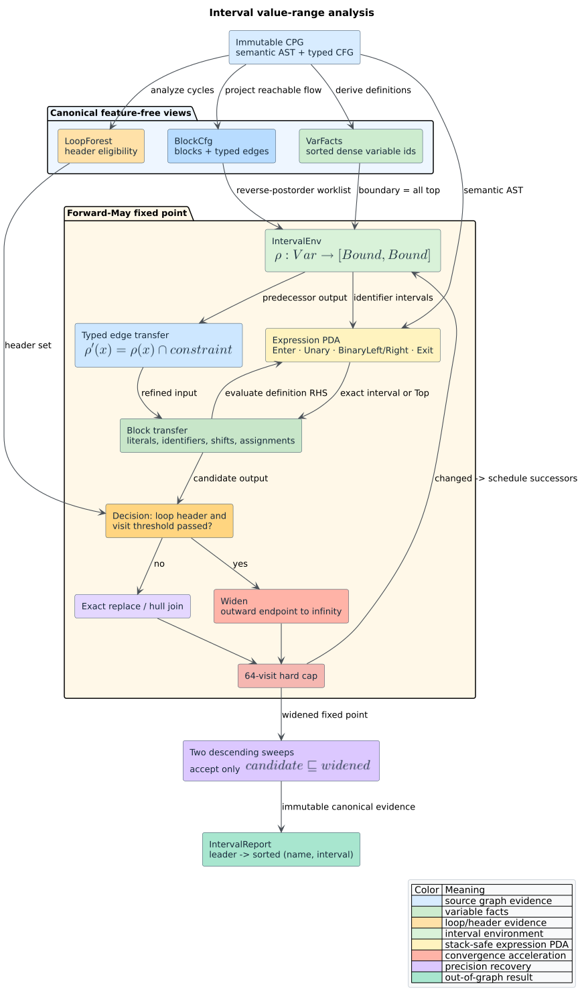

# Interval value-range analysis

`libcpg::value_ranges` computes sound integer **value ranges** with interval
abstract interpretation. Instead of enumerating every concrete execution, it
maps each variable to a closed interval that contains every modeled value the
variable can hold at a basic-block entry. The result can answer questions such
as “is `x` always below 10 on this branch?” without changing the source Code
Property Graph (CPG).

The API is feature-free, deterministic, read-only, and intraprocedural. It is a
forward-May instantiation of the shared [monotone data-flow
framework](dataflow-framework.md) over an infinite-height lattice. The analysis
consumes the canonical [`BlockCfg`](basic-block-cfg.md),
[`VarFacts`](dataflow-framework.md#built-in-domains-and-fact-universes), and
[`LoopForest`](loop-analysis.md); it does not parse source text or invent a
second intermediate representation.



*Figure — the end-to-end interval-analysis pipeline. Source:
[`diagrams/interval-analysis.puml`](../../diagrams/interval-analysis.puml).*

## Terms and intuition

- An **abstract value** summarizes a set of concrete runtime values. The
  interval $`[2, 7]`$ represents the integers 2 through 7.
- **Top**, written $`[-\infty,+\infty]`$, represents any signed integer. An
  unsupported expression becomes top, which loses precision but remains sound.
- **Bottom**, written $`\bot`$, represents no executable state. At environment
  level libcpg encodes bottom as an empty `IntervalEnv`.
- A **join** combines incoming paths. Intervals join by their convex hull: the
  smallest interval containing both inputs.
- **Widening** accelerates an ascending sequence to a fixed point by replacing
  an outward-moving endpoint with infinity.
- **Narrowing** performs bounded descending sweeps after widening to recover
  precision without risking nontermination.
- A **loop header** is the entry node of a natural or conservative irreducible
  loop reported by `loop_forest`. Widening is permitted only there.

For example, an unconstrained parameter `x` starts at top. On the true edge of
`x < 5`, the analysis intersects its range with
$`[-\infty,4]`$; on the false edge it intersects with
$`[5,+\infty]`$. Both intervals safely over-approximate their corresponding
concrete paths.

## Interval domain

### Extended bounds

`Bound` is the ordered extended number line:

```math
-\infty < n < +\infty \qquad \text{for every } n \in \mathbb{Z}_{128}.
```

Its Rust variants are `NegInf`, `Finite(i128)`, and `PosInf`. An `Interval`
contains inclusive `lo` and `hi` bounds with the invariant $`lo \le hi`$.
`Interval::new` checks that invariant; `top` and `singleton` construct the two
common cases.

The precision order is subset inclusion:

```math
[a,b] \sqsubseteq [c,d] \quad\Longleftrightarrow\quad c \le a \land b \le d.
```

Thus a singleton is more precise than a larger interval, and every interval is
below top. `contains` tests concrete membership, `meet` computes a non-empty
intersection, and `hull` implements interval join:

```math
[a,b] \sqcup [c,d] = [\min(a,c),\max(b,d)].
```

### Environment lattice

`IntervalEnv` stores sorted `(u32, Interval)` pairs in a
`SmallVec<[(u32, Interval); 8]>`. The integer key is the stable dense variable
identifier from `VarFacts`; small functions avoid a heap allocation, while
larger environments spill transparently. `from_vars` sorts, deduplicates, and
hulls duplicate keys.

Environments join pointwise. An absent pair is per-variable bottom, while an
entirely empty environment is path bottom. The function boundary contains
every known variable at top. That distinction is important: a branch whose
constraint has an empty intersection remains bottom and cannot be resurrected
by a later assignment transfer.

`IntervalEnv` implements the public `Lattice` trait. Its `join` is
commutative, associative, and idempotent; `leq` requires each left-hand
interval to be a subset of its matching right-hand interval.

## Widening and narrowing

Plain Kleene iteration may generate an infinite ascending chain such as
$`[0,0] \sqsubset [0,1] \sqsubset [0,2] \sqsubset \cdots`$. For a previous
interval $`I=[a,b]`$ and new candidate $`J=[c,d]`$, libcpg widens as follows:

```math
I \nabla J =
[\;a' , b'\;],
\qquad
a' =
\begin{cases}
-\infty & c < a,\\
a & c \ge a,
\end{cases}
\qquad
b' =
\begin{cases}
+\infty & d > b,\\
b & d \le b.
\end{cases}
```

The solver configuration is fixed by the public analysis contract:

| Control | Value | Meaning |
|---|---:|---|
| `max_visits_per_block` | 64 | hard termination backstop |
| `widen_after` | `Some(3)` | widen after the third visit |
| `narrow_passes` | 2 | deterministic descending sweeps |

The shared solver consults `LoopForest` before widening, so a non-header block
never widens. During a narrowing sweep it accepts a recomputed state only when
that state is below the current widened state. `Interval::narrow` also exposes
the standard endpoint operation: replace infinite bounds from a more precise
candidate while retaining finite bounds, never enlarging the receiver.

## Transfer semantics

The transfer layer interprets semantic `CpgNodeKind` values that a builder has
already produced. Tree-sitter remains the parser for parser-backed languages.
The interval evaluator is an abstract interpreter, not a lexer or parser.

### Definitions and expressions

| CPG form | Abstract transfer |
|---|---|
| integer literal `k` | `Interval::singleton(k)` |
| identifier `x` | current environment interval for `x`, otherwise top |
| unary `+x` | interval of `x` |
| unary `-x` | endpoints negated and reversed; overflow becomes top |
| `x + k`, `k + x` | shift the interval of `x` by `k` |
| `x - k` | shift the interval of `x` by `-k` |
| variable initializer | evaluate the initializer, or top when absent |
| simple assignment | evaluate its right-hand side |
| `x += k`, `x -= k` | shift the current range by the singleton operand |
| call, non-integer literal, unsupported operator | top |

Only language-independent integer shifts are modeled. Multiplication,
division, overloaded arithmetic, floating-point operations, and mixed numeric
coercions intentionally become top rather than receiving language-dependent or
potentially unsound semantics.

AST evaluation uses a visited stack. A malformed AST cycle therefore produces
top instead of recursing indefinitely.

### Conditional edges

For comparisons between an identifier `x` and integer literal `k`, the
analysis recognizes both operand orders and the operators `<`, `<=`, `>`, and
`>=`. A `ConditionalTrue` or `ConditionalFalse` block edge intersects `x` with
the corresponding half-line:

| Predicate | True-edge constraint | False-edge constraint |
|---|---|---|
| `x < k` | $`[-\infty,k-1]`$ | $`[k,+\infty]`$ |
| `x <= k` | $`[-\infty,k]`$ | $`[k+1,+\infty]`$ |
| `x > k` | $`[k+1,+\infty]`$ | $`[-\infty,k]`$ |
| `x >= k` | $`[k,+\infty]`$ | $`[-\infty,k-1]`$ |

An empty intersection makes the complete path environment bottom. Other edge
kinds remain identity transfers. In particular, an untyped or
language-specific case edge is never guessed.

## Public API

All interval types are exported from `libcpg::analysis` and the crate root:

```rust
// requires: no features
use libcpg::{value_ranges, AnalysisError, CodePropertyGraph, IntervalReport, NodeId};

fn ranges(
    cpg: &CodePropertyGraph,
    function: NodeId,
) -> Result<IntervalReport, AnalysisError> {
    let report = value_ranges(cpg, function)?;
    for (leader, variables) in &report.at_block_entry {
        println!("block {leader:?}: {variables:?}");
    }
    Ok(report)
}
```

`IntervalReport::interval_at(leader, name)` performs a binary search in the
canonical block-entry vector. Only reachable block leaders with a non-bottom
environment appear. Unknown and non-function selectors return
`AnalysisError::{UnknownNode, NotAFunction}`. A function with no variables has
an empty map. With feature `serde`, `Bound`, `Interval`, `IntervalEnv`, and
`IntervalReport` serialize and round-trip.

## Literate algorithm

The procedure below follows the production control flow and records why each
phase exists:

```text
VALUE_RANGES(cpg, function):
    cfg   := block_cfg(cpg, function)          # canonical reachable blocks
    facts := variable_facts(cpg, function)     # stable dense variable ids
    loops := loop_forest(cpg, function)        # widening eligibility

    bottom   := empty IntervalEnv
    boundary := every facts variable mapped to [-infinity, +infinity]
    worklist := all blocks in deterministic reverse-postorder priority

    while worklist is nonempty:
        block := smallest-priority scheduled block
        reject visit 65 with IterationLimitExceeded
        input := hull of predecessor outputs after typed edge transfer

        state := input
        for node in block execution order:
            evaluate integer definition transfer into state

        if block is a loop header and visits(block) > 3:
            output[block] := WIDEN(output[block], state)
        else:
            output[block] := state

        if output changed:
            schedule successors

    repeat two deterministic sweeps:
        recompute each state without widening
        accept it only when recomputed <= widened

    return block leaders mapped to sorted (variable name, interval) vectors
```

## Determinism, complexity, and resources

Let $`B`$ be the basic-block count, $`E`$ the block-edge count, $`V`$ the
variable count, and $`A`$ the total number of transferred CFG nodes. A join or
widen is $`O(V \log V)`$ with the small sorted environment; one solver visit is
$`O(V \cdot pred(b) + transfer(b))`$. The hard bound is 64 visits per block,
followed by exactly two sweeps, so termination does not depend on well-formed
input. Space is $`O(BV + E + A)`$ for before/after states and existing views.

Blocks, edges, variable identifiers, report keys, and report vectors all use
canonical orders. Property tests rebuild the same graph under reversed node and
CFG-edge insertion and require identical reports.

## Validation strategy

The test campaign combines example, property, integration, and cross-analysis
evidence:

- generated straight-line programs run through an independent concrete
  interpreter; every observed definition value must belong to its interval;
- generated counting loops must converge below the 64-visit cap and contain
  every bounded concrete header observation;
- interval hull, widening, narrowing, and environment join obey their algebraic
  laws over 96 generated cases per property;
- solutions with two narrowing sweeps must be below their widened-only
  counterparts at every before/after state;
- direct and parser-built branch examples check exact true/false half-lines;
- insertion-order permutations require identical reports;
- every SCCP integer constant in the shared straight-line corpus must belong to
  the interval analysis state for the same definition;
- malformed AST cycles, invalid selectors, graph non-interference, empty paths,
  unsupported calls, and Serde round trips have fixed examples.

See the [scientific validation record](../../scientific/06-interval-analysis-validation.md)
for the hypotheses and oracle independence argument.

## Security and semantic limits

Intervals are sound for the modeled, language-independent integer subset of the
input CPG. They do not model:

- language-specific integer widths, unsigned arithmetic, wrapping modes, or
  overflow exceptions;
- multiplication, division, remainder, bitwise operations, casts, or overloaded
  operators;
- heap aliases, fields, arrays, volatile/atomic access, reflection, or calls;
- exceptional control flow caused by expression evaluation; or
- relational facts between two variables.

Unsupported values become top. This can cause false positives (“the range may
include this value”) but must not create a false safety proof. The future
relational upgrade is an octagon domain; the current edge-transfer boundary
allows that domain to replace interval meets without changing the solver.

Applications receiving hostile source should enforce parser source-size and
time limits before analysis. Within the analysis, AST cycle checks, loop-header
widening, and the 64-visit cap prevent unbounded recursion or fixed-point work.
The result borrows the CPG immutably, so analysis cannot corrupt source
evidence.

## Related documentation

- [Monotone data-flow framework](dataflow-framework.md) — solver contract.
- [Basic-block CFGs](basic-block-cfg.md) — transfer granularity.
- [Natural loops](loop-analysis.md) — widening eligibility.
- [SCCP](sccp-analysis.md) — exact singleton/value-sensitive companion.
- [ADR-0011](../../design/0011-loop-header-interval-widening.md) — design choice.
- [Interval validation](../../scientific/06-interval-analysis-validation.md) — evidence.
- [Input hardening](../../security/01-input-and-resource-hardening.md) — limits.

## References

1. Cousot, P., Cousot, R. (1977). *Abstract Interpretation: A Unified Lattice
   Model for Static Analysis of Programs by Construction or Approximation of
   Fixpoints.* POPL '77. DOI:
   [10.1145/512950.512973](https://doi.org/10.1145/512950.512973)
2. Miné, A. (2006). *The Octagon Abstract Domain.* Higher-Order and Symbolic
   Computation 19, 31–100. DOI:
   [10.1007/s10990-006-8609-1](https://doi.org/10.1007/s10990-006-8609-1)
3. Kildall, G. A. (1973). *A Unified Approach to Global Program Optimization.*
   POPL '73. DOI:
   [10.1145/512927.512945](https://doi.org/10.1145/512927.512945)
