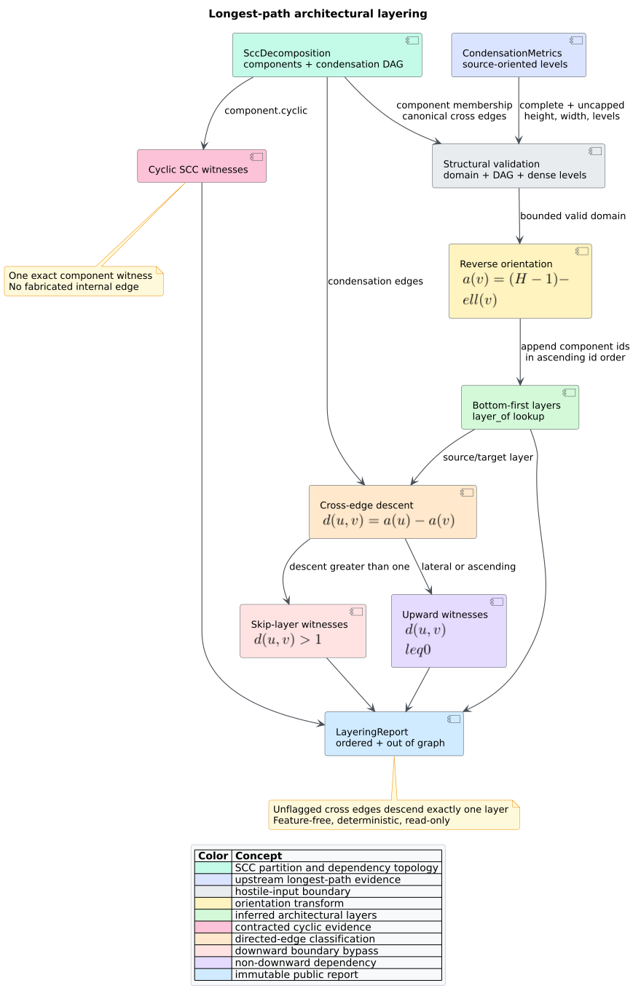

# Architectural layering inference

`libcpg::infer_layering` converts source-oriented longest-path levels from an
SCC condensation into bottom-first architectural layers. It reports cyclic
components, downward skips, and non-downward edges without mutating or copying
the Code Property Graph (CPG). The API is deterministic, feature-free,
language-independent, bounded by the upstream condensation cap, and total over
public struct values.



*Figure 1 — complete inference and classification flow. Source:
[`layering-analysis-pipeline.puml`](../../diagrams/layering-analysis-pipeline.puml).*

## Public API

```rust
use libcpg::{
    condensation_metrics, infer_layering, module_graph_projection,
    projection_sccs, CodePropertyGraph, CondensationOptions,
};

fn architecture(cpg: &CodePropertyGraph) {
    let modules = module_graph_projection(cpg);
    let sccs = projection_sccs(&modules);
    let metrics = condensation_metrics(&sccs, &CondensationOptions::default());
    let report = infer_layering(&sccs, &metrics);

    if report.complete {
        for (layer, components) in report.layers.iter().enumerate().rev() {
            println!("upper-to-lower layer {layer}: {components:?}");
        }
        for violation in &report.violations {
            println!("{violation:?}");
        }
    }
}
```

No Cargo feature is required. Feature `serde` adds serialization for the
report, violation record, and violation kind.

### `LayeringReport`

| Field | Contract |
|---|---|
| `layers` | Bottom-first vectors of sorted SCC component ids; index zero is the lowest layer. |
| `layer_of` | Direct bottom-first layer lookup indexed by component id. |
| `violations` | Total-order-sorted `LayeringViolation` witnesses. |
| `complete` | Input structure and consumed level metadata were valid; violations do not make a report incomplete. |
| `capped` | The upstream condensation computation exceeded its component budget. |

### `LayeringViolation`

Each witness records `kind`, source/target component ids, their layer indices,
and `layers_crossed`. The kinds are:

| Kind | Meaning |
|---|---|
| `CyclicComponent` | The SCC contains internal cyclic dependencies; source and target identify the same contracted component and distance is zero. |
| `SkipLayer` | Source is more than one layer above target. |
| `Upward` | Target is at or above source; same-layer cross-component edges are included because they are not downward. |

## Worked shape

For condensation edges `0 -> 1`, `1 -> 2`, and `0 -> 2`, longest-path levels
are `[0, 1, 2]`. Reversal produces:

```text
layer 2 (upper): [0]
layer 1:         [1]
layer 0 (lower): [2]
```

Edges `0 -> 1` and `1 -> 2` each descend one layer. Edge `0 -> 2` crosses two
layers and is a `SkipLayer` witness. If component `1` is cyclic, a separate
`CyclicComponent` witness identifies it; the condensation has no lawful
self-edge from which to recover a concrete internal dependency.

## Input and failure contract

Pass `CondensationMetrics` computed for the same `SccDecomposition`. The
function validates component ids and membership, condensation endpoints and
acyclicity, canonical distinct edge order, the multi-node cyclic flag, level
domain, dense level occupancy, height, and width. It returns an empty report
with `complete == false` for a mismatch. An incomplete upstream report returns
immediately and preserves its `capped` state.

A structurally bounded but directionally stale level vector remains
classifiable: lateral/upward edges become `Upward` witnesses. This diagnostic
path exists because both input structs are public and serializable. Directly
composed `condensation_metrics` output has strict source-level growth, so its
cross-component output consists only of healthy and skip-layer edges.

## Security and operational boundary

The analysis performs no parsing, I/O, unsafe code, recursion, random sampling,
or environment access. It reuses the one-million-component hard ceiling of
condensation analytics and refuses level values that could force oversized
allocation. Callers should choose a smaller `CondensationOptions::max_components`
before analyzing untrusted repositories and should not interpret a structural
violation as authority to modify source code automatically.

See [Theory 20](../../theory/20-longest-path-architectural-layering.md), [ADR
0026](../../design/0026-longest-path-architectural-layering.md), and
[Scientific validation 21](../../scientific/21-layering-validation.md).

## Reference

1. Coffman, E. G., Jr., & Graham, R. L. (1972). Optimal scheduling for two-
   processor systems. *Acta Informatica, 1*, 200–213. DOI:
   [10.1007/BF00288685](https://doi.org/10.1007/BF00288685).
