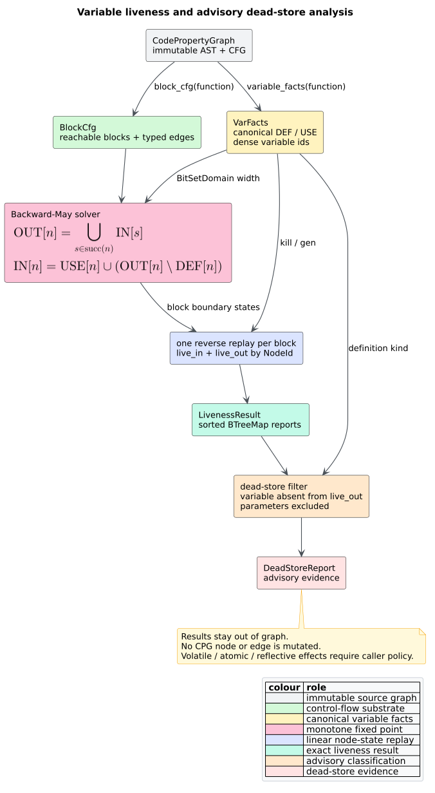

# Variable liveness and dead stores

**Variable liveness** asks whether the value currently held by a variable may
be read along some future control-flow path before another definition replaces
it. It is a backward **may analysis**: information travels from successors to
predecessors and paths meet by union. A **dead store** is a reachable,
non-parameter definition whose value is not live immediately after the write.

`libcpg::liveness` and `libcpg::dead_stores` are feature-free, deterministic,
read-only instantiations of the [monotone data-flow
framework](dataflow-framework.md). They return out-of-graph reports and never
add, remove, or relabel CPG nodes or edges.



*Figure — end-to-end liveness and dead-store analysis. Source:
[`diagrams/liveness-analysis.puml`](../../diagrams/liveness-analysis.puml).*

## Intuition and equations

For a reachable CFG node $`n`$, define:

- $`\operatorname{USE}[n]`$: variables read at $`n`$;
- $`\operatorname{DEF}[n]`$: variables defined at $`n`$;
- $`\operatorname{IN}[n]`$: variables live immediately before $`n`$; and
- $`\operatorname{OUT}[n]`$: variables live immediately after $`n`$.

The standard equations are:

```math
\operatorname{OUT}[n]
  = \bigcup_{s \in \operatorname{succ}(n)} \operatorname{IN}[s],
\qquad
\operatorname{IN}[n]
  = \operatorname{USE}[n]
    \cup \left(\operatorname{OUT}[n] \setminus \operatorname{DEF}[n]\right).
```

The exit boundary is the empty set: absent an explicit language-specific
escape model, no local variable is live after a function exits. Union means a
variable is live when **any** successor path may read it. The transfer removes
definitions first and then adds uses, which is the node-level form of the
second equation.

## Public API

```rust
// requires: no features
use libcpg::{dead_stores, liveness, CodePropertyGraph, NodeId};

# fn analyze(
#     cpg: &CodePropertyGraph,
#     function: NodeId,
# ) -> Result<(), libcpg::AnalysisError> {
let live = liveness(cpg, function)?;
for (node, variables) in &live.live_out {
    println!("{node:?}: {variables:?}");
}

let stores = dead_stores(cpg, function)?;
for store in stores.dead {
    println!("dead {:?} write to {}", store.kind, store.variable);
}
# Ok(())
# }
```

| API | Result contract |
|---|---|
| `liveness(cpg, function)` | `LivenessResult { function, live_in, live_out }`; both maps contain every reachable block-CFG node and sorted variable names |
| `dead_stores(cpg, function)` | `DeadStoreReport { function, dead }`; entries are ordered by node and canonical fact order |
| `DeadStore` | definition `node`, variable name, and original `DefinitionKind` |

Unknown ids and non-function selectors retain the shared
`AnalysisError::{UnknownNode, NotAFunction}` behavior. Unreachable AST nodes and
nested functions are absent because [`BlockCfg`](basic-block-cfg.md) defines the
analysis universe.

## Transfer and convergence

`variable_facts` supplies the exact binding/use classification shared with the
DFG sweep: declarations, parameters, and simple/compound assignments define;
binder identifiers and plain-assignment targets are not reads; compound targets
are reads. Dense variable ids index `BitSetDomain`.

The literate algorithm is:

```text
facts := variable_facts(cpg, function)
cfg   := block_cfg(cpg, function)

analysis.direction  := Backward
analysis.confluence := May
analysis.bottom     := empty bit set of facts.universe.len()
analysis.boundary   := empty bit set of facts.universe.len()

transfer_node(n, state):
    remove every variable in DEF[n]
    insert every variable in USE[n]

transfer_block(b, state):
    for n in reverse(cfg.block(b).nodes): transfer_node(n, state)

solution := solve(cpg, cfg, analysis, SolverConfig::default(), no_loop_forest)
```

The finite union lattice converges without widening. The shared solver still
applies its default 256-visit hard cap, so malformed clients cannot create an
unbounded worklist.

## Per-node state materialization

The solver stores block-boundary states. Liveness materializes node states with
one reverse replay per block:

```text
state := solution.after[block]
for node in reverse(block.nodes):
    live_out[node] := state
    state := transfer_node(node, state)
    live_in[node] := state
```

This is semantically the same replay contract as
`DataflowSolution::state_at`, but batches a whole block. Replaying separately
for every node would be quadratic in a long straight-line block; the batched
form is linear in block members, apart from the unavoidable cloning of each
reported fact set.

## Dead-store rule and advisory scope

A reachable definition of variable $`v`$ at node $`n`$ is reported exactly when:

```math
v \notin \operatorname{OUT}[n]
\quad\land\quad
\operatorname{kind}(n) \ne \mathrm{Parameter}.
```

Parameters are excluded even when unused: an unused-parameter diagnostic has a
different remediation and often belongs to an API/lint policy. Definitions in
unreachable AST islands are also excluded because no block-CFG state exists for
them.

The report is **advisory**, not an automatic deletion instruction. Syntactic
liveness does not model volatile or atomic stores, destructors, reflection,
foreign-function observers, or language-specific setter side effects. A caller
must apply those semantics before transforming source.

## Determinism and complexity

Canonical `FactUniverse` numbering, deterministic block order, and `BTreeMap`
reports make results independent of CPG node/edge insertion order. For $`B`$
blocks, $`E`$ block edges, $`N`$ reachable CFG nodes, $`F`$ variables, and
$`W = \lceil F / 64 \rceil`$ machine words per state, the finite worklist costs
$`O(H(B + E)W)`$ in the conventional bound, where $`H \le F`$ is lattice
height. Per-node report materialization costs $`O(NW)`$ time and space.

## Validation and benchmark oracle

The test-local oracle is an independent Gauss–Seidel round-robin fixed point.
It must exactly equal the shared-solver block states on a fixture containing a
diamond and a loop. Property tests also require byte-equivalent reports after
node/edge insertion permutations and assert that every reported variable is
absent from its `live_out` set. Examples cover unused parameters, assignment
kinds, unreachable definitions, bodyless functions, serde, graph
non-mutation, and typed selector errors. The repository malformed-input property
harness runs both public analyses across all ten corruption classes.

`benches/dataflow_liveness.rs` is feature-free. Before timing, its independent
node-level round-robin oracle must equal `liveness` on chain, diamond-ladder,
and nested-loop CFG families. Run it through the environment-control wrapper:

```sh
./scripts/bench.sh dataflow_liveness
```

The wrapper records the performance governor, pins CPU affinity with `taskset`,
and tees Criterion output to one timestamped log.

## See also

- [Monotone data-flow framework](dataflow-framework.md) — solver and lattice
  contracts.
- [Basic-block CFGs](basic-block-cfg.md) — the reachable analysis universe.
- [DFG builder](../builder/dfg.md) — materialized definition/use edges.
- [Performance](../../engineering/03-performance.md) — benchmark protocol and
  active targets.

## References

1. Aho, A. V., Lam, M. S., Sethi, R., Ullman, J. D. (2006). *Compilers:
   Principles, Techniques, and Tools* (2nd ed.). Addison-Wesley. ISBN
   978-0321486813 (no DOI). *(Live-variable analysis, §9.2.5.)*
