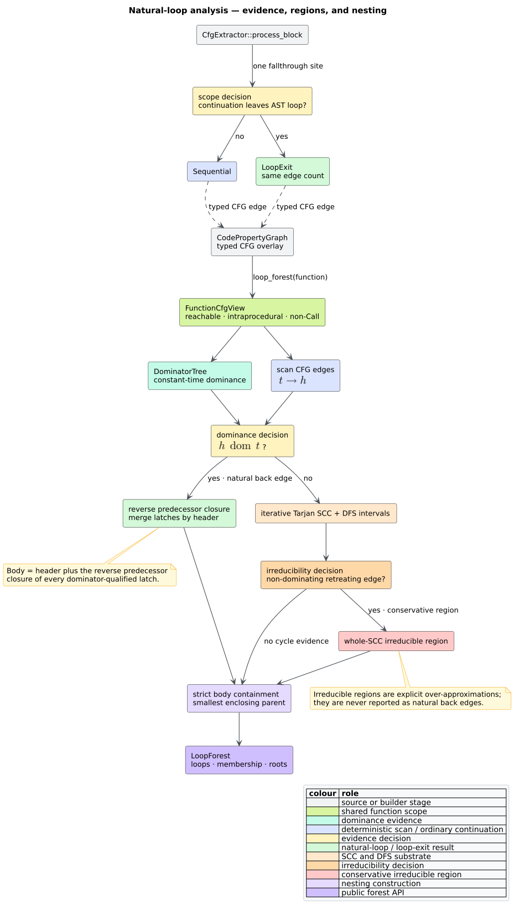

# Natural loops and nesting forests

`libcpg` computes a deterministic, feature-free [`LoopForest`](#result-contract)
for one function's reachable control-flow graph (CFG). The analysis identifies
dominator-qualified natural loops, merges multiple latches that share a header,
models irreducible cyclic regions conservatively, records loop exits, and derives
a strict nesting forest. It is read-only: construction emits CFG edges, while
`loop_forest` interprets them without mutating the CPG.



*Figure — end-to-end loop construction and analysis. Source:
[`diagrams/loop-analysis.puml`](../../diagrams/loop-analysis.puml).*

## Terms and intuition

Let a CFG be a directed graph $`G = (V, E)`$ with function entry $`r`$. The
following terms are defined before the algorithm uses them:

- A node $`h`$ **dominates** node $`t`$ when every path from $`r`$ to $`t`$
  passes through $`h`$.
- An edge $`t \to h`$ is a **natural back edge** when $`h`$ dominates $`t`$.
  Its target $`h`$ is the loop **header** and its source $`t`$ is a **latch**.
- The **natural-loop body** is the header plus the reverse predecessor closure
  from every latch, stopping expansion at the header. Intuitively, these are
  the nodes that can participate in an iteration before returning to $`h`$.
- A **loop exit** is an intraprocedural CFG edge whose source is inside the body
  and target is outside it.
- A cyclic region is **irreducible** when its multiple-entry control flow cannot
  be represented by one dominating header. `libcpg` reports the whole cyclic
  strongly-connected component (SCC) as an explicit over-approximation.
- Loop $`A`$ **strictly contains** loop $`B`$ when $`B.body`$ is a proper subset
  of $`A.body`$. The smallest such $`A`$ is $`B`$'s parent.

The key distinction is evidence: every natural loop has a dominance proof for
its back edge; an irreducible region instead has SCC and non-dominating
retreating-edge evidence. Consumers can inspect `irreducible` and never mistake
the conservative region for a single-entry natural loop.

## Public API

The function and result types are exported from both `libcpg::analysis` and the
crate root:

```rust
use libcpg::{
    loop_forest, AnalysisError, CodePropertyGraph, LoopForest, NodeId,
};

fn loops_in(
    cpg: &CodePropertyGraph,
    function: NodeId,
) -> Result<LoopForest, AnalysisError> {
    loop_forest(cpg, function)
}
```

`function` must name a `CpgNodeKind::Function`. An absent node returns
`AnalysisError::UnknownNode`; another node kind returns
`AnalysisError::NotAFunction`. A valid acyclic or bodyless function returns an
empty forest rather than an error.

### Result contract

`LoopForest` has three deterministic collections:

| Field | Meaning |
|---|---|
| `loops: Vec<NaturalLoop>` | Natural loops and conservative irreducible regions in stable id order. |
| `loop_of_node: BTreeMap<NodeId, usize>` | Innermost containing loop id for each represented node. |
| `roots: Vec<usize>` | Top-level loop ids, sorted ascending. |

Its helpers are `innermost(node)`, `max_depth()`, and
`is_back_edge(source, target)`. `is_back_edge` deliberately returns `false` for
non-dominating retreating edges in irreducible regions.

Each `NaturalLoop` exposes:

| Field | Meaning |
|---|---|
| `id` | Stable index into `LoopForest::loops`. |
| `header` | Dominating header, or deterministic representative for an irreducible region. |
| `entries` | Sorted body nodes reached from outside the body. |
| `latches` | Sorted natural back-edge tails, or retreating-edge tails for an irreducible region. |
| `body` | Sorted body nodes including `header`. |
| `exits` | Sorted `LoopExitEdge { source, target, kind }` values crossing the body boundary. |
| `parent`, `children`, `depth` | Immediate strict-containment forest; roots have depth one. |
| `irreducible` | `true` only for a whole-SCC conservative region. |

With the `serde` feature, `LoopForest`, `NaturalLoop`, and `LoopExitEdge`
serialize and round-trip without changing membership or stable identifiers.

## Natural-loop algorithm

The implementation follows the Aho–Sethi–Ullman dominator construction
[[1]](#references). Multiple back edges with the same header form one loop, so
their latches are merged before the reverse closure is computed.

For header $`h`$ and latch set $`L_h`$, the body is the least fixed point:

```math
B_h = \{h\} \cup L_h \cup
      \bigcup_{v \in B_h \setminus \{h\}} \operatorname{pred}(v)
```

The implementation realizes that equation with an explicit work stack, not
recursion:

```text
NATURAL-LOOPS(cpg, function):
    view ← reachable non-Call FunctionCfgView(cpg, function)
    dom  ← DOMINATOR-TREE(view.projection, view.entry)
    latches_by_header ← empty ordered map

    for each sorted CFG edge (tail, header):
        if dom.dominates(header, tail):
            latches_by_header[header].insert(tail)

    for each (header, latches) in latches_by_header:
        body ← {header}
        work ← all latches
        while work is not empty:
            node ← work.pop()
            if node was newly added and node ≠ header:
                push every predecessor of node not already in body
        emit one draft(header, latches, body)
```

This is literate in the operational sense: the dominance test explains *why*
an edge is a back edge, merging explains *why* shared-header loops are not
duplicated, and reverse closure explains *why* every iteration predecessor is
included.

## Irreducible regions

A depth-first-search (DFS) **retreating edge** points from a node to one of its
DFS ancestors. `libcpg` computes iterative DFS entry/exit intervals and an
iterative Tarjan SCC decomposition. A cyclic SCC is irreducible evidence when
it contains a retreating edge $`t \to h`$ for which $`h`$ does not dominate
$`t`$ [[2]](#references).

```text
IRREDUCIBLE-REGIONS(view, dominators):
    sccs ← ITERATIVE-TARJAN(view.projection)
    intervals ← ITERATIVE-DFS-INTERVALS(view.entry)
    for each cyclic component C:
        retreating ← edges (tail, head) within C
                     where head is a DFS ancestor of tail
                     and not dominators.dominates(head, tail)
        if retreating is not empty:
            body ← every node in C
            entries ← nodes in C reached from outside C
            header ← smallest entry, or smallest body node
            emit draft(header, retreating tails, body, irreducible = true)
```

Whole-SCC reporting is intentionally conservative. Havlak's reducibility work
and Ramalingam's reducibility characterization explain why forcing a
multiple-entry region into one natural-loop header loses structural truth
[[2]](#references) [[3]](#references). The public flag keeps that approximation
visible.

## Nesting and membership

After all drafts exist, stable sorting assigns ids. For each loop, the parent is
the smallest body that strictly contains it; equal bodies never create a
parent-child cycle. Children and roots follow from those parent links, and an
iterative forest walk assigns depths. `loop_of_node` considers loops from
smallest body to largest, so the first membership written is the innermost one.

The resulting invariants are:

```math
child.parent = parent \Longrightarrow child.body \subset parent.body
```

```math
forest.max\_depth() =
\begin{cases}
0 & \text{if no loop exists},\\
\max_{L \in forest.loops} L.depth & \text{otherwise.}
\end{cases}
```

All output vectors are sorted and deduplicated. The same node/edge set therefore
produces the same forest regardless of CPG insertion order.

## `LoopExit` construction semantics

`CfgExtractor` emits `LoopExit` at the block handler's one continuation site.
When a completed statement hands an exit to the next statement, the extractor
compares their AST loop scopes:

```text
CONTINUATION-KIND(source, target):
    target_scope ← target plus its AST ancestors
    for each source-or-ancestor loop with a structurally valid body:
        if loop is absent from target_scope:
            return LoopExit
    return Sequential
```

This is a **retyping**, not an added edge: the old `Sequential` continuation
becomes `LoopExit`. CFG edge count and cyclomatic complexity are unchanged for
the same AST. Because [`block_cfg`](basic-block-cfg.md) makes every
non-`Sequential` target a leader, a `LoopExit` source and target cannot be fused
into one basic block. Normal `while` guard fallthrough, `for` header
fallthrough, and `break` continuation all use this one rule.

Parser ASTs may retain keyword and delimiter children. The loop handlers select
the semantic condition and final block rather than treating a `while` token as
the guard. Generic expression handlers also chain every child in AST order, so
the returned expression exit is reachable before a loop-back edge is attached.

## Example

This parser-backed example requires the `lang-rust` feature:

```rust
// requires: features = ["lang-rust"]
use libcpg::{loop_forest, CpgBuilder, Language, TreeSitterCpgBuilder};

let source = r#"
    fn count(mut n: i32) {
        while n > 0 {
            while n > 1 { n -= 2; }
            n -= 1;
        }
    }
"#;
let cpg = TreeSitterCpgBuilder::new().build(source, Language::Rust)?;
let function = cpg.functions().next().expect("count function").id;
let forest = loop_forest(&cpg, function)?;

assert_eq!(forest.loops.len(), 2);
assert_eq!(forest.roots.len(), 1);
assert_eq!(forest.max_depth(), 2);
# Ok::<(), libcpg::Error>(())
```

## Complexity, safety, and validation

Let $`V`$ and $`E`$ be the reachable intraprocedural CFG sizes and $`L`$ the
number of reported regions. Dominator computation has conservative worst-case
time $`O(VE)`$. Edge scanning, Tarjan decomposition, DFS intervals, entries,
and exits are $`O(V + E)`$ apart from ordered-set factors. Reverse closures can
visit $`O(V + E)`$ per distinct header, and containment is $`O(L^2 V)`$ in the
worst case. Auxiliary space is $`O(V + E + LV)`$ for the projection and bodies.

Every graph walk and forest walk is iterative. A 25,000-node natural loop is a
regression test for native-stack safety. Malformed or incomplete graphs retain
the shared analysis contract: typed selector errors, bounded visited sets, and
no panic. The analysis excludes interprocedural `Call` edges and nested
functions through `FunctionCfgView`.

Validation combines exact examples, a parsed nested-loop integration test,
irreducible and shared-header fixtures, idempotent builder tests, serde
round-tripping, the 25,000-node stress case, and 256-case properties. The main
property permutes node/edge insertion order, checks back edges and bodies
against independent brute-force dominance and fixed-point oracles for graphs up
to 24 nodes, requires every body to fit within a cyclic SCC, and requires every
child body to be a strict subset of its parent. A separate 128-case builder
property checks that `Sequential` stays within loop scope, `LoopExit` crosses a
loop boundary, and every exit target is a basic-block leader.

## References

1. Aho, A. V., Sethi, R., Ullman, J. D. (1986). *Compilers: Principles,
   Techniques, and Tools.* Addison-Wesley. ISBN 0-201-10088-6 (no DOI).
2. Havlak, P. (1997). *Nesting of Reducible and Irreducible Loops.* ACM
   Transactions on Programming Languages and Systems 19(4), 557–567. DOI:
   [10.1145/262004.262005](https://doi.org/10.1145/262004.262005).
3. Ramalingam, G. (1999). *Identifying Loops in Almost Linear Time.* ACM
   Transactions on Programming Languages and Systems 21(2), 175–188. DOI:
   [10.1145/316686.316687](https://doi.org/10.1145/316686.316687).
