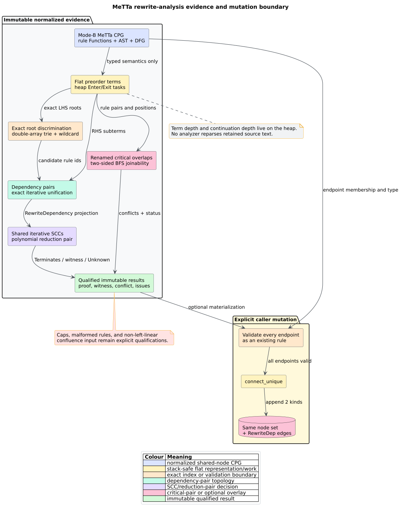

# MeTTa dependency-pair and critical-pair analysis

`analysis::rewriting`, available with feature `metta`, extracts a first-order
term rewriting system from normalized MeTTa CPG rules. It returns qualified
termination and critical-pair evidence and can optionally materialize a typed
`RewriteDep` overlay. It never parses source text.

## Public surface

| API or type | Contract |
|---|---|
| `dependency_pairs` | deterministic DP graph with default limits |
| `dependency_pairs_with_caps` | same graph with caller-selected limits |
| `terminates` | three-valued termination result with default limits |
| `terminates_with_caps` | same decision with caller-selected limits |
| `critical_pairs` | positive projection of proven non-joinable overlaps; empty is not proof |
| `analyze_critical_pairs` | qualified critical-pair report with default limits |
| `analyze_critical_pairs_with_caps` | same report with caller-selected limits |
| `materialize_rewrite_dep_overlay` | transactional, idempotent append over existing rule nodes |
| `DpGraph` | rules, dependency pairs, CSR projection, existing iterative SCC result, completeness, issues |
| `TerminationVerdict` | `Terminates`, `DoesNotTerminate`, or `Unknown` |
| `CriticalPairAnalysis` | sorted conflicts, completeness, and typed issues |
| `RewriteAnalysisCaps` | six independent retained-work/resource ceilings |
| `RewriteDepOverlayError` | exact unknown/non-rule source or target before mutation |

## Evidence pipeline

1. Select canonical `Function` rule nodes from a `Language::MeTTa` graph.
2. Read exactly two non-operator AST children as LHS and RHS.
3. Normalize typed rule-local binders and flatten both terms with explicit
   `Enter`/`Exit` tasks.
4. Build an exact double-array-trie root index and wildcard-variable bucket.
5. Unify each defined-symbol RHS subterm with indexed rule LHS candidates.
6. Build `ProjectionKind::RewriteDependency` and reuse `projection_sccs`.
7. Prove each cyclic component with the fixed polynomial reduction pair,
   refute an alpha-equivalent root self-loop, or retain `Unknown`.
8. Independently enumerate renamed-apart critical overlaps and exhaust paired
   BFS frontiers when the reachable rewrite state spaces are finite.

## Caps and completeness

| Field | Default | Bounds |
|---|---:|---|
| `max_rules` | 100,000 | normalized rules retained |
| `max_term_nodes` | 2,000,000 | aggregate flat extraction and each instantiated term |
| `max_dependency_pairs` | 2,000,000 | distinct DP edges retained |
| `max_unification_steps` | 8,000,000 | aggregate unification/occurs/matching work per analysis |
| `max_critical_pairs` | 1,000,000 | distinct proven conflicts retained |
| `max_joinability_states` | 1,000,000 | aggregate states admitted across joinability searches |

Unsupported language, malformed rule shape, unresolved/ambiguous RHS binder,
non-left-linear confluence input, or a reached cap is a typed
`RewriteAnalysisIssue`. `DpGraph::complete` and
`CriticalPairAnalysis::complete` are the authority for negative
interpretation.

## RewriteDep overlay

`DependencyPair` connects a source rule to a target rule whose LHS unifies with
a defined-symbol RHS call. `CriticalConflict` connects the ordered outer and
inner rules of a proven non-joinable overlap. Query materialized edges with
`rewrite_dep_edges`, `rewrite_dep_successors`,
`rewrite_dep_predecessors`, or `CpgEdgeKind::is_rewrite_dep`.

The Datalog master `cpg_edge` relation preserves both details. ML export
appends in/out RewriteDep degree columns at 73--74 and edge classes at 60--61;
all earlier columns and classes retain their identifiers.

## Stack-safety contract

- flat preorder term arenas replace recursive trees;
- explicit vectors implement extraction, unification, occurs checks,
  substitution, alpha-comparison, and matching continuations;
- `VecDeque` implements two-sided joinability BFS;
- the external exact trie builder and libcpg SCC consumer are iterative; and
- report, overlay, serialization, and destruction paths contain no
  term-depth native recursion.

The public depth oracle exercises 100,000 nested term levels on a 64 KiB native
stack. Caps bound retained heap work, not process resident memory.

## Related documentation

- [Theory](../../theory/53-dependency-pairs-and-critical-pair-confluence.md)
- [ADR-0070](../../design/0070-stack-safe-metta-rewriting-analysis.md)
- [Usage](../../usage/38-metta-rewriting-analysis.md)
- [Security boundary](../../security/28-metta-rewriting-boundary.md)
- [Validation](../../scientific/65-metta-rewriting-validation.md)
