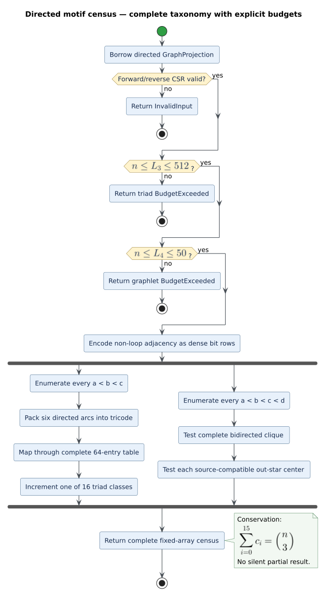

# Directed motif census

A **motif** is a small induced topology considered independently of vertex
names. `libcpg` counts every three-vertex directed topology and two selected
four-vertex graphlets in a [`GraphProjection`](projections.md). The analysis is
feature-free, deterministic, read-only, and ignores edge weights and
self-loops.



*Figure — success returns a complete fixed-array census; either binding budget
returns a typed error before combinatorial work. Source:
[`diagrams/motif-census-pipeline.puml`](../../diagrams/motif-census-pipeline.puml).*

```rust
use libcpg::{motif_census, GraphProjection, MotifOptions, NodeId, ProjectionKind};

let graph = GraphProjection::from_edges(
    ProjectionKind::External,
    [10, 20, 30].into_iter().map(NodeId::new),
    [
        (NodeId::new(10), NodeId::new(20), 1.0),
        (NodeId::new(10), NodeId::new(30), 1.0),
        (NodeId::new(20), NodeId::new(30), 1.0),
    ],
);
let census = motif_census(&graph, &MotifOptions::default())?;
assert_eq!(census.triads[8], 1); // 030T: a transitive directed triangle
# Ok::<(), libcpg::AnalysisError>(())
```

## The sixteen directed triads

The name `MANx` records the number of **mutual**, **asymmetric**, and **null**
dyads among a three-vertex subset; the optional letter distinguishes
orientations with the same dyad counts. Every row below has `M + A + N = 3`.
The array index is stable and is also exposed by `TRIAD_NAMES`.

| Index | Name | Characteristic topology |
|---:|---|---|
| 0 | `003` | no arcs |
| 1 | `012` | one asymmetric arc |
| 2 | `102` | one mutual pair |
| 3 | `021D` | one vertex points to the other two |
| 4 | `021U` | two vertices point to one vertex |
| 5 | `021C` | directed two-edge chain |
| 6 | `111D` | the third vertex points into a mutual pair |
| 7 | `111U` | a mutual pair points to the third vertex |
| 8 | `030T` | transitive directed triangle |
| 9 | `030C` | directed three-cycle |
| 10 | `201` | two mutual pairs sharing a vertex |
| 11 | `120D` | the third vertex points to both ends of a mutual pair |
| 12 | `120U` | both ends of a mutual pair point to the third vertex |
| 13 | `120C` | a directed cycle containing one mutual pair |
| 14 | `210` | two mutual pairs and one asymmetric pair |
| 15 | `300` | three mutual pairs |

Every unordered triple is classified exactly once, so a successful result
obeys the conservation law

```math
\sum_{i=0}^{15} \mathtt{triads}[i] = {n \choose 3}.
```

This identity is useful when treating motif distributions as architecture
evidence: a violation means the census or its consumer has dropped or
double-counted a triple.

## Selected four-node graphlets

`graphlets_4[0]` counts induced complete bidirected four-cliques: every pair
has both arc directions. `graphlets_4[1]` counts out-star embeddings: one
center reaches three leaves and the leaves have no arcs in either direction
among themselves. Reverse leaf-to-center arcs are intentionally inert for the
out-star predicate, preserving the source algorithm's topology contract. A
four-vertex subset can therefore contribute one count for each qualifying
center, though leaf independence prevents two distinct centers in practice.

## Classification algorithm

The implementation first validates the projection, then encodes its directed
adjacency as dense bit rows. For a triple `a < b < c`, six bits encode
`a→b`, `b→a`, `a→c`, `c→a`, `b→c`, and `c→b`. A complete 64-entry
Batagelj–Mrvar lookup maps the code to one of the sixteen Davis–Leinhardt
classes. This table keeps `111D`/`111U` and `120D`/`120U`/`120C` distinct.

```text
validate projection and both size budgets
encode non-loop directed adjacency as bit rows
for every a < b < c:
    code = six directed adjacency bits
    triads[class_by_code[code]] += 1
for every a < b < c < d:
    graphlets_4[0] += is_complete_bidirected(a, b, c, d)
    for each possible center:
        graphlets_4[1] += center_reaches_three_independent_leaves
return the complete census
```

The running time is `O(n³ + n⁴)` and the bit rows occupy
`O(n ceil(n / 64))` machine words. The representation replaces
hash-membership probes with constant-time bit tests and removes hash-order
variation.

## Resource and error semantics

`MotifOptions` defaults to 512 vertices for triads and 50 vertices for
four-node graphlets. Caller limits above those hard ceilings are clamped;
smaller caller limits are honored. Because one call requests both result
families, the projection must fit both effective limits. Exceeding either
returns `AnalysisError::BudgetExceeded`; malformed forward/reverse CSR returns
`AnalysisError::InvalidInput`. The function never returns a silently partial
census.

See [Theory 17](../../theory/17-directed-motif-census.md) for the taxonomy,
[ADR 0022](../../design/0022-deterministic-motif-census.md) for the data-
structure and completeness decisions, and the [scientific validation
record](../../scientific/17-motif-census-validation.md) for the independent
oracles and coverage evidence.

## References

- Holland, P. W., and Leinhardt, S. (1970). *A Method for Detecting Structure
  in Sociometric Data*. American Journal of Sociology 76(3), 411–432.
  [DOI 10.1086/224954](https://doi.org/10.1086/224954).
- Batagelj, V., and Mrvar, A. (2001). *A subquadratic triad census algorithm
  for large sparse networks with small maximum degree*. Social Networks 23(3),
  237–243.
  [DOI 10.1016/S0378-8733(01)00035-1](https://doi.org/10.1016/S0378-8733(01)00035-1).
- Milo, R. et al. (2002). *Network Motifs: Simple Building Blocks of Complex
  Networks*. Science 298(5594), 824–827.
  [DOI 10.1126/science.298.5594.824](https://doi.org/10.1126/science.298.5594.824).
