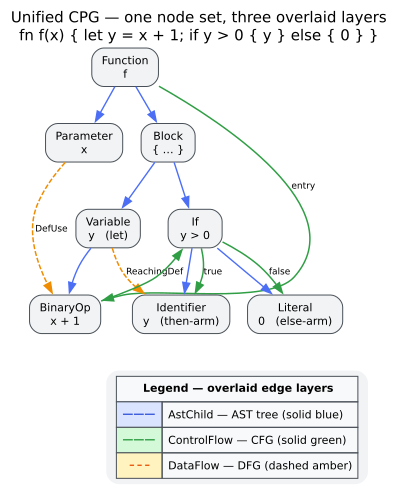

# Graph Core Overview

The `graph` module holds the data structures at the heart of `libcpg`: the
[Code Property Graph](../../GLOSSARY.md#code-property-graph-cpg) (CPG) and the
node, edge, and identifier types it is built from. Everything else in the crate
— the builders, graph projections, centrality, community, cohesion, dominator,
SCC, condensation, architectural-layering, DSM, Martin-metrics, and reflexion analyses, the pattern matchers, the slicer, the GNN — reads
from or writes to this one structure. This page explains what a CPG is, why `libcpg` merges
several program views into a single graph, how that graph is stored, and how you
create and inspect one.

## What is a Code Property Graph?

A [Code Property Graph](../../GLOSSARY.md#code-property-graph-cpg) is a single
directed graph $`G = (V, E)`$ that merges several classic program
representations onto **one shared node set** $`V`$. Instead of building a
separate tree for syntax, a separate graph for control flow, and yet another for
data flow, a CPG keeps *one* set of nodes — the syntactic elements of the
program — and layers **typed edges** over them, one edge type per view. The idea
was introduced by Yamaguchi et al. [[1]](#references) to express security
queries that need syntax, control flow, and data flow *simultaneously*.

`libcpg` overlays four views on the shared node set:

| Overlay | Glossary | Represents | Edge kinds | Built by |
|---------|----------|------------|------------|----------|
| [AST](../../GLOSSARY.md#abstract-syntax-tree-ast) | Abstract Syntax Tree | syntactic containment and order | `AstChild`, `AstParent`, `AstNextSibling`, `AstPrevSibling` | the CPG builder (always) |
| [CFG](../../GLOSSARY.md#control-flow-graph-cfg) | Control Flow Graph | possible execution order | `ControlFlow(CfgEdgeKind)` | `CfgExtractor` |
| [DFG](../../GLOSSARY.md#data-flow-graph-dfg) | Data Flow Graph | values flowing from definitions to uses | `DataFlow(DfgEdgeKind)` | `DfgExtractor` |
| [PDG](../../GLOSSARY.md#program-dependence-graph-pdg) | Program Dependence Graph | control and data *dependence* | `ControlDependence`, `DataDependence` | `PdgBuilder` (**on demand**) |

The AST is the **base layer**: the parser produces AST nodes, and every other
overlay adds edges *between the very same nodes*. The PDG is special — it is not
built during initial construction; you add it on demand by calling
`PdgBuilder::build` when you need [program slicing](../../GLOSSARY.md#program-slicing).



*Figure — the AST, CFG, and DFG overlays drawn over a single shared set of CPG
nodes; each overlay contributes a differently-typed set of edges. Source:
[`diagrams/cpg-overlay.dot`](../../diagrams/cpg-overlay.dot).*

## Why combine these views?

Many interesting questions about code are not answerable from any single view
alone. A [taint-analysis](../../GLOSSARY.md#taint-analysis) query — *can an
untrusted value reach a sensitive sink?* — needs syntax (to recognise the source
and sink), control flow (to know a path exists), and data flow (to know the
value actually propagates). With three disconnected representations you must run
three analyses and *correlate their results* by hand; with a CPG you traverse a
single graph, hopping between overlays as needed.

```text
Separate representations:              Code Property Graph:

  "Is x tainted?"                        "Is x tainted?"
        │                                       │
   ┌────┴────┐                                  ▼
   ▼         ▼                          one traversal that steps
 syntax    data-flow                    across AST → DFG → CFG edges
   │         │                          on the same node set
   └────┬────┘
        ▼
  correlate by hand
```

Because the overlays share nodes, an answer found in one view (say, the DFG node
that defines `x`) is *immediately* usable in another (its AST parent, its CFG
successors) with no translation step. That shared-node property is the entire
point of the design; see [`design/0001-unified-overlay-graph.md`](../../design/0001-unified-overlay-graph.md)
for the decision record.

## The core type: `CodePropertyGraph`

`CodePropertyGraph` is the container for a whole program (or file). It is backed
by a [petgraph](../../GLOSSARY.md#petgraph) `DiGraph<CpgNode, CpgEdge>` — **not**
by hand-rolled adjacency lists — plus two side tables that map `libcpg`'s stable
identifiers to petgraph's internal indices. All fields are **private**; you
interact with the graph exclusively through its methods.

```rust
// Internal layout (all fields private — shown to explain the storage model).
pub struct CodePropertyGraph {
    graph: DiGraph<CpgNode, CpgEdge>,                    // petgraph node/edge store
    node_index_map: FxHashMap<NodeId, NodeIndex>,        // stable NodeId → petgraph index
    edge_index_map: FxHashMap<EdgeId, (NodeIndex, NodeIndex)>,
    language: Language,
    source_path: Option<Arc<str>>,
    source_code: Option<Arc<str>>,                       // retained only if requested
    next_node_id: u32,
    next_edge_id: u32,
    root: Option<NodeId>,                                // AST root
    cfg_entries: Vec<NodeId>,                            // function entry nodes
    cfg_exits: Vec<NodeId>,                              // function exit/return nodes
}
```

Why this design? petgraph gives `libcpg` a mature graph store and a stable
`NodeIndex` model. Exact analyses operate on deterministic
[`GraphProjection`](projections.md) CSR views; the [dominator engine](dominator-analysis.md)
uses petgraph only as an independent test oracle. The
`node_index_map` / `edge_index_map` tables let callers hold small, `Copy`,
serialisation-friendly [`NodeId`](nodes.md#nodeid) / `EdgeId` handles while the
graph internally uses petgraph indices — so an id survives being written to disk
and read back, which a raw `NodeIndex` would not.

The [centrality family](centrality-analysis.md) consumes those same projection
views. It never replaces `CodePropertyGraph` storage with a parallel graph;
dense CSR is a normalized read model whose results map back to stable `NodeId`
values.

[Community detection](community-detection.md) consumes the canonical
weighted-undirected projection view. Multi-level Louvain and optional connected
refinement return node-aligned immutable partitions; neither creates another
graph store nor changes an overlay.

[Cohesion and robustness](cohesion-analysis.md) consumes the same validated
projection. Core, truss, low-link, component, assortativity, and attack kernels
share a canonical simple-undirected topology; bounded global minimum cut uses
its separately validated finite nonnegative weighted view. Results remain
out-of-graph and stable-identifier aligned.

[Spectral connectivity](spectral-analysis.md) consumes that canonical simple
topology and computes combinatorial-Laplacian algebraic connectivity, a
node-aligned Fiedler vector, and its sign split. Exact disconnected handling and
a bounded sparse iteration keep results deterministic, out-of-graph, and
numerically qualified by convergence and residual evidence.

[Bounded simple-cycle analysis](cycle-analysis.md) preserves projection edge
direction and returns concrete elementary-cycle witnesses. It reuses the shared
SCC engine, canonicalizes rotations, and exposes the first omitted cycle when
the result-count cap binds.

[Directed motif analysis](motif-analysis.md) also preserves direction, but
classifies every unordered triple into the complete sixteen-class triad
taxonomy and tests two bounded four-node graphlets. Dense adjacency bit rows,
explicit 512/50 vertex ceilings, and typed budget errors keep the exhaustive
census deterministic and complete within its admitted domain.

[Martin package metrics](martin-metrics.md) combine a caller-selected directed
dependency projection with an explicit node-to-module assignment. They report
afferent/efferent coupling, instability, CPG-backed type abstractness,
main-sequence distance, and concrete Stable Dependencies Principle witnesses
without changing the graph or guessing an architectural boundary.

[Code metrics](code-metrics.md) combine resolved calls, type relations, and
real method–field references into deterministic CK and LCOM1–5 reports. A
separate function-scope pass classifies semantic CPG nodes for Halstead,
cyclomatic, cognitive-complexity, and maintainability-index values without
reparsing source text.

[Reflexion-model conformance](reflexion-model.md) compares an ordered declared
path-layer model with caller-supplied dependency paths. Its pure, feature-free
summary separates convergences, divergences, uncovered edges, realized allowed
pairs, and declared absences without parsing or filesystem access.

[Architectural layering inference](layering-analysis.md) composes an SCC
decomposition with its condensation longest-path metrics. It reverses source
depth into bottom-first layers and reports contracted cycles, downward skips,
and non-downward edges as immutable component-aligned evidence.

[Architectural-smell analysis](architecture-smells.md) composes that SCC
topology with explicit module assignments and Martin metrics. It validates the
bundle before reporting multi-node cycles, two-sided hubs, dependencies toward
less-stable modules, and module-size outliers as immutable advisory evidence.

### Creating a CPG

With **no cargo features enabled** (`default = []`), `libcpg` links no grammars,
so there are two feature-free ways to obtain a graph — build one by hand, or feed
in a tree you parsed yourself ([Mode B](../../GLOSSARY.md#mode-b--build_from_tree)).
The hand-built route uses only the always-available graph API:

```rust
use libcpg::{
    CodePropertyGraph, CpgNode, CpgNodeKind, CpgEdgeKind, CfgEdgeKind,
    Language, NodeId, SourceRange,
};

let mut cpg = CodePropertyGraph::new(Language::Rust);

// `add_node` assigns the real id and returns it; the id you pass is a
// placeholder, so `NodeId::new(0)` is the idiomatic filler.
let first = cpg.add_node(CpgNode::new(NodeId::new(0), CpgNodeKind::Return, SourceRange::default()));
let second = cpg.add_node(CpgNode::new(NodeId::new(0), CpgNodeKind::Return, SourceRange::default()));

// Overlay a sequential control-flow edge between them.
cpg.connect(first, second, CpgEdgeKind::ControlFlow(CfgEdgeKind::Sequential));

assert_eq!(cpg.node_count(), 2);
assert_eq!(cpg.edge_count(), 1);
```

To parse real source with a bundled grammar, enable the matching `lang-*`
feature and call `build` through the [`CpgBuilder`](../builder/overview.md) trait:

```rust
// requires: features = ["lang-rust"]
use libcpg::{TreeSitterCpgBuilder, CpgBuilder, Language};

let builder = TreeSitterCpgBuilder::new();
let source = "fn main() { let x = 1; }";
// `build` returns `Result<CodePropertyGraph, libcpg::Error>`; propagate with `?`
// in a fallible context, or `.expect` as shown here.
let cpg = builder
    .build(source, Language::Rust)
    .expect("Rust grammar is linked via the lang-rust feature");
println!("{} nodes, {} edges", cpg.node_count(), cpg.edge_count());
```

> **Honesty note.** Because the default feature set is empty, `build(source,
> language)` returns `Err(Error::UnsupportedLanguage(..))` for *every* language
> until you enable a `lang-*` feature. Feature-free code must hand-build the CPG
> or call
> [`build_from_tree`](../../GLOSSARY.md#mode-b--build_from_tree) with a
> caller-owned `tree_sitter::Tree`. Errors are the crate's own
> `libcpg::Error` (there is no `CpgError`).

### Inspecting a CPG

`stats()` returns a `CpgStats` snapshot with per-overlay edge tallies. Note the
field names are `ast_edges` / `cfg_edges` / `dfg_edges` (counts), and
[`cyclomatic_complexity`](../../GLOSSARY.md#cyclomatic-complexity) is computed
over the CFG:

```rust
let stats = cpg.stats();
println!("nodes:      {}", stats.node_count);
println!("edges:      {}", stats.edge_count);
println!("AST edges:  {}", stats.ast_edges);
println!("CFG edges:  {}", stats.cfg_edges);
println!("DFG edges:  {}", stats.dfg_edges);
println!("call edges: {}", stats.call_edges);
println!("functions:  {}", stats.function_count);
println!("classes:    {}", stats.class_count);
println!("cyclomatic: {}", stats.cyclomatic_complexity);
```

The individual counters `node_count()` and `edge_count()` are also available
directly, as are `language()`, `root()` (the [`NodeId`](nodes.md#nodeid) of the
AST root, if any), `source_path()`, and `source_code()`.

## Nodes and edges at a glance

A [`CpgNode`](nodes.md) is a single syntactic element. Its fields are **public**
— you read `node.kind` and `node.range` directly, they are not method calls:

```rust
pub struct CpgNode {
    pub id: NodeId,
    pub kind: CpgNodeKind,                 // e.g. Function { .. }, If, Call { .. }
    pub range: SourceRange,                // byte + line/col span
    pub text: Option<Arc<str>>,            // original source text, for terminals
    pub properties: FxHashMap<PropertyKey, PropertyValue>,
    pub children: SmallVec<[NodeId; 4]>,   // AST children, in source order
    pub parent: Option<NodeId>,            // AST parent
}
```

`CpgNodeKind` has **45 variants** — a mix of unit variants (`Root`, `If`,
`Return`, `Await`, …) and data-carrying struct variants (`Function { signature }`,
`Call { target, is_method }`, `Variable { name, .. }`, …). See [nodes.md](nodes.md)
for the full taxonomy.

A [`CpgEdge`](edges.md) connects two nodes with a typed relationship; its fields
are public too (`edge.source`, `edge.target`, `edge.kind`, `edge.label`):

```rust
pub struct CpgEdge {
    pub id: EdgeId,
    pub source: NodeId,
    pub target: NodeId,
    pub kind: CpgEdgeKind,                  // AstChild | ControlFlow(..) | DataFlow(..) | ...
    pub label: Option<String>,
}
```

`CpgEdgeKind` wraps the control- and data-flow sub-kinds as
`ControlFlow(CfgEdgeKind)` and `DataFlow(DfgEdgeKind)` (14 and 13 variants
respectively). See [edges.md](edges.md) for every variant and the classifier
helpers (`is_ast`, `is_cfg`, `is_dfg`, `is_pdg`, `is_call`, `is_type`).

## Memory model

`libcpg` keeps CPGs compact so that large files stay cheap to hold and traverse:

- **petgraph storage.** Nodes and edges live in a single
  `DiGraph<CpgNode, CpgEdge>`; adjacency is petgraph's, not a bespoke map.
- **Compact identifiers.** [`NodeId`](nodes.md#nodeid) and `EdgeId` are
  newtypes around `u32` — 4 bytes, `Copy`, hashable — so holding thousands of
  them in analysis work-lists is cheap.
- **Shared text.** A node's `text` is an `Option<Arc<str>>`; cloning a node
  bumps a reference count instead of copying the string bytes.
- **Small inline children.** A node's AST `children` use a
  `SmallVec<[NodeId; 4]>`, so the common case of four or fewer children needs no
  heap allocation.
- **Fast maps.** The id→index side tables use `rustc_hash::FxHashMap`, a fast
  non-cryptographic hash suited to integer keys.

Resolving an id to a node or its incident edges is an
$`O(1)`$ map lookup followed by petgraph adjacency iteration.

## Thread-safety

`CodePropertyGraph` is `Send + Sync` (all of its fields are), so a
`&CodePropertyGraph` can be shared **read-only** across threads — for example to
run per-function analyses in parallel (see the
[rayon note in traversal.md](traversal.md#parallelism-with-rayon)). Two caveats
keep this honest:

- The graph is **not** frozen after parsing. Construction proceeds in stages
  that *mutate* it: the [`CfgExtractor`](../builder/cfg.md) and
  [`DfgExtractor`](../builder/dfg.md) add control- and data-flow edges after the
  AST exists, `PdgBuilder` adds dependence edges on demand, and `node_mut`
  exists. Any mutation requires `&mut CodePropertyGraph` and therefore exclusive
  access — there are no interior-mutability tricks and no atomic id counters
  (`next_node_id` / `next_edge_id` are plain `u32`).
- `NodeId` and `EdgeId` are `Copy` and trivially shareable.

So the safe pattern is: build (single-threaded, `&mut`), then analyse
(multi-threaded, `&`).

## Where to go next

- [Nodes](nodes.md) — the 45 `CpgNodeKind` variants, `SourceRange`, and the
  supporting `TypeInfo` / `MethodSignature` / `Visibility` types.
- [Edges](edges.md) — `CpgEdgeKind` and the full `CfgEdgeKind` (14) and
  `DfgEdgeKind` (13) taxonomies, with classifier helpers.
- [Traversal](traversal.md) — the navigation accessors and their exact return
  types, plus a worked taint/reachability walk.
- [Deterministic projections](projections.md) — payload-free forward/reverse
  CSR views used by exact analyses.
- [Basic-block CFGs](basic-block-cfg.md) — id-preserving maximal sequential
  runs, typed block edges, entry/exits, and deterministic traversal orders.
- [Monotone data flow](dataflow-framework.md) — forward/backward fixed points,
  lattice domains, canonical facts, widening/narrowing, and bounded worklists.
- [Variable liveness and dead stores](liveness-analysis.md) — backward-May
  variable states and conservative advisory evidence for unused writes.
- [Available and very-busy expressions](expression-analysis.md) — dual
  forward/backward Must states and dominance-backed advisory CSE/PRE evidence.
- [Sparse conditional constant propagation](sccp-analysis.md) — coupled
  executable-edge and scalar-constant evidence with reachability refinement.
- [Interval value ranges](interval-analysis.md) — forward integer abstract
  interpretation with branch meets, loop-header widening, and narrowing.
- [Loop induction](induction-analysis.md) — DFG-backed invariant fixed points,
  additive and one-level-affine induction variables, conservative hoist
  candidates, and counted-trip evidence.
- [Dominators and post-dominators](dominator-analysis.md) — immediate
  dominators, frontiers, constant-time ancestry, and PDG control dependence.
- [Strongly-connected components](scc-analysis.md) — exact CFG loops and
  call-graph recursion clusters.
- [Condensation-DAG analytics](condensation-analysis.md) — canonical
  source-oriented depth/width, SCC-member-weighted critical paths, and
  sink-oriented width-bounded Coffman–Graham layers.
- [Architectural layering](layering-analysis.md) — bottom-first longest-path
  layers plus cyclic-component, skip-layer, and upward witnesses.
- [Architectural smells](architecture-smells.md) — validated multi-node cycle,
  two-sided hub, instability-direction, and module-size-outlier evidence.
- [DSM visibility and core–periphery](dsm-analysis.md) — transitive visibility
  fan-in/fan-out, propagation cost, median roles, and the largest
  multi-vertex cyclic group over any directed projection.
- [Martin package metrics](martin-metrics.md) — explicit module assignment,
  afferent/efferent coupling, instability/abstractness/distance, and witnessed
  stable-dependency violations.
- [Code metrics](code-metrics.md) — CK and LCOM1–5 over resolved graph evidence,
  plus language-independent Halstead, cyclomatic, cognitive, and maintainability
  summaries for functions.
- [Reflexion-model conformance](reflexion-model.md) — ordered path layers,
  deterministic edge verdicts, realized pairs, and declared absences.
- [WL labels and structural clones](wl-analysis.md) — bounded deterministic
  directed-degree refinement and ordered stable-id clone-candidate classes over
  any valid directed projection.
- [Community detection](community-detection.md) — deterministic bounded
  multi-level Louvain partitions, modularity scores recomputed on the original
  projection, and checked connected-community refinement.
- [Cohesion and structural robustness](cohesion-analysis.md) — deterministic
  k-core/k-truss peeling, iterative articulation/bridge and robust-block
  analysis, bounded weighted minimum cut, assortativity, and attack traces.
- [Bounded simple cycles](cycle-analysis.md) — SCC-pruned directed witnesses,
  canonical rotations, hard length/count ceilings, and explicit truncation.
- [Directed motif census](motif-analysis.md) — all sixteen induced directed
  triads, selected four-node graphlets, conservation checks, and explicit
  combinatorial budgets.
- [Natural loops and nesting](loop-analysis.md) — dominator-qualified headers,
  shared latches, conservative irreducible regions, strict nesting, and loop
  exits.
- [CFG reachability and dead branches](reachability-analysis.md) — deterministic
  reachable/unreachable partitions, post-terminator islands, and read-only
  structural branch evidence.
- [Evidence-bounded call resolution](call-resolution.md) — deterministic
  lexical symbols, confidence tiers, and the conservative boundary between
  recorded evidence and definite call topology.
- [Multi-file program composition](program-composition.md) — collision-free
  per-file identity translation, explicit file scopes, and conservative
  import/export linkage that feeds cross-file call resolution.
- [IFDS/IDE summary framework](ifds-ide-framework.md) — validated current call
  topology, deterministic callee-first SCC scheduling, and explicitly bounded
  recursive procedure summaries.
- [Interprocedural effect summaries](effect-summaries.md) — typed global,
  parameter, and field effects; transitive purity; return-flow masks; and
  checked scalar constants over that shared schedule.
- [Advisory taint and maybe-null analysis](taint-analysis.md) — data-driven call
  catalogs, typed AST/DFG propagation, interprocedural jump functions,
  canonical witnesses, and explicit completeness evidence.
- [System dependence and interprocedural slicing](system-dependence-slicing.md)
  — effect-derived labeled summary edges and deterministic context-sensitive
  two-pass slices with explicit node and call-depth caps.
- [Channel-event extraction and topology](channel-topology.md) — frontend-
  normalized message kinds, definition-resolved channel identities, and
  ordered advisory matching/linear-consumption findings.
- [Communication and lock-order deadlocks](deadlock-analysis.md) — initially
  blocked process waits, typed direct/interprocedural lock order, shared SCCs,
  and statement-precise advisory witnesses.
- [May-happen-in-parallel analysis](mhp-analysis.md) — typed parallel operand
  subtrees, canonical symmetric execution-site pairs, nested-region
  composition, and explicit quadratic-output truncation.
- [`api/graph-reference.md`](../../api/graph-reference.md) — the precise,
  method-by-method API reference for `CodePropertyGraph`.
- [`theory/01-code-property-graphs.md`](../../theory/01-code-property-graphs.md)
  — the formal model behind the overlays.

## References

1. Yamaguchi, F., Golde, N., Arp, D., Rieck, K. (2014). *Modeling and Discovering Vulnerabilities with Code Property Graphs.* 2014 IEEE Symposium on Security and Privacy. DOI: [10.1109/SP.2014.44](https://doi.org/10.1109/SP.2014.44)
