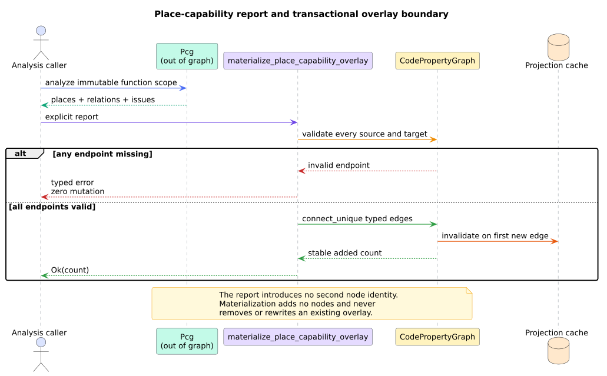

# Rust place-capability analysis

`analysis::place_capability` reconstructs an advisory Rust ownership and
borrowing overlay from a normalized Code Property Graph (CPG). The feature-free
analysis consumes typed operation metadata, Data Flow Graph (DFG) and
`Reference` identity, Abstract Syntax Tree (AST) function scope, and Control
Flow Graph (CFG) reachability. It never parses source text and creates no new
node identity.

## Public surface

| API or type | Contract |
|---|---|
| `place_capability_graph` | deterministic places, move/borrow/reborrow relations, and typed issues for one function |
| `borrow_check` | ordered advisory move-after-use and incompatible-live-loan findings |
| `materialize_place_capability_overlay` | transactional, idempotent typed-edge append over existing nodes |
| `Pcg` | function identity, canonical `places`, `capability_edges`, and `issues` |
| `CapabilityPlace` | existing node identity, storage role, name/type/mutability, and copy classification |
| `PlaceCapabilityEdge` | source, destination, operation, kind, and exact graph witnesses |
| `PcgIssue` | `MissingSource` or `UnknownCopySemantics` qualification |
| `BorrowViolation` | finding kind, place, operations, CFG/DFG witness, and copy qualification |
| `PlaceCapabilityOverlayError` | exact unknown source or target before mutation |

Both analysis functions return `AnalysisError::UnknownNode` or
`AnalysisError::NotAFunction` for an invalid function selector.

## Evidence pipeline

1. Select the function's AST scope with an iterative traversal.
2. Stable-sort nodes carrying `OwnershipOperationKind` metadata.
3. Find local sources through incoming `DefUse`/`ReachingDef` edges and fields
   through outgoing `Reference` edges.
4. Walk ancestors iteratively to a destination `Variable` or `Assignment`, or
   retain the operation as an uncaptured temporary.
5. Classify move/copy evidence from normalized `TypeInfo` and retain unknown
   nominal traits as issues.
6. Classify a borrow through a reference place as a reborrow.
7. Use CFG reachability plus DFG uses for move-after-use and loan-liveness
   evidence.

Every relation carries its function scope and operand plus either a DFG pair or
a `Reference` pair. Nested ownership operations stop the outer operand walk so
each transfer owns one evidence boundary.

## Report semantics

`Pcg::is_complete()` means every represented ownership operation had a source
and every represented move source had decisive built-in copy evidence. It does
not mean that the Rust compiler's borrow checker has been reconstructed.

`BorrowViolationKind::UseAfterMove` requires a reachable later DFG use outside
the move expression. `ConflictingBorrow` requires identical represented source
identity, at least one mutable borrow/reborrow, an earlier-to-later CFG path,
and a reachable later use of the earlier destination reference. Shared/shared
loans remain compatible.

## Typed overlay and export schema

`PlaceCapabilityEdgeKind` contains `Move`, `SharedBorrow`, `MutableBorrow`,
`SharedReborrow`, and `MutableReborrow`. Query materialized edges with
`place_capability_edges`, `place_capability_successors`,
`place_capability_predecessors`, or `CpgEdgeKind::is_place_capability`.

The Datalog master `cpg_edge` relation preserves each typed detail. PyTorch
Geometric export appends in/out place-capability degree columns at 75--76 and
relation classes at 62--66. The complete schema therefore has 77 node columns,
67 relation classes, and 13 coarse layers. All earlier numeric identities are
unchanged.

## Stack-safety contract

- function scope and operand discovery use heap vectors;
- ancestor walks use loops plus ordered visited sets;
- CFG reachability uses `VecDeque` breadth-first search;
- uses, places, relations, issues, and findings use ordered heap collections;
  and
- report, overlay, serialization, and destruction contain no input-depth
  native recursion.

The public depth oracle analyzes 100,000 AST levels on a 64 KiB native stack.
This protects call-stack depth; process memory and time still require host
limits.

## Related documentation

- [Theory](../../theory/54-place-capability-ownership-and-borrowing.md)
- [ADR-0071](../../design/0071-stack-safe-place-capability-analysis.md)
- [Usage](../../usage/39-place-capability-analysis.md)
- [Security boundary](../../security/29-place-capability-boundary.md)
- [Validation](../../scientific/66-place-capability-validation.md)
