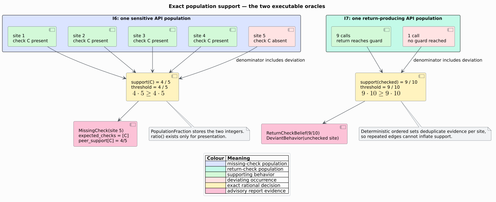

# Component — Population anomaly detectors

## Responsibility

`analysis::bugs::{missing_check,deviant}` infers common checking and call-use
behavior from typed CPG populations, then reports represented deviations. The
component owns exact population policy, evidence normalization, beliefs,
findings, and qualification. Parsing, call resolution, taint catalog syntax,
CFG/DFG/PDG construction, and source rendering remain in their existing
providers.

## Feature boundary

Both detectors are available with `default = []`. Language features are needed
only when libcpg parses source. `serde` adds deterministic report and policy
serialization without changing analysis semantics. The analyzers are
read-only and add no nodes or edges.

## Source map

| File | Ownership |
|---|---|
| `src/analysis/bugs/evidence.rs` | `ApiIdentity`, exact fractions/thresholds, typed callee identity, call ownership, guard recognition |
| `src/analysis/bugs/missing_check.rs` | sensitive-site admission, peer scopes, flat check fingerprints, missing-check report |
| `src/analysis/bugs/deviant.rs` | call-order reachability, return-check value reachability, beliefs and deviations |
| `src/analysis/serde_util.rs` | canonical sequence encoding for typed-key ordered maps and duplicate-key rejection |

## Public surface

| API/type | Contract |
|---|---|
| `analyze_missing_checks(cpg, config)` | qualified I6 report or invalid-policy `AnalysisError` |
| `missing_checks(cpg, config)` | positive-only `Vec<MissingCheck>` projection |
| `MissingCheckConfig` | catalog/class admission, exact support, minimum population, peer scope, fingerprint and identity bounds |
| `MissingCheckAnalysis` | findings, admitted sites, ordered issues, and `is_complete()` |
| `MissingCheck` | site/function/API, absent fingerprints, exact support, peers, and concrete guard witnesses |
| `PeerScope` | whole-program or bounded undirected call-neighborhood population |
| `CheckFingerprint` | stack-safe flat postorder semantic check tape |
| `analyze_deviant_behavior(cpg, config)` | qualified I7 belief and deviation report or invalid-policy `AnalysisError` |
| `deviant_behaviors(cpg, config)` | positive-only `Vec<DeviantBehavior>` projection |
| `DeviantBehaviorConfig` | exact support, minimum population, CFG/value and identity bounds |
| `DeviantBehaviorAnalysis` | inferred order/return beliefs, findings, admitted sites, issues, and `is_complete()` |
| `CallOrderBelief` | predecessor/successor identity, exact support, supporting sites |
| `ReturnCheckBelief` | API, exact support, checked sites, representative guards |
| `DeviantBehavior` | violating site/function/API, belief kind, support, supporting sites |
| `ApiIdentity` | represented target set or typed external callee path |
| `PopulationFraction` / `PopulationThreshold` | exact observed and required rational support |

## Missing-check path

1. Enumerate calls and their AST owner functions in stable node order.
2. Reconstruct typed callee identity; match its path against catalog sink rules
   and optional sensitive classes.
3. Collect represented PDG controllers of the call and its ancestors.
4. Normalize every guard into a flat postorder `CheckFingerprint`; abstract
   local names but retain semantic operators, literals, members, types, and
   APIs.
5. Select complete same-API peers globally or within the configured call-graph
   radius.
6. Count one vote per fingerprint per site and compare exact support by widened
   integer cross multiplication.
7. Emit absent supported fingerprints with peers and guard witnesses.

## Deviant-behavior path

1. Build the same canonical call identity and owner inventory.
2. For each call, iteratively enumerate later reachable CFG calls in its
   function.
3. Separately walk forward DFG/PDG value evidence to the first canonical guard;
   do not follow reverse `UseDef` edges.
4. Group complete occurrences by API and infer threshold-supported order and
   return-check beliefs.
5. Emit every complete occurrence that violates an inferred belief.

## Invariants

1. The CPG node and edge counts are unchanged.
2. Every finding site, function, peer, supporter, and guard witness exists in
   the input graph.
3. Resolved identity equality includes the complete sorted target set.
4. Each occurrence contributes at most one vote for one fingerprint or belief.
5. The candidate occurrence remains in the population denominator.
6. Threshold decisions use exact integer arithmetic, never `ratio()`.
7. Incomplete occurrences do not vote and create a typed issue.
8. Findings and serialization are independent of relation insertion order.
9. Every graph- or source-sized traversal is iterative and heap-backed.
10. An empty convenience projection alone cannot support an absence claim.

## Bounds and failure semantics

| Bound | Effect when reached |
|---|---|
| `max_callee_depth` | identity is excluded and a typed capped-identity issue is retained |
| `max_check_nodes` | that guard/site is excluded from missing-check inference with exact needed/cap evidence |
| `max_cfg_nodes_per_call` | the occurrence is excluded from call-order inference with `CfgEvidenceCap` |
| `max_return_evidence_nodes` | the occurrence is excluded from return-check inference with `ReturnEvidenceCap` |

Zero-sized traversal caps, a zero support denominator, a numerator greater than
its denominator, or a zero minimum population are invalid inputs returned as
`AnalysisError::InvalidInput`. Structural evidence gaps are report issues,
because valid positive evidence may still exist elsewhere.

## Complexity

Let $`U`$ be calls, $`A`$ inspected guard AST nodes, $`E_c`$ call-graph edges,
$`R`$ total CFG nodes/edges visited over call-order samples, and $`D`$ total
value-evidence nodes/edges visited. Evidence collection costs
$`O((U+A+E_c+R+D)\log U)`$ modulo ordered-map factors and configured caps.
Peer comparison can be quadratic in the number of same-API sites and distinct
fingerprints, which is output-sensitive because each qualifying site/check
pair may become evidence.

## Tests

Examples pin the 4-of-5 missing-check and 9-of-10 return-check oracles,
call-order deviations, call neighborhoods, catalog classes, normalization,
every issue/cap, invalid policies, serde, and graph immutability. Generated
properties compare exact independent population oracles under changed sizes and
insertion orders. Public integration covers hand-built and parsed Rust CPGs.
Dedicated 256 KiB worker-stack tests traverse 100,000-node AST/CFG evidence.

See [Theory 35](../../theory/35-population-anomaly-inference.md),
[ADR-0045](../../design/0045-exact-population-anomaly-detectors.md), the
[validation ledger](../../scientific/40-population-anomaly-validation.md), the
[security boundary](../../security/10-population-anomaly-detectors.md), and the
[usage guide](../../usage/18-population-anomaly-detectors.md).
