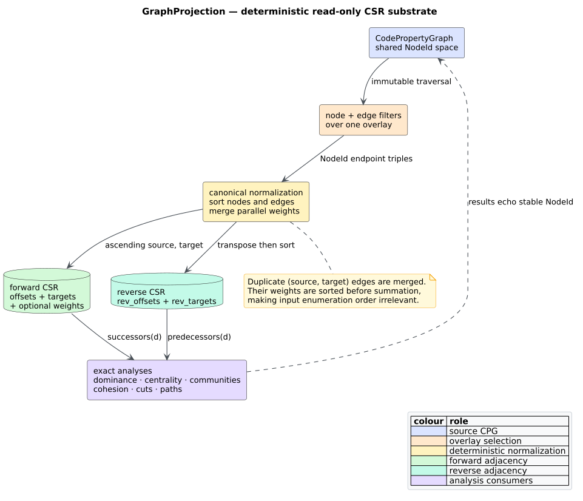

# Deterministic graph projections

A **graph projection** selects one relation—such as control flow or data
flow—from a code property graph (CPG) without copying the selected nodes'
source ranges, properties, names, or other payloads. `GraphProjection` is the
feature-free read substrate used by exact analyses. It retains the shared
`NodeId` identity space while giving algorithms compact integer indices.



*Figure — projection construction and its read-only relationship to the CPG.
Source: [`projection-csr.puml`](../../diagrams/projection-csr.puml).*

## Terms and representation

A **vertex** is a projected CPG node. A **directed edge** is an ordered pair of
vertices. A **dense identifier** is a zero-based `u32` index into the sorted
`nodes` array; it is local to one projection. **Compressed sparse row** (CSR)
is an adjacency representation consisting of an offsets array and a contiguous
targets array.

For dense vertex $`d`$, its sorted successor slice is:

```math
N^{+}(d) = \mathtt{targets}[\mathtt{offsets}[d] \ldots \mathtt{offsets}[d+1])
```

The reverse arrays encode $`N^{-}(d)`$, the predecessor relation, in the same
form. Thus `successors` and `predecessors` return borrowed slices without an
allocation. The following invariants hold for every constructor-produced
projection:

- `nodes` is sorted by `NodeId` and contains no duplicate;
- `offsets.len() == rev_offsets.len() == nodes.len() + 1`;
- `offsets[0] == rev_offsets[0] == 0`;
- the final offsets equal `targets.len()` and `rev_targets.len()`;
- each adjacency slice is sorted and contains no duplicate target;
- `weights`, when present, is aligned one-to-one with `targets`; and
- the source CPG is neither mutated nor stripped of unprojected nodes.

## Public API

All types and functions are exported from both `libcpg::analysis` and the crate
root. They require no Cargo feature.

```rust
use libcpg::{
    call_graph_projection, cfg_projection, dfg_projection,
    module_graph_projection, pdg_projection, GraphProjection, ProjectionKind,
};
```

The built-in constructors have these scopes:

| Constructor | Vertex universe | Selected relation |
|---|---|---|
| `call_graph_projection(cpg)` | every function, including isolates | resolved caller-function to callee-function edges |
| `module_graph_projection(cpg)` | `Root` and `Module` nodes | `Imports` edges whose endpoints are both in that universe |
| `cfg_projection(cpg, f)` | `f` plus in-scope CFG edge endpoints | intraprocedural `ControlFlow` except `Call` |
| `dfg_projection(cpg, None)` | all DFG edge endpoints | every `DataFlow` edge |
| `dfg_projection(cpg, Some(root))` | `root` plus in-scope DFG endpoints | `DataFlow` within the AST scope, stopping before nested functions |
| `pdg_projection(cpg, f)` | `f` plus in-scope PDG edge endpoints | `ControlDependence` and `DataDependence` |
| `SccDecomposition::condensation_projection()` | each component's smallest node as representative | edges between distinct strongly connected components |

`cfg_projection` and `pdg_projection` return `ProjectionError::UnknownNode`
when `f` is absent and `ProjectionError::NotAFunction` when it is not a
function. `dfg_projection` deliberately accepts any AST scope root; an absent
root yields an empty view instead of inventing a vertex.

### The shared function CFG view

Exact intraprocedural analyses need one additional contract beyond the public
overlay constructor. The crate-private `analysis::cfg_scope` module builds a
`FunctionCfgView` with three fields:

| Field | Meaning |
|---|---|
| `projection` | CFG nodes reachable from the selected function through every `ControlFlow` edge except `Call`, encoded as canonical CSR. |
| `entry` | The dense identifier that maps back to the selected function node. |
| `exit_like` | Sorted dense identifiers for recorded CFG exits, structural sinks, and explicit `Return`/`Throw` nodes. |

This internal view and `cfg_projection` intentionally answer related but
different questions. `cfg_projection` selects CFG endpoints inside the
function's AST scope, so it is suitable as a public overlay projection. The
shared analysis view follows actual CFG reachability from the entry. That
reachable rule preserves connective `Block` nodes and the historical
`PdgBuilder` semantics even for a hand-built graph whose AST metadata is
incomplete. Both exclude interprocedural `Call` edges.

The construction is read-only and deterministic:

```text
FUNCTION_CFG_VIEW(cpg, function):
    validate that function exists and has Function kind
    reachable = iterative DFS from function over non-Call CFG successors
    projection = induced non-Call CFG over reachable, normalized as CSR
    entry = projection.dense_index(function)
    recorded = cpg.cfg_exits intersect reachable
    exit_like = sorted {d | d is a sink, recorded exit, Return, or Throw}
    return (projection, entry, exit_like)
```

The view is crate-private because it is a coordination contract among
post-dominance and the reachability/basic-block analyses, not a second public
projection API. Invalid selectors become the shared
`AnalysisError::UnknownNode` or `AnalysisError::NotAFunction` variants at this
boundary.

### Traversal example

The example below prints stable identifiers while traversing the compact dense
adjacency. It is valid for `default = []`.

```rust
use libcpg::{call_graph_projection, CodePropertyGraph};

fn print_calls(cpg: &CodePropertyGraph) {
    let calls = call_graph_projection(cpg);
    for dense_source in 0..calls.node_count() as u32 {
        let source = calls.node_id(dense_source);
        for &dense_target in calls.successors(dense_source) {
            println!("{:?} calls {:?}", source, calls.node_id(dense_target));
        }
    }
}
```

`dense_index(node)` performs the inverse mapping by binary search. `node_id`,
`successors`, and `predecessors` panic for an out-of-range dense identifier;
callers should obtain dense identifiers from `dense_index`, an iterator bounded
by `node_count`, or an adjacency slice.

## Canonical construction algorithm

`GraphProjection::from_edges` is the adapter entry point for external graphs.
It retains explicitly supplied isolated vertices and ignores edges with an
endpoint outside that universe. Parallel edges are merged by summing weights.
If every merged weight is exactly `1.0`, `weights` is omitted and unit weight is
implicit.

The construction is intentionally literate: each step below states both the
operation and the invariant it establishes.

```text
PROJECT(nodes, weighted_edges):
    sort and deduplicate nodes                 // stable dense identifiers
    map each retained endpoint to its dense id // no payload cloning
    discard edges outside the node universe    // closed projection
    sort by (source, target, weight.total_cmp) // order-independent grouping
    sum each equal (source, target) group       // one canonical edge
    append targets by ascending source/target  // forward CSR
    swap every source and target, then sort     // reverse CSR
    omit the weight array iff all weights are 1 // compact unweighted case
```

Sorting weights before each sum fixes the floating-point addition order. The
same edge multiset therefore produces byte-identical CSR arrays even when an
input hash map enumerates edges differently. IEEE-754 non-finite values remain
representable; an analysis that requires finite or non-negative costs must
enforce that algorithm-specific precondition.

## Transformations

`transpose()` reverses every edge and preserves stable node identifiers. Its
involution law is tested directly:

```math
(G^{\mathsf T})^{\mathsf T} = G
```

`undirected()` forgets direction. Reciprocal edges are merged into one
undirected edge by summing their weights; a self-loop remains one self-loop.
The returned `UndirectedProjection` provides `neighbors` and aligned
`neighbor_weights` slices. This explicit conversion prevents an analysis from
quietly mixing directed successors and predecessors.

The condensation projection represents each strongly connected component
(SCC) by its smallest `NodeId`. Since SCCs are ordered by that representative,
the representative's dense identifier equals the component identifier. The
result is a directed acyclic graph by the definition of maximal SCCs.

## Complexity and resource safety

Let $`V`$ be the retained vertex count and $`E`$ the input edge count. Node and
edge normalization takes $`O(V \log V + E \log E)`$ time; CSR construction then
takes $`O(V + E)`$ time and space. A neighbor lookup is $`O(1)`$ plus the
returned slice, and `dense_index` is $`O(\log V)`$.

CSR indices and offsets are `u32` by contract. Construction checks both
conversions and fails explicitly rather than truncating an oversized graph.
Projection construction walks only existing CPG edges and uses iterative AST
scope discovery with a visited set, so malformed cyclic `AstChild` input still
terminates. No parser, filesystem, network, or executable-code surface is
introduced.

## Validation

The test suite combines:

- example-based cases for sparse node identifiers, parallel weighted edges,
  isolates, self-loops, scope validation, transpose, and undirected conversion;
- 256-case property tests proving input-order determinism and the transpose
  involution;
- a parsed Rust corpus oracle comparing CFG, DFG, PDG, module, and call
  projections with direct traversal of the corresponding CPG overlays;
- the SCC differential property, which also checks that every condensation
  projection is acyclic; and
- serialization round-tripping when the `serde` feature is enabled.

## Related material

- [CPG graph data model](../../architecture/graph-data-model.md)
- [Strongly-connected-component analysis](scc-analysis.md)
- [Traversal API](traversal.md)
- [Testing methodology](../../engineering/02-testing.md)

## References

- Barrett, R., Berry, M., Chan, T. F., Demmel, J., Donato, J., Dongarra, J.,
  Eijkhout, V., Pozo, R., Romine, C., and van der Vorst, H. (1994).
  *Templates for the Solution of Linear Systems: Building Blocks for Iterative
  Methods* (2nd ed.). SIAM. DOI:
  [10.1137/1.9781611971538](https://doi.org/10.1137/1.9781611971538).
- Tarjan, R. E. (1972). *Depth-First Search and Linear Graph Algorithms.* SIAM
  Journal on Computing 1(2), 146–160. DOI:
  [10.1137/0201010](https://doi.org/10.1137/0201010).
