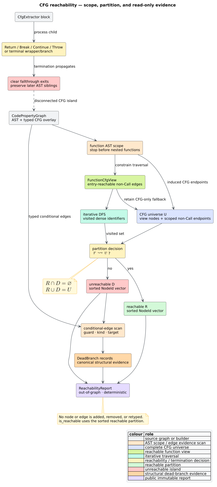

# CFG reachability and dead branches

`libcpg` provides a deterministic, feature-free [`ReachabilityReport`](#result-contract)
for one function's control-flow graph (CFG). The report separates executable
topology from disconnected CFG islands, identifies conditional edges inside
those islands, and leaves the Code Property Graph (CPG) unchanged. Its primary
construction-facing use is finding statements that `CfgExtractor` preserves
after a terminator but deliberately does not wire into the executable path.



*Figure — end-to-end reachability analysis and its read-only boundary. Source:
[`diagrams/reachability-analysis.puml`](../../diagrams/reachability-analysis.puml).*

## Terms and intuition

Let the intraprocedural CFG be $`G = (V, E)`$ with function entry $`r`$. The
terms used by the API are:

- A node $`v`$ is **reachable** when a directed path from $`r`$ to $`v`$
  exists, including the length-zero path that makes $`r`$ reachable from itself.
- A node in the function's CFG universe is **unreachable** when no such path
  exists. It remains a real CPG node with AST, source-range, and other overlay
  information; the analysis never deletes it.
- A **CFG island** is a connected or cyclic region of function-scoped CFG
  endpoints that has no directed path from $`r`$.
- A **dead branch** in the plain report is a conditional edge in an unreachable
  island. Its `guard`, `edge_kind`, and `target` fields preserve the original
  CFG evidence. Value-sensitive analyses can refine this structural result
  when they prove that a reachable guard selects only one successor.
- **Intraprocedural** means control stays within one function. `Call` edges and
  nested functions are excluded.

The distinction between *unreachable node* and *removed node* matters. Source
after `return` is still useful to diagnostics, refactoring tools, and source
mapping. `ReachabilityReport` classifies that source without rewriting the
unified overlay graph.

## Public API

The function and result types are exported from both `libcpg::analysis` and the
crate root:

```rust
use libcpg::{
    unreachable_code, AnalysisError, CodePropertyGraph, NodeId,
    ReachabilityReport,
};

fn reachability_in(
    cpg: &CodePropertyGraph,
    function: NodeId,
) -> Result<ReachabilityReport, AnalysisError> {
    unreachable_code(cpg, function)
}
```

`function` must name a `CpgNodeKind::Function`. An absent identifier returns
`AnalysisError::UnknownNode`; another node kind returns
`AnalysisError::NotAFunction`. A valid function without CFG edges produces a
one-node reachable partition containing only the function.

### Result contract

`ReachabilityReport` has four fields:

| Field | Meaning |
|---|---|
| `function: NodeId` | Function entry used as the traversal root. |
| `reachable: Vec<NodeId>` | Reachable CFG nodes, sorted by stable identifier. |
| `unreachable: Vec<NodeId>` | Unreachable function-scoped CFG nodes, sorted by stable identifier. |
| `dead_branches: Vec<DeadBranch>` | Canonically sorted conditional edges whose targets lie in unreachable CFG islands. |

`is_reachable(node)` performs a binary search over the sorted reachable vector.
It returns `false` for an unreachable node, an AST-only node outside the CFG
universe, or an identifier absent from the CPG.

Each `DeadBranch` contains:

| Field | Meaning |
|---|---|
| `guard` | Source guard or match-dispatch node. |
| `edge_kind` | `ConditionalTrue`, `ConditionalFalse`, `Case`, or `DefaultCase`. |
| `target` | Unreachable branch target. |

With the `serde` feature, both public result types serialize and round-trip
without changing identifiers, partitions, or edge classifications.

## Function scope and universe

Two related views are intentionally kept distinct:

1. `FunctionCfgView` supplies the **walkable graph**: the subset actually
   reachable from the entry through those same intraprocedural edges.
2. `cfg_projection(cpg, function)` supplies every endpoint of a non-`Call`
   CFG edge whose source and target both belong to the function's AST scope.

The report's universe is the union of those two node sets. This exact union
preserves reachable nodes in legacy CFG-only hand-built graphs that provide no
AST edges. When an AST scope exists it remains authoritative and excludes
malformed cross-function sequential edges; when it does not, the analysis can
classify the reachable CFG topology but cannot attribute disconnected islands
to a function without inventing scope evidence.

AST scope discovery follows `AstChild` edges and stops before nested functions.
This prevents a malformed sequential edge into another function from leaking
that function into the report. AST-only syntax nodes with no CFG incidence are
not mislabeled as dead code: absence from the CFG universe means only that the
CFG extractor did not model them as control-flow vertices.

Formally, if $`U`$ is the universe and $`R`$ is the entry-reachable set, the
report satisfies:

```math
R = \{v \in U \mid r \leadsto v\}
```

```math
D = U \setminus R
```

where $`D`$ is the unreachable set and $`\leadsto`$ denotes a directed path.
Therefore the partition laws are:

```math
R \cap D = \varnothing
```

```math
R \cup D = U
```

## Literate algorithm

The implementation uses an explicit depth-first-search (DFS) stack. Stable
output does not depend on stack order because both partitions are materialized
in the universe's sorted `NodeId` order.

```text
UNREACHABLE-CODE(cpg, function):
    view     ← reachable, function-scoped, non-Call CFG view
    universe ← view nodes union all scoped non-Call CFG endpoints
    seen     ← empty set of dense node identifiers
    work     ← [view.entry]

    while work is not empty:
        node ← work.pop()
        if node was newly inserted into seen:
            push every successor of node

    reachable   ← universe nodes whose view identifier is in seen
    unreachable ← universe nodes not in reachable
    dead        ← conditional CFG edges whose target is unreachable
    canonicalize dead by (guard, edge kind, target)
    return ReachabilityReport(function, reachable, unreachable, dead)
```

The traversal and partition scan require $`O(|V| + |E|)`$ time and
$`O(|V|)`$ auxiliary memory. Canonicalizing $`B`$ dead-branch records adds
$`O(|B| \log |B|)`$ comparison work; $`B \le |E|`$. There is no iteration or
path-enumeration cap because every dense vertex is expanded at most once.

## Builder termination semantics

`CfgExtractor::process_block` still processes AST siblings after `Return`,
`Break`, `Continue`, or `Throw` so their syntax and nested overlays remain
available. It clears the current fallthrough exits, leaving the following CFG
island disconnected from the function entry.

Parser grammars can retain transparent wrappers. For example, tree-sitter Rust
places a `Return` below an `expression_statement`. The block builder propagates
function-terminal exits through such wrappers, and it applies the same rule to
an `if` or `match` whose every exposed exit is `Return` or `Throw`. It does not
promote loop `Break`/`Continue` nodes: loop handlers deliberately turn those
into normal exits of the enclosing loop.

```text
BLOCK-CHILD-TERMINATES(child, child_exits):
    if child is Return, Break, Continue, or Throw:
        return true
    if child_exits is nonempty and every exit is Return or Throw:
        return true
    return false
```

This rule prevents a wrapped terminator or an all-return branch from acquiring
a sequential edge to the next statement. The reachability analysis then
reports the preserved post-terminator island rather than hiding it by deletion.

## Example

This parser-backed example requires the `lang-rust` feature:

```rust
// requires: features = ["lang-rust"]
use libcpg::{
    unreachable_code, CpgBuilder, CpgNodeKind, Language,
    TreeSitterCpgBuilder,
};

let source = r#"
    fn example() {
        return;
        let first = 1;
        let second = first + 1;
    }
"#;
let cpg = TreeSitterCpgBuilder::new().build(source, Language::Rust)?;
let function = cpg.functions().next().expect("example function").id;
let report = unreachable_code(&cpg, function)?;

for declaration in cpg.variables().filter(|node| {
    matches!(node.kind, CpgNodeKind::Variable { .. })
}) {
    assert!(!report.is_reachable(declaration.id));
}
# Ok::<(), libcpg::Error>(())
```

The result is a diagnostic value only. The two declarations remain queryable
through the CPG and retain their AST parents and source ranges.

## Validation strategy

The test suite combines examples, generated laws, an independent oracle, and
integration checks:

- generated graphs compare `reachable` with `petgraph::visit::Bfs` over an
  equivalently scoped graph;
- insertion-order permutations must produce byte-for-byte equal reports;
- generated partitions must be disjoint and exhaustive;
- adding a CFG edge may enlarge reachability but may never shrink it;
- generated post-`Return` and post-`Break` tails are unreachable;
- parser-backed Rust verifies the transparent `expression_statement` case;
- builder regressions cover wrapped returns and `if` branches that all return;
- a 25,000-node graph proves the walk is iterative and stack-safe;
- malformed-AST robustness tests drive the public API without panics;
- the `serde` feature round-trips a report including a dead branch.

The analysis also snapshots node and edge counts before and after representative
calls, pinning the out-of-graph and non-removal contract.

## Security and limitations

The function borrows `&CodePropertyGraph`, uses visited sets for both AST scope
and CFG traversal, and never follows `Call` edges. Cyclic or malformed input
therefore terminates without recursion proportional to CFG path length. Memory
is proportional to the scoped CFG, so callers should still apply construction
size limits before analyzing hostile source.

Plain reachability answers a topological question only. It does not infer
constant guard values, path feasibility, exception behavior absent from the
CFG, or callee behavior. A reachable conditional target is therefore possible,
not necessarily executable in a concrete run. Value-sensitive SCCP refinement
is the layer that can add proof-backed dead branches without weakening this
conservative base report.

## Related documentation

- [CFG construction](../builder/cfg.md) — construct handlers and termination.
- [Deterministic projections](projections.md) — scoped CSR representation.
- [Dominators](dominator-analysis.md) — path universality over reachable CFGs.
- [Natural loops](loop-analysis.md) — dominator-qualified cyclic regions.
- [Control-flow theory](../../theory/02-control-flow-and-complexity.md) — CFG
  semantics and edge kinds.
- [Input hardening](../../security/01-input-and-resource-hardening.md) — finite
  work on malformed and hostile graphs.
