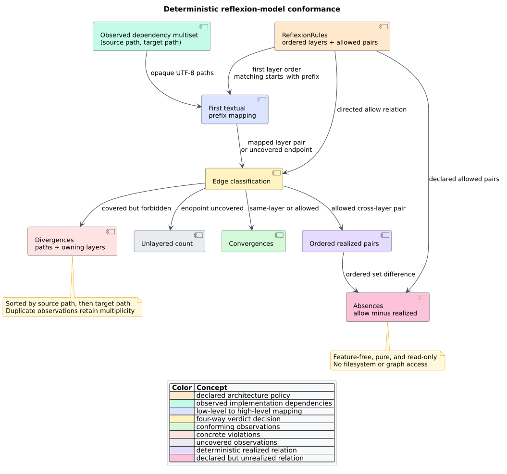

# Reflexion-model conformance

`libcpg::reflexion` compares caller-supplied path dependencies with an ordered
layer policy. It is feature-free, language-independent, deterministic,
read-only, and independent of the filesystem and `CodePropertyGraph`.



*Figure 1 — complete conformance flow. Source:
[`reflexion-model-pipeline.puml`](../../diagrams/reflexion-model-pipeline.puml).*

## Public API

```rust
use libcpg::{reflexion, LayerSpec, ReflexionRules};

let rules = ReflexionRules {
    layers: vec![
        LayerSpec {
            name: "api".into(),
            prefixes: vec!["src/api/".into()],
        },
        LayerSpec {
            name: "domain".into(),
            prefixes: vec!["src/domain/".into()],
        },
    ],
    allow: vec![("api".into(), "domain".into())],
};

let summary = reflexion(
    &rules,
    [("src/api/http.rs".into(), "src/domain/model.rs".into())],
);
assert_eq!(summary.convergences, 1);
assert!(summary.divergences.is_empty());
assert!(rules.absences(&summary.realized_pairs).is_empty());
```

The snippet requires no feature. The `serde` feature adds serialization for
rules, verdicts, divergences, and summaries.

| API | Contract |
|---|---|
| `LayerSpec { name, prefixes }` | One named layer; prefixes are textual and evaluated in vector order. |
| `ReflexionRules { layers, allow }` | First-matching layer policy and directed permitted cross-layer name pairs. |
| `layer_of(path)` | First layer containing a prefix accepted by `path.starts_with(prefix)`, or `None`. |
| `classify(source, target)` | `SameLayer`, `Allowed`, `Divergence`, or `Unlayered`. |
| `reflexion(rules, edges)` | Full deterministic summary; consumes owned `Arc<str>` path pairs. |
| `absences(realized_pairs)` | Sorted, deduplicated allowed pairs not realized by the summary. |

`ReflexionSummary` exposes sorted `divergences`, an observed-edge
`convergences` count, an `unlayered` count, and ordered `realized_pairs`.
`ReflexionDivergence` preserves both paths and their owning layers.

## Path and ordering contract

- Layer order is semantic; put specific prefixes before broad prefixes.
- Prefix order within one layer does not affect ownership because every match
  yields the same name.
- Paths are opaque UTF-8 strings. Normalize relative/absolute form and
  separators before calling when dependency producers disagree.
- Same-layer edges need no `allow` pair and never enter `realized_pairs`.
- Directed policy matters: permitting `api -> domain` does not permit
  `domain -> api`.
- Input multiplicity is preserved in counts and divergence witnesses; permitted
  pair realization and absences are set-valued.

## Worked classification

For layers `api`, `domain`, and `data`, with `api -> domain` and
`domain -> data` allowed:

| Observed dependency | Verdict | Reason |
|---|---|---|
| `src/api/a.rs -> src/api/b.rs` | same-layer convergence | both map to `api` |
| `src/api/a.rs -> src/domain/m.rs` | allowed convergence | declared pair |
| `src/api/a.rs -> src/data/q.rs` | divergence | covered pair is not allowed |
| `generated/x.rs -> src/data/q.rs` | unlayered | source has no matching prefix |

If no `domain -> data` edge occurs, that declared pair is an absence.

## Failure and security boundary

The pure API has no parser, graph index, recursion, I/O, unsafe code, or
environment lookup. Empty rules classify every edge as unlayered. Empty input
returns an empty summary. Public vectors may contain duplicate/unknown names;
the functions remain total and apply their documented literal semantics.

The caller owns resource admission. For untrusted policy, cap layer, prefix,
allow-pair, path-length, and observed-edge counts before allocating the input.
Do not treat lexical prefix matching as a filesystem sandbox check: normalize
and validate paths separately if security authority depends on path identity.

## Interpretation boundary

Conformance is advisory. It compares a declared model to a supplied dependency
relation; it neither discovers intent nor proves runtime coupling. Persist both
inputs and review concrete divergences before changing code or policy.

See [Theory 19](../../theory/19-reflexion-model-conformance.md), [ADR
0025](../../design/0025-pure-path-reflexion-model.md), and [Scientific
validation 20](../../scientific/20-reflexion-model-validation.md).

## Reference

1. Murphy, G. C., Notkin, D., & Sullivan, K. J. (2001). Software reflexion
   models: Bridging the gap between design and implementation. *IEEE
   Transactions on Software Engineering, 27*(4), 364–380. DOI:
   [10.1109/32.917525](https://doi.org/10.1109/32.917525).
