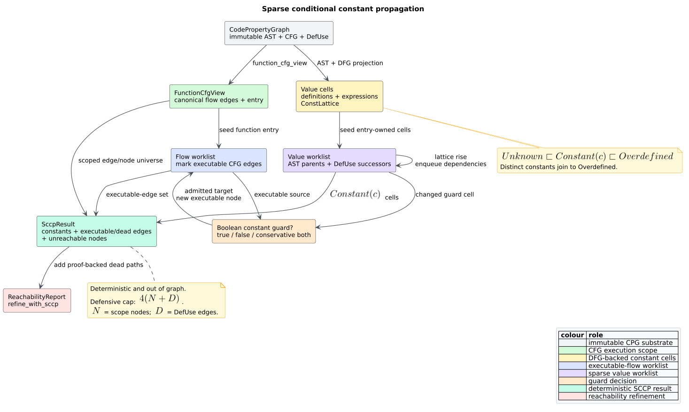

# Sparse conditional constant propagation

`libcpg::sccp` performs **sparse conditional constant propagation** (SCCP): it
proves scalar constants while simultaneously proving which control-flow graph
(CFG) edges can execute. The two proofs strengthen one another. A constant
boolean guard removes one branch from consideration; definitions on that dead
branch then cannot pollute later value joins.

The API is feature-free, deterministic, read-only, and intraprocedural. It
combines the canonical [`FunctionCfgView`](projections.md), abstract syntax tree
(AST) expression dependencies, and data-flow graph (DFG) `DefUse` edges. The
result stays out of the Code Property Graph (CPG) and can refine a structural
[`ReachabilityReport`](reachability-analysis.md) without deleting source nodes.



*Figure — SCCP's coupled control-flow and value fixed point. Source:
[`diagrams/sccp-analysis.puml`](../../diagrams/sccp-analysis.puml).*

## Terms and intuition

- A **value cell** is the abstract value attached to a definition or expression
  node. Definitions include variables, parameters, and assignments; expressions
  include literals, identifiers, operators, and calls.
- An **executable node** has an executable CFG path from the selected function
  entry. An AST-only parameter is owned by the function entry; other AST-only
  value cells are owned by their nearest CFG ancestor.
- An **executable edge** can participate in at least one execution admitted by
  the current abstract values.
- A **dead edge** is a conditional CFG edge that never becomes executable.
- A **phi-like join** combines every executable `DefUse` predecessor of an
  identifier. libcpg's source CPG is not in static single assignment (SSA)
  form, so the join is implicit rather than represented by a phi node.
- **Sparse** means value changes travel through AST dependency links and DFG
  `DefUse` links instead of propagating one environment across every basic
  block.

For example, after `x = 3`, the condition `x == 3` becomes `true`. SCCP marks
only `ConditionalTrue` executable, ignores definitions on the false branch,
and reports that branch as dead. Plain reachability cannot prove this because
it treats both CFG edges as possible.

## Constant domain and lattice

`ConstValue` preserves the scalar values the shared CPG can represent without
normalization:

| Variant | Meaning |
|---|---|
| `Int(i64)` | signed integer |
| `Float(u64)` | exact IEEE-754 `f64` bits, including signed zero and NaN payloads |
| `Bool(bool)` | boolean |
| `Str(Arc<str>)` | immutable string |
| `Char(char)` | Unicode scalar value |
| `Null` | null or nil |

Array, object, and regular-expression literals are not scalar constants in this
domain. They conservatively become `Overdefined`.

Each value cell belongs to the height-two `ConstLattice`:

```math
\bot = Unknown
```

```math
Unknown \sqsubset Constant(c) \sqsubset Overdefined
```

Distinct constants join to the top element:

```math
Constant(a) \sqcup Constant(b) =
\begin{cases}
Constant(a), & a = b, \\
Overdefined, & a \ne b.
\end{cases}
```

`Unknown` means no executable definition has supplied information yet. It is
not the same as a runtime input: parameters, unresolved identifiers, calls, and
unsupported operations become `Overdefined` once executable. This distinction
lets a not-yet-executable definition later contribute information without any
downward lattice move.

The implementation exposes `ConstLattice` as a public implementation of the
shared [`Lattice`](dataflow-framework.md) trait. Its `join` is idempotent,
commutative, and associative; `leq` implements the order above.

## Transfer semantics

### Literals and operators

Scalar `LiteralKind` values map directly to `ConstValue`. Unary and binary
operators fold only when their operands provide sufficient constant evidence.
The supported language-agnostic spellings include:

- signed integer arithmetic, remainder, exponentiation, shifts, bitwise
  operators, comparisons, and equality;
- floating arithmetic, remainder, exponentiation, comparisons, and runtime
  equality;
- boolean logical, bitwise, and equality operators;
- string concatenation, string ordering, and equality; and
- character ordering and equality.

Signed integer arithmetic uses `checked_*` operations. Overflow, division by
zero, invalid shifts, and negating `i64::MIN` yield `Overdefined`; they never
produce a wrapped constant. Floating equality uses `f64` runtime semantics, so
negative zero equals positive zero and NaN does not equal itself even though
the stored domain preserves exact bits.

Boolean `false && value` and `true || value` use their absorbing values even
when the other operand is not constant. Unsupported overloaded or
language-specific operations remain conservative.

### Definitions and uses

A simple assignment receives its right-hand-side value. A compound assignment
uses its target and right-hand side with the corresponding binary operator. A
variable definition receives its initializer; a parameter is an external input
and therefore `Overdefined`.

An identifier joins all incoming `DefUse` definitions whose execution owner is
executable:

```math
VALUE[use] = \bigsqcup_{d \in DefUsePred(use),\ executable(d)} VALUE[d].
```

This executable-definition qualification is load-bearing. If two feasible
branches define `x` as `7` and `9`, the later use is `Overdefined`. If the
second definition belongs to a proven-dead branch, the same use remains the
constant `7`.

### Conditional edges

Every non-conditional edge leaving an executable node becomes executable. For
`ConditionalTrue` and `ConditionalFalse`:

| Guard cell | Edge decision |
|---|---|
| `Unknown` | wait; mark neither conditional edge yet |
| `Constant(Bool(true))` | mark only `ConditionalTrue` |
| `Constant(Bool(false))` | mark only `ConditionalFalse` |
| another constant or `Overdefined` | conservatively mark both |

`Case` and `DefaultCase` stay executable when reached because their edge
payloads do not encode comparable case constants. If a boolean cell later rises
from one constant to `Overdefined`, the previously excluded edge is added; SCCP
never retracts an executable edge.

## Public API

All types are exported from `libcpg::analysis` and the crate root:

```rust
// requires: no features
use libcpg::{
    sccp, unreachable_code, AnalysisError, CodePropertyGraph, NodeId,
    ReachabilityReport, SccpResult,
};

fn analyze(
    cpg: &CodePropertyGraph,
    function: NodeId,
) -> Result<(SccpResult, ReachabilityReport), AnalysisError> {
    let constants = sccp(cpg, function)?;
    let structural = unreachable_code(cpg, function)?;
    let refined = structural.refine_with_sccp(&constants)?;
    Ok((constants, refined))
}
```

`SccpResult` contains:

| Field | Contract |
|---|---|
| `function` | selected function entry |
| `constants` | `BTreeMap<NodeId, ConstValue>` for executable constant definition/expression cells |
| `executable_edges` | all executable intraprocedural CFG edges, canonically sorted |
| `dead_edges` | conditional edges not executable, including disconnected CFG islands |
| `unreachable_nodes` | function-scoped CFG nodes not executable |

Unknown and non-function selectors return
`AnalysisError::{UnknownNode, NotAFunction}`. A function without CFG edges
produces an empty result. With feature `serde`, `ConstValue`, `ConstLattice`, and
`SccpResult` serialize and round-trip.

`ReachabilityReport::refine_with_sccp` returns a new report. It moves SCCP-dead
nodes into the unreachable partition and unions SCCP dead edges with structural
dead branches. The original two reports remain unchanged. Supplying an SCCP
result for another function returns `AnalysisError::FunctionMismatch`. A dead
edge's target can remain reachable through a different executable predecessor;
dead-edge evidence and node reachability are related but distinct facts.

## Literate algorithm

The algorithm is presented in execution order so each step states both what it
does and why it is required:

```text
SCCP(cpg, function):
    flow     := canonical reachable FunctionCfgView edges
    universe := reachable view nodes union scoped CFG endpoints
    cells    := function-scoped definition and expression nodes
    values   := Unknown for every cell
    execNode := {function}
    execEdge := empty
    flowWork := {function}
    valueWork := value cells owned by function entry

    while either worklist is nonempty:
        enforce 4 * (scope nodes + DefUse edges) event cap

        if flowWork has a source:
            inspect its guard value
            for each admitted outgoing edge not already executable:
                mark the edge executable
                if its target is newly executable:
                    enqueue the target's flow and owned value cells
        else:
            remove the smallest NodeId from valueWork
            evaluate its literal/operator/definition/use transfer
            join the candidate upward into the existing value
            if the cell changed:
                enqueue AST value parents
                enqueue DefUse successors
                enqueue executable CFG sources guarded by this cell

    constants   := executable cells equal to Constant(c)
    deadEdges   := scoped conditional edges absent from execEdge
    unreachable := universe minus execNode
    return canonically ordered out-of-graph facts
```

Both worklists are `BTreeSet<NodeId>` values, so duplicate scheduling collapses
and the smallest stable identifier runs first. Value cells can move at most
twice: `Unknown` to a constant and then to `Overdefined`. CFG edges are marked
at most once. The explicit event cap is therefore a defensive boundary for
malformed or adversarial overlay combinations, not the ordinary convergence
mechanism.

## Determinism, complexity, and resource bounds

Let $`N`$ be the function-scope node count, $`F`$ the function CFG edge count,
$`D`$ the `DefUse` edge count, and $`C`$ the value-cell count. Canonical scope,
edge, parent, owner, and dependency maps cost $`O(N + F + D)`$ space and
construction work plus sorting. The monotone event bound is
$`4(N + D)`$; each event performs local AST/DFG or outgoing-CFG work. Across the
fixed point, each dependency is reconsidered only after a source lattice rise,
so the conventional total is $`O(N + F + D)`$ apart from ordered-worklist
logarithmic factors and output sorting.

Public maps and vectors use stable `NodeId` order and canonical CFG-kind order.
Generated tests rebuild identical graphs with reversed node and non-AST edge
insertion and require byte-for-byte equal results.

## Validation strategy

The suite combines independent and cross-layer evidence:

- a generated straight-line `StmtSpec` mini-language is interpreted concretely;
  every concrete definition value must equal the SCCP-proven constant;
- lattice property tests check join associativity, commutativity, and
  idempotence over generated values;
- branch examples require executable conditional edges and dead edges to form
  a disjoint, exhaustive partition of scoped conditional edges;
- multi-definition examples cover equal, conflicting, and dead-path inputs;
- scalar-transfer examples cover every supported integer, float, boolean,
  string, and character operator, plus overflow, zero division, invalid shifts,
  signed-minimum negation, cross-kind equality, and boolean absorption;
- insertion-order property tests require deterministic reports;
- a parser-backed Rust integration proves `let x = 1 + 2; if x == 3` and the
  dead `else` through real AST, CFG, and DFG construction;
- malformed AST cycles must terminate without graph mutation, while invalid
  out-of-scope/non-value DefUse endpoints are excluded independently; and
- Serde, empty functions, invalid selectors, cross-function refinement, and
  the crate-root feature-free API have example tests.

The parser-backed oracle also exposed and fixed a construction defect:
anonymous tree-sitter keyword/operator tokens were becoming semantic CPG nodes.
The node-aware mapper now retains named rules and drops anonymous syntax tokens
for every frontend, restoring expression operands and control-child order.

## Security and semantic limits

SCCP is conservative with respect to its input overlays, not a proof of full
language semantics. It does not model:

- integer widths other than the CPG's `i64` literal domain;
- overloaded operators, coercions, volatile/atomic reads, reflection, or
  foreign calls;
- exception edges caused by operator evaluation;
- heap aliases, mutable fields, or interprocedural effects; or
- case-label values absent from `CfgEdgeKind` payloads.

Accordingly, `Overdefined` means “not safely provable in this domain,” not
“non-constant in every richer semantics.” A source transformer must still
validate language-specific effects before replacing an expression or deleting
a branch. The result itself cannot corrupt the source graph because SCCP only
borrows `&CodePropertyGraph`.

Visited sets bound malformed AST owner/guard walks. The event cap returns
`AnalysisError::IterationLimitExceeded` instead of spinning. Applications
accepting hostile source should also enforce builder source-size and parser-time
limits before invoking any graph analysis.

## Related documentation

- [Monotone data-flow framework](dataflow-framework.md) — shared lattice laws.
- [Reachability](reachability-analysis.md) — structural base and refinement.
- [DFG extraction](../builder/dfg.md) — `DefUse` evidence generation.
- [ADR-0010](../../design/0010-dual-worklist-sccp.md) — decision record.
- [SCCP validation](../../scientific/05-sccp-validation.md) — oracle design.
- [Input hardening](../../security/01-input-and-resource-hardening.md) — caps.

## References

1. Wegman, M. N., Zadeck, F. K. (1991). *Constant Propagation with Conditional
   Branches.* ACM Transactions on Programming Languages and Systems 13(2),
   181–210. DOI:
   [10.1145/103135.103136](https://doi.org/10.1145/103135.103136)
2. Kildall, G. A. (1973). *A Unified Approach to Global Program Optimization.*
   POPL '73. DOI:
   [10.1145/512927.512945](https://doi.org/10.1145/512927.512945)
