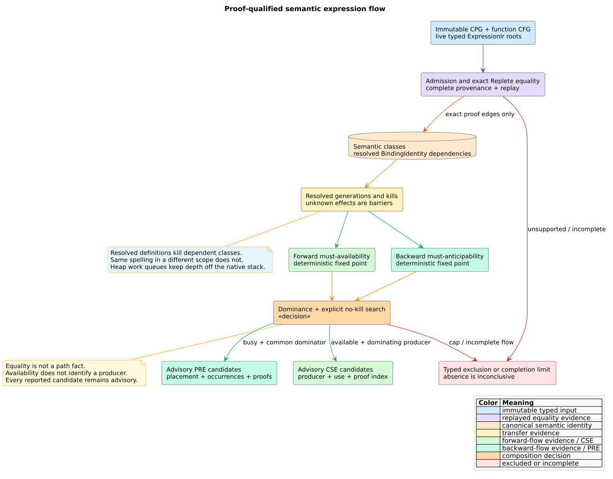
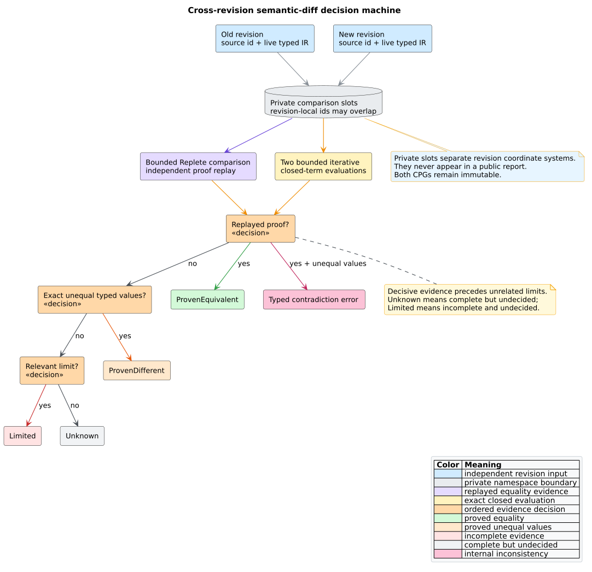

# Semantic expression-flow component

## Responsibility

`analysis::semantic_expression_flow` composes two independent evidence
systems:

- proof-producing exact equality classifies live typed expressions; and
- deterministic forward/backward must dataflow establishes path facts.

It reports conservative CSE and PRE candidates and compares one old expression
with one new expression. It does not parse source, infer missing facts, choose
an optimization, rewrite source, mutate either CPG, or alter the structural
diff taxonomy.

## Data and ownership flow



*Figure -- component data flow. Source:
[`semantic-expression-flow-pipeline.puml`](../../diagrams/semantic-expression-flow-pipeline.puml).*

The caller owns the CPG, semantic profile, and flat `ExpressionIr` arenas.
The report owns canonical vectors and a nested `ExpressionEquivalenceReport`.
Each CSE `proof_pair` and each PRE `proof_pairs` entry indexes that nested
report. No mutable graph, engine-local e-class id, or private revision slot
crosses the API boundary.

## Literate algorithm

```text
ANALYZE-FLOW(cpg, function, domain, profile, candidates, limits):
    validate independent flow and equality limits
    run proof-producing expression equivalence
        because semantic identity requires complete replayable evidence
    retain reachable, admitted candidates and exact proof edges
    find connected exact-proof classes in stable source order
    collect each class's resolved BindingIdentity dependencies
    build node generations and resolved kills
        treating unknown assignments and unmodeled effects as kill-all barriers
    solve forward must-availability with an iterative ordered work queue
    solve backward must-anticipability with an iterative ordered work queue
    for each exact proof edge:
        emit CSE only if one occurrence dominates the other,
        the class is available at the use, and no path contains an intervening kill
    for each multi-occurrence class:
        emit PRE only if its nearest common dominator is anticipable,
        dominates all occurrences, and retained proof edges span the class
    sort, deduplicate, account, and return without mutating the CPG
```

The must meet is set intersection. The boundary state is empty: no class is
assumed available at entry or anticipable at exit. Non-boundary solver states
begin at the fact universe so descending intersection reaches the greatest
must fixed point.

## Generation and kill rules

An admitted occurrence generates its exact semantic class. A variable or
parameter definition kills classes depending on that exact definition. An
assignment uses the resolved definition of its target identifier; an
unresolved target kills every class. Unmodeled calls, `await`, and `yield` are
kill-all barriers. A call root admitted by the pure expression boundary carries
the evidence needed not to be treated as an unmodeled call.

These rules are conservative. A same-spelling variable in another scope has a
different `BindingIdentity` and does not kill the class. Conversely, missing
resolution cannot be treated as evidence of independence.

## Semantic diff



*Figure -- semantic-diff decision order. Source:
[`semantic-diff-decision-machine.puml`](../../diagrams/semantic-diff-decision-machine.puml).*

The two expressions may come from unrelated CPG arenas and may have equal
numeric `NodeId` values. The adapter maps them to private revision slots, runs
bounded equality, replays any proof, and evaluates both closed terms with an
iterative typed evaluator. The decision order is proof, exact unequal values,
relevant limit, then unknown. Private slots never appear in the report.

## Complexity and stack use

Let $`V`$ and $`E`$ be CFG nodes and edges, $`C`$ semantic classes, $`K`$
represented kill relations, and $`W`$ candidate path-search work. Equality has
the separately bounded cost documented by ADR-0075. Each dataflow extraction
performs bit-set transfers and is bounded by `max_visits_per_block`; candidate
qualification is bounded by `max_candidate_work`, including explicit graph
searches around kills. Public state materialization is proportional to facts
actually retained.

The implementation uses flat expression/proof arenas, dense bit sets, vectors,
ordered maps, and explicit work queues. CFG depth, expression depth, and proof
depth therefore do not become native call-stack depth.

## Dependencies and repository boundary

The dependency direction is `libcpg -> Replete`. Replete supplies generic
e-graph mechanics; libcpg supplies program semantics and flow. Neither is part
of MeTTaIL, and this component creates no authority to edit MeTTaIL. Standalone
externalization may consult an immutable MeTTaIL revision as an oracle only.

## References

1. Kildall, G. A. (1973). *A Unified Approach to Global Program Optimization.*
   DOI: [10.1145/512927.512945](https://doi.org/10.1145/512927.512945).
2. Morel, E., Renvoise, C. (1979). *Global Optimization by Suppression of
   Partial Redundancies.* DOI:
   [10.1145/359060.359069](https://doi.org/10.1145/359060.359069).
