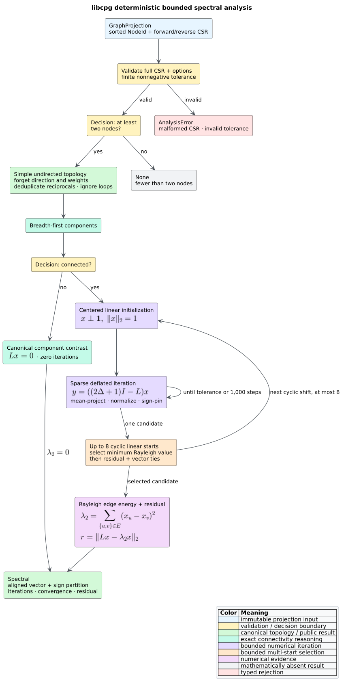

# Spectral connectivity and Fiedler partitioning

**Spectral analysis** studies a graph through eigenvalues and eigenvectors of a
matrix derived from its topology. libcpg provides deterministic, feature-free
algebraic connectivity and a Fiedler sign partition over an immutable
[`GraphProjection`](projections.md).



*Figure 1 — complete spectral-analysis flow. Source:
[`diagrams/spectral-pipeline.puml`](../../diagrams/spectral-pipeline.puml).*

## What the result means

For a simple undirected graph with adjacency matrix $`A`$ and diagonal degree
matrix $`D`$, the **combinatorial Laplacian** is

```math
L=D-A.
```

Its eigenvalues are real and nonnegative. In ascending order they are
$`0=\lambda_1\le\lambda_2\le\cdots\le\lambda_n`$. The second-smallest value
$`\lambda_2`$ is the **algebraic connectivity** or **Fiedler value**. It is
positive exactly when the graph is connected. An associated unit eigenvector
$`x`$, called a **Fiedler vector**, satisfies

```math
Lx=\lambda_2x,
\qquad
\boldsymbol{1}^{\mathsf T}x=0,
\qquad
\lVert x\rVert_2=1.
```

libcpg splits vertices by the sign of $`x`$: nonnegative entries are one side
and negative entries are the other. This is the classical unnormalized Fiedler
cut heuristic. It is related to spectral partitioning and normalized cuts, but
it is not Shi and Malik's normalized-Laplacian objective; the distinction
matters for irregular-degree graphs.

## Public API

```rust
pub const MAX_SPECTRAL_ITERATIONS: usize = 1_000;
pub const MAX_SPECTRAL_STARTS: usize = 8;

pub struct SpectralOptions {
    pub max_iterations: usize,
    pub tolerance: f64,
}

pub struct Spectral {
    pub nodes: Vec<NodeId>,
    pub algebraic_connectivity: f64,
    pub fiedler: Vec<f64>,
    pub partition: Vec<bool>,
    pub iterations: usize,
    pub starts: usize,
    pub converged: bool,
    pub residual_norm: f64,
}

pub fn algebraic_connectivity(
    graph: &GraphProjection,
    options: &SpectralOptions,
) -> Option<Spectral>;

pub fn try_algebraic_connectivity(
    graph: &GraphProjection,
    options: &SpectralOptions,
) -> Result<Option<Spectral>, AnalysisError>;
```

`Spectral::nodes`, `fiedler`, and `partition` have identical lengths and use
projection order. `partition[i]` is exactly `fiedler[i] >= 0.0`. The first
nonzero vector component is positive, eliminating the arbitrary global sign.
The result stays outside the graph and the operation does not mutate the
projection or source Code Property Graph (CPG).

`algebraic_connectivity` is a total convenience boundary: it returns `None`
for fewer than two nodes, malformed projections, or invalid options. Use the
checked `try_` form when rejection must be distinguished from a graph too small
to have a second eigenvalue.

## Topology semantics

The analysis derives one **simple undirected, unweighted** topology:

1. edge direction is forgotten;
2. reciprocal and parallel relations become one edge;
3. self-loops are ignored; and
4. numeric weights are ignored, including non-finite or negative values.

These rules make the result a property of relation presence. Call-graph edge
weights, for example, cannot silently change the Laplacian being solved. Use a
separately named weighted or directed analysis when those semantics are wanted.

## Deterministic bounded algorithm

The checked boundary first validates both forward and reverse compressed sparse
row (CSR) invariants. Breadth-first search then finds connected components. A
disconnected graph has $`\lambda_2=0`$ exactly, so libcpg returns a normalized
indicator contrasting the first dense-order component with all remaining
vertices and performs no numerical iteration.

For a connected graph, libcpg runs deflated power iteration on

```math
B=cI-L,
\qquad
c=2\Delta+1,
```

where $`\Delta`$ is maximum degree. The all-ones eigenvector is removed by
subtracting the mean after each multiplication. On the orthogonal subspace,
the dominant eigenpair of $`B`$ corresponds to the smallest positive eigenpair
of $`L`$.

```text
FIEDLER(projection, options):
    validate complete CSR and finite nonnegative tolerance
    build canonical simple undirected adjacency
    components = breadth_first_components(adjacency)
    if fewer than two vertices: return no eigenpair
    if components has more than one member:
        return exact zero eigenvalue and canonical component indicator

    c = 2 * maximum_degree + 1
    limit = min(options.max_iterations, 1,000)
    for at most eight cyclic shifts of a centered linear vector:
        x = shifted linear vector, normalized and sign-pinned
        repeat at most limit times:
            y = c * x - L * x using sparse adjacency
            subtract mean(y), normalize(y), and pin its sign
            lambda = sum over edges (y[u] - y[v]) squared
            stop when eigenvalue and vector deltas meet tolerance
            x = y
    select the smallest Rayleigh value, then residual and vector ties
    return lambda, x, sign partition, starts, convergence, and residual
```

One centered linear seed can be exactly orthogonal to the Fiedler eigenspace
under graph symmetry and converge to a higher eigenpair. libcpg therefore
evaluates up to $`s=\min(|V|,8)`$ cyclic shifts of that sequence and selects
the lowest Rayleigh quotient. This is a deterministic multi-start numerical
safeguard; it does not turn finite iteration into an exact eigendecomposition.

Adjacency, reductions, starts, and sign choice use stable dense order. Each
start is capped at 1,000 iterations even if a caller asks for more. One sparse
step is $`O(|V|+|E|)`$ time. Total work is
$`O(sk(|V|+|E|))`$ for $`s\le8`$ and $`k\le1000`$, with
$`O(|V|+|E|)`$ auxiliary space because starts run sequentially. No traversal
is recursive.

## Convergence and interpretation

`starts` records how many connected-graph starts were evaluated; disconnected
results report zero. `iterations` belongs to the selected start, not the sum
over starts. `converged` reports whether that start's eigenvalue change and
Euclidean vector change reached `tolerance` before the cap. `residual_norm`
independently reports

```math
r=\lVert Lx-\lambda_2x\rVert_2.
```

A capped result is still returned because it is a deterministic approximation,
not proof of convergence. Consumers that need a certified numerical envelope
must require `converged` and choose an acceptable residual. A zero-iteration
request deliberately compares the normalized initial estimates with
`converged == false`.

Repeated eigenvalues can admit several valid Fiedler vectors. Stable
initialization and ordering choose one reproducibly, but do not make it the
only mathematically valid partition. A sign split is structural evidence for a
candidate seam; it does not prove architectural ownership, runtime isolation,
or security impact.

## End-to-end example

```rust
use libcpg::{
    try_algebraic_connectivity, GraphProjection, NodeId, ProjectionKind,
    SpectralOptions,
};

fn main() -> Result<(), libcpg::AnalysisError> {
    let graph = GraphProjection::from_edges(
        ProjectionKind::External,
        [10, 20, 30, 40].into_iter().map(NodeId::new),
        [
            (NodeId::new(10), NodeId::new(20), 1.0),
            (NodeId::new(20), NodeId::new(30), 1.0),
            (NodeId::new(30), NodeId::new(40), 1.0),
        ],
    );
    let result = try_algebraic_connectivity(&graph, &SpectralOptions::default())?
        .expect("a four-node graph has a second eigenvalue");

    let expected = 2.0 - 2.0 * (std::f64::consts::PI / 4.0).cos();
    assert!((result.algebraic_connectivity - expected).abs() < 1.0e-8);
    assert_eq!(result.nodes, graph.nodes);
    assert_eq!(result.partition, vec![true, true, false, false]);
    assert!(result.converged && result.residual_norm < 1.0e-7);
    Ok(())
}
```

## References

- Fiedler, “Algebraic Connectivity of Graphs,” 1973.
  [DOI: 10.21136/CMJ.1973.101168](https://doi.org/10.21136/CMJ.1973.101168).
- Shi and Malik, “Normalized Cuts and Image Segmentation,” 2000.
  [DOI: 10.1109/34.868688](https://doi.org/10.1109/34.868688).
