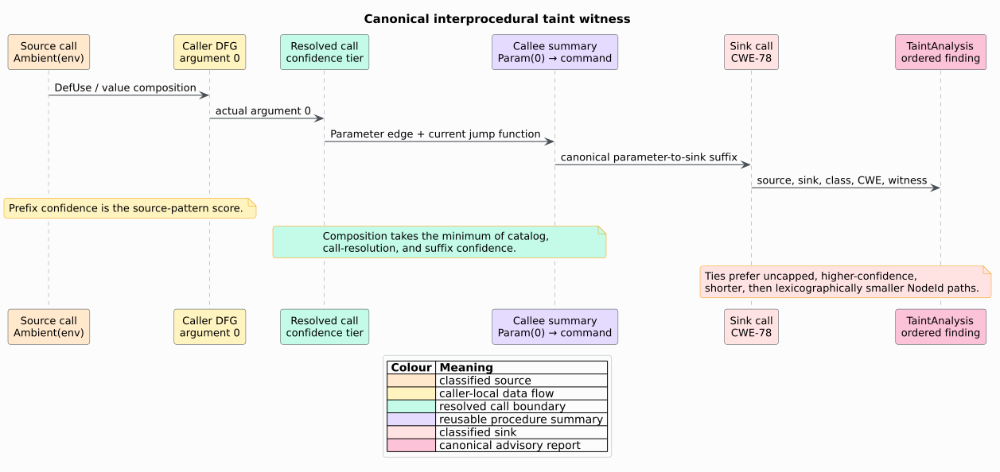

# Interprocedural taint and maybe-null analysis

`libcpg::analyze_taint_report` computes deterministic, advisory source-to-sink
flows over a typed Code Property Graph (CPG). A caller supplies a declarative
`TaintCatalog`; libcpg supplies typed local transfer, call-target composition,
bounded recursive fixed points, canonical witnesses, Common Weakness
Enumeration (CWE) metadata, confidence, and explicit completeness evidence.

`libcpg::analyze_null_flows_report` is the companion maybe-null instantiation.
It follows null literals, uninitialized variables, nullable returns, and formal
parameters to typed dereference sites.

Both analyses are feature-free, read-only, language-agnostic, and advisory.
They do not parse retained source text and they never add nodes or edges.


## 1. Vocabulary and evidence boundary

- **Taint** is an analysis label indicating that represented data may descend
  from a configured source. It is not a claim that the value is malicious.
- A **source** introduces a value into an open class such as `env`, `request`,
  or a project-defined `message_bus`.
- A **sink** consumes a value in a security-sensitive role such as `command` or
  `sql`. A sink rule may carry a CWE identifier.
- A **sanitizer** kills argument taint at its result. This is policy supplied by
  the catalog, not a proof of the implementation's correctness.
- A **procedure summary**, or jump function, records parameter-to-sink,
  parameter-to-return, and source-to-return reachability so callers need not
  reanalyze a callee body.
- A **witness** is the canonical sequence of `NodeId` values selected by typed
  transfer and summary composition.
- **Advisory** means the result identifies review candidates. It never declares
  a vulnerability, exploitability, or program safety.

The evidence boundary is the represented CPG: AST value composition, forward
DFG relations, call topology, type annotations, and the supplied catalog.
Missing call, alias, def-use, or type evidence can reduce recall. The analysis
does not compensate by scanning or reparsing source code.

## 2. Catalog syntax and matching semantics

`Pattern` has four non-regex forms:

| Form | Meaning | Match confidence |
|---|---|---:|
| `Exact("eval")` | whole path equality | `1.00` |
| `Segment("eval")` | one identifier segment equals `eval` | `0.95` |
| `Suffix("::eval")` | path ends with the literal suffix | `0.90` |
| `Substring("process")` | literal occurs anywhere | `0.80` |

Segment boundaries are non-alphanumeric characters other than underscore, so
one catalog works with paths such as `std::env::var`, `os.environ.get`, and
`request.body`. Matching is case-sensitive because the CPG preserves symbol
case.

```rust
use libcpg::{CatalogRule, ExternalModel, Pattern, TaintCatalog};

fn project_catalog() -> TaintCatalog {
    TaintCatalog {
        sources: vec![CatalogRule {
            pattern: Pattern::Exact("bus::receive".into()),
            class: "message_bus".into(),
            cwe: None,
        }],
        sinks: vec![CatalogRule {
            pattern: Pattern::Exact("shell::run".into()),
            class: "command".into(),
            cwe: Some(78),
        }],
        sanitizers: vec![],
        externals: vec![(
            Pattern::Exact("vendor::escape".into()),
            ExternalModel::Sanitizer,
        )],
    }
}
```

`TaintCatalog::builtin_generic()` preserves the pgmcp source families `env`,
`argv`, `stdin`, and `request`; its sink families are `command` (CWE-78), `sql`
(CWE-89), `eval` (CWE-95), `deserialize` (CWE-502), and `path` (CWE-22).
Classes remain `Arc<str>` values, so consumers can extend or replace the
catalog without modifying libcpg or selecting a language feature.

Classification precedence is sanitizer, source, sink, then resolved/external
call behavior. A sanitizer therefore cannot accidentally pass argument taint
through merely because the same path also matches a broad source or sink rule.
Duplicate class/CWE matches retain the most specific confidence.

## 3. External-call models

Opaque external and unresolved calls use one of five models:

| Model | Result taint | Sink effect |
|---|---|---|
| `Passthrough` | union of argument facts | none |
| `Havoc` | empty | none |
| `Source { class }` | fresh ambient source | none |
| `Sink { class, cwe }` | empty | every tainted argument reaches the sink |
| `Sanitizer` | empty | none |

The default is `Passthrough`. This preserves a possible flow through an opaque
wrapper without inventing a sink. Because the call evidence is unresolved, an
unconfigured passthrough contributes a lower `0.50` confidence floor. A
consumer that knows an API should add an exact model rather than interpreting
that default as semantic knowledge.

## 4. Taint facts and summaries

`TaintFact::Param(i)` is a formal input used to construct reusable summaries.
`TaintFact::Ambient(class)` is concrete source-class taint. Internally, ambient
facts also retain their source `NodeId`; distinct same-class sources therefore
do not collapse into one witness.

`TaintSummary` contains:

- `param_sinks[i]`: open sink classes reachable from formal parameter `i`;
- `param_to_return`: a 64-bit may-reach-return relation;
- `return_sources`: source classes reaching a return;
- canonical parameter-to-sink, parameter-to-return, source-to-return, and
  concrete source-to-sink witness maps;
- `param_mask_truncated` and `capped` completeness evidence.

The summary is a finite product join-semilattice. Sets and bit masks join by
union; Boolean evidence joins by disjunction. For each fixed witness key,
canonical choice uses the total preference order:

```math
(\mathrm{uncapped},-\mathrm{confidence},\mathrm{length},\mathrm{NodeIds}).
```

Taking the minimum under this order is associative, commutative, and
idempotent. It lets recursive rounds improve presentation evidence without
changing the underlying may-flow relation.

## 5. Typed transfer algorithm

The following literate pseudocode states the algorithm and its rationale.

```text
TAINT-SUMMARY(function, current summaries, catalog, resolver, caps)
    seed Param(i) at each formal parameter
        because a reusable summary describes unknown caller values

    seed Ambient(class) at each catalog or external-model source
        because concrete findings must retain source identity

    repeat in ascending NodeId and typed-edge order
        propagate facts through AST value composition and forward DFG edges
        resolve call results using sanitizer/source/sink precedence
        substitute callee parameter-to-return and source-to-return summaries
        retain the preferred predecessor chain for each (node, fact, origin)
        stop with capped evidence if a configured fact/work bound is reached
    until no fact or preferred witness changes

    at each direct, resolved-callee, or modeled external sink
        map Param(i) to a parameter-to-sink summary edge
        map Ambient(class, origin) to an advisory TaintFlow

    at each explicit return or value-like tail expression
        record parameter-to-return and source-to-return summary edges

    return the monotone summary
```

The shared IFDS scheduler validates the current call-graph strongly connected
components (SCCs), evaluates acyclic callees before callers, and iterates
recursive SCCs from bottom to a bounded fixed point.



## 6. Findings and confidence

`TaintFlow` reports source/sink classes, optional CWE, concrete endpoints,
optional callee parameter index, witness, confidence, and `capped` state.
Confidence is the minimum of the participating source-pattern, sink-pattern,
external-model, call-resolution, and summary-suffix scores. Minimum is used
because an end-to-end claim is no stronger than its weakest evidence boundary.

A positive uncapped flow means: under the supplied catalog and represented
typed CPG transfer relation, there is a candidate path from this source to this
sink. A positive capped flow retains useful evidence but announces that the run
may have omitted other flows. An empty result proves absence only when
`TaintAnalysis::is_complete()` is true, and even then only relative to the
represented CPG and catalog.

## 7. Maybe-null instantiation

`MaybeNull` has formal-parameter and concrete-origin facts. Concrete origins
are:

1. `LiteralKind::Null`;
2. a `Variable` with no represented initializer; and
3. a call whose typed return admits `Option`, `Optional`, `Nullable`, `Maybe`,
   `Null`, a `?` suffix, or a pointer prefix.

Sinks are typed `DfgEdgeKind::Dereference` relations and unary `*` nodes.
Resolved parameter-to-dereference and return summaries compose across calls.
The result is a `NullFlow`, not a memory-safety verdict: a language may refine
nullable types, a path may be infeasible, and future points-to analysis may
change precision.

## 8. Determinism and resource bounds

- functions and recursive components follow canonical `NodeId` order;
- catalog matches, facts, summaries, and findings use ordered containers;
- source/DFG insertion order cannot affect the result;
- `max_functions`, `max_scc_iters`, `max_facts_per_node`,
  `max_worklist_steps`, and `max_call_depth` are explicit;
- a 65th formal parameter sets `param_mask_truncated` and makes the aggregate
  incomplete rather than silently losing a return relation;
- every domain-local cap rolls up through `domain_capped_functions` and
  `is_complete()`;
- the input graph's node and edge counts are unchanged.

Under a cap, this may-analysis returns a deterministic retained prefix. Missing
flows are possible; a retained flow is never upgraded into a verdict.

## 9. Complexity

Let $`N_f`$ be typed nodes in function $`f`$, $`E_f`$ be admitted local DFG
edges, $`D_f`$ be retained facts, and $`I_f`$ be local relaxation rounds. The
bounded local work is

```math
O\!\left(I_f(N_f+E_f)D_f\log D_f\right).
```

Call-SCC composition adds the shared solver's bounded Kleene rounds. In
practice `IfdsCaps` imposes hard ceilings before the mathematical worst case.
The `ifds_taint` Criterion target measures path, one-SCC ring, and clustered
recursive call graphs only after an exact source-to-sink oracle succeeds.

## 10. See also

- [Theory 27](../../theory/27-interprocedural-taint-and-nullflow.md)
- [ADR-0034](../../design/0034-data-driven-advisory-taint.md)
- [Scientific validation 29](../../scientific/29-taint-nullflow-validation.md)
- [Security interpretation](../../security/02-taint-analysis.md)
- [Usage 10](../../usage/10-taint-and-nullflow.md)
- [IFDS/IDE framework](ifds-ide-framework.md)

## References

1. Yamaguchi, F., Golde, N., Arp, D., Rieck, K. (2014). *Modeling and
   Discovering Vulnerabilities with Code Property Graphs.* IEEE Symposium on
   Security and Privacy. DOI:
   [10.1109/SP.2014.44](https://doi.org/10.1109/SP.2014.44).
2. Reps, T., Horwitz, S., Sagiv, M. (1995). *Precise Interprocedural Dataflow
   Analysis via Graph Reachability.* POPL. DOI:
   [10.1145/199448.199462](https://doi.org/10.1145/199448.199462).
3. Sagiv, M., Reps, T., Horwitz, S. (1996). *Precise Interprocedural Dataflow
   Analysis with Applications to Constant Propagation.* Theoretical Computer
   Science 167(1–2). DOI:
   [10.1016/0304-3975(96)00072-2](https://doi.org/10.1016/0304-3975(96)00072-2).
