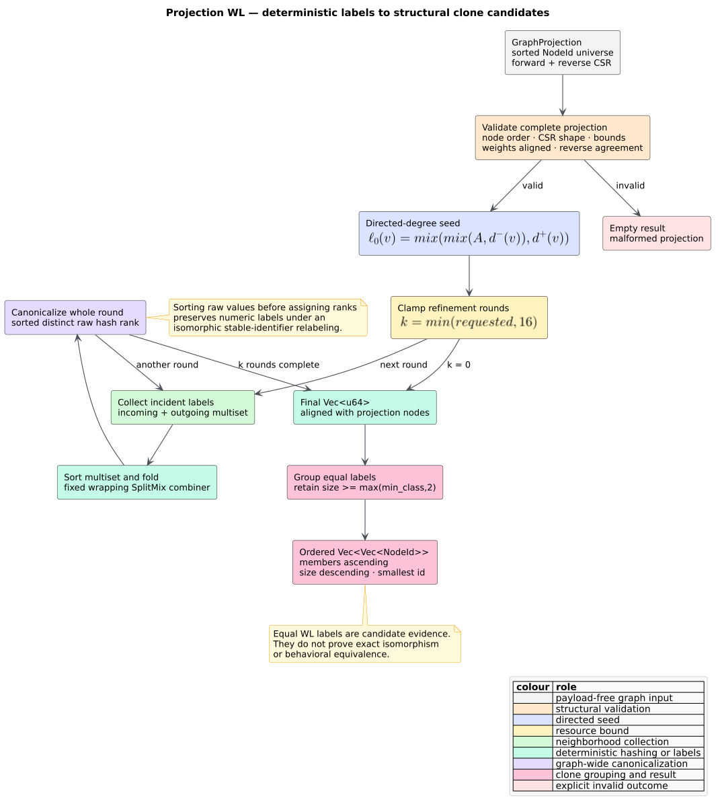

# Weisfeiler–Lehman labels and structural clone classes

`libcpg::wl_labels` assigns deterministic structural labels to the vertices of
any valid [`GraphProjection`](projections.md). `libcpg::structural_clone_classes`
groups vertices whose final labels are equal. Both entry points are
feature-free, read-only, language-independent, and bounded to at most 16
refinement rounds.

**Weisfeiler–Lehman (WL) refinement** repeatedly replaces each vertex label by
a digest of its current label and the multiset of labels around it. Vertices
that begin with the same directed degree but have different neighborhoods tend
to split into different label classes. Equal final labels are useful
structural-clone candidates; they are not a proof of graph isomorphism.



*Figure 1 — the complete projection-WL pipeline. Source:
[`diagrams/wl-clone-pipeline.puml`](../../diagrams/wl-clone-pipeline.puml).*

## Public API

The crate root and `libcpg::analysis` export both functions and the iteration
ceiling:

```rust
use libcpg::{
    structural_clone_classes, wl_labels, GraphProjection, NodeId,
    MAX_WL_ITERATIONS,
};

fn clone_candidates(graph: &GraphProjection) -> Vec<Vec<NodeId>> {
    let rounds = 4.min(MAX_WL_ITERATIONS);
    let labels = wl_labels(graph, rounds);
    assert_eq!(labels.len(), graph.node_count());
    structural_clone_classes(graph, rounds, 2)
}
```

The code is valid with `default = []`. `wl_labels` returns one `u64` label per
projection vertex, aligned with `graph.nodes`. `structural_clone_classes`
returns stable `NodeId` values, not projection-local dense identifiers.

| Input | Contract |
|---|---|
| `graph` | A well-formed directed projection. Edge weights do not participate. |
| `iterations` | Requested refinement rounds, clamped to `MAX_WL_ITERATIONS = 16`. Zero requests only directed-degree seeding. |
| `min_class` | Minimum returned class size. Values zero and one are interpreted as two because a clone class requires at least two members. |

Members of each clone class are sorted by `NodeId`. Classes are ordered by
descending cardinality, then by their smallest member. A threshold above the
vertex count returns no classes. Empty valid projections and malformed public
projection values return empty results.

## Label semantics

Let the directed graph be $`G=(V,E)`$. For a vertex $`v\in V`$, let
$`d^-(v)`$ and $`d^+(v)`$ denote its incoming and outgoing degree. The seed is

```math
\ell_0(v)=\operatorname{mix}(\operatorname{mix}(\mathtt{0xABCD},d^-(v)),d^+(v)).
```

Direction matters at this first step: a source and sink joined by one edge have
different seeds. During refinement, the **incident-neighbor multiset** combines
incoming and outgoing endpoints and preserves multiplicity between the two
directions:

```math
M_t(v)=\operatorname{bag}\!\left(\ell_t(u)\mid (v,u)\in E\right)
\uplus\operatorname{bag}\!\left(\ell_t(u)\mid (u,v)\in E\right).
```

A reciprocal relation contributes its neighbor label twice. A self-loop is
present in both CSR directions and likewise contributes twice. After sorting
$`M_t(v)`$, one round computes

```math
r_{t+1}(v)=\operatorname{fold}_{\operatorname{mix}}
\left(\operatorname{mix}(\mathtt{0x1234},\ell_t(v)),
\operatorname{sort}(M_t(v))\right).
```

The raw values $`r_{t+1}`$ are sorted and deduplicated. Each vertex receives
the zero-based rank of its raw value as $`\ell_{t+1}`$. Sorting is essential:
assigning ranks in vertex traversal order would make the public labels depend
on stable-identifier relabeling.

## Literate algorithm

The implementation keeps labels in dense-projection order and reuses one
temporary neighbor buffer. The following pseudocode makes every normalization
step explicit:

```text
WL_LABELS(graph, requested_rounds):
    if graph is not well formed:
        return []

    for each dense vertex v in canonical order:
        label[v] = mix(mix(0xABCD, indegree(v)), outdegree(v))

    for round in 0 .. min(requested_rounds, 16):
        for each dense vertex v:
            incident = labels of successors(v) followed by predecessors(v)
            sort incident                         // multiset order independence
            raw[v] = fold mix from mix(0x1234, label[v]) over incident

        vocabulary = sorted unique copy of raw   // traversal-independent ranks
        for each dense vertex v:
            label[v] = binary-search(vocabulary, raw[v])

    return label

STRUCTURAL_CLONE_CLASSES(graph, rounds, minimum):
    labels = WL_LABELS(graph, rounds)
    if labels are not aligned with graph.nodes:
        return []
    group stable NodeIds by equal label
    retain groups with size at least max(minimum, 2)
    sort members ascending
    sort groups by descending size, then smallest member
    return groups
```

The fixed wrapping `u64` combiner uses the ported FNV multiplier and SplitMix64
finalizers. Unlike Rust's `DefaultHasher`, its constants and operation sequence
are part of the implementation contract and are pinned by exact hexadecimal
test vectors. The labels are deterministic across Rust releases; callers
should still treat the numeric values as structural tokens rather than a
cryptographic digest or serialized semantic identifier.

## Worked examples

### Two directed triangles

```text
0 -> 1 -> 2 -> 0      3 -> 4 -> 5 -> 3
```

Every vertex has one predecessor and one successor, and every incident
neighborhood remains symmetric. At two rounds all six labels are equal and
the only threshold-two clone class is `[0, 1, 2, 3, 4, 5]`.

### Outward star

```text
        1
        ^
        |
2  <-- 0 --> 3
```

Vertex 0 has directed degree `(0, 3)`; each leaf has `(1, 0)`. The center is
separate at round zero. The leaves remain indistinguishable, so the clone
result is `[1, 2, 3]`.

### A limit of the method

One-dimensional WL cannot distinguish every pair of non-isomorphic graphs.
Moreover, a 64-bit digest can collide. A returned class therefore means
“indistinguishable under this seeded, bounded refinement,” not “interchangeable
program fragments.” Consumers that require proof must run an exact labeled
subgraph-isomorphism check over each candidate class.

## Complexity and resource policy

Let $`n=|V|`$, $`m=|E|`$, $`k=\min(\mathtt{iterations},16)`$, and
$`d(v)=d^-(v)+d^+(v)`$. Projection validation is linear apart from reverse-CSR
membership checks. Refinement takes

```math
O\!\left(k\left(n\log n+m+\sum_{v\in V}d(v)\log d(v)\right)\right)
```

time and $`O(n+d_{\max})`$ temporary space. Clone grouping adds
$`O(n\log n)`$ time and $`O(n)`$ space. The hard round ceiling bounds
adversarial requests such as `usize::MAX`; the algorithm performs no recursive
traversal and allocates no matrix.

`GraphProjection::is_well_formed` validates sorted unique nodes, both CSR
shapes, target bounds and ordering, optional weight alignment, and exact
forward/reverse agreement. WL returns an empty result before indexed traversal
when this boundary fails. `GraphProjection::from_edges` excludes endpoints
outside the declared vertex universe, so they cannot influence labels.

## Distinction from graph-similarity WL

[`GraphSimilarity`](../../theory/06-graph-similarity.md) has a separate
whole-CPG similarity metric. It seeds labels from `CpgNodeKind`, performs three
rounds, accumulates label histograms across rounds, and compares two graphs by
cosine similarity. The projection API documented here seeds directed degree,
returns final per-vertex labels, and forms clone candidates within one
projection. The two surfaces answer different questions and their numeric
labels are not interchangeable.

## Validation and interpretation boundary

The implementation is guarded by triangle and star fixtures, exact mixer
vectors, zero/capped iteration examples, malformed projection and external-edge
cases, clone-ordering examples, a 256-case isomorphic-relabeling property, a
feature-free crate-root integration test, the repository malformed-CPG
campaign, and oracle-guarded ring/star benchmarks at 1,024 and 8,192 vertices.
The property also reverses edge enumeration and duplicates edges before
projection construction.

See [Scientific validation 11](../../scientific/11-wl-validation.md) for the
falsifiable claims and reproduction commands. Results describe only the
provided topology. They do not prove parser completeness, edge semantics,
behavioral equivalence, clone intent, or exact graph isomorphism.

## References

1. Weisfeiler, B. Yu., and Leman, A. A. (1968). *The Reduction of a Graph to
   Canonical Form and the Algebra Which Appears Therein.* Nauchno-Technicheskaya
   Informatsia, Series 2, 9, 12–16. English translation in NISTIR 7315 (2006).
2. Shervashidze, N., Schweitzer, P., van Leeuwen, E. J., Mehlhorn, K., and
   Borgwardt, K. M. (2011). *Weisfeiler-Lehman Graph Kernels.* Journal of
   Machine Learning Research 12(77), 2539–2561.
   [JMLR article and PDF](https://jmlr.org/papers/v12/shervashidze11a.html).
