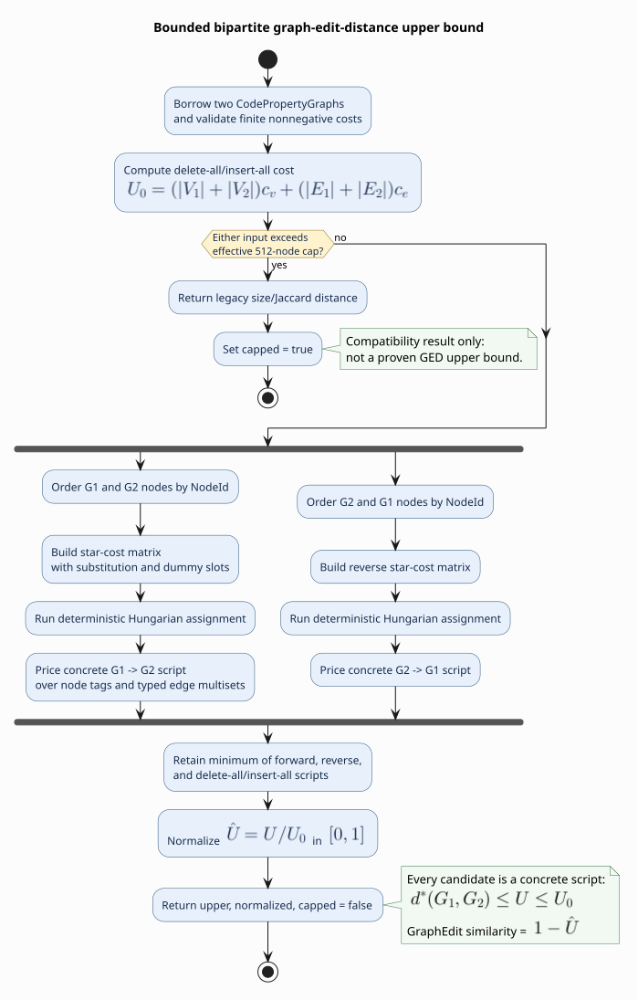

# Bipartite graph-edit-distance analysis

This guide covers the always-on `libcpg::pattern::ged_upper_bound` API. It
computes a deterministic, symmetric upper bound on
[graph-edit distance](../../GLOSSARY.md#graph-edit-distance) (GED) by selecting
a node correspondence with bipartite assignment and then pricing the concrete
typed edit script induced by that correspondence.

Use this API when the *cost of change* is more useful than a yes/no
[VF2](../../GLOSSARY.md#vf2) embedding. It is feature-free and read-only: both
inputs are borrowed, and the result contains no references to graph storage.



*Figure — node assignment proposes a correspondence; concrete typed edits,
not the assignment objective, determine the upper bound. Source:
[`diagrams/ged-pipeline.puml`](../../diagrams/ged-pipeline.puml).*

## API

```rust
use libcpg::pattern::{ged_upper_bound, GedBound, GedOptions, MAX_GED_NODES};

pub fn ged_upper_bound(
    first: &CodePropertyGraph,
    second: &CodePropertyGraph,
    options: &GedOptions,
) -> Result<GedBound, AnalysisError>;
```

`GedOptions` defines real edit costs and the caller budget:

| Field | Default | Meaning |
|---|---:|---|
| `node_sub` | `1.0` | Substitute unequal `NodeKindTag` values |
| `node_ins_del` | `1.0` | Insert or delete one node |
| `edge_ins_del` | `0.5` | Insert or delete one typed directed edge |
| `max_nodes` | `512` | Per-input node limit, clamped to `MAX_GED_NODES` |

All three costs must be finite and nonnegative. Invalid costs or non-finite
derived matrix arithmetic return `AnalysisError::InvalidInput`; the function
never converts invalid numbers into a plausible score.

`GedBound` has three public fields:

| Field | Contract |
|---|---|
| `upper` | Cost of the selected concrete script when uncapped |
| `normalized` | `upper` divided by delete-all/insert-all cost, in $`[0,1]`$ |
| `capped` | `true` only when the node budget selected the compatibility fallback |

With the `serde` feature, `GedOptions` and `GedBound` derive `Serialize` and
`Deserialize`.

## Example

```rust
use libcpg::pattern::{ged_upper_bound, GedOptions, GraphSimilarity, SimilarityMetric};
use libcpg::{CodePropertyGraph, CpgEdgeKind, CpgNode, CpgNodeKind, Language, NodeId, SourceRange};

let mut before = CodePropertyGraph::new(Language::Rust);
let a = before.add_node(CpgNode::new(NodeId::new(0), CpgNodeKind::Root, SourceRange::default()));
let b = before.add_node(CpgNode::new(NodeId::new(0), CpgNodeKind::While, SourceRange::default()));
before.connect(a, b, CpgEdgeKind::AstChild);

let mut after = CodePropertyGraph::new(Language::Rust);
let x = after.add_node(CpgNode::new(NodeId::new(0), CpgNodeKind::Root, SourceRange::default()));
let y = after.add_node(CpgNode::new(NodeId::new(0), CpgNodeKind::If, SourceRange::default()));
after.connect(x, y, CpgEdgeKind::AstChild);

let bound = ged_upper_bound(&before, &after, &GedOptions::default())?;
assert_eq!(bound.upper, 1.0);       // While → If
assert_eq!(bound.normalized, 0.2);  // normalization = 4 node + 1 edge = 5
assert!(!bound.capped);

let similarity = GraphSimilarity::new()
    .with_metric(SimilarityMetric::GraphEdit)
    .similarity(&before, &after);
assert_eq!(similarity, 1.0 - bound.normalized);
# Ok::<(), libcpg::AnalysisError>(())
```

## Semantics

### Labels, edges, and multiplicity

- Node equality means equality of the public 29-way `NodeKindTag`, not equality
  of every payload field such as identifier spelling or source range.
- An edge is identified by mapped source, mapped target, and complete
  `CpgEdgeKind`. Changing a kind therefore costs one deletion plus one
  insertion.
- Directed orientation matters.
- Parallel edges are a multiset and count independently.
- Self-loops participate normally.
- Stable `NodeId` ordering and ascending Hungarian tie-breaking make repeated
  results deterministic despite graph insertion order.

### Why the value is an upper bound

The Hungarian objective uses local node-star information to choose a partial
one-to-one correspondence. The implementation then constructs an actual edit
script under that correspondence and evaluates every unmatched node,
substituted tag, and typed edge multiset difference. Any concrete script costs
at least exact GED. The minimum of forward assignment, reverse assignment, and
delete-all/insert-all remains a concrete script and makes the result symmetric
and bounded.

See the [theory chapter](../../theory/06-graph-similarity.md#4-bounded-bipartite-graph-edit-distance)
for the cost matrix, normalization equations, and literate pseudocode.

## Budget behavior

The Hungarian matrix has side $`|V_1|+|V_2|`$, so the admitted path is cubic
in time and quadratic in memory. The effective per-input limit is
`min(options.max_nodes, MAX_GED_NODES)`, with `MAX_GED_NODES = 512`.

If either graph exceeds that limit, the call succeeds with `capped = true` and
the former size/Jaccard compatibility distance. That value remains normalized
and deterministic, but is **not** a proven GED upper bound. Security-sensitive
or scientific callers should reject capped results explicitly:

```rust
let result = ged_upper_bound(&first, &second, &options)?;
if result.capped {
    return Err(std::io::Error::other("GED budget exceeded").into());
}
# Ok::<(), Box<dyn std::error::Error>>(())
```

`GraphSimilarity` uses default GED costs within the budget. Its legacy
`with_structural_weight` and `with_label_weight` settings affect only the
capped compatibility path.

## Complexity and selection

Let $`N=|V_1|+|V_2|`$. The admitted implementation uses
$`O(N^3+|E_1|+|E_2|)`$ time and
$`O(N^2+|E_1|+|E_2|)`$ auxiliary space. The fallback is linear.

Choose:

- `ged_upper_bound` for configurable, inspectable edit evidence;
- `SimilarityMetric::GraphEdit` for the default normalized score;
- `SimilarityMetric::WeisfeilerLehman` for cheaper neighborhood similarity;
- `Vf2Matcher` when an exact subgraph embedding, not a graded whole-graph
  distance, is the question.

## References

1. Riesen, K., Bunke, H. (2009). *Approximate Graph Edit Distance Computation by Means of Bipartite Graph Matching.* Image and Vision Computing 27(7), 950–959. DOI: [10.1016/j.imavis.2008.04.004](https://doi.org/10.1016/j.imavis.2008.04.004)
2. Kuhn, H. W. (1955). *The Hungarian Method for the Assignment Problem.* Naval Research Logistics Quarterly 2(1–2), 83–97. DOI: [10.1002/nav.3800020109](https://doi.org/10.1002/nav.3800020109)
