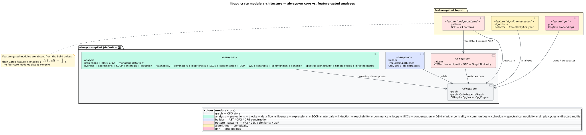

# Design Decisions (ADR index)

This directory holds `libcpg`'s **Architecture Decision Records** (ADRs): short,
durable notes that capture *why* a load-bearing design choice was made, not just
*what* the code does. The API reference in [`../api/`](../api/graph-reference.md)
tells you the shapes; the [component guides](../components/) tell you how to use
them; the [theory pillar](../theory/00-overview.md) explains the science. An ADR
answers the remaining question — **"why this and not the obvious alternative?"** —
so that a future reader (or a rewrite from scratch) inherits the reasoning and
does not silently undo a decision that was made for a good reason.

## What an ADR is

An ADR records **one** decision. Following Michael Nygard's original format, each
record here has a fixed skeleton so it can be skimmed:

| Section | Question it answers |
| :--- | :--- |
| **Status** | Is this decision proposed, accepted, superseded? |
| **Context** | What forces (requirements, constraints, prior art) made a decision necessary? |
| **Decision** | What did we choose, stated plainly? |
| **Consequences** | What do we gain and what do we pay — the honest pro/con ledger? |
| **Alternatives considered** | What else was on the table, and why was it rejected? |

The value is in the last two sections: a decision without its rejected
alternatives is folklore, and a decision without its costs is marketing.

## How to read one

1. Start with **Status** and the one-sentence **Decision** to know what you are
   looking at.
2. Read **Context** only if you need to understand the pressure behind it.
3. Consult **Consequences** before you build on the decision — the *Negative*
   column is where the sharp edges live (traversal must filter by edge kind,
   the data-flow sweep over-approximates in branches, relaxed matching trades
   precision for recall, and so on).
4. Follow the cross-links. Each ADR points back into
   [`../theory/`](../theory/00-overview.md) for the formal grounding and into
   [`../architecture/`](../architecture/overview.md) for where the decision
   lives in the module map, and links every term to the
   [glossary](../GLOSSARY.md).

## Index

| ADR | Decision | Status |
| :--- | :--- | :--- |
| [0001 — Unified overlay graph on petgraph](0001-unified-overlay-graph.md) | One shared node set; AST / CFG / DFG / PDG are typed *edge overlays* over it, stored in a `petgraph` `DiGraph`. | Accepted |
| [0002 — Mode B: `build_from_tree`](0002-mode-b-build-from-tree.md) | Accept a caller-parsed tree-sitter tree; keep the `rholang` / `metta` features empty `cfg` toggles; match grammar pins to pgmcp to avoid duplicate C symbols. | Accepted |
| [0003 — AST-ordered reaching definitions](0003-ast-ordered-reaching-defs.md) | Build the DFG from a single AST-ordered, flow-sensitive reaching-definitions sweep rather than SSA or a CFG fixed point. | Accepted |
| [0004 — Relaxed VF2 detection](0004-relaxed-vf2-detection.md) | Detect Gang-of-Four patterns with a *relaxed* (category-level) VF2 matcher plus a completeness-scaled confidence, not strict isomorphism or pure ML. | Accepted |
| [0005 — Feature-flag taxonomy](0005-feature-flag-taxonomy.md) | `default = []`: every grammar and optional analysis family is opt-in via Cargo features, grouped into `lang-*` sets and an umbrella `full`; core graph analyses remain feature-free. | Accepted |
| [0006 — Evidence-bounded call resolution](0006-evidence-bounded-call-resolution.md) | Record every call-resolution outcome out of graph, but materialize call topology only when an approved evidence tier identifies one unique target. | Accepted |
| [0007 — Dominator-based natural-loop forest](0007-dominator-natural-loop-forest.md) | Qualify natural back edges with dominance, expose irreducible SCC regions explicitly, nest by strict body containment, and retype loop-leaving continuations as `LoopExit`. | Accepted |
| [0008 — Id-preserving basic-block CFG view](0008-id-preserving-basic-block-cfg.md) | Partition the reachable function CFG without rewriting CPG nodes; assign blocks by sorted leaders and preserve every typed non-internal edge. | Accepted |
| [0009 — Deterministic monotone data-flow solver](0009-deterministic-monotone-dataflow.md) | Share a bounded forward/backward Kildall worklist over `BlockCfg`, with canonical facts and loop-header widening. | Accepted |
| [0010 — Dual-worklist sparse conditional constant propagation](0010-dual-worklist-sccp.md) | Couple executable CFG edges with sparse AST/DFG value cells; keep proof results out of graph and composable with reachability. | Accepted |
| [0011 — Loop-header interval widening](0011-loop-header-interval-widening.md) | Compute sound integer ranges with pointwise interval environments, header-only widening, bounded narrowing, and typed comparison-edge meets. | Accepted |
| [0012 — DFG-backed loop-induction evidence](0012-dfg-backed-loop-induction-evidence.md) | Compute reaching-definition-backed invariants, unique latch-dominating induction variables, conservative hoist candidates, and direction-compatible trip evidence outside the graph. | Accepted |
| [0013 — Evidence-bounded complexity estimates](0013-evidence-bounded-complexity-estimates.md) | Compose validated CFG loop depth and DFG-backed induction bounds into advisory complexity, with an exact legacy AST fallback. | Accepted |
| [0014 — Deterministic condensation-DAG analytics](0014-deterministic-condensation-analytics.md) | Compute canonical SCC-weighted critical paths and source levels, plus sink-first width-bounded Coffman–Graham layers, without rebuilding graph identity. | Accepted |
| [0015 — Bounded DSM visibility analysis](0015-bounded-dsm-visibility-analysis.md) | Compute transitive visibility and median roles over validated projections, reuse the shared SCC engine for cyclic core, and expose cap/malformed states explicitly. | Accepted |
| [0016 — Stable WL projection labels](0016-stable-wl-projection-labels.md) | Refine directed-degree labels with a fixed mixer, sorted round canonicalization, a hard iteration ceiling, and deterministic stable-id clone classes. | Accepted |
| [0017 — Deterministic bounded centrality](0017-deterministic-bounded-centrality.md) | Port centrality onto dense projections with aligned results, explicit numerical/traversal bounds, stable reductions, and a serial source-partition seam. | Accepted |
| [0018 — Deterministic multi-level community detection](0018-deterministic-multilevel-community-detection.md) | Port Louvain onto validated projections, add deterministic aggregation, canonical tie/label rules, bounded work, and a separate checked connected-component refinement. | Accepted |
| [0019 — Deterministic bounded cohesion analysis](0019-deterministic-bounded-cohesion-analysis.md) | Share one simple-undirected topology across deterministic core/truss/connectivity/assortativity/attack kernels, while bounding and validating weighted Stoer–Wagner separately. | Accepted |
| [0020 — Deterministic bounded spectral analysis](0020-deterministic-bounded-spectral-analysis.md) | Compute combinatorial-Laplacian algebraic connectivity and a stable Fiedler sign split with exact disconnected handling, bounded sparse iteration, and explicit residual evidence. | Accepted |
| [0021 — Deterministic bounded cycle enumeration](0021-deterministic-bounded-cycle-enumeration.md) | Reuse projection SCCs for canonical directed cycle witnesses with hard length/count ceilings and a concrete first-omission boundary. | Accepted |
| [0022 — Complete bounded directed-motif census](0022-deterministic-motif-census.md) | Classify all sixteen directed triads with dense bit rows and return typed errors instead of silently omitted graphlets. | Accepted |
| [0023 — Deterministic bounded bipartite GED](0023-deterministic-bipartite-ged.md) | Select a stable node correspondence with Hungarian assignment, price a concrete typed edit script, and expose the hard-cap fallback. | Accepted |
| [0024 — Explicit Martin module assignments](0024-explicit-martin-module-assignments.md) | Keep dependency topology and module boundaries explicit, count distinct external vertices, derive abstractness from CPG types, and retain stable-dependency witnesses. | Accepted |
| [0025 — Pure path reflexion model](0025-pure-path-reflexion-model.md) | Decouple ordered path-layer conformance from pgmcp configuration and make every convergence, divergence, realization, and absence deterministic. | Accepted |
| [0026 — Longest-path architectural layering](0026-longest-path-architectural-layering.md) | Reverse validated condensation levels into bottom-first architecture and retain honest cyclic, skip-layer, and upward witnesses. | Accepted |
| [0027 — Validated advisory architectural smells](0027-validated-advisory-architectural-smells.md) | Validate projection, SCC, module, and Martin evidence as one snapshot before emitting canonical advisory smell findings. | Accepted |
| [0028 — Evidence-bounded member-to-field resolution](0028-evidence-bounded-member-field-resolution.md) | Emit complex-l-value writes and resolve only uniquely supported `self`/`this` accesses to same-scope field declarations. | Accepted |
| [0029 — Evidence-bounded code metrics](0029-evidence-bounded-code-metrics.md) | Derive CK/LCOM and function metrics from resolved CPG evidence, preserve method-field witnesses, condense inheritance cycles, and align numerical scoring with pgmcp. | Accepted |
| [0030 — Bounded function clone detection](0030-bounded-function-clone-detection.md) | Classify strongest Type-1–4 function relations with stable AST Merkle, multiset, WL, and bounded existing-VF2 evidence. | Accepted |
| [0031 — Deterministic program composition](0031-deterministic-program-composition.md) | Translate every per-file identity into one program CPG and emit import/export topology only for uniquely supported file aliases. | Accepted |
| [0032 — Deterministic bounded IFDS/IDE summaries](0032-deterministic-ifds-ide-summaries.md) | Validate current call topology, schedule callees before callers, and expose bounded recursive summary fixed points as ordered evidence. | Accepted |
| [0033 — Compositional effect summaries](0033-compositional-effect-summaries.md) | Specialize the shared summary solver with typed storage places, transitive purity, return dependencies, and a lawful flat constant lattice. | Accepted |
| [0034 — Data-driven advisory taint](0034-data-driven-advisory-taint.md) | Specialize the shared summary solver with caller-owned source/sink policy, typed value flow, canonical witnesses, maybe-null evidence, and explicit partial-result semantics. | Accepted |
| [0035 — Overlay SDG summary edges and two-pass slicing](0035-system-dependence-summary-slicing.md) | Materialize labeled caller-local parameter-to-return dependences and apply deterministic HRB phase masks with explicit node/depth caps. | Accepted |
| [0036 — Typed channel topology](0036-typed-channel-topology.md) | Preserve language-neutral message semantics at the frontend boundary and classify def-use-resolved channel matching/linearity as ordered out-of-graph evidence. | Accepted |
| [0037 — Typed deadlock witnesses](0037-typed-deadlock-witnesses.md) | Build communication wait-for and interprocedural lock-order projections from typed identity evidence, reuse shared SCCs, and retain statement-precise advisory witnesses. | Accepted |

These thirty-seven are not independent. ADR-0001 fixes the substrate that all analyses
write onto; ADR-0002 and ADR-0005 together explain how a language reaches that
substrate and what you must switch on to get there; ADR-0003 and ADR-0004 are
two analyses *over* the substrate (one always-on, one feature-gated) that each
chose an evidence-bounded algorithm over a textbook-maximal one; ADR-0006 defines when
parsed call syntax may become interprocedural graph topology; ADR-0007 combines
the shared CFG scope, dominance, and SCC substrate into natural-loop structure;
ADR-0008 projects that same scope into deterministic blocks without breaking
overlay identity; ADR-0009 supplies the generic fixed-point engine over those
blocks while keeping the AST-ordered DFG builder as a distinct materialization
pass.
ADR-0010 specializes the lattice and deterministic-worklist discipline of
ADR-0009 while using the sparse `DefUse` evidence produced by ADR-0003. Read
ADR-0011 instead instantiates ADR-0009 densely over `BlockCfg` environments and
uses the loop headers established by ADR-0007. Read 0001 first.
ADR-0012 composes ADR-0003's `DefUse` evidence with ADR-0007's loops and the
dominance substrate, while keeping its optimization and trip results advisory.
ADR-0013 consumes ADR-0012 and ADR-0007 from the feature-gated algorithm layer,
preserving the original AST heuristic as an exact compatibility boundary.
ADR-0014 consumes ADR-0001's out-of-graph result discipline and the canonical
SCC condensation substrate, then fixes deterministic tie, orientation, cap, and
malformed-input policy for downstream graph-theory analyses.
ADR-0015 consumes ADR-0001's projection/out-of-graph discipline and the shared
SCC engine, then fixes visibility direction, median thresholds, stable
provenance, malformed-CSR behavior, and the quadratic-work cap.
ADR-0016 consumes that projection discipline, centralizes complete CSR
validation for DSM and WL, and adds a separately bounded structural-clone view.
ADR-0017 consumes the same validated forward/reverse CSR, fixes direction and
weight semantics for the centrality family, and exposes ordered source
partitions rather than introducing a core-owned thread pool.
ADR-0018 consumes the canonical undirected projection view, fixes weighted
modularity and deterministic local-moving semantics, adds true multi-level
aggregation, and keeps connected refinement as an explicit separate guarantee.
ADR-0019 consumes the same validation and projection seam, fixes shared simple-
topology semantics, deterministic peeling/low-link/cut choices, and explicit
edge, node, and attack-step budgets for cohesion and robustness experiments.
ADR-0020 consumes the same simple-projection seam, selects the combinatorial
Laplacian, and fixes exact disconnected behavior, deterministic numerical
choices, a hard iteration cap, and explicit convergence/residual evidence.
ADR-0021 preserves directed topology and reuses the shared SCC substrate to
bound canonical concrete cycle evidence. ADR-0022 also preserves direction,
but fixes a complete tricode taxonomy, dense bounded adjacency, and explicit
all-or-error semantics for combinatorial motif work.
ADR-0023 keeps whole-graph similarity feature-free but replaces a count blend
with a deterministic concrete edit-script upper bound and an explicit capped
compatibility state.
ADR-0024 returns to the projection substrate: it composes caller-selected
dependency direction with a first-class module assignment so Martin metrics
and Stable Dependencies Principle findings remain reproducible and auditable.
ADR-0025 deliberately needs no projection: dependency producers pass path
edges into a pure first-prefix layer policy, keeping configuration conversion
at the application boundary and ordered conformance evidence in the library.
ADR-0026 returns to the SCC condensation substrate and consumes ADR-0014's
longest-path levels. It fixes architectural orientation, one-step descent, and
the evidence boundary created when SCC contraction removes internal edges.
ADR-0027 composes the projection/SCC substrate with ADR-0024's explicit Martin
module boundary. It rejects mismatched evidence bundles before classifying
cycles, two-sided hubs, less-stable dependency shares, and module-size outliers
as deterministic advisory findings.
ADR-0028 returns to the builder seam established by ADR-0003: it adds the
missing complex-l-value writes, indexes declarative fields once, and admits a
member-to-declaration edge only when receiver, owner, lexical scope, type, and
field-name evidence are unique.
ADR-0029 consumes those real field edges together with ADR-0006's resolved call
topology. It retains the method-access-field witnesses behind LCOM, fixes the
class/function metric vocabulary and degenerate cases, and keeps the scorer
feature-free by classifying common CPG node kinds rather than reparsing source.
ADR-0030 composes ADR-0016's fixed WL combiner and labels with ADR-0004's
corrected relaxed VF2 verifier over pure function PDGs, while keeping pair,
PDG-size, and invocation limits observable as typed errors.
ADR-0031 returns to ADR-0001's identity and overlay rules and ADR-0006's
evidence boundary. It translates complete per-file reference sets into one
program id space, retains ordered file scopes, and admits cross-file dependency
and call evidence only after a unique strongest file alias is represented.
ADR-0032 consumes that resolved call topology through the exact SCC substrate.
It validates the decomposition as current, orders callee components first, and
centralizes bounded monotone recursion for IFDS/IDE summary domains.
ADR-0033 instantiates that framework with typed CPG and DFG evidence. It maps
callee parameter effects through actual arguments, uses a worst-purity chain
and flat constant lattice, and widens visibly when a domain-local bound is
reached.
ADR-0034 builds on the same framework but keeps security policy outside the
graph. It classifies typed call paths with a caller-owned catalog, composes
source-to-return and parameter-to-sink jump functions, retains canonical
positive witnesses, and treats maybe-null dereferences as advisory evidence.
ADR-0035 composes those summaries with PDG/DFG overlays using labeled caller-
local edges and two-pass context discipline. ADR-0036 instead extends the
frontend-to-analysis seam: it preserves orthogonal typed concurrency metadata,
resolves stable channel identity from existing definition evidence, and keeps
matching/linearity findings immutable and advisory. ADR-0037 deepens that
evidence into process wait-for and lock-resource order projections, reuses the
shared SCC engine, and preserves exact sites/ranges for every cyclic witness.

*Figure — the module map these decisions inhabit: the `graph` core (ADR-0001) with the `analysis`, `builder`, `pattern`/`patterns`, `algorithms`, and `gnn` modules layered on top. Source: [`diagrams/module-architecture.puml`](../diagrams/module-architecture.puml).*

## Conventions

- **Numbering.** Records are numbered in the order they were accepted
  (`0001`…). Numbers are never reused; a reversed decision is marked
  *Superseded* and a new record supersedes it, so history stays legible.
- **Status lifecycle.** `Proposed → Accepted → (Superseded by NNNN | Deprecated)`.
  All thirty-six current records are **Accepted** and reflect the shipped `v0.1.1`
  code.
- **Grounding.** Every claim here is traceable to source: the
  [`Cargo.toml`](../engineering/01-build-and-features.md) feature block, the
  `#[cfg(any())]` retired code paths in `src/builder/dfg.rs`, and the inline
  `#[cfg(test)]` tests that pin each behaviour. Where a record cites external
  literature it lists it verbatim under **References**; where a decision is a
  pure engineering trade-off with no literature behind it, that is stated
  plainly.

## References

This index cites no external literature; each decision record below carries its
own **References** section listing only the works it cites. Terminology is
defined once in the [glossary](../GLOSSARY.md) and linked from every record.
