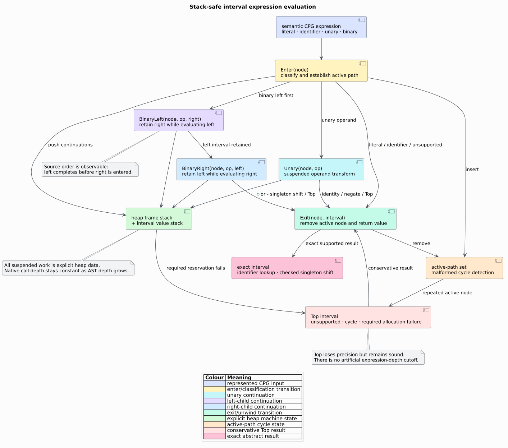

# ADR-0011: Loop-header widening for interval value ranges

## Status

Accepted.

- **Amended:** 2026-08-18

## Context

Integer intervals form an infinite-height lattice. A monotone loop such as
`x = x + 1` can produce the ascending chain $`[0,0]`$, $`[0,1]`$,
$`[0,2]`$, and so on, preventing plain fixed-point iteration from terminating.
libcpg needs a feature-free value-range analysis that composes with its
deterministic block solver and preserves the immutable unified-overlay design
of [ADR-0001](0001-unified-overlay-graph.md).

The natural-loop analysis already identifies loop headers, including
conservative representatives for irreducible cyclic regions. The generic
solver already provides widening hooks, per-block visit limits, typed edge
transfers, and bounded narrowing sweeps.

The initial implementation evaluated unary and binary ASTs with direct Rust
recursion. A malformed-cycle guard prevented infinite recursion but did not
make a deep acyclic expression stack-safe: represented AST depth still became
native call depth. The loop solver's 64-visit cap is unrelated to expression
depth and cannot solve that ownership of continuation state.

## Decision

Represent each integer value by a closed `Interval` over extended `Bound`
endpoints and each program state by a canonical sorted `IntervalEnv`. Instantiate
the shared solver as a forward-May analysis with pointwise convex-hull join.

Use `SolverConfig { max_visits_per_block: 64, widen_after: Some(3),
narrow_passes: 2 }`. Apply interval widening only when the solver confirms that
a block contains a `LoopForest` header. After the widened fixed point, perform
two deterministic descending sweeps; accept a recomputed state only when it is
below the widened state.

Interpret integer literals, identifier reads, unary signs, constant addition
and subtraction shifts, simple assignments, and `+=`/`-=`. Refine
`ConditionalTrue` and `ConditionalFalse` edges for identifier/literal `<`,
`<=`, `>`, and `>=` comparisons. Map every unsupported or language-dependent
right-hand side to top. Return only immutable, canonically ordered
`IntervalReport` evidence.

Defunctionalize expression evaluation into a typed heap continuation machine.
`Enter` establishes active-path state; `Unary`, `BinaryLeft`, and
`BinaryRight` retain suspended operator work and exact left-before-right order;
`Exit` removes the node from the active path and returns one interval through a
value stack. A repeated active node returns top, exactly as the prior cycle
guard did. Required machine-owned frame, value, and active-path growth is
fallible; inability to retain required state returns top rather than an
unsound precise interval. No public depth cap or thread-stack size participates
in expression semantics.

## Consequences

### Positive

- Widening converts unbounded loop chains to a finite fixed point; the visit cap
  remains a hard guarantee for malformed inputs.
- Header-only widening preserves more precision than widening every cyclic
  block.
- Two descending sweeps recover useful finite branch and loop bounds without
  reopening an unbounded iteration.
- Typed edge transfer isolates relational refinement from the generic solver
  and leaves a clean replacement point for an octagon domain.
- `default = []` consumers receive the complete analysis and public domain.
- Canonical block, variable, and environment orders make reports reproducible.
- Expression source depth is represented by heap frames while native call depth
  remains constant.
- Active cycles and required machine-state allocation failure conservatively
  return top without changing the public API.

### Negative

- Convex intervals forget correlations such as $`x+y=10`$ and disjoint sets
  such as $`x<0 \lor x>10`$.
- Widening can replace a finite endpoint with infinity; bounded narrowing does
  not promise the least fixed point.
- Unsupported integer semantics become top, so the analysis may be imprecise.
- The fixed visit and narrowing counts are policy choices that trade precision
  for predictable resource use.
- A deep expression retains one continuation frame per admitted AST level, so
  heap usage remains linear in logical depth.

## Alternatives considered

### Iterate without widening

Rejected because the interval lattice admits infinite ascending chains. A hard
cap alone would turn ordinary counting loops into errors rather than results.

### Widen at every block

Rejected because only cyclic headers require acceleration. Widening acyclic
joins would discard finite bounds without improving termination.

### Use wrapping `i64` arithmetic

Rejected because language frontends differ in integer width, signedness,
overflow mode, and build configuration. The shared CPG cannot justify one
wrapping semantics. Finite endpoints use `i128`, and unsupported/overflowing
transfers conservatively become unbounded.

### Adopt octagons immediately

Rejected for the initial value-range layer because a relational domain has
substantially higher implementation and resource cost. The non-relational
interval domain answers common bound questions and establishes solver, transfer,
validation, and API contracts. Miné's octagon domain remains the designated
relational upgrade.

### Mutate the CPG with inferred bounds

Rejected because inferred facts are analysis evidence, not source facts.
Out-of-graph reports preserve original graph identity and let callers decide
how to consume advisory bounds.

### Keep recursive expression evaluation behind the cycle guard

Rejected because an active-path guard proves termination on cycles but says
nothing about native-stack consumption on a deep acyclic AST.

### Increase the native thread stack or impose an expression-depth cutoff

Rejected because either choice moves or hides the failure boundary and makes
otherwise identical abstract interpretation depend on process configuration.
The finite continuation algebra is explicit and preserves all accepted depths.

## References

1. Cousot, P., Cousot, R. (1977). *Abstract Interpretation: A Unified Lattice
   Model for Static Analysis of Programs by Construction or Approximation of
   Fixpoints.* POPL '77. DOI:
   [10.1145/512950.512973](https://doi.org/10.1145/512950.512973)
2. Miné, A. (2006). *The Octagon Abstract Domain.* Higher-Order and Symbolic
   Computation 19, 31–100. DOI:
   [10.1007/s10990-006-8609-1](https://doi.org/10.1007/s10990-006-8609-1)
3. Reynolds, J. C. (1972). *Definitional Interpreters for Higher-Order
   Programming Languages.* DOI:
   [10.1145/800194.805852](https://doi.org/10.1145/800194.805852)
