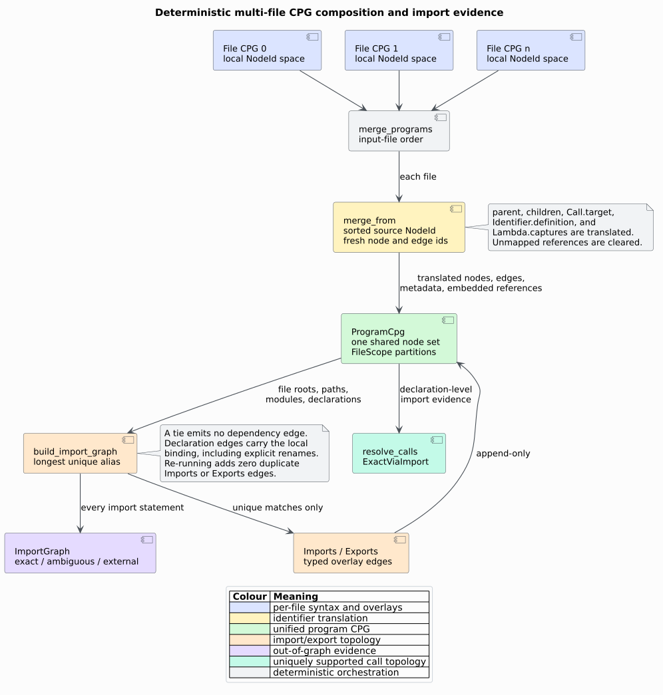

# ADR-0031 — Deterministic program composition with evidence-bounded imports

- **Status:** Accepted
- **Date:** 2026-08-13
- **Decision owners:** `libcpg` maintainers
- **Scope:** feature-free `CodePropertyGraph::merge_from` and `analysis::program`

## Context

Per-file CPGs independently allocate `NodeId(0)`, `EdgeId(0)`, and subsequent
identifiers. Combining their internal petgraph stores or copying stable ids
would collide. Cross-file analyses also need explicit file membership and
import evidence, but [ADR-0001](0001-unified-overlay-graph.md) forbids a second
authoritative graph with copied program nodes. [ADR-0006](0006-evidence-bounded-call-resolution.md)
further requires unique evidence before an import may become call topology.

## Decision

Append source graphs through a total source-node translation. Allocate fresh
destination ids in sorted source-`NodeId` order, translate every typed embedded
reference, append source edges in stable `EdgeId` order with fresh ids, and
translate CFG entry/exit metadata. Clear source-dangling embedded references
instead of preserving collision-prone numbers. Never remove destination nodes.

Represent program membership as ordered out-of-graph `FileScope` records over
the same merged CPG. Retain input file order and use it to assign contiguous id
ranges. Record a common graph language only when every input agrees.

Derive language-neutral file aliases from source paths and `Module` nodes.
Resolve an import only when one non-importing file owns the unique longest
matching alias. Emit file-root `Imports`, root-to-declaration `Exports`, and
import-to-declaration `Imports` edges for exact matches. Label each declaration
edge with its local binding, including explicit `as` renames. Preserve
ambiguous and external decisions only in `ImportGraph` evidence. Extend
call-resolution symbol tables to prefer unique declaration-level imported
functions before the global bare-name fallback.

*Figure — accepted program-composition pipeline. Source:
[`program-composition.puml`](../diagrams/program-composition.puml).*

## Consequences

- Node and edge collisions are impossible until the underlying `u32` id domain
  itself is exhausted, matching the existing graph allocator contract.
- Parent/child, call, definition, capture, edge-endpoint, and CFG metadata remain
  inside the merged node set.
- Input order is semantically observable in `FileScope` indices and fresh ids;
  callers control it explicitly.
- Multi-language programs are representable without lying about one graph-wide
  language.
- Module projection sees exact file-root dependencies, while call resolution
  sees exact imported declarations under their local binding names.
- A path-alias tie or absent represented target creates no dependency edge.
- Import lookup remains filesystem-free and cannot validate package-manager,
  build-system, conditional-compilation, or language visibility rules.
- Re-running import construction is idempotent; merge itself is intentionally
  append-only and duplicates the supplied graph on each call.

## Alternatives considered

### Preserve source identifiers

Rejected because every ordinary per-file graph starts at the same ids. An
offset heuristic also fails for sparse, reconstructed, or non-monotone source
ids and would not translate embedded references safely.

### Serialize and deserialize into one graph

Rejected because serialization is optional, adds format work, and does not
solve identity collision or file-membership semantics.

### Store one parallel import graph with copied file/declaration nodes

Rejected by the unified-overlay invariant. `ImportGraph` is an evidence summary;
authoritative dependency topology remains typed edges over the merged CPG nodes.

### Resolve every terminal path segment globally

Rejected because same-named files and declarations are common. Longest alias
matching preserves available directory/module evidence, and ties remain
explicitly ambiguous.

### Let the existing bare-name call resolver infer cross-file imports

Rejected because two files can define the same function name. Declaration-level
import edges preserve which represented file the import selected, enabling a
true `ExactViaImport` result without weakening the ambiguity boundary.

### Reparse each import with language-specific grammars

Rejected because the pass must remain feature-free and accept hand-built or
Mode-B graphs. The node mapper already stores import text; a token/alias evidence
layer works across language families without duplicating parsers.

## Validation

[Scientific validation 26](../scientific/26-program-composition-validation.md)
records example, generated, public-integration, serialization, malformed-input,
idempotency, and benchmark-oracle experiments. The component semantics and
usage contract are documented in
[multi-file program composition](../components/graph/program-composition.md).

## References

This record introduces an internal identity-translation and evidence policy; it
does not rely on an external algorithm or empirical claim. Its antecedents are
the repository decisions [ADR-0001](0001-unified-overlay-graph.md) and
[ADR-0006](0006-evidence-bounded-call-resolution.md).
