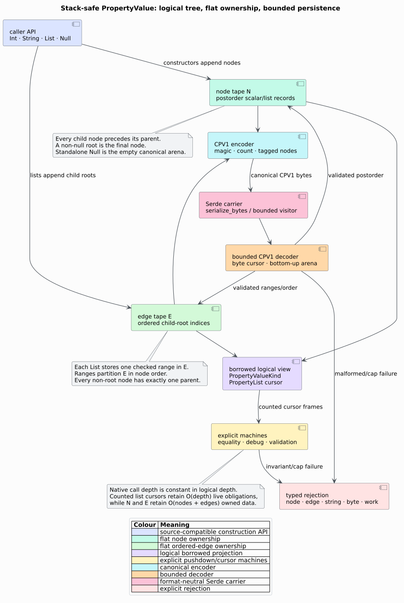

# ADR-0040: Own recursive property values as a flat canonical arena

- **Status:** Accepted
- **Date:** 2026-08-18
- **Scope:** `graph::PropertyValue`, its lifecycle, canonical codec, and Serde boundary

## Context

`PropertyValue` is the open metadata value attached to a CPG node. Its original
`List(Vec<PropertyValue>)` variant represented a logical tree directly as an
owned Rust tree. That shape made generated `Clone`, `PartialEq`, `Debug`,
`Serialize`, `Deserialize`, and implicit destruction consume one native call
frame per logical list level. Source or persisted metadata can therefore turn
logical depth into process-stack exhaustion before an analysis begins.

A deserializer nesting limit addresses only one entry path. It does not flatten
clone, equality, formatting, construction, or destruction, and rejecting every
deep value would conflate a semantic resource policy with the host stack size.
The root cause is recursive ownership, not a particular bincode limit.

## Decision

`PropertyValue` owns two contiguous tapes:

- the **node tape** $`N`$ stores scalar records and list records in postorder;
- the **edge tape** $`E`$ stores ordered child-root indices; each list record
  owns one checked half-open range in $`E`$.

For every child edge $`(p,c)`$, $`c < p`$. A non-null root is $`|N|-1`$,
the list ranges partition $`E`$ in node order, and every non-root node has
exactly one parent. A standalone null is the unique empty arena. These
invariants make cycles, sharing, forward references, missing nodes, duplicate
parents, and alternate physical encodings invalid.



### Logical API and physical identity

Construction spellings remain source-compatible:

```rust
use libcpg::PropertyValue;

let value = PropertyValue::List(vec![
    PropertyValue::String("role".into()),
    PropertyValue::Int(7),
    PropertyValue::Null,
]);
```

Because the physical type is no longer a recursive enum, observation uses
`PropertyValue::kind`, scalar accessors, or `PropertyValue::as_list`:

```rust
use libcpg::{PropertyValue, PropertyValueKind};

fn first_integer(value: &PropertyValue) -> Option<i64> {
    let PropertyValueKind::List(children) = value.kind() else {
        return None;
    };
    children.get(0)?.as_int()
}
```

Arena indices are never semantic identity. `PartialEq` interprets paired
logical views with explicit `Compare` and counted-list frames. It preserves the
old `f64` rules: equal signed zeroes compare equal and a NaN remains unequal to
itself. Exact floating-point bits remain distinct in canonical bytes.

### Construction and lifecycle machine

The constructor consumes child arenas bottom-up. It shifts node and edge
indices only when combining distinct arenas; a unary wrapper reuses both child
tapes and appends one edge and one node. This avoids one allocation per logical
level. Clone and destruction are ordinary flat `Vec` lifecycle operations.

Formatting and equality use counted list continuations instead of eagerly
pushing every sibling. In literate pseudocode, formatting is:

```text
format(root):
  obligations := [Value(root)]
  while obligations is not empty:
    pop one obligation
    Value(scalar): emit its bounded scalar form
    Value(list):   emit "List(["; push ListCursor(list, 0)
    ListCursor(list, i) where i = length(list): emit "])"
    ListCursor(list, i):
      emit separator when i > 0
      push ListCursor(list, i + 1)
      push Value(list[i])
```

The loop's native call depth is constant. Its live obligation storage is
$`O(d)`$ for logical depth $`d`$; owned storage is $`O(|N|+|E|)`$.

### Canonical `CPV1` codec

The format begins with `CPV` and version byte `1`, followed by a little-endian
`u64` node count. Nodes are emitted in arena order with this closed alphabet:

| Tag | Logical value | Payload |
|---:|---|---|
| 0 | nested null | none |
| 1 | string | `u64` byte length, then UTF-8 |
| 2 | signed integer | little-endian `i64` |
| 3 | unsigned integer | little-endian `u64` |
| 4 | boolean | one byte, exactly 0 or 1 |
| 5 | float | exact little-endian `u64` IEEE-754 bits |
| 6 | list | `u64` child count, then ordered `u64` child indices |

Encoding is a single bounded scan over $`N`$ and $`E`$. Decoding uses one byte
cursor, appends list children to $`E`$, appends each completed record to $`N`$,
rejects trailing bytes, and validates the complete canonical tree before
returning it. No recursive Serde visitor reconstructs the logical tree.

With feature `serde`, `PropertyValue` is embedded as these canonical bytes via
`serialize_bytes` and a bounded byte visitor. This changes the serialized shape
of property values. Formats surrounding the graph remain caller-selected;
only this recursive field has a versioned inner representation.

### Independent bounds and failure semantics

`PropertyValueLimits` separates five policies: nodes, edges, aggregate UTF-8
string bytes, encoded bytes, and work steps. `PropertyValueError::LimitExceeded`
names the failed dimension and reports observed and maximum values. Checked
arithmetic, bounds-before-payload reads, fallible arena reservations, strict
tags, UTF-8 validation, parent counts, source order, range partitioning, and
trailing-byte rejection keep malformed data on an error path.

The default admits one million nodes and edges, 64 MiB of strings, 256 MiB of
encoded bytes, and four million work steps. `UNBOUNDED` means the host address
space remains the only construction bound; it is intended for already-trusted
in-memory composition, not an untrusted persistence boundary.

## Compatibility and migration

| Previous use | Migration |
|---|---|
| `PropertyValue::Int(3)` and other constructors | unchanged |
| `PropertyValue::List(vec![...])` / `PropertyValue::Null` | unchanged |
| `match value { PropertyValue::List(xs) => ... }` | match `value.kind()` and use `PropertyList` |
| borrowed scalar pattern | use `as_str`, `as_int`, `as_uint`, `as_bool`, or `as_float` |
| persisted recursive Serde value | invalidate/rebuild it or migrate through the owning format's declared version boundary |

pgmcp owns such a boundary: cache envelope v2 and its builder signature include
`property-cpv1`, so a v1 cache row is a miss and is rebuilt from source. libcpg
does not silently interpret old unversioned recursive property bytes because a
generic Serde data model cannot suspend and resume an arbitrary nested visitor
without returning to the native call stack.

## Rejected alternatives

### Raise a bincode or JSON nesting limit

Rejected. It leaves clone, equality, debug, and destruction recursive and moves
the failure cliff rather than removing it.

### Use `stacker`, `serde_stacker`, or a larger worker stack

Rejected. These mechanisms change stack capacity, not the asymptotic mapping
from input depth to native frames.

### Keep a recursive compatibility representation beside the arena

Rejected. Any routine that materializes or releases it recreates the original
vulnerability and two representations invite semantic drift.

### Extract a generic external crate immediately

Deferred. The stable abstraction here is the small `PropertyValue` alphabet,
its public limits, and CPV1—not a generic serializer framework. pgmcp consumes
the same libcpg type rather than independently consuming a neutral machine.
The MeTTa/f1r3node codecs have schema-generated programs, heterogeneous value
stacks, and consensus-specific wire rules. Extraction becomes justified when a
second independent type needs the same node/edge-tape contract without importing
libcpg; extracting only a `while let Some(op)` shell would add indirection but
no shared semantics.

## Consequences

### Positive

- Every owned and public persistence path has constant native call depth.
- One canonical representation supplies lifecycle, validation, and bytes to
  libcpg and pgmcp.
- Exact typed bounds distinguish semantic policy from process-stack capacity.
- Float payloads preserve all bit patterns even through JSON-backed caches.

### Negative

- Logical enum pattern matching is a source migration.
- The Serde shape of `PropertyValue` is intentionally incompatible with the
  former unversioned recursive shape.
- Combining several large child arenas must shift their physical indices once.
- Validation needs a temporary flat parent-count vector of $`O(|N|)`$.

## Verification

Bounded recursive test oracles compare debug and logical round trips over 256
generated trees. A second 256-case property proves exact-limit acceptance and
one-unit-smaller rejection for every nonzero dimension. Examples cover every
scalar/list form, stable golden bytes, all float-bit behavior, invalid prefix,
tag, boolean, UTF-8, forward reference, root-null encoding, truncation, and
trailing data. Public tests construct, clone, compare, format, encode, decode,
validate, serialize, deserialize, and drop 100,000 logical levels on a 256 KiB
native stack. pgmcp repeats the same depth through its real cache envelope.

## References

1. Reynolds, J. C. (1972). *Definitional Interpreters for Higher-Order
   Programming Languages.* DOI:
   [10.1145/800194.805852](https://doi.org/10.1145/800194.805852).
2. Knuth, D. E. (1984). *Literate Programming.* DOI:
   [10.1093/comjnl/27.2.97](https://doi.org/10.1093/comjnl/27.2.97).
3. f1r3node-rust-mettail, stable reference
   `dcc4600d4560a32671302841c79e2a1637091f83`,
   `models/src/rust/rholang/{bincode_encoder,bincode_decoder,bincode_schema}.rs`.
4. mettail-rust, stable reference
   `1d2d8ce8c902399cbeb567294f0b9acc93d4c07c`, representative lifecycle
   machines under `ast/src/language/lifecycle.rs` and `prattail/src/*/lifecycle.rs`.
