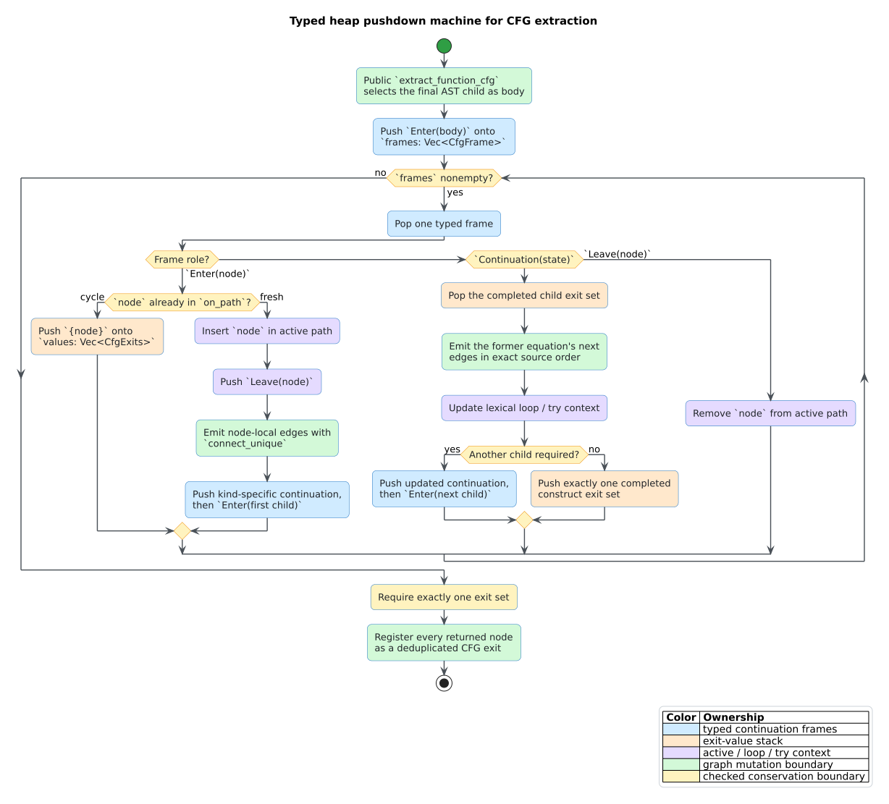

# ADR-0042: Defunctionalize CFG extraction into one typed pushdown machine

- **Status:** Accepted
- **Date:** 2026-08-18
- **Scope:** feature-free `builder::cfg`, malformed-AST hardening, and parser-backed construction

## Context

Control-flow graph (CFG) extraction was expressed as one mutually recursive
component: `process_node` dispatched to block, branch, loop, match, terminator,
exception, call, and sequential handlers, and those handlers called
`process_node` for their children. The equations were clear, but a represented
abstract-syntax-tree (AST) depth of $`D`$ required $`O(D)`$ native Rust frames.
A path guard cut a malformed cycle after re-entry; it did not protect a valid
acyclic input with sufficient depth.

This was a process-availability defect. Rust stack overflow aborts rather than
returning `libcpg::Error`, and both public builder modes run CFG extraction by
default. A source-depth limit, larger thread stack, helper thread, `stacker`, or
unwinding boundary would move or hide the failure rather than remove the native
stack dependency.

The existing edge stream is observable. A replacement must preserve:

- AST/source child order and exact `connect_unique` call order;
- ordered exit sets and CFG entry/exit registration;
- terminator propagation through transparent wrappers and all-terminal branches;
- loop header, `break`, and `continue` ownership;
- try-body-only handler scope, catch order, and `finally` funneling;
- configuration behavior and extractor idempotency; and
- active-path cycle cuts while replaying a shared node on disjoint paths.

## Decision

Defunctionalize the complete recursive component as one first-order, typed
pushdown machine. Defunctionalization replaces each possible suspended call
with a data constructor that an explicit interpreter executes [1, 2]. Partial
conversion is not sufficient: leaving even one same-component handler call
would retain input-depth native recursion.

The machine state is

```math
S = (F, V, L, T, P),
```

where $`F`$ is `Vec<CfgFrame>`, $`V`$ is the stack of completed `CfgExits`,
$`L`$ is the lexical loop stack, $`T`$ is the lexical try stack, and $`P`$ is
the active AST path. All five are heap-backed.



The frame algebra has three roles:

1. `Enter(NodeId)` admits a node and dispatches its concrete kind.
2. Construct continuations such as `BlockAfterChild`, `IfAfterElse`,
   `WhileAfterBody`, `MatchNext`, `TryAfterCatch`, and
   `SequentialAfterChild` store every local variable needed after a child
   returns.
3. `Leave(NodeId)` ends active-path lifetime only after the construct's result
   has been assembled.

Frames are pushed in reverse execution order. Therefore a last-in-first-out
pop observes children in the same left-to-right order as the former equations.
The parallel value stack makes return values explicit: one completed `Enter`
produces exactly one exit set, and its immediately following continuation
consumes that set.

In literate pseudocode:

```text
push Enter(body)
while frames is not empty:
  frame := pop frames
  if frame is Enter(node):
    if node is already in P:
      push {node} onto V
    else:
      insert node into P
      push Leave(node)
      emit node-local edges
      push the continuation that owns the remaining equation
      push Enter(the next required child)
  else if frame is a construct continuation:
    child_exits := pop V
    emit the former equation's next edges in the same order
    update L or T when entering/leaving lexical regions
    push another child or one completed exit set
  else if frame is Leave(node):
    remove node from P
require |V| = 1
```

## Conservation and lifecycle invariants

The implementation and its differential tests enforce these invariants:

1. **Value conservation.** When `process_node` finishes, $`|V|=1`$. Every
   child continuation consumes one value before scheduling or producing the
   next one.
2. **Path balance.** Every admitted `Enter(n)` has one later `Leave(n)`.
   Rejected active re-entry schedules no `Leave`, so it cannot prematurely
   remove its ancestor.
3. **Context balance.** A loop continuation pops exactly the loop it pushed.
   `TryAfterBody` pops the handler scope before visiting catches or `finally`,
   matching the former lexical behavior.
4. **Order preservation.** Children, arms, catches, arguments, exits, and
   handler edges retain source or prior equation order; hash iteration never
   selects public order.
5. **Mutation preservation.** Node and AST state are unchanged. All CFG edges
   still pass through `connect_unique`, and entry/exit registries still
   deduplicate.
6. **Malformed-path preservation.** An active back edge yields `{node}`;
   shared directed-acyclic-graph paths are evaluated independently.

## Resource behavior

For a parser-built AST with $`N`$ nodes, $`E_c`$ emitted CFG edges, depth
$`D`$, and maximum live exit frontier $`X`$, time is $`O(N+E_c)`$, heap state
is $`O(D+X)`$, and native call depth is $`O(1)`. A hand-built shared graph may
replay a subgraph once per incoming path, exactly as before. Active cycles
terminate without a semantic depth cutoff.

The machine deliberately has no source-depth cap. A resource cap is a product
policy and must report incompleteness; it cannot serve as stack protection.
Required vector growth uses Rust's ordinary allocation behavior, consistent
with the surrounding infallible builder API. This ADR does not invent a hidden
partial CFG state.

## Rejected alternatives

### Keep recursion and raise the stack size

Rejected because the accepted input depth would depend on runtime stack
configuration, and a larger finite stack only changes the crash threshold.

### Cut only malformed cycles

Rejected because an acyclic depth-$`D`$ chain never repeats a node and still
consumes $`O(D)`$ native frames.

### Convert only `process_node`

Rejected because the construct handlers and dispatcher formed one strongly
connected component. Same-component calls would remain recursive.

### Use a global visited set

Rejected because shared nodes on distinct AST paths historically contribute
flow on each path. Active-path membership is the semantic boundary.

### Emit edges in a post-pass

Rejected because it would change insertion order, edge identifiers, try/loop
context timing, and potentially downstream snapshots. Continuations preserve
the existing emission trace directly.

## Consequences

- Public CFG construction is stack-safe with respect to valid and malformed
  AST depth.
- The frame enum is longer than recursive source, but every suspension point
  and owned state transition is explicit and exhaustively checked by Rust.
- The former equations remain compiled only under `cfg(test)` as a bounded,
  shallow differential oracle. They are never reachable in production.
- [Scientific validation 37](../scientific/37-cfg-extraction-machine-validation.md)
  records handler-complete, generated, malformed, ordering, idempotency, and
  100,000-depth evidence.

## References

1. Reynolds, J. C. (1972). *Definitional Interpreters for Higher-Order Programming Languages.* Proceedings of the ACM Annual Conference. DOI: [10.1145/800194.805852](https://doi.org/10.1145/800194.805852)
2. Danvy, O., & Nielsen, L. R. (2001). *Defunctionalization at Work.* BRICS Report Series 8(23). DOI: [10.7146/brics.v8i23.21684](https://doi.org/10.7146/brics.v8i23.21684)
