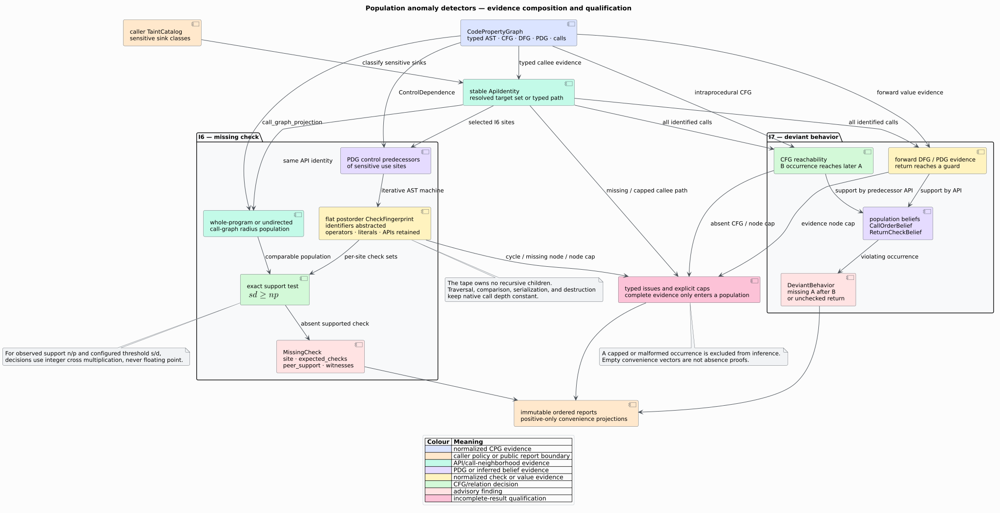

# ADR-0045: Infer advisory anomalies from exact peer populations

- **Status:** Accepted
- **Date:** 2026-08-19
- **Scope:** feature-free `analysis::bugs::{missing_check,deviant}`

## Context

A missing validation condition and an unusual call discipline are rarely
recognizable from one statement in isolation. Their evidence is comparative:
similar uses normally apply a condition, most calls normally check a return, or
one API normally appears later after another. Chucky showed that conditions
linked to a security-critical object can expose omitted checks; CRIX refined
the approach with semantic and contextual peer slices [[1]](#references),
[[2]](#references). Engler et al. showed that common program behavior can be
treated as an implicit programmer **belief** and deviations ranked for review
[[3]](#references).

The library already has the required typed relations: a caller-owned taint
catalog, Program Dependence Graph (PDG) control edges, a resolved call graph,
Control Flow Graph (CFG) reachability, and Data Flow Graph (DFG) value flow.
The detector must compose these relations without parsing source text, mutating
the graph, using native recursion, or letting floating-point rounding decide a
finding.



## Decision

1. Identify every call by an `ApiIdentity`. A represented static or dynamic
   target set is authoritative; otherwise a bounded typed callee path supplies
   a named external identity. Missing or capped identity evidence is an issue.
2. Let `MissingCheckConfig::catalog` identify security-sensitive calls through
   taint sink rules. An empty `sensitive_classes` set admits every matched sink
   class; a non-empty set selects named classes.
3. Collect checks only from represented `ControlDependence` predecessors of a
   sensitive call or its AST ancestors. A sensitive call that itself controls a
   branch is also a check.
4. Normalize each check into a flat postorder `CheckFingerprint`. Local
   identifier and declaration spellings are abstracted. Operators, literals,
   member names, nominal types, called APIs, imports, attributes, macros, and
   language-specific opaque node kinds remain semantic.
5. Define peer populations either over every same-API use or over caller
   functions within a configurable radius of the undirected call graph. Radius
   two naturally connects callers through their shared represented callee.
6. Count a check at most once per site. Include the candidate site in the
   population denominator. Report `MissingCheck { site, expected_checks,
   peer_support, ... }` when a supported fingerprint is absent at that site.
7. Represent observed support as `PopulationFraction { supporting,
   population }` and the policy as `PopulationThreshold { numerator,
   denominator }`. For observed $`n/p`$ and threshold $`s/d`$, accept exactly
   when:

   ```math
   n d \geq s p.
   ```

   The implementation performs this comparison in `u128`; `ratio()` is
   presentation-only.
8. Infer `CallOrderBelief(B, A)` when a configured fraction of occurrences of
   API `B` can reach a later `A` occurrence in the same represented CFG. A `B`
   occurrence that cannot reach `A` becomes `MissingFollowingCall` evidence.
9. Infer `ReturnCheckBelief(A)` when a configured fraction of `A` call results
   reach a represented guard over forward DFG or PDG data-dependence edges. An
   occurrence with no such path becomes `UncheckedReturn` evidence.
10. Admit only complete per-occurrence evidence into a population. Cyclic or
    missing guard AST nodes, fingerprint caps, absent CFG nodes, capped CFG/DFG
    traversals, and incomplete callee paths remain typed issues.
11. Keep every input-sized traversal iterative. The check tape owns child
    counts rather than recursive child values; call-neighborhood, CFG, DFG, and
    AST traversals use heap worklists and visited sets.
12. Return ordered, read-only reports. Convenience projections return positive
    findings only; a negative claim requires the report and `is_complete()`.
13. Serialize typed-key evidence maps as ordered key/value sequences. This
    preserves JSON compatibility, canonical order, and duplicate-key rejection
    across missing-check, taint, null-flow, and typestate reports.

## Literate algorithm

The prose names the evidence boundary first; the pseudocode then states the
same executable order:

```text
procedure INFER-MISSING-CHECKS(CPG, policy)
  sites := calls with complete API identity matching policy.taint sinks
  for each site in stable NodeId order
    guards := PDG controllers of site and its AST ancestors
    checks[site] := stack-safe normalized fingerprints of guards
  for each site
    peers := same-API sites admitted by policy.peer_scope
    for each fingerprint C occurring in peers
      support := sites in peers whose check set contains C
      if exact_threshold(support / |peers|) and C not in checks[site]
        emit MissingCheck(site, C, support, peers, guard witnesses)
```

```text
procedure INFER-DEVIANT-BEHAVIOR(CPG, policy)
  sites := calls with complete API identity
  for each site
    following[site] := APIs reachable later in its intraprocedural CFG
    checked[site] := first guard reachable through forward value evidence
  infer exact-threshold beliefs from complete same-API populations
  emit one finding for each occurrence that violates an inferred belief
```

## Rejected alternatives

### Parse conditions or call sequences from retained source text

Rejected. It would duplicate every language grammar, confuse comments or
strings with syntax, and discard the CPG's resolution and dependence evidence.

### Compare guard node identifiers

Rejected. Two equivalent checks at different source sites necessarily have
different `NodeId` values. The normalized postorder tape compares semantics and
shape while abstracting local spelling.

### Store a recursive fingerprint tree

Rejected. Source nesting would become native call-stack depth during
construction, comparison, formatting, serialization, or destruction. A flat
postorder tape makes all lifecycle operations stack-safe.

### Use a floating-point support threshold

Rejected. Rounding near a boundary can make the decision dependent on numeric
representation. Integer cross multiplication exactly decides every rational
threshold representable by `usize` counts.

### Treat all same-name calls as the same API

Rejected. When targets are represented, the sorted target set distinguishes
overloads and dynamic-dispatch alternatives. Names are a fallback only for
external or unresolved targets with typed path evidence.

### Infer from incomplete occurrences

Rejected. Dropping an unknown site from only the numerator or treating it as a
negative silently biases support. The occurrence is excluded and the report is
visibly incomplete.

## Consequences

### Positive

- The 4-of-5 and 9-of-10 acceptance oracles are represented exactly as `4/5`
  and `9/10`, including the deviating site in each denominator.
- Findings retain peer sites, supporting sites, normalized expected checks, and
  concrete guard witnesses for audit.
- The same feature-free API works on hand-built, parser-built, and Mode-B CPGs.
- Stable ordered collections and exact arithmetic make repeated results and
  serialized evidence deterministic.
- A 100,000-node guard and a 100,000-node CFG path execute on a 256 KiB native
  stack.

### Negative

- A common behavior can encode a common bug. Population support is evidence for
  review, not proof of correctness.
- PDG, DFG, CFG, call-resolution, and catalog precision bound the detector's
  precision. Missing evidence cannot be reconstructed by the analysis.
- Whole-program peers may combine unrelated contexts; a call-graph radius can
  narrow context but cannot establish semantic equivalence.
- Identifier abstraction intentionally trades local spelling for cross-site
  comparability; operators, constants, members, and called APIs keep distinct
  checks separate.

## Verification

Example tests pin the exact 4/5 missing-check and 9/10 checked-return outcomes,
call-order violations, call-graph-radius semantics, class filtering, reverse
DFG exclusion, invalid options, every cap/issue boundary, JSON round trips, and
graph immutability. Generated tests vary population sizes and anomaly counts,
re-run each report, and compare exact fractions. Parser integration builds a
Rust CPG, materializes the PDG, and identifies only the fifth unguarded caller.
Two small-stack tests traverse 100,000-node evidence on 256 KiB stacks.

## References

1. Yamaguchi, F., Wressnegger, C., Gascon, H., Rieck, K. (2013). *Chucky:
   Exposing Missing Checks in Source Code for Vulnerability Discovery.* ACM
   CCS, 499–510. DOI:
   [10.1145/2508859.2516665](https://doi.org/10.1145/2508859.2516665).
2. Lu, K., Pakki, A., Wu, Q. (2019). *Detecting Missing-Check Bugs via
   Semantic- and Context-Aware Criticalness and Constraints Inferences.* 28th
   USENIX Security Symposium, 1769–1786.
   [USENIX proceedings page](https://www.usenix.org/conference/usenixsecurity19/presentation/lu).
3. Engler, D., Chen, D. Y., Hallem, S., Chou, A., Chelf, B. (2001). *Bugs as
   Deviant Behavior: A General Approach to Inferring Errors in Systems Code.*
   SOSP, 57–72. DOI:
   [10.1145/502034.502041](https://doi.org/10.1145/502034.502041).
