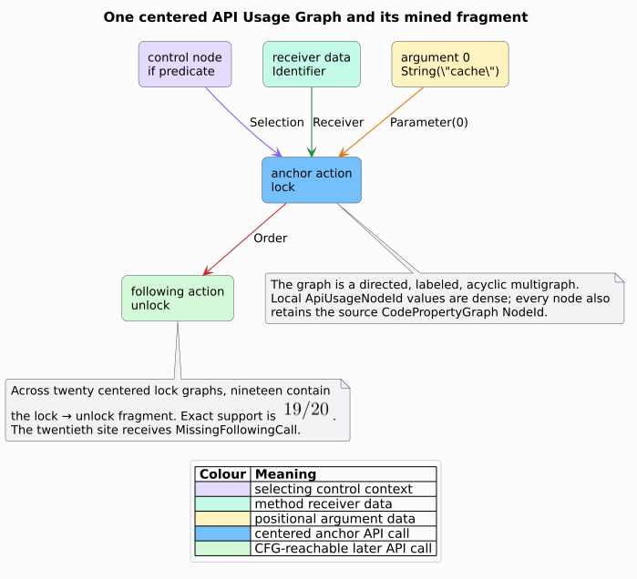

# ADR-0047: Mine bounded API-usage and temporal evidence

- **Status:** Accepted
- **Date:** 2026-08-19
- **Scope:** feature-free `analysis::bugs::api_mining`

## Context

An Application Programming Interface (API) is a named contract through which
software invokes a reusable operation. An API misuse is a call whose represented
context deviates from a sufficiently common peer pattern or violates an explicit
caller-supplied temporal property. API Usage Graphs (AUGs) give action, data, and
control evidence a common graph representation. ASAP-Repair demonstrates the
utility of directed, labeled, acyclic API-usage multigraphs as repair evidence
[[1]](#references). ProveNFix demonstrates why temporal properties are useful
for detecting resource, memory, and unchecked-result faults [[2]](#references).

libcpg already has all required evidence providers:

- typed Abstract Syntax Tree (AST) nodes identify calls, arguments, receivers,
  and control constructs;
- Control Flow Graph (CFG) edges establish represented intra-procedural order;
- Data Flow Graph (DFG) and reference edges carry object identity;
- Program Dependence Graph (PDG) control edges identify selecting contexts;
- evidence-bounded call resolution supplies `ApiIdentity`;
- the T6.1 finite-state typestate worklist checks allocation/event protocols.

The missing decision is how to combine those providers without parsing source
again, treating a convention as a specification, hiding incomplete evidence, or
introducing input-depth native recursion.

## Decision

### 1. Center every usage graph on one admitted call site

For each call site `c`, resolve exactly one containing function and one stable
`ApiIdentity`. Build a per-function CFG projection and require `c` to be a
member. The centered AUG is a directed labeled acyclic multigraph:

```math
G_c = (V_c, E_c, \lambda_V, \lambda_E)
```

Here, $`V_c`$ is the finite local node set, $`E_c`$ is the directed multiedge
set, $`\lambda_V`$ assigns a typed action/data/control role, and
$`\lambda_E`$ assigns `Receiver`, `Parameter(i)`, `Selection`, or
`Order`. Data and control nodes point into the anchor; the anchor points to
CFG-reachable later calls. Every local node retains its source `NodeId`.



This centered star projection is intentionally smaller than a complete
method-level usage graph. It preserves exactly the relations the public pattern
kinds can claim, gives each call site a comparable unit, and is acyclic by
construction. `ApiUsageGraph::is_acyclic` independently checks the invariant
with iterative Kahn elimination.

### 2. Admit only complete observations

A site enters a population only when its owner, identity, CFG membership,
reachability, and graph construction are complete within configured bounds.
Every exclusion becomes a typed `ApiUsageMiningIssue`. If the global call-site
inventory exceeds its cap, mining fails closed before admitting any site.

This is a semantic boundary: excluding an incomplete occurrence from both the
support numerator and denominator prevents partial evidence from silently
diluting or inflating a pattern.

### 3. Mine exact strict-majority one-edge fragments

Partition complete observations by anchor `ApiIdentity`. For each population,
count five fragment families:

1. a distinct API reachable after the anchor;
2. argument count;
3. language-neutral shape at each argument position;
4. method-receiver shape;
5. direct control context.

Let $`n`$ be supporting sites, $`p`$ the complete population, and let the
configured threshold be $`s/d`$. A fragment is frequent exactly when:

```math
\frac{n}{p} \geq \frac{s}{d}
\quad\Longleftrightarrow\quad
nd \geq sp
```

The threshold itself must be a strict majority:

```math
2s > d
```

All counts use checked, exact rational semantics already provided by
`PopulationFraction` and `PopulationThreshold`; no floating-point decision is
made. A strict majority is required because argument count, argument position,
and receiver are single-valued at each site. Two contradictory values therefore
cannot both become expected patterns.

### 4. Report deviations, never rewrite the graph

For every frequent fragment, emit `ApiUsageMisuse` for each complete occurrence
that lacks or differs from it. Findings retain the deviating site, containing
function, anchor API, exact peer support, supporting peer sites, and observed
witness nodes. Reports and convenience projections never mutate the input CPG
and never propose or apply a repair.

### 5. Reuse typestate for named temporal properties

A `NamedTemporalProperty` pairs a unique non-empty name with the existing
`PropertyFsm`. Each finite-state machine (FSM) defines allocation events,
ordinary events, transitions, an error state, and accepting states.
`analyze_api_usage_mining` delegates each property to the T6.1 typestate and
resource-leak analyses:

- a missing transition becomes `ForbiddenTransition`;
- a represented path ending in a non-accepting state becomes
  `NonAcceptingExit`.

The complete delegated `ResourceLeakAnalysis` is retained beside the projected
temporal findings. Consequently, `is_complete()` is true only when mining has
no issues and every temporal analysis is complete.


### 6. Keep every input-shaped traversal stack-safe

CFG reachability uses `VecDeque`; ordering and populations use heap
`BTreeMap`/`BTreeSet` structures; AUG validation uses iterative Kahn
elimination; temporal checking reuses the heap worklist of ADR-0043. No native
call chain grows with AST depth, CFG depth, call count, or AUG depth.

### 7. Make resource ceilings explicit and hard-bounded

`ApiUsageMiningConfig` exposes operational caps, while the module imposes
larger compile-time hard ceilings:

| Resource | Default | Hard ceiling | Failure surface |
|---|---:|---:|---|
| call sites | 100,000 | 200,000 | atomic `CallSiteCap` |
| CFG nodes reached per site | 100,000 | 2,000,000 | site `CfgEvidenceCap` |
| nodes per AUG | 10,000 | 100,000 | site `GraphNodeCap` |
| edges per AUG | 100,000 | 1,000,000 | site `GraphEdgeCap` |
| temporal properties | 128 | 1,024 | invalid input |
| typed callee depth | 256 | caller bounded | site `CalleeIdentityCapped` |

The delegated `IfdsCaps` separately bounds each temporal analysis.

## Consequences

### Positive

- The analyzer is feature-free and language-neutral after CPG construction.
- Every claim is tied to typed CPG evidence and exact peer counts.
- Missing evidence is visible and cannot support a negative verdict.
- Named temporal properties reuse one validated stack-safe semantic engine.
- Stable ordering makes repeated runs and edge-insertion permutations equal.
- A 100,000-node CFG completes on a 64-KiB native thread stack.

### Trade-offs

- Centered one-edge fragments do not express arbitrary multi-edge subgraph
  isomorphism. The narrower relation is deliberate and exactly matches the
  implemented finding vocabulary.
- CFG reachability is a may relation: a later call need not execute on every
  runtime path.
- A dominant population convention is evidence, not an API specification.
- Allocation-site abstraction can merge multiple runtime instances created by
  one call site.

### Rejected alternatives

- **Reparse source text in the detector.** This duplicates frontend semantics
  and makes results language-specific.
- **Infer from incomplete sites.** This biases support and makes absence claims
  unsound relative to the represented population.
- **Use floating-point support.** Boundary decisions would lose exactness.
- **Permit a half-or-greater threshold.** Contradictory single-valued patterns
  could both win at a tie.
- **Implement a second temporal solver.** It would duplicate T6.1 semantics,
  caps, witnesses, and stack-safety work.
- **Apply repairs automatically.** Neither frequency nor temporal evidence
  proves developer intent or repair safety.

## Verification

- Example tests cover the exact 19/20 call-order case, argument/receiver/control
  shapes, forbidden transitions, non-accepting exits, cap qualification, and
  serde round trips.
- Property tests compare mined deviations with an independent Boolean
  population oracle and permute CFG edge insertion order.
- Public integration tests exercise both hand-built CPGs and a real Rust
  Tree-sitter construction pipeline.
- A Criterion target checks correctness before timing 20- and 100-peer corpora.
- Strict Clippy, rustdoc, diagram rendering, documentation checks, the full
  verification matrix, and `pgmcp bug-gate` form the leaf gate.

## References

1. Nielebock, S., Blockhaus, P., Krüger, J., Ortmeier, F. (2024).
   *ASAP-Repair: API-Specific Automated Program Repair Based on API Usage
   Graphs.* DOI:
   [10.1145/3643788.3648011](https://doi.org/10.1145/3643788.3648011).
2. Song, Y., Gao, X., Li, W., Chin, W.-N., Roychoudhury, A. (2024).
   *ProveNFix: Temporal Property-Guided Program Repair.* DOI:
   [10.1145/3643737](https://doi.org/10.1145/3643737).
3. Strom, R. E., Yemini, S. (1986). *Typestate: A Programming Language
   Concept for Enhancing Software Reliability.* DOI:
   [10.1109/TSE.1986.6312929](https://doi.org/10.1109/TSE.1986.6312929).
