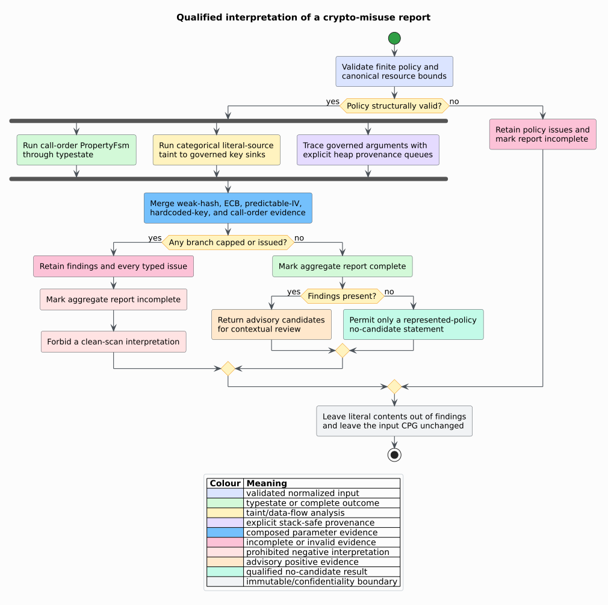

# ADR-0049: Compose cryptographic misuse evidence

- **Status:** Accepted
- **Date:** 2026-08-20
- **Scope:** feature-free `analysis::security::crypto`

## Context

A cryptographic application programming interface (API) is secure only when
the caller selects suitable algorithms and parameters *and* follows the
library's required call protocol. CrySL introduced declarative specifications
that combine finite call-order constraints with value constraints
[[1]](#references). CryptoGuard demonstrated that precise cryptographic misuse
detection also needs data-flow-aware refinements for embedded secrets and
predictable values [[2]](#references).

libcpg already has two suitable feature-free engines:

- `PropertyFsm` and `analyze_typestate` propagate allocation-site object states
  over represented Control Flow Graph (CFG) and Data Flow Graph (DFG) evidence;
- `TaintCatalog` and `analyze_taint_report` propagate open provenance classes
  through typed Abstract Syntax Tree (AST), DFG, call, and summary relations.

The missing design decision is how to express crypto rules without parsing
source again, duplicating either solver, treating partial evidence as clean, or
making source depth consume the native stack.

## Decision

### 1. Treat policy as data

`CryptoRuleSet` contains one `PropertyFsm`, weak-hash call patterns, positional
rules for algorithm/mode, initialization-vector (IV), nonce, and key arguments,
secure-random source patterns, and normalized forbidden-name sets. An IV is a
per-operation initialization vector; a nonce is a value intended to be used at
most once under a key. Both are checked through the same provenance relation.

`CryptoArgumentRule` binds a stable name, a finite disjunction of typed callee
path `Pattern` values, and a finite set of zero-based argument positions. The
rule is invalid when either set is empty. Empty string matchers are invalid.

### 2. Compose, rather than reimplement, semantic engines


The call-order branch delegates to `analyze_typestate`. The hardcoded-key
branch compiles key rules into taint sinks and categorical string/array literal
sources. ECB and weak algorithm arguments inspect typed string-literal origins.
Predictable-IV rules inspect the same origins and suppress a fixed-value
candidate when a recognized secure-random call is the represented origin.

The taint catalog gained `LiteralSourceRule`, whose `LiteralPattern` recognizes
a `LiteralKind` category rather than a value. This is a general provenance
primitive: clients can model an embedded string or array as a source without
copying its potentially secret contents into the catalog or report.

### 3. Preserve a three-valued interpretation

Let $`F`$ be the ordered finding set, $`I`$ the crypto-layer issue set, $`T`$
the typestate report, and $`D`$ the taint/data-flow report. Completeness is:

```math
\operatorname{complete}(R)
=
(\neg R.\operatorname{capped})
\land (I=\varnothing)
\land \operatorname{complete}(T)
\land \operatorname{complete}(D)
```

Therefore the observable states are: advisory evidence present; no evidence in
a complete represented model; or an incomplete result that permits no clean
claim. Findings remain useful when incomplete, but every retained finding is
marked `capped` when a resource boundary curtailed the aggregate run.

### 4. Keep evidence typed and out of graph

`CryptoFinding` stores category, call site, rule name, optional argument index,
typed evidence, and cap qualification. `CryptoEvidence` records a call path,
literal `NodeId` provenance, a compact taint witness, or a typestate witness.
Literal text is never copied into a finding. The input CPG is immutable.

The built-in policy reports:

| Category | Required represented evidence |
|---|---|
| `WeakHash` | a recognized MD5/SHA-1 call or algorithm-name argument |
| `EcbMode` | an algorithm argument with an `ECB` segment |
| `PredictableIv` | a literal-origin IV/nonce without secure-random origin evidence |
| `HardcodedKey` | categorical literal-source taint reaches a governed key argument |
| `InvalidCallOrder` | `PropertyFsm` reaches a forbidden transition |

These are candidates, not proofs of exploitability or calibrated risk.

### 5. Bound work independently of stack depth

Call enumeration is capped by `max_calls` under `MAX_CRYPTO_CALLS`. Each
argument provenance query is capped independently by
`max_origin_nodes_per_argument` under `MAX_CRYPTO_ORIGIN_NODES`. The delegated
engines retain `IfdsCaps` and their typed cap events.

The provenance machine stores its queue and visited set on the heap. It follows
identifier definitions, reaching definitions, incoming typed data-flow edges,
and ordered AST operands. Cycles terminate through the visited set. A
100,000-definition test runs on a 64-KiB thread stack.



## Consequences

### Positive

- The checker and rule vocabulary are feature-free and optionally serializable.
- Call-order and data-flow semantics remain single-sourced in existing engines.
- Public ordering is deterministic and independent of relation insertion order.
- Embedded key material flows interprocedurally without exposing its value in a
  finding.
- Every local and delegated cap remains visible.
- Arbitrary provenance depth does not consume native call frames.

### Trade-offs

- Name patterns approximate external-library semantics and need reviewed
  project-specific extensions for uncommon APIs.
- Static may-flow and allocation-site abstraction can report infeasible or
  joined paths.
- Secure-random recognition establishes represented provenance, not runtime
  entropy quality, uniqueness, or correct deployment.
- Unknown reflection, native code, macros, and missing call resolution remain
  outside the represented model.

### Rejected alternatives

- **Parse source strings or use regular expressions over retained text.** This
  would duplicate frontends and make semantics language-specific.
- **Scan a key call's immediate literal child only.** This misses aliases,
  definitions, DFG edges, and interprocedural summary flow.
- **Copy a literal key into the finding.** Node provenance is sufficient and
  avoids expanding secret exposure.
- **Create a second crypto data-flow solver.** The existing taint lattice and
  witness semantics already solve the required problem.
- **Use recursion or a depth cutoff.** The first risks process failure and the
  second silently changes the accepted program domain.

## Verification

- Example oracles cover ECB, MD5, literal keys, fixed IVs, clean AES-GCM with a
  random nonce, and a forbidden post-finalization call.
- A 128-case property campaign repeats analysis across bounded cap selections.
- Serde round trips cover both policy and aggregate report.
- Feature-free and Rust parser integration tests verify the public surface.
- A 100,000-definition provenance chain runs on a 64-KiB native stack.
- `examples/crypto_misuse.rs` is an executable, feature-free usage example.

## References

1. Krüger, S., Späth, J., Ali, K., Bodden, E., Mezini, M. (2019). *CrySL: An
   Extensible Approach to Validating the Correct Usage of Cryptographic APIs.*
   DOI: [10.1109/TSE.2019.2948910](https://doi.org/10.1109/TSE.2019.2948910).
2. Rahaman, S., Xiao, Y., Afrose, S., Shaon, F., Tian, K., Frantz, M.,
   Kantarcioglu, M., Yao, D. (2019). *CryptoGuard: High Precision Detection of
   Cryptographic Vulnerabilities in Massive-sized Java Projects.* DOI:
   [10.1145/3319535.3345659](https://doi.org/10.1145/3319535.3345659).
