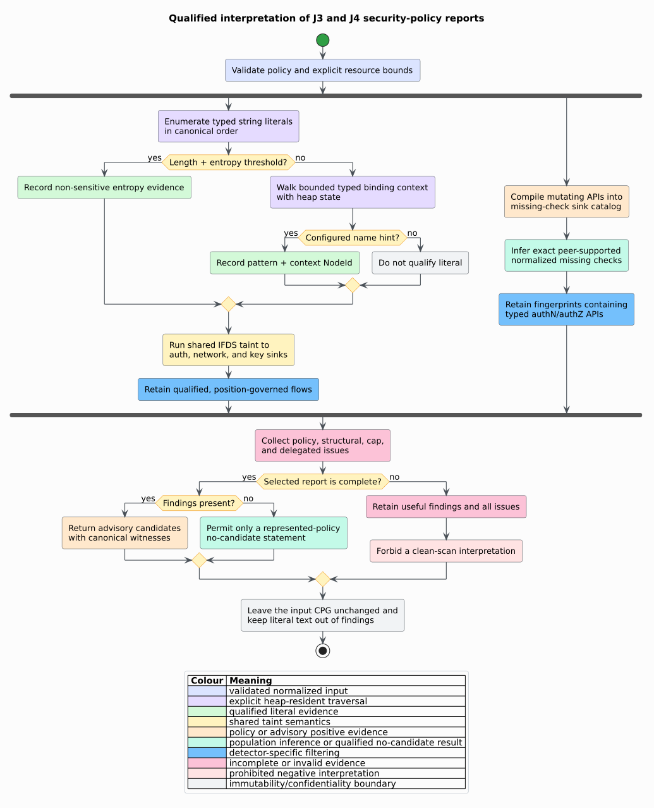

# ADR-0050: Compose secret flow and access-policy inference

- **Status:** Accepted
- **Date:** 2026-08-20
- **Scope:** feature-free `analysis::security::{secrets,authz}`

## Context

Embedded credentials become more consequential when they cross an
authentication, network, or cryptographic boundary. Meli, McNiece, and Reaves
measured widespread key leakage and used both distinctive formats and Shannon
entropy to qualify candidate secrets [[1]](#references). A source-only match,
however, does not establish that a candidate reaches a security-sensitive API.

Missing authorization is a different evidence problem. Chucky showed that a
security check can be inferred from the dominant convention among structurally
similar sites [[2]](#references). libcpg already implements that exact
population relation, including normalized flat check fingerprints, rational
support, peer topology, witnesses, and completeness issues.

libcpg therefore needs two advisory detectors without:

- copying secret values into findings;
- reparsing source or introducing language-specific regular expressions;
- duplicating the interprocedural taint or missing-check solvers;
- treating a bounded or malformed analysis as clean; or
- consuming native call-stack depth for graph or syntax depth.

## Decision

### 1. Separate qualification from propagation

`SecretRuleSet` describes security sinks and typed binding-name hints.
`SecretAnalysisConfig` supplies a minimum byte length, a Shannon-entropy
threshold represented in integer millibits per byte, literal and binding-context
bounds, and delegated `IfdsCaps`.

Every typed string literal is a categorical taint source. The detector separately
qualifies a source node when either:

1. its length and measured entropy cross the configured thresholds; or
2. a bounded typed binding context matches a configured name pattern.

The existing IFDS-style taint engine proves source-to-sink propagation. The
detector retains only flows whose origin qualified and whose positional sink
rule governs the observed argument. This deliberately overproduces internal
candidate taint facts and filters them afterward: taint semantics remain
single-sourced, while secret heuristics remain local policy.

### 2. Do not reproduce secret text

`SecretLiteralEvidence::HighEntropy` records byte length and entropy in
millibits. `SecretLiteralEvidence::NameHint` records the matched policy pattern
and typed context `NodeId`. Neither variant stores the literal value or the
potentially sensitive binding spelling.

The protected CPG still owns its literal payload. This decision limits
amplification into reports and logs; it does not declassify the graph.

### 3. Specialize the shared missing-check population

`AuthzRuleSet` separates mutation-call patterns from authentication and
authorization guard patterns. Mutation patterns compile into the existing
`TaintCatalog` sink vocabulary consumed by `analyze_missing_checks`.

The shared engine:

- groups sites by exact `ApiIdentity` and configured `PeerScope`;
- constructs stack-safe postorder `CheckFingerprint` tapes;
- computes exact `PopulationFraction` support; and
- reports absent peer-supported fingerprints with concrete guard witnesses.

`analyze_missing_authz` retains only fingerprints containing a typed call,
member, attribute, or macro name matched by an access-guard pattern. Local
identifier spellings remain abstracted exactly as in the generic engine.

### 4. Preserve three-valued interpretation


For a secret report $`S`$ with issue set $`I_S`$ and taint report $`T`$:

```math
\operatorname{complete}(S)
=
(I_S=\varnothing)\land\operatorname{complete}(T)
```

For an access-policy report $`A`$ with policy and translated population issues
$`I_A`$:

```math
\operatorname{complete}(A)=(I_A=\varnothing)
```

Findings remain useful when a report is incomplete. An empty incomplete report
must never be interpreted as a clean scan.

### 5. Keep traversal state on the heap

Literal binding qualification uses a bounded parent loop and `VecDeque` subtree
machine with ordered visited sets. The auth specialization scans an already-flat
fingerprint tape. Delegated taint and missing-check engines already use explicit
worklists, flat tapes, and bounded call-path loops.

The implementation does not move work to another thread, enlarge the native
stack, or impose an implicit semantic depth cutoff. One hundred thousand typed
context/fingerprint nodes are exercised on 64-KiB test stacks.



## Consequences

### Positive

- Both APIs remain available with `default = []` and optionally serialize with
  `serde`.
- Secret flow composes qualification with real interprocedural propagation.
- Authorization inference reuses exact peer support and normalized witnesses.
- Findings remain immutable, deterministic, out of graph, and value-minimizing.
- Policy, structure, and resource failures remain typed and auditable.
- Input depth grows heap state rather than native call frames.

### Trade-offs

- Entropy is a heuristic, not a proof that a value is secret or live.
- Binding hints and API-name patterns require project-specific review and can
  admit false positives or miss unusual libraries.
- Static may-flow can join infeasible runtime paths.
- A population convention can reproduce a widespread incorrect practice.
- Missing PDG control-dependence or call identity reduces represented evidence.

### Rejected alternatives

- **Add secret-specific predicates to the generic taint catalog.** That would
  couple a reusable propagation vocabulary to one heuristic policy.
- **Inspect only an immediate literal child of a sink.** That misses DFG aliases,
  reaching definitions, calls, and summaries.
- **Copy candidate strings into findings.** Node provenance is sufficient and
  avoids widening secret exposure.
- **Implement another authorization pattern miner.** The existing I6 engine
  already supplies exact support, fingerprint normalization, and issues.
- **Treat any control guard as authorization.** Quota, null, and range checks are
  not access-control evidence.
- **Use recursive AST traversal or a larger worker stack.** Neither addresses the
  true unbounded-depth failure mode.

## Verification

- Direct high-entropy authentication flow and low-entropy binding-hint network
  flow oracles pass; ordinary strings and ungoverned positions remain clean.
- A four-of-five guarded mutation population reports only the fifth site;
  unrelated quota guards are excluded.
- Two 128-case property campaigns cover entropy bounds and complete-report
  determinism.
- Policy and aggregate reports round-trip under `serde`.
- Feature-free public and Rust parser/CFG/DFG/PDG integrations compose both
  analyses without mutating the graph.
- Flat binding and guard paths handle 100,000 nodes on 64-KiB stacks.
- `examples/security_policies.rs` demonstrates the value-minimizing workflow.

## References

1. Meli, M., McNiece, M. R., Reaves, B. (2019). *How Bad Can It Git?
   Characterizing Secret Leakage in Public GitHub Repositories.* Network and
   Distributed System Security Symposium. DOI:
   [10.14722/ndss.2019.23418](https://doi.org/10.14722/ndss.2019.23418).
2. Yamaguchi, F., Wressnegger, C., Gascon, H., Rieck, K. (2013). *Chucky:
   Exposing Missing Checks in Source Code for Vulnerability Discovery.* DOI:
   [10.1145/2508859.2516665](https://doi.org/10.1145/2508859.2516665).
3. Shannon, C. E. (1948). *A Mathematical Theory of Communication.* Part I DOI:
   [10.1002/j.1538-7305.1948.tb01338.x](https://doi.org/10.1002/j.1538-7305.1948.tb01338.x);
   Part II DOI:
   [10.1002/j.1538-7305.1948.tb00917.x](https://doi.org/10.1002/j.1538-7305.1948.tb00917.x).
4. Yamaguchi, F., Golde, N., Arp, D., Rieck, K. (2014). *Modeling and
   Discovering Vulnerabilities with Code Property Graphs.* DOI:
   [10.1109/SP.2014.44](https://doi.org/10.1109/SP.2014.44).
